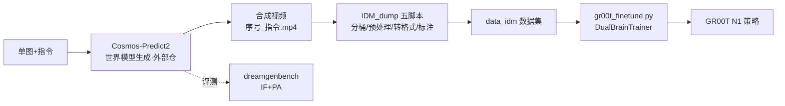

# GR00T-Dreams 新人导览（ONBOARDING）

> `NVIDIA/GR00T-Dreams` · commit `ec3881d4` · 图谱 12 层/15 步 tour。行号锚均经核实。

## 1. 一句话定位与项目背景

**GR00T-Dreams 是 DreamGen 论文（arXiv 2505.12705）的开源实现：用 Cosmos 视频世界模型从单张场景图+一句指令批量合成机器人操作视频，由逆动力学模型（IDM）从视频反推动作标签，最终微调 GR00T N1 VLA 策略——零人工遥操作。**

与 Isaac GR00T 主仓的关系：本仓是"数据造梦"分支，复用其 `gr00t/` 包（数据 schema、GR00T_N1、微调 runner 均在仓内），叠加 **IDM_dump**（视频→动作标注→LeRobot 数据集）与 **dreamgenbench**（视频评测）两条新管线。四具身开箱即用：franka/gr1/so100/robocasa。README.md:L10-14 列五步工作流，第 1-2 步依赖外部 Cosmos-Predict2 仓，本仓覆盖第 3-5 步。参考硬件为 RTX Pro 6000 Blackwell 8x800GB 与 DGX B300（reference_architecture/）。

## 2. 总体架构：五段式管线

五段拆解：①Cosmos（外部仓）在真机小数据微调后"做梦"生成视频；②IDM_dump（L09）五脚本把视频变成带动作标签的 LeRobot 数据集——仓名 "Dreams" 落地主线；③IDM=SigLIP 塔+flow matching 头反推 action，可自训（scripts/idm_training.py）或直用 HF `seonghyeonye/IDM_*`；④N1 微调（L08）；⑤评测（L11）。

环境两个坑：Dockerfile:L1 基于 pytorch 2.6.0 镜像，Dockerfile:L32 又 force-reinstall 降 torch==2.5.1（transformer-engine 冲突矫正），实际运行 2.5.1；pyproject.toml:L97 `version={attr="gr00t.version.VERSION"}` 是死配置——`gr00t/version.py` 不存在（已核实），版本实为静态 0.1.0。

## 3. 目录地图与 12 层分层速览

顶层：`gr00t/`（数据+模型+训练+评测包）、`IDM_dump/`（合成管线+具身元数据）、`dreamgenbench/`、`getting_started/`、`scripts/`、`demo_data/`、`tests/`。

| 层 | 职责与关键文件 |
|---|---|
| L01 门面 | README 五步/Docker/CI |
| L02 LeRobot 格式 | 格式契约+演示集：gr00t/data/schema.py |
| L03 数据变换 | 原始数据→张量：gr00t/data/transform/ |
| L04 模型核心 | 双系统+策略+IDM：gr00t/model/ |
| L05 动作头 | 流匹配+DiT：action_head/ |
| L06 SigLIP vendored | IDM 视觉塔副本：action_head/siglip/ |
| L07 Eagle2 VLM | System 2+tokenizer：eagle2_hg_model/ |
| L08 训练框架 | 微调全链：experiment/+scripts/ |
| L09 IDM 管线 | 视频→动作标注：IDM_dump/ |
| L10 具身资产 | 四具身 modality/stats：global_metadata/ |
| L11 评测服务 | dreamgenbench/+gr00t/eval/ |
| L12 教程示例 | getting_started/ 0-5 篇 |

跨层大模式：**复制式孪生**——data_config 两版（各 788 行）、runner 两版（diff 仅 11 行）、action_head 与 transforms 各两版。IDM 线是整文件复制后改链尾，改代码先找孪生兄弟。

## 4. 核心链路一：数据格式与加载

**格式 = LeRobot V2.0 + meta/modality.json**（GR00T 独有追加）。合法数据集（demo_data/robot_sim.PickNPlace 实例）：parquet（observation.state/action 拼接 float32 向量+timestamp+annotation 列）、meta/info.json（fps/features）、**meta/modality.json**（state/action 各字段 start/end 切片+rotation_type+absolute，video 短键映回原生键）、episodes/tasks/stats。规范见 getting_started/LeRobot_compatible_data_schema.md。pydantic 真源 schema.py：L27 `RotationType(Enum)`、L54 `LeRobotStateActionMetadata`、L101 `LeRobotModalityMetadata`（四模态组）、L212 `DatasetMetadata`。

**embodiment_tags 是跨具身路由唯一键**：embodiment_tags.py:L19 `EmbodimentTag(Enum)`（GR1/SO100/FRANKA/ROBOCASA…，L45 兜底 NEW_EMBODIMENT），同时充当数据集参数、训练配置键、动作头类别 id。robocasa 实际用细粒度标签 `robocasa_panda_omron`，须与 data_config 注册键对齐。

**dataset.py:L86 `LeRobotSingleDataset`** 是全仓枢纽（图谱 fanIn=23 最高）：L37 硬编码 meta/modality.json 路径（缺它即不合法）；L478 `__getitem__` 交 ComposedModalityTransform 出样本；L558 `retrieve_data_and_pad` 按 delta_indices（如 [-4..0]）取历史窗口、越界复制补齐——不懂 delta_indices 就不懂输入 shape；L792 起 Cached 子类全帧缓存。

**transform 链**（base.py:L24 `ModalityTransform`=pydantic+ABC；L87 加 unapply 反归一化协议）：① gr00t/data/transform/video.py:L30 `VideoTransform`，L145 `ReplayCompose` 保证同 episode 各帧共享随机增强；② state_action.py:L98 `Normalizer`（L99 模式 q99/mean_std/min_max/binary）；③ concat.py:L26 `ConcatTransform` 拼统一张量并缓存 state_dims/action_dims（L54/L58）；④ 链尾接模型级变换（第 6 节）。

## 5. 核心链路二：模型（N1 双系统 / IDM）

**gr00t_n1.py:L60 `GR00T_N1`** 为 VLA 主体，L81-83 装配两系统：

- **System 2 = EagleBackbone**（eagle_backbone.py:L79）：Eagle2 VLM（SmolLM2-1.7B+SigLIP 塔）。精巧细节：eagle_backbone.py:L30-31 用 `os.path.dirname(gr00t.__file__)` 反推仓内权重目录——所以 gr00t/__init__.py 虽只是许可证头（本仓四个 __init__.py 皆非 barrel），却不能删：`__file__` 是权重路径锚点。
- **System 1 = FlowmatchingActionHead**（flow_matching_action_head.py:L179）：条件流匹配生成动作块。DiT（cross_attention_dit.py:L190）去噪+AdaLayerNorm（L44）时间步条件；L79 `CategorySpecificMLP` 按 embodiment id 切权重实现多具身单模型。

L171 `get_action` 推理；L200-204 `from_pretrained` 四级微调开关（tune_visual/llm/projector/diffusion_model，默认关 LLM），取舍见 4_deeper_understanding.md。

**idm.py:L51 `IDM`**：同构双脑容器，L71-72 两大件均经 hydra `instantiate` 动态装配，L209 注册 idm 类型。动机：IDM 只"看帧推动作"不需语言——identity.py:L6 `IdentityBackbone` 输出 (B,1,0) 空张量（空对象模式），动作头自带 SigLIP 塔。IDM 版动作头是 N1 版加强孪生：L193 `siglip_model=instantiate(...)`，L256-261 冻结视觉塔冗余参数。**两个已核实坑**：L349 用 `self.vis_sep_embedding` 但 __init__ 从未定义（grep 全文仅此一处，bug 疑点）；L457 `.cuda()` 硬编码，非 CUDA 会炸。action_head/siglip/ 四件套（modeling 1678 行）是 IDM 塔离线副本；Eagle2 用 transformers 上游 SiglipVisionConfig。

**policy.py**：L35 `BasePolicy(ABC)` 定 get_action/get_modality_config；L57 `Gr00tPolicy` 做变换正逆施放（归一化空间↔真实观测），L32 COMPUTE_DTYPE=bfloat16，L184 cuda autocast——本地策略与远程 RPC 客户端由此可互换（第 7 节）。

## 6. 核心链路三：训练与 IDM_dump 管线

**data_config.py:L779 `DATA_CONFIG_MAP`** 是具身→变换链注册表：9 个具身配置类（Gr1ArmsOnly L49、So100 L140、Franka L678…）各组装 视频变换+StateAction+Concat+链尾 GR00TTransform（L127）。**孪生实证**：data_config_idm.py 同 788 行逐行对齐，唯一实质差异是 L127 链尾 `GR00TTransform↔GR00TIDMTransform`。N1 链尾（transforms.py:L64）送 Eagle processor 做视频 token 化、L190 语言指令 dropout、L94-95 pad 统一维度；IDM 链尾（transforms_idm.py:L57）用 SiglipProcessor（L84 默认 google/siglip2-large-patch16-256），L177 `_build_token_ids` 手工构造视觉+state/action token 序列——不走 VLM 语言链路。

**训练编排**：gr00t_finetune.py（tyro CLI L23；L129 构造数据集；L150-151 lora_rank>0 时经 peft.py:L17 `get_lora_model` 注入 LoRA；多卡自动 torchrun）。runner.py:L34 `TrainRunner` 组装 collator+DualBrainTrainer+CheckpointFormatCallback（embodiment 元数据随 checkpoint 落盘），L162 train()。trainer.py:L63 `DualBrainTrainer` 重写 L74 compute_loss（整包 inputs 直调模型取 loss 字典）。runner 两版 diff 实测仅 11 行。

**IDM 训练 = hydra 装配**：idm_training.py:L127-128 `instantiate(OmegaConf.load("IDM_dump/base.yaml"))`——路径硬编码仓根相对，必须仓根执行。base.yaml 即蓝图：IDM(IdentityBackbone+FlowMatchingActionHeadIDM)，SigLIP2-large-patch16-256 塔、4 层自注意力+8 层 DiT、action_dim=32/horizon=16。

**IDM_dump 五步**（四具身一键脚本 IDM_dump/scripts/preprocess/*.sh）：① convert_directory.py:L25 把平铺 `序号_指令.mp4` 重组为「指令目录/0.mp4」分桶；② split_video_instruction.py:L18-19 拆 labels/{n}.txt+videos/{n}.mp4；③ preprocess_video.py:L15 裁剪-补边-缩放 256x256 重编码；④ raw_to_lerobot.py L26 ffprobe 探测、L327-333 生成 meta jsonl、L494-500 按 embodiment 复制 global_metadata/<具身>/ 的 modality/stats——**归一化统计继承自真机数据集而非合成视频**；⑤ dump_idm_actions.py:L157 `IDM.from_pretrained`（本地或 seonghyeonye/IDM_*）批量预测、反归一化后 L136 to_parquet 写回，产出 `<具身>.data_idm` 供微调。

## 7. 评测体系

**dreamgenbench（评视频，README 第 5 步）**：IF 指令遵循=eval_sr_gpt4o_whole.py（GPT-4o 8 帧 base64 判 0/1）与 eval_sr_qwen_whole.py:L59（本地 Qwen2.5-VL-7B 采 49 帧替代 API）；PA 物理对齐=eval_qwen_pa.py:L38，L69 判官 prompt 明言 strict judge、breaks the laws of physics answer 0。utils.py:L9 set_seed 钉死全随机源。**三坑已核实**：① 两 eval 的 argparse `type=bool`（eval_sr_qwen_whole.py:L139、gpt4o 版 L117）——`--zeroshot false` 恒 True；② gpt4o 版 L28 `openai.api_key=` 死代码，L29 才是真路径；③ gpt4o 版 L48-50 坏视频路径只 print 不 continue 会崩。.gitmodules 挂 videophy 子模块，clone 带 --recursive。

**gr00t/eval（评策略）**：service.py:L44 `BaseInferenceServer`=ZMQ REP/REQ 可注册端点 RPC 底座；robot.py:L23 `RobotInferenceServer` 注册 get_action/get_modality_config，L41 `RobotInferenceClient(BaseInferenceClient, BasePolicy)` 双继承——远程模型呈现为本地策略对象，分体部署核心。scripts/inference_service.py 拉服务；5_policy_deployment.md 实测 denoising_steps=4 与 16 步效果相当。gym wrapper：multistep_wrapper.py:L80 动作分块、obs_index_selection_wrapper 时域对齐、video_recording_wrapper 录制。离线 MSE：utils/eval.py:L37 `calc_mse_for_single_trajectory`。eval_gr00t_so100.py:L36 `from service import ...` 是 sys.path hack（单文件可搬）；tictac_bot.py 是双系统最小演示。

## 8. 新人上手路径与已知坑

tour 15 步重组为四阶段：

- **阶段一·全局（s01-s02，半天）**：README 五步→0_load_dataset.ipynb→tests/test_dataset.py（格式契约可执行版）。
- **阶段二·数据与模型（s03-s07，一两天）**：schema→embodiment_tags→dataset（重点 delta_indices）→transform 四件→gr00t_n1→eagle_backbone 与 identity 对照→flow_matching+DiT；配 1_gr00t_inference.ipynb。
- **阶段三·Dreams 主线（s08-s11，一两天）**：SigLIP 四件套→idm.py+transforms_idm→base.yaml 对照源码→IDM_dump 五脚本；跑 2_finetuning.ipynb 闭环。
- **阶段四·评测部署（s12-s15，一天）**：gr00t_finetune+finetune.sh→trainer→dreamgenbench→eval 服务→5_policy_deployment.md。

**坑清单（全源码实证）**：①torch 表里不一（Dockerfile L1 声明 2.6.0、L32 强降 2.5.1）；②pyproject attr version 死配置；③gr00t/__init__.py 的 __file__ 是权重路径锚点不能删；④四对复制式孪生改动先找兄弟；⑤IDM 头 vis_sep_embedding 用而未定义+硬编码 .cuda()；⑥评测 type=bool 陷阱+api_key 死代码+坏路径不 continue；⑦idm_training 须仓根执行；⑧embodiment_tag 粒度以 data_config 注册键为准；⑨IDM checkpoint 是 HF 外部资产；⑩合成数据统计继承真机 global_metadata。

### 📌 下一步

1. 跑通 0_load_dataset.ipynb+tests/test_dataset.py，对照 schema.py 印证字段。
2. 读 IDM_dump/scripts/preprocess/so100.sh（最简具身），映射五脚本。
3. 为 vis_sep_embedding 疑点写复现测试再定夺修复。

### ✍️ 练习

1. 仅凭 schema.py 手写最小 modality.json（6 维+单相机）并加载验证。
2. diff 两个 data_config 找全部差异，体会孪生维护成本。
3. 修 eval_sr_gpt4o_whole.py 的 continue 缺失与 type=bool。
