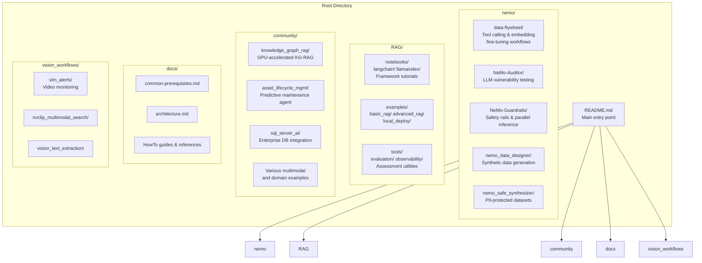
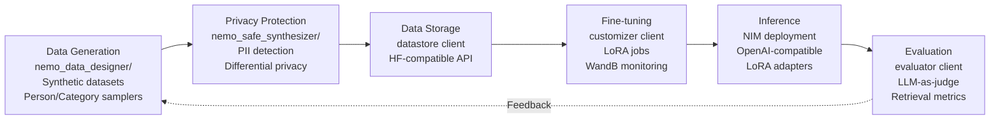
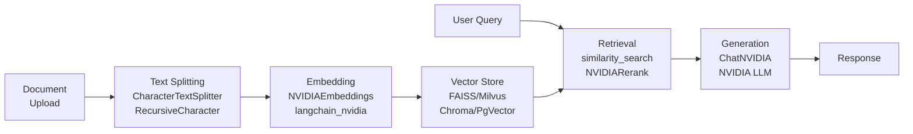
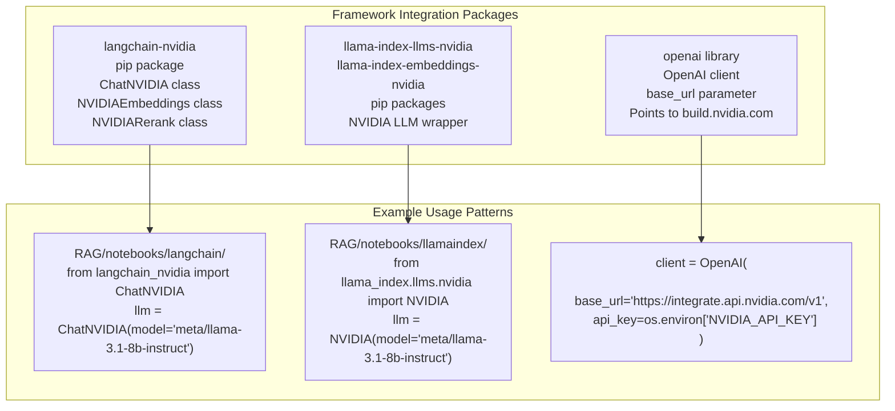

<!-- source: DeepWiki mcp.deepwiki.com · repo NVIDIA/GenerativeAIExamples · page 1 Overview · fetched 2026-10-26 -->

# Overview

Relevant source files

The following files were used as context for generating this wiki page:

- [LICENSE.DATA](LICENSE.DATA)
- [LICENSE.md](LICENSE.md)
- [README.md](README.md)
- [docs/contributing.md](docs/contributing.md)
- [oss_tutorials/Building_a_Simple_AI_Agent_with_Qwen3_Next_powered_by_NVIDIA_NIM.ipynb](oss_tutorials/Building_a_Simple_AI_Agent_with_Qwen3_Next_powered_by_NVIDIA_NIM.ipynb)
- [oss_tutorials/notes.txt](oss_tutorials/notes.txt)

## Purpose and Scope

The NVIDIA Generative AI Examples repository provides a comprehensive collection of reference implementations, tools, and workflows for building generative AI applications using NVIDIA's software ecosystem. This repository serves as a starting point for developers to integrate NVIDIA inference microservices (NIMs), NeMo Microservices, and other NVIDIA AI technologies into their applications. The materials span from quick-start examples requiring no GPU to production-ready enterprise solutions with fine-tuning, evaluation, and safety guardrails.

This page provides an architectural overview of the entire repository. For specific implementation details, see:
- NeMo Data Designer workflows: [Section 2](#2)
- Data Flywheel continuous improvement: [Section 4](#4)
- RAG implementations across frameworks: [Section 6](#6)
- Industry-specific solutions: [Section 7](#7)

**Sources:** [README.md:1-218]()

## Repository Organization

The repository is organized into four major categories: NeMo Microservices workflows, RAG pipeline implementations, industry solutions, and community examples. The following diagram maps the directory structure to these categories.

### Repository Directory Structure

**Sources:** [README.md:12-36](), [README.md:38-87](), [README.md:125-217]()

## Core Infrastructure Layers

The repository demonstrates applications built on three infrastructure layers: model serving (NVIDIA NIM and API Catalog), microservices (NeMo platform), and client integrations (framework-specific SDKs). Understanding these layers clarifies how the example code leverages NVIDIA's ecosystem.

### Infrastructure Layer Architecture

```mermaid
graph TB
    subgraph "Model Serving Layer"
        APICatalog["build.nvidia.com<br/>NVIDIA API Catalog<br/>Hosted inference endpoint"]
        NIMDocker["NVIDIA NIM<br/>Docker containers<br/>Self-hosted deployment"]
    end
    
    subgraph "NeMo Microservices Layer"
        DataStore["nemo_microservices.datastore<br/>Dataset management<br/>HuggingFace-compatible"]
        EntityStore["nemo_microservices.entity<br/>Model registry<br/>LoRA adapter storage"]
        Customizer["nemo_microservices.customizer<br/>Fine-tuning jobs<br/>LoRA training"]
        Evaluator["nemo_microservices.evaluator<br/>Model assessment<br/>LLM-as-judge"]
        GuardrailsService["nemo_microservices.guardrails<br/>Safety checks<br/>Parallel rails"]
    end
    
    subgraph "Client SDK Layer"
        LangChainNV["langchain_nvidia<br/>ChatNVIDIA<br/>NVIDIAEmbeddings<br/>NVIDIARerank"]
        LlamaIndexNV["llama_index.llms.nvidia<br/>llama_index.embeddings.nvidia<br/>NVIDIA LLM classes"]
        OpenAIClient["openai.OpenAI<br/>base_url override<br/>OpenAI-compatible API"]
        NemoSDK["nemo_microservices Python SDK<br/>Service client wrappers"]
    end
    
    subgraph "Application Layer"
        BasicRAG["RAG/examples/basic_rag/<br/>Streamlit apps<br/>Docker Compose"]
        AdvancedRAG["RAG/examples/advanced_rag/<br/>Multi-turn, multimodal<br/>Structured data"]
        Notebooks["RAG/notebooks/<br/>Jupyter tutorials<br/>Gradio interfaces"]
        DataFlywheelApps["nemo/data-flywheel/<br/>Fine-tuning pipelines<br/>Evaluation workflows"]
    end
    
    APICatalog --> LangChainNV
    APICatalog --> LlamaIndexNV
    APICatalog --> OpenAIClient
    NIMDocker --> LangChainNV
    NIMDocker --> LlamaIndexNV
    NIMDocker --> OpenAIClient
    
    NemoSDK --> DataStore
    NemoSDK --> EntityStore
    NemoSDK --> Customizer
    NemoSDK --> Evaluator
    NemoSDK --> GuardrailsService
    
    LangChainNV --> BasicRAG
    LangChainNV --> AdvancedRAG
    LangChainNV --> Notebooks
    LlamaIndexNV --> BasicRAG
    LlamaIndexNV --> Notebooks
    OpenAIClient --> Notebooks
    NemoSDK --> DataFlywheelApps
```

**Sources:** [README.md:89-122](), [README.md:136-174]()

## Deployment Patterns

The repository supports two primary deployment patterns: cloud-hosted inference using the NVIDIA API Catalog, and self-hosted deployment using containerized NIMs. Examples demonstrate both patterns to accommodate different security, latency, and cost requirements.

### Cloud-Hosted Pattern (No GPU Required)

The simplest deployment pattern uses the NVIDIA API Catalog at `https://build.nvidia.com` for all inference operations. This pattern is demonstrated in the quick-start examples.

| Component | Technology | Location |
|-----------|-----------|----------|
| LLM Inference | NVIDIA API Catalog | Cloud-hosted |
| Embedding Generation | NVIDIA API Catalog | Cloud-hosted |
| Reranking | NVIDIA API Catalog | Cloud-hosted |
| Vector Storage | FAISS (in-memory) | Local |
| Application | Docker Compose | Local |

**Example:** The basic RAG pipeline at [RAG/examples/basic_rag/langchain/]() uses this pattern with API key authentication via `NVIDIA_API_KEY` environment variable.

**Sources:** [README.md:89-122](), [README.md:164-167]()

### Self-Hosted Pattern (GPU Required)

For production deployments or on-premises requirements, NIMs can be deployed as Docker containers on GPU infrastructure. This pattern provides full control over model versions and data privacy.

| Component | Technology | Location |
|-----------|-----------|----------|
| LLM Inference | NVIDIA NIM container | Self-hosted GPU |
| Embedding Generation | NVIDIA NIM container | Self-hosted GPU |
| Reranking | NVIDIA NIM container | Self-hosted GPU |
| Vector Storage | Milvus/PgVector | Self-hosted |
| Application | Kubernetes/Docker | Self-hosted |

**Example:** The local deployment configurations at [RAG/examples/local_deploy/]() demonstrate self-hosted NIM deployment with custom model configurations.

**Sources:** [README.md:162](), [README.md:66-68]()

## Core Workflows

The repository demonstrates three primary workflows: Data Flywheel for continuous model improvement, RAG pipelines for knowledge retrieval, and industry-specific solutions for production use cases.

### Data Flywheel Workflow

**Implementations:**
- Tool calling workflow: [nemo/data-flywheel/tool-calling/]()
- Embedding fine-tuning: [nemo/data-flywheel/embedding-finetuning/]()

**Sources:** [README.md:40-46](), [README.md:125-134]()

### RAG Pipeline Workflow

**Implementations:**
- LangChain: [RAG/examples/basic_rag/langchain/](), [RAG/notebooks/langchain/]()
- LlamaIndex: [RAG/examples/basic_rag/llamaindex/](), [RAG/notebooks/llamaindex/]()
- Haystack: [RAG/examples/]() with Haystack integration

**Sources:** [README.md:136-174](), [README.md:143-159]()

### Industry Solution Workflow

Industry solutions combine multiple technologies into production-ready applications. For example, the asset lifecycle management agent integrates time series forecasting, SQL generation, and agentic workflows.

**Example Architecture (Asset Lifecycle Management):**
- Data ingestion: SQL Server → Pandas DataFrames
- NL-to-SQL: Vanna library with NIM backend
- Time series forecasting: XGBoost + MOMENT models
- Agent orchestration: NeMo Agent Toolkit
- Execution sandbox: Docker container isolation

**Implementations:**
- Asset lifecycle management: [community/asset_lifecycle_mgmt/]()
- SQL Server AI integration: [community/sql_server_ai/]()

**Sources:** [README.md:54-58](), [README.md:214-217]()

## Getting Started Paths

The repository provides multiple entry points depending on your use case and technical requirements. The following table maps use cases to recommended starting points.

| Use Case | Recommended Path | Requirements |
|----------|-----------------|--------------|
| Quick RAG prototype | [RAG/examples/basic_rag/langchain/]() | API key, Docker, no GPU |
| Framework evaluation | [RAG/notebooks/]() | API key, Python, Jupyter |
| Custom fine-tuning | [nemo/data-flywheel/tool-calling/]() | NeMo access, GPU cluster |
| Production deployment | [RAG/examples/local_deploy/]() | GPU infrastructure, Kubernetes |
| Enterprise integration | [community/sql_server_ai/]() | SQL Server 2025, Azure/on-prem |
| Safety & guardrails | [nemo/NeMo-Guardrails/]() | API key or NIM deployment |
| Synthetic data generation | [nemo/nemo_data_designer/]() | NeMo access, Python SDK |

### Quick Start Example

The fastest way to experience the repository is the 5-minute RAG setup:

1. Obtain API key from `https://build.nvidia.com/explore/`
2. Set environment variable: `export NVIDIA_API_KEY=nvapi-...`
3. Clone repository: `git clone https://github.com/nvidia/GenerativeAIExamples.git`
4. Launch application: `cd GenerativeAIExamples/RAG/examples/basic_rag/langchain/ && docker compose up -d --build`
5. Access UI at `https://localhost:8090/`

This deployment uses the cloud-hosted NVIDIA API Catalog for all inference, requiring no local GPU resources.

**Sources:** [README.md:89-122]()

## API Compatibility and Integration Standards

A key design principle of this repository is OpenAI API compatibility. All NVIDIA NIMs expose OpenAI-compatible endpoints at `/v1/chat/completions` and `/v1/embeddings`, enabling drop-in replacement for existing OpenAI-based applications.

### Integration with Popular Frameworks

**Sources:** [README.md:139-159]()

## Documentation Structure

The repository includes comprehensive documentation organized by purpose:

**Getting Started:**
- [docs/common-prerequisites.md](): System requirements and setup
- [docs/architecture.md](): Detailed architecture diagrams

**How-To Guides:**
- [docs/change-model.md](): Switching inference or embedding models
- [docs/vector-database.md](): Configuring alternative vector databases
- [docs/chain-server.md](): Customizing the RAG chain server
- [docs/text-splitter.md](): Document chunking strategies
- [docs/prompt-customization.md](): Prompt template engineering
- [docs/llm-params.md](): Runtime LLM parameter configuration
- [docs/multiturn.md](): Multi-turn conversation support
- [docs/riva-asr-tts.md](): Voice interface integration

**Reference:**
- [docs/support-matrix.md](): Supported models and frameworks
- [docs/using-sample-web-application.md](): Web UI usage guide
- [docs/frontend.md](): RAG Playground documentation
- [docs/configuration.md](): Component configuration reference

**Sources:** [README.md:188-212]()

## Contribution and Licensing

This repository is open source under the Apache 2.0 license ([LICENSE.md]()) with separate data licensing ([LICENSE.DATA]()). Contributions are welcome via pull requests following the Developer Certificate of Origin signing process detailed in [docs/contributing.md]().

The community section at [community/]() contains user-contributed examples demonstrating additional use cases and integration patterns beyond the core NVIDIA-maintained examples.

**Sources:** [README.md:214-217](), [docs/contributing.md:1-55](), [LICENSE.md:1-201]()

---

