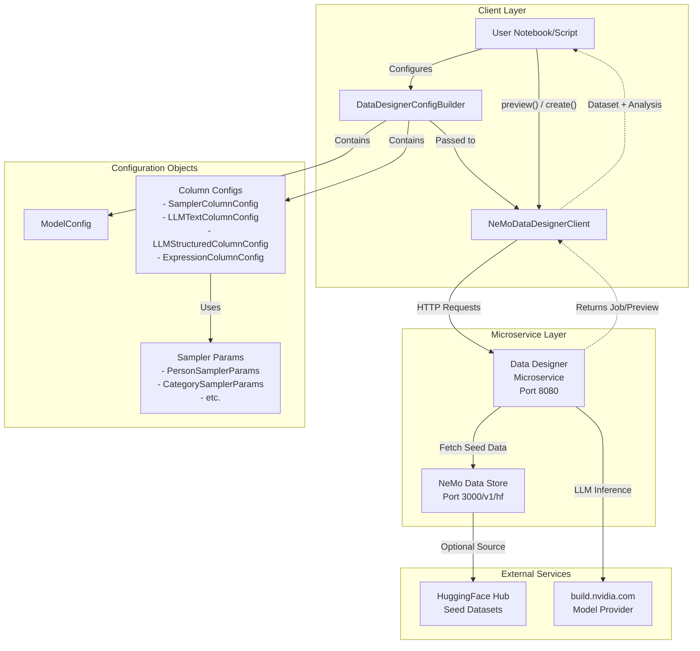
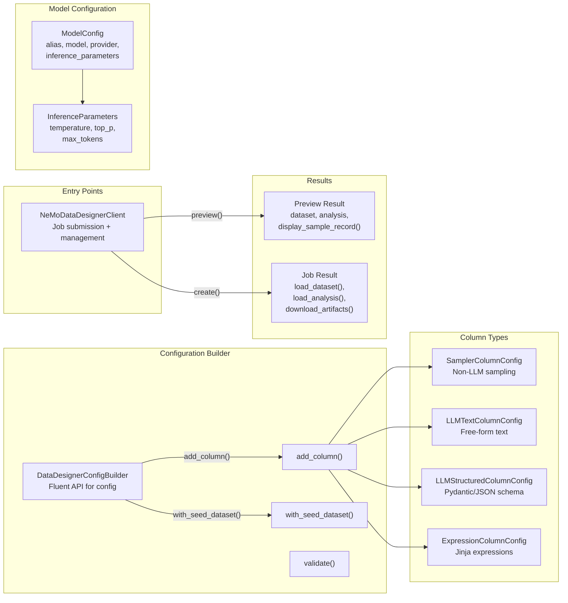
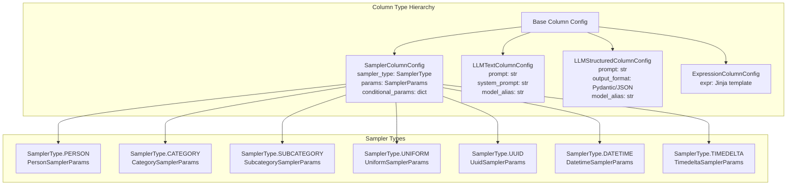
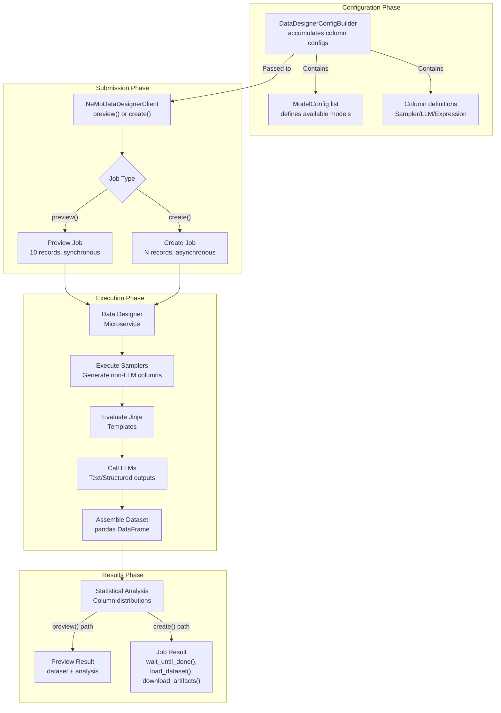
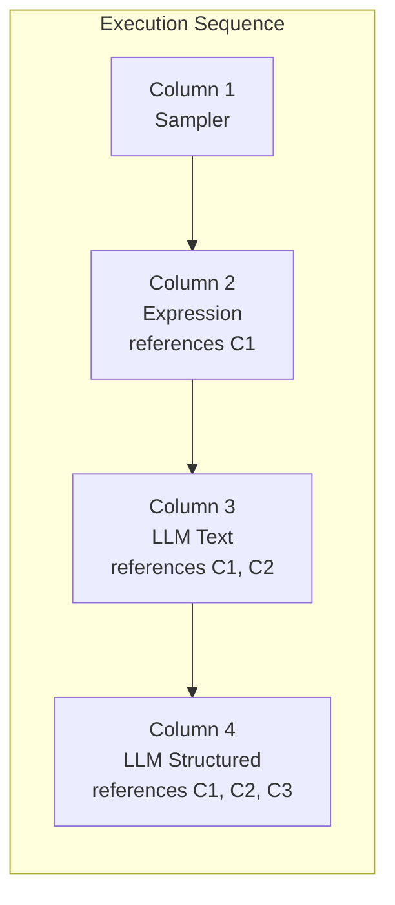

<!-- source: DeepWiki mcp.deepwiki.com · repo NVIDIA/GenerativeAIExamples · page 2 NeMo Data Designer · fetched 2026-10-26 -->

# NeMo Data Designer

<details>
<summary>Relevant source files</summary>

The following files were used as context for generating this wiki page:

- [.gitignore](.gitignore)
- [nemo/NeMo-Data-Designer/README.md](nemo/NeMo-Data-Designer/README.md)
- [nemo/NeMo-Data-Designer/TUTORIAL_STYLE_GUIDE.md](nemo/NeMo-Data-Designer/TUTORIAL_STYLE_GUIDE.md)
- [nemo/NeMo-Data-Designer/managed-service-tutorials/getting-started/1-the-basics.ipynb](nemo/NeMo-Data-Designer/managed-service-tutorials/getting-started/1-the-basics.ipynb)
- [nemo/NeMo-Data-Designer/managed-service-tutorials/getting-started/2-structured-outputs-and-jinja-expressions.ipynb](nemo/NeMo-Data-Designer/managed-service-tutorials/getting-started/2-structured-outputs-and-jinja-expressions.ipynb)
- [nemo/NeMo-Data-Designer/managed-service-tutorials/getting-started/3-seeding-with-a-dataset.ipynb](nemo/NeMo-Data-Designer/managed-service-tutorials/getting-started/3-seeding-with-a-dataset.ipynb)
- [nemo/NeMo-Data-Designer/pyproject.toml](nemo/NeMo-Data-Designer/pyproject.toml)
- [nemo/NeMo-Data-Designer/self-hosted-tutorials/getting-started/1-the-basics.ipynb](nemo/NeMo-Data-Designer/self-hosted-tutorials/getting-started/1-the-basics.ipynb)
- [nemo/NeMo-Data-Designer/self-hosted-tutorials/getting-started/2-structured-outputs-and-jinja-expressions.ipynb](nemo/NeMo-Data-Designer/self-hosted-tutorials/getting-started/2-structured-outputs-and-jinja-expressions.ipynb)
- [nemo/NeMo-Data-Designer/self-hosted-tutorials/getting-started/3-seeding-with-a-dataset.ipynb](nemo/NeMo-Data-Designer/self-hosted-tutorials/getting-started/3-seeding-with-a-dataset.ipynb)
- [nemo/NeMo-Data-Designer/self-hosted-tutorials/getting-started/README.md](nemo/NeMo-Data-Designer/self-hosted-tutorials/getting-started/README.md)

</details>


## Purpose and Scope

NeMo Data Designer is a microservice-based system for generating synthetic datasets using a combination of statistical samplers and large language models (LLMs). This page documents the system architecture, core components, configuration mechanisms, and data generation workflows. For information about using Data Designer within the broader Data Flywheel workflow for model fine-tuning, see [NeMo Data Flywheel](#4). For PII-protected synthetic data generation, see [NeMo Safe Synthesizer](#3).

**Sources:** [nemo/NeMo-Data-Designer/README.md:1-50]()

## System Architecture

NeMo Data Designer operates as a client-server system where users configure data generation pipelines through a Python SDK and submit jobs to a microservice that orchestrates LLM calls, sampler execution, and dataset assembly.



**Sources:** [nemo/NeMo-Data-Designer/self-hosted-tutorials/getting-started/1-the-basics.ipynb:58-77](), [nemo/NeMo-Data-Designer/self-hosted-tutorials/getting-started/2-structured-outputs-and-jinja-expressions.ipynb:31-77]()

## Deployment Options

NeMo Data Designer supports two deployment modes:

| Deployment Mode | Base URL | Use Case | Job Limitations |
|----------------|----------|----------|-----------------|
| **Managed Service** | `https://ai.api.nvidia.com/v1/nemo/dd` | Quick prototyping, no infrastructure setup | Preview jobs only, no long-running jobs |
| **Self-Hosted** | `http://localhost:8080` (default) | Production use, custom configurations, long-running jobs | No limitations |

### Managed Service Configuration

The managed service requires an API key and connects to NVIDIA's hosted instance:

[nemo/NeMo-Data-Designer/managed-service-tutorials/getting-started/1-the-basics.ipynb:60-83]()

### Self-Hosted Configuration

Self-hosted deployments use Docker Compose and connect to a local microservice instance:

[nemo/NeMo-Data-Designer/self-hosted-tutorials/getting-started/1-the-basics.ipynb:67-76]()

**Sources:** [nemo/NeMo-Data-Designer/README.md:23-38](), [nemo/NeMo-Data-Designer/managed-service-tutorials/getting-started/1-the-basics.ipynb:48-83]()

## Core SDK Components

The following diagram maps the primary SDK classes to their roles in the data generation pipeline:



### NeMoDataDesignerClient

The client class manages communication with the microservice and provides two execution modes:

- **`preview(config_builder, num_records=10)`**: Generates a small sample synchronously for rapid iteration
- **`create(config_builder, num_records)`**: Submits a long-running job and returns a job handle

[nemo/NeMo-Data-Designer/self-hosted-tutorials/getting-started/1-the-basics.ipynb:67-76]()

### DataDesignerConfigBuilder

The builder accumulates column configurations and model settings through a fluent API:

[nemo/NeMo-Data-Designer/self-hosted-tutorials/getting-started/1-the-basics.ipynb:138-146]()

Key methods:
- `add_column()`: Adds a column configuration to the dataset schema
- `with_seed_dataset()`: Specifies an external dataset for seeding generation
- `validate()`: Checks configuration validity before submission

**Sources:** [nemo/NeMo-Data-Designer/self-hosted-tutorials/getting-started/1-the-basics.ipynb:29-55](), [nemo/NeMo-Data-Designer/self-hosted-tutorials/getting-started/2-structured-outputs-and-jinja-expressions.ipynb:31-57]()

## Model Configuration

Each `ModelConfig` object specifies an LLM provider, model identifier, and inference parameters:

[nemo/NeMo-Data-Designer/self-hosted-tutorials/getting-started/1-the-basics.ipynb:93-123]()

| Parameter | Type | Description |
|-----------|------|-------------|
| `alias` | `str` | Reference name used in column configs |
| `model` | `str` | Model identifier (e.g., `nvidia/nvidia-nemotron-nano-9b-v2`) |
| `provider` | `str` | Provider name (e.g., `nvidiabuild`) |
| `inference_parameters` | `InferenceParameters` | Sampling parameters |

### InferenceParameters

Controls LLM sampling behavior:

- `temperature`: Sampling temperature (0.0 to 1.0+)
- `top_p`: Nucleus sampling threshold
- `max_tokens`: Maximum tokens to generate

[nemo/NeMo-Data-Designer/self-hosted-tutorials/getting-started/1-the-basics.ipynb:117-122]()

**Sources:** [nemo/NeMo-Data-Designer/self-hosted-tutorials/getting-started/1-the-basics.ipynb:79-123]()

## Column Types and Configurations

Data Designer supports four column types, each serving a distinct purpose in the generation pipeline:



### SamplerColumnConfig

Generates values using deterministic or statistical samplers without LLM calls. Common samplers include:

| Sampler Type | Parameters | Example Use |
|-------------|------------|-------------|
| `PERSON` | `PersonSamplerParams(age_range)` | Generate synthetic person data (name, age, location, etc.) |
| `CATEGORY` | `CategorySamplerParams(values, weights)` | Sample from a categorical distribution |
| `SUBCATEGORY` | `SubcategorySamplerParams(category, values)` | Sample subcategory conditional on parent category |
| `UNIFORM` | `UniformSamplerParams(low, high)` | Sample from uniform distribution |
| `UUID` | `UuidSamplerParams(prefix, short_form)` | Generate unique identifiers |
| `DATETIME` | `DatetimeSamplerParams(start, end)` | Generate random timestamps |
| `TIMEDELTA` | `TimedeltaSamplerParams(dt_min, dt_max, reference_column_name)` | Generate time offsets from reference column |

Example of a person sampler with conditional parameters:

[nemo/NeMo-Data-Designer/self-hosted-tutorials/getting-started/1-the-basics.ipynb:269-280]()

Example of category sampler with weights and conditional parameters:

[nemo/NeMo-Data-Designer/self-hosted-tutorials/getting-started/2-structured-outputs-and-jinja-expressions.ipynb:306-321]()

**Sources:** [nemo/NeMo-Data-Designer/self-hosted-tutorials/getting-started/1-the-basics.ipynb:148-303]()

### LLMTextColumnConfig

Generates free-form text by prompting an LLM. Prompts use Jinja templating to reference other columns:

[nemo/NeMo-Data-Designer/self-hosted-tutorials/getting-started/1-the-basics.ipynb:324-351]()

**Jinja Template Features:**
- Reference column values: `{{ column_name }}`
- Access nested attributes: `{{ customer.first_name }}`
- Conditional logic: `...`

**Sources:** [nemo/NeMo-Data-Designer/self-hosted-tutorials/getting-started/1-the-basics.ipynb:306-353]()

### LLMStructuredColumnConfig

Generates structured data conforming to a Pydantic model or JSON schema. The LLM is constrained to produce valid output matching the schema:

[nemo/NeMo-Data-Designer/self-hosted-tutorials/getting-started/2-structured-outputs-and-jinja-expressions.ipynb:174-200]()

Example usage with Pydantic model:

[nemo/NeMo-Data-Designer/self-hosted-tutorials/getting-started/2-structured-outputs-and-jinja-expressions.ipynb:360-395]()

**Sources:** [nemo/NeMo-Data-Designer/self-hosted-tutorials/getting-started/2-structured-outputs-and-jinja-expressions.ipynb:150-397]()

### ExpressionColumnConfig

Creates derived columns using Jinja expressions without LLM calls. Useful for extracting nested fields or combining values:

[nemo/NeMo-Data-Designer/self-hosted-tutorials/getting-started/2-structured-outputs-and-jinja-expressions.ipynb:343-358]()

**Sources:** [nemo/NeMo-Data-Designer/self-hosted-tutorials/getting-started/2-structured-outputs-and-jinja-expressions.ipynb:328-397]()

## Data Generation Workflow

The following diagram illustrates the execution flow from configuration to dataset output:



### Preview Mode

Preview mode generates 10 records synchronously and returns immediately. Useful for rapid iteration during development:

[nemo/NeMo-Data-Designer/self-hosted-tutorials/getting-started/1-the-basics.ipynb:371-377]()

The preview result provides interactive methods for inspecting records:

[nemo/NeMo-Data-Designer/self-hosted-tutorials/getting-started/1-the-basics.ipynb:380-397]()

### Create Mode

Create mode submits a long-running job and returns a job handle. The job executes asynchronously:

[nemo/NeMo-Data-Designer/self-hosted-tutorials/getting-started/1-the-basics.ipynb:432-441]()

Job results provide methods for retrieving outputs:

[nemo/NeMo-Data-Designer/self-hosted-tutorials/getting-started/1-the-basics.ipynb:444-465]()

Artifacts can be downloaded to disk:

[nemo/NeMo-Data-Designer/self-hosted-tutorials/getting-started/1-the-basics.ipynb:468-480]()

**Sources:** [nemo/NeMo-Data-Designer/self-hosted-tutorials/getting-started/1-the-basics.ipynb:356-480]()

## Seed Datasets

Seed datasets provide external data to guide synthetic generation. Prompts can reference seed dataset fields using Jinja templating.

### SeedDatasetReference

Seed datasets are specified using `SeedDatasetReference`:

[nemo/NeMo-Data-Designer/self-hosted-tutorials/getting-started/3-seeding-with-a-dataset.ipynb:180-191]()

### Datastore Integration

Data Designer integrates with two datastore types:

| Datastore | Endpoint | Use Case |
|-----------|----------|----------|
| **Local NeMo Data Store** | `http://localhost:3000/v1/hf` | Self-hosted deployments, uploaded datasets |
| **HuggingFace Hub** | `https://huggingface.co` | Public datasets directly from HuggingFace |

The `upload_seed_dataset()` method uploads local files to the datastore:

[nemo/NeMo-Data-Designer/self-hosted-tutorials/getting-started/3-seeding-with-a-dataset.ipynb:180-191]()

### Seed Dataset Sampling

The `with_seed_dataset()` method configures how seed data is sampled during generation:

```python
config_builder.with_seed_dataset(
    dataset_reference=seed_dataset_reference,
    sampling_strategy="shuffle",  # or "sequential"
)
```

**Sampling Strategies:**
- `shuffle`: Random sampling with replacement
- `sequential`: Sequential sampling

### Using Seed Fields in Prompts

Seed dataset fields are accessible in Jinja templates using their column names:

[nemo/NeMo-Data-Designer/self-hosted-tutorials/getting-started/3-seeding-with-a-dataset.ipynb:308-326]()

In this example, `{{ diagnosis }}` and `{{ patient_summary }}` reference fields from the seed dataset.

**Sources:** [nemo/NeMo-Data-Designer/self-hosted-tutorials/getting-started/3-seeding-with-a-dataset.ipynb:142-327]()

## Column Execution Order

Columns are executed in the order they are added to `DataDesignerConfigBuilder`. This order determines dependency resolution:



**Rules:**
1. Sampler columns typically execute first to provide base data
2. Expression columns can reference any previously executed column
3. LLM columns can reference any previously executed column in their prompts
4. Columns cannot reference columns defined later in the sequence

### Drop Flag

The `drop=True` flag removes a column from the final dataset while keeping it available for reference:

[nemo/NeMo-Data-Designer/self-hosted-tutorials/getting-started/2-structured-outputs-and-jinja-expressions.ipynb:222-231]()

This is useful for intermediate columns that generate data needed by other columns but aren't required in the output.

**Sources:** [nemo/NeMo-Data-Designer/self-hosted-tutorials/getting-started/2-structured-outputs-and-jinja-expressions.ipynb:222-397]()

## Statistical Analysis

Data Designer automatically generates statistical analysis for generated datasets. The analysis is available via the `analysis` property on result objects:

[nemo/NeMo-Data-Designer/self-hosted-tutorials/getting-started/1-the-basics.ipynb:410-418]()

The analysis includes:
- Column-level statistics (min, max, mean, std for numeric columns)
- Distribution summaries for categorical columns
- Missing value counts
- Data type information

**Sources:** [nemo/NeMo-Data-Designer/self-hosted-tutorials/getting-started/1-the-basics.ipynb:400-465]()

## Environment Setup

### Dependencies

The tutorial environment requires the following dependencies:

[nemo/NeMo-Data-Designer/pyproject.toml:12-22]()

### Installation

Environment setup uses the `uv` package manager:

[nemo/NeMo-Data-Designer/README.md:5-21]()

**Sources:** [nemo/NeMo-Data-Designer/README.md:5-21](), [nemo/NeMo-Data-Designer/pyproject.toml:1-23]()

## Configuration Patterns

### Keyword Arguments vs. Type Objects

Columns can be configured using either explicit type objects or keyword arguments:

**Explicit Type Objects (Recommended):**
[nemo/NeMo-Data-Designer/self-hosted-tutorials/getting-started/2-structured-outputs-and-jinja-expressions.ipynb:183-197]()

**Keyword Arguments (Shorthand):**
[nemo/NeMo-Data-Designer/self-hosted-tutorials/getting-started/3-seeding-with-a-dataset.ipynb:236-260]()

The explicit type object approach is preferred for clarity and IDE support, but keyword arguments are convenient for shorter examples.

**Sources:** [nemo/NeMo-Data-Designer/self-hosted-tutorials/getting-started/2-structured-outputs-and-jinja-expressions.ipynb:183-197](), [nemo/NeMo-Data-Designer/self-hosted-tutorials/getting-started/3-seeding-with-a-dataset.ipynb:236-260]()

## Tutorial Structure

The repository contains two tutorial tracks:

| Track | Location | Description |
|-------|----------|-------------|
| **Self-Hosted** | `self-hosted-tutorials/getting-started/` | For users running Data Designer locally via Docker |
| **Managed Service** | `managed-service-tutorials/getting-started/` | For users accessing the NVIDIA-hosted service |

### Core Tutorial Sequence

1. **1-the-basics.ipynb**: Introduction to samplers, LLM text generation, and basic workflows
2. **2-structured-outputs-and-jinja-expressions.ipynb**: Structured outputs, Pydantic models, and advanced Jinja usage
3. **3-seeding-with-a-dataset.ipynb**: Using external datasets to guide generation

**Sources:** [nemo/NeMo-Data-Designer/self-hosted-tutorials/getting-started/README.md:1-20](), [nemo/NeMo-Data-Designer/README.md:41-49]()

---

