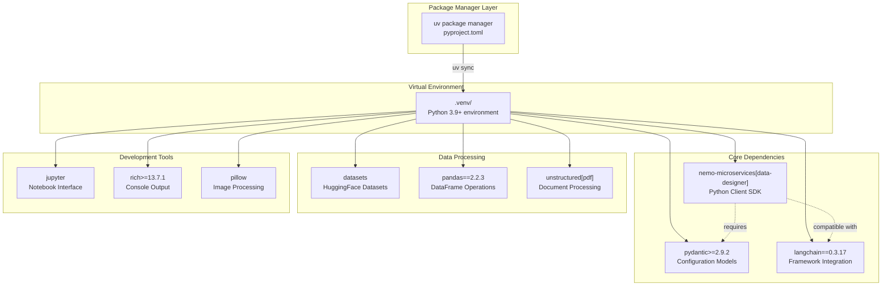
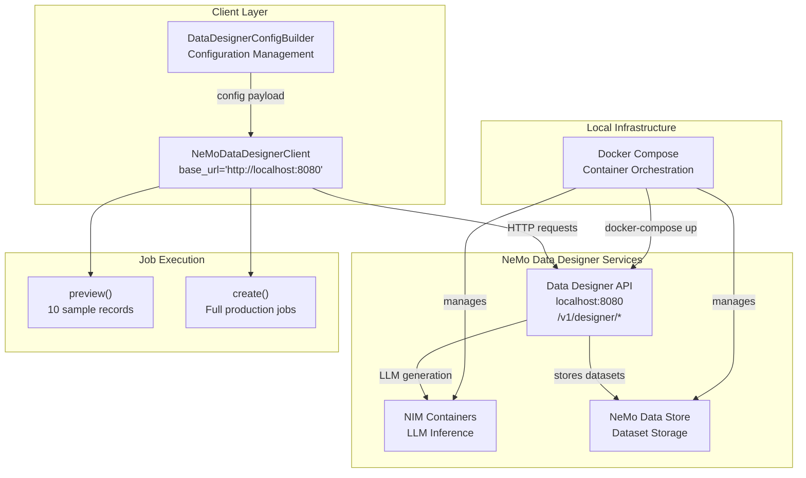
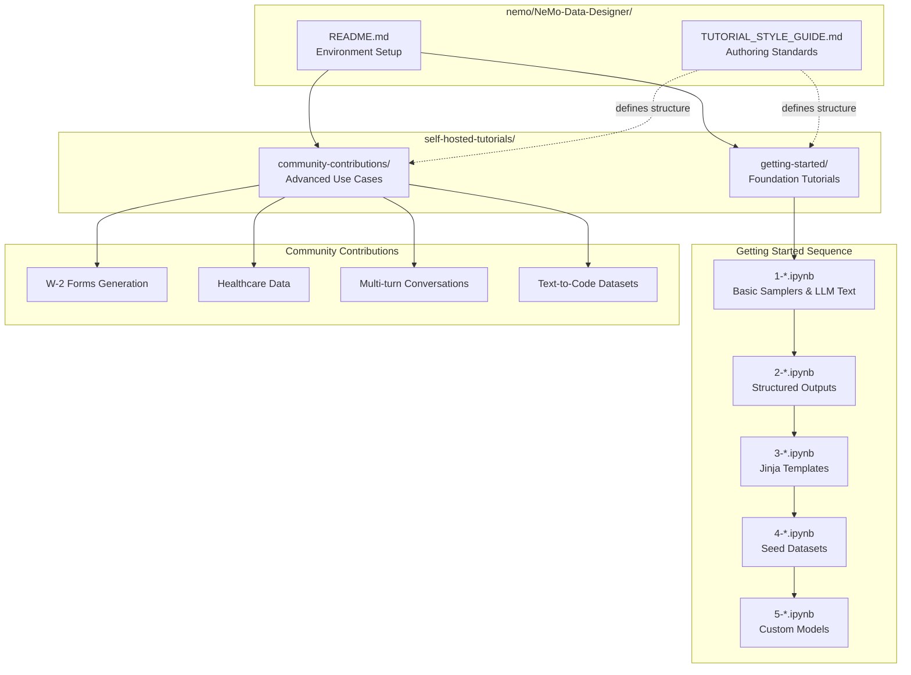
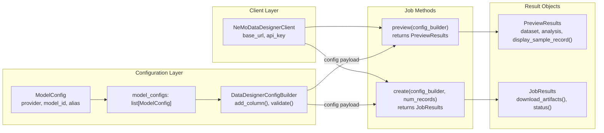
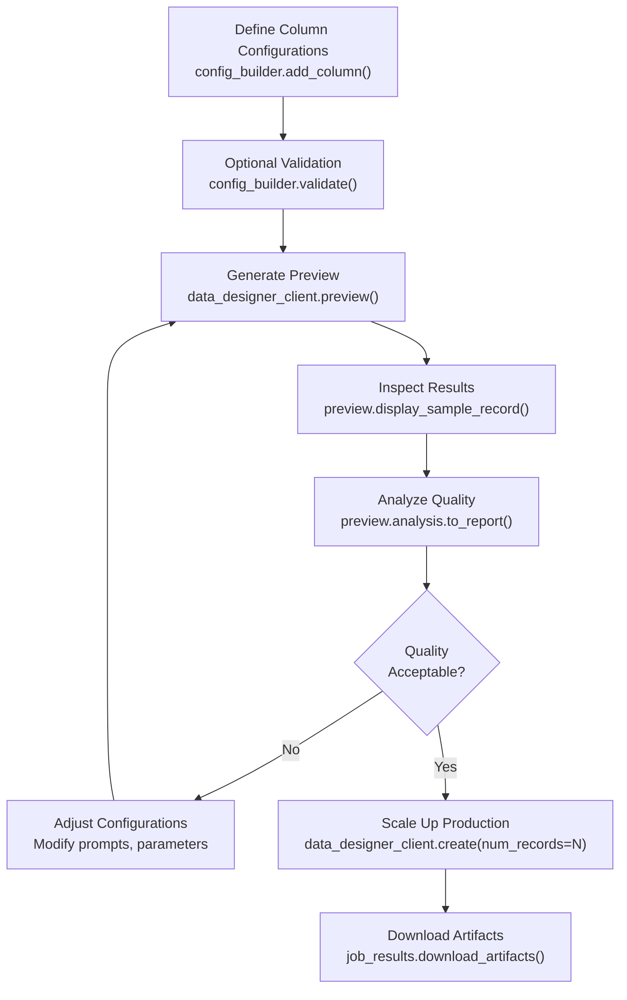

<!-- source: DeepWiki mcp.deepwiki.com · repo NVIDIA/GenerativeAIExamples · page 2.1 Getting Started with Data Designer · fetched 2026-10-26 -->

# Getting Started with Data Designer

<details>
<summary>Relevant source files</summary>

The following files were used as context for generating this wiki page:

- [nemo/NeMo-Data-Designer/README.md](nemo/NeMo-Data-Designer/README.md)
- [nemo/NeMo-Data-Designer/TUTORIAL_STYLE_GUIDE.md](nemo/NeMo-Data-Designer/TUTORIAL_STYLE_GUIDE.md)
- [nemo/NeMo-Data-Designer/pyproject.toml](nemo/NeMo-Data-Designer/pyproject.toml)

</details>


## Purpose and Scope

This document provides the essential setup instructions and foundational concepts for working with NeMo Data Designer. It covers environment configuration, deployment options, tutorial organization, and initial client setup. This page focuses on the prerequisites and basic scaffolding required before generating synthetic datasets.

For information about the core tutorials and data generation workflows, see [Core Tutorials](#2.2). For domain-specific applications, see [Domain-Specific Data Generation](#2.3).

## Overview

NeMo Data Designer is a microservice that generates synthetic datasets using LLM-based text generation combined with non-LLM samplers. The system supports two deployment modes: self-hosted Docker containers for production workloads and a managed cloud service for rapid prototyping. The tutorial notebooks in this repository demonstrate both foundational concepts and advanced patterns using the Python client SDK.

## Prerequisites

Before beginning Data Designer development, ensure you have:

| Requirement | Purpose | Installation Reference |
|------------|---------|----------------------|
| Python 3.9+ | Required for `nemo-microservices` SDK | [pyproject.toml:10]() |
| `uv` package manager | Dependency management and virtual environment | [uv documentation](https://docs.astral.sh/uv/getting-started/installation/) |
| NVIDIA API Key | Authentication for managed service or NIM models | NVIDIA API Catalog registration |
| Docker Compose (optional) | Self-hosted deployment | NeMo Data Designer documentation |

## Environment Setup

### Package Manager Installation

The tutorials use `uv` as the package manager for consistent dependency resolution and virtual environment management. After installing `uv`, navigate to the `NeMo-Data-Designer` directory and initialize the environment:

```bash
uv sync
```

This command:
1. Creates a `.venv` virtual environment in the current directory
2. Resolves dependencies specified in [pyproject.toml:12-22]()
3. Installs the `nemo-microservices[data-designer]` SDK and supporting libraries

Activate the virtual environment:

```bash
source .venv/bin/activate
```

**Important**: Jupyter notebooks must use this virtual environment as their kernel. You may need to restart the kernel after initial setup.

Sources: [nemo/NeMo-Data-Designer/README.md:5-21]()

### Dependency Architecture



**Dependency Architecture**: The environment setup establishes three layers. The package manager (`uv`) creates an isolated virtual environment that installs the core SDK with Pydantic-based configuration models, data processing libraries for DataFrame and document operations, and development tools for notebook-based workflows.

Sources: [nemo/NeMo-Data-Designer/pyproject.toml:1-22](), [nemo/NeMo-Data-Designer/README.md:5-21]()

## Deployment Options

NeMo Data Designer supports two deployment architectures with distinct use cases and operational characteristics.

### Deployment Comparison

| Characteristic | Self-Hosted Docker | Managed Service |
|---------------|-------------------|-----------------|
| **Base URL** | `http://localhost:8080` (default) | `https://build.nvidia.com/nemo/data-designer` |
| **Job Types** | `preview` and full production jobs | `preview` only |
| **GPU Requirements** | Required for LLM inference | Not required (cloud-hosted) |
| **Setup Time** | ~15-30 minutes | Immediate (API key only) |
| **Latency** | Local network (milliseconds) | Internet (variable) |
| **Data Privacy** | Full control, on-premises | Cloud-hosted (NVIDIA servers) |
| **Cost Model** | Infrastructure + GPU costs | API usage-based |
| **Use Case** | Production deployments, large datasets | Prototyping, tutorials |

### Self-Hosted Deployment Architecture

The self-hosted deployment uses Docker Compose to orchestrate multiple services:



**Self-Hosted Architecture**: The Docker Compose deployment exposes the Data Designer API on port 8080. The client SDK (`NeMoDataDesignerClient`) communicates via HTTP with the API, which orchestrates LLM inference through NIM containers and persists datasets to Data Store. The `preview()` method generates 10 sample records for iteration, while `create()` launches full production jobs.

Sources: [nemo/NeMo-Data-Designer/README.md:23-33]()

### Managed Service Configuration

The managed service provides immediate access without infrastructure setup:

```python
# Managed service endpoint (preview jobs only)
NEMO_MICROSERVICES_BASE_URL = "https://build.nvidia.com/nemo/data-designer"

# Initialize client with managed service
from nemo_microservices.data_designer.essentials import NeMoDataDesignerClient

data_designer_client = NeMoDataDesignerClient(base_url=NEMO_MICROSERVICES_BASE_URL)
```

**Limitation**: The managed service restricts jobs to preview mode, generating only 10 records per request. For production workloads requiring hundreds or thousands of records, self-hosted deployment is required.

Sources: [nemo/NeMo-Data-Designer/README.md:35-38]()

## Tutorial Organization

The tutorial notebooks follow a structured progression from foundational concepts to advanced applications.

### Tutorial Directory Structure



**Tutorial Progression**: The `getting-started/` directory contains sequential notebooks that build foundational knowledge, while `community-contributions/` demonstrates domain-specific applications. Each tutorial follows the style guide's structure for consistent learning patterns.

Sources: [nemo/NeMo-Data-Designer/README.md:41-49](), [nemo/NeMo-Data-Designer/TUTORIAL_STYLE_GUIDE.md:54-64]()

### Standard Tutorial Structure

All tutorials follow this cell organization pattern:

| Cell Section | Emoji | Purpose |
|-------------|-------|---------|
| Title & Learning Objectives | 🎨 | Describes what the notebook demonstrates |
| Environment Setup Notice | 👋 | Links to README for dependency installation |
| Imports | 📦 | `from nemo_microservices.data_designer.essentials import ...` |
| Client Initialization | ⚙️ | `NeMoDataDesignerClient(base_url=...)` |
| Model Configuration | 🎛️ | `ModelConfig` definitions for LLM providers |
| Config Builder | 🏗️ | `DataDesignerConfigBuilder(model_configs=...)` |
| Dataset Design | 🎨 | Custom section with domain-specific column definitions |
| Preview & Iteration | 🔁 | `preview = data_designer_client.preview(config_builder)` |
| Analysis | 📊 | `preview.analysis.to_report()` quality metrics |
| Scale Up | 🆙 | `job_results = data_designer_client.create(config_builder, num_records=...)` |
| Next Steps | ⏭️ | Links to subsequent tutorials or documentation |

This standardized structure enables users to focus on the unique aspects of each tutorial rather than navigating different organizational patterns.

Sources: [nemo/NeMo-Data-Designer/TUTORIAL_STYLE_GUIDE.md:20-83]()

## Client Initialization Pattern

The Python SDK provides two primary classes for interacting with Data Designer:

### Core Client Classes



**Client SDK Architecture**: The `NeMoDataDesignerClient` requires a base URL and optional API key for authentication. The `DataDesignerConfigBuilder` manages column configurations and model settings. Preview jobs return `PreviewResults` with immediate dataset access, while create jobs return `JobResults` with artifact download capabilities.

### Initialization Code Pattern

```python
# Constants defined at notebook top
NEMO_MICROSERVICES_BASE_URL = "http://localhost:8080"  # or managed service URL
MODEL_PROVIDER = "nvidiabuild"
MODEL_ID = "nvidia/nvidia-nemotron-nano-9b-v2"
MODEL_ALIAS = "nemotron-nano-v2"
TUTORIAL_OUTPUT_PATH = "data-designer-tutorial-output"

# Client initialization
from nemo_microservices.data_designer.essentials import NeMoDataDesignerClient

data_designer_client = NeMoDataDesignerClient(base_url=NEMO_MICROSERVICES_BASE_URL)

# Model configuration
from nemo_microservices.data_designer.essentials import ModelConfig

model_configs = [
    ModelConfig(
        provider=MODEL_PROVIDER,
        model_id=MODEL_ID,
        alias=MODEL_ALIAS,
    )
]

# Config builder initialization
from nemo_microservices.data_designer.essentials import DataDesignerConfigBuilder

config_builder = DataDesignerConfigBuilder(model_configs=model_configs)
```

**Naming Conventions**: The style guide mandates `UPPER_SNAKE_CASE` for constants (URLs, model identifiers) and `snake_case` for instantiated objects (`data_designer_client`, `config_builder`). This pattern appears consistently across all tutorials.

Sources: [nemo/NeMo-Data-Designer/TUTORIAL_STYLE_GUIDE.md:210-228](), [nemo/NeMo-Data-Designer/TUTORIAL_STYLE_GUIDE.md:56-60]()

## Configuration Concepts

Before beginning data generation, understand these fundamental configuration constructs:

### Column Types

Data Designer supports two primary column types:

| Column Type | Purpose | Configuration Class | Example Use Case |
|------------|---------|-------------------|------------------|
| **Sampler** | Non-LLM deterministic generation | `SamplerColumnConfig` with `SamplerType` enum | UUIDs, categories, names from lists |
| **LLM Text** | LLM-based text generation | `LLMTextColumnConfig` with prompt templates | Product reviews, descriptions, summaries |

### Model Configuration

The `ModelConfig` class defines LLM backends for text generation columns:

```python
ModelConfig(
    provider="nvidiabuild",           # API provider (nvidiabuild, openai, etc.)
    model_id="nvidia/model-name",     # Full model identifier
    alias="short-name",               # Reference name for column configs
    system_prompt="/no_think",        # Optional system-level instruction
)
```

The `alias` field enables column definitions to reference specific models without repeating full identifiers.

### Output Paths

The tutorials use a standardized output directory excluded from version control:

```python
TUTORIAL_OUTPUT_PATH = "data-designer-tutorial-output"

job_results.download_artifacts(
    output_path=TUTORIAL_OUTPUT_PATH,
    artifacts_folder_name="descriptive-folder-name",
)
```

The `.gitignore` file excludes this directory to prevent generated datasets from being committed to the repository.

Sources: [nemo/NeMo-Data-Designer/TUTORIAL_STYLE_GUIDE.md:229-258](), [nemo/NeMo-Data-Designer/TUTORIAL_STYLE_GUIDE.md:454-467]()

## Validation and Iteration Workflow

Data Designer emphasizes iterative development through preview-before-scale patterns:



**Iteration Cycle**: The `validate()` method checks configuration correctness before generation. The `preview()` method generates 10 sample records for rapid iteration. Users inspect individual records with `display_sample_record()` and review quality metrics with `analysis.to_report()`. Once satisfied, the `create()` method launches production jobs with configurable record counts.

### Preview vs. Create Job Characteristics

| Characteristic | `preview()` | `create()` |
|---------------|-------------|-----------|
| **Record Count** | Fixed at 10 | Configurable (`num_records` parameter) |
| **Response Time** | Synchronous (seconds) | Asynchronous (minutes to hours) |
| **Return Type** | `PreviewResults` | `JobResults` |
| **Primary Methods** | `.dataset`, `.display_sample_record()`, `.analysis` | `.download_artifacts()`, `.status()` |
| **Data Access** | Immediate DataFrame | Artifact download required |
| **Supported in Managed Service** | Yes | No (self-hosted only) |

The preview-iterate-scale pattern reduces compute waste by validating configurations on small samples before committing to large production runs.

Sources: [nemo/NeMo-Data-Designer/TUTORIAL_STYLE_GUIDE.md:54-64](), [nemo/NeMo-Data-Designer/README.md:35-38]()

## Code Import Patterns

The SDK exports commonly used classes through the `essentials` module for simplified imports:

```python
from nemo_microservices.data_designer.essentials import (
    CategorySamplerParams,
    DataDesignerConfigBuilder,
    LLMTextColumnConfig,
    ModelConfig,
    NeMoDataDesignerClient,
    SamplerColumnConfig,
    SamplerType,
    # ... additional classes alphabetically ordered
)
```

**Import Standards**: The style guide mandates importing from `essentials` when available, alphabetical ordering, explicit imports (no wildcards), and one import per line within the tuple. This convention appears throughout all tutorial notebooks.

Sources: [nemo/NeMo-Data-Designer/TUTORIAL_STYLE_GUIDE.md:193-208]()

## Next Steps

After completing environment setup and understanding these foundational concepts:

1. **Begin with Core Tutorials**: Start with [Core Tutorials](#2.2) to learn basic sampler columns, LLM text generation, structured outputs, Jinja templates, and seed dataset integration.

2. **Explore Domain Applications**: Review [Domain-Specific Data Generation](#2.3) for examples of W-2 forms, healthcare data, multi-turn conversations, and multimodal datasets.

3. **Study Code Generation**: See [Text-to-Code Data Generation](#2.4) for synthetic datasets supporting text-to-Python, text-to-SQL, and code evolution tasks.

4. **Integrate with Data Flywheel**: Learn how Data Designer fits into continuous improvement cycles in [NeMo Data Flywheel](#4).

The self-hosted deployment enables full experimentation with unlimited record generation, while the managed service provides immediate access for learning and prototyping.

Sources: [nemo/NeMo-Data-Designer/README.md:41-49](), [nemo/NeMo-Data-Designer/TUTORIAL_STYLE_GUIDE.md:66-82]()

---

