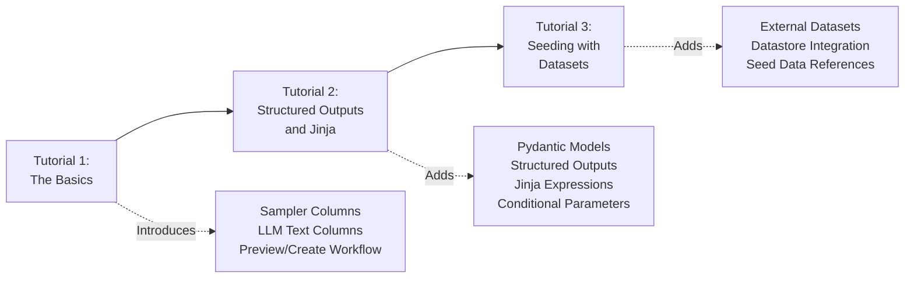
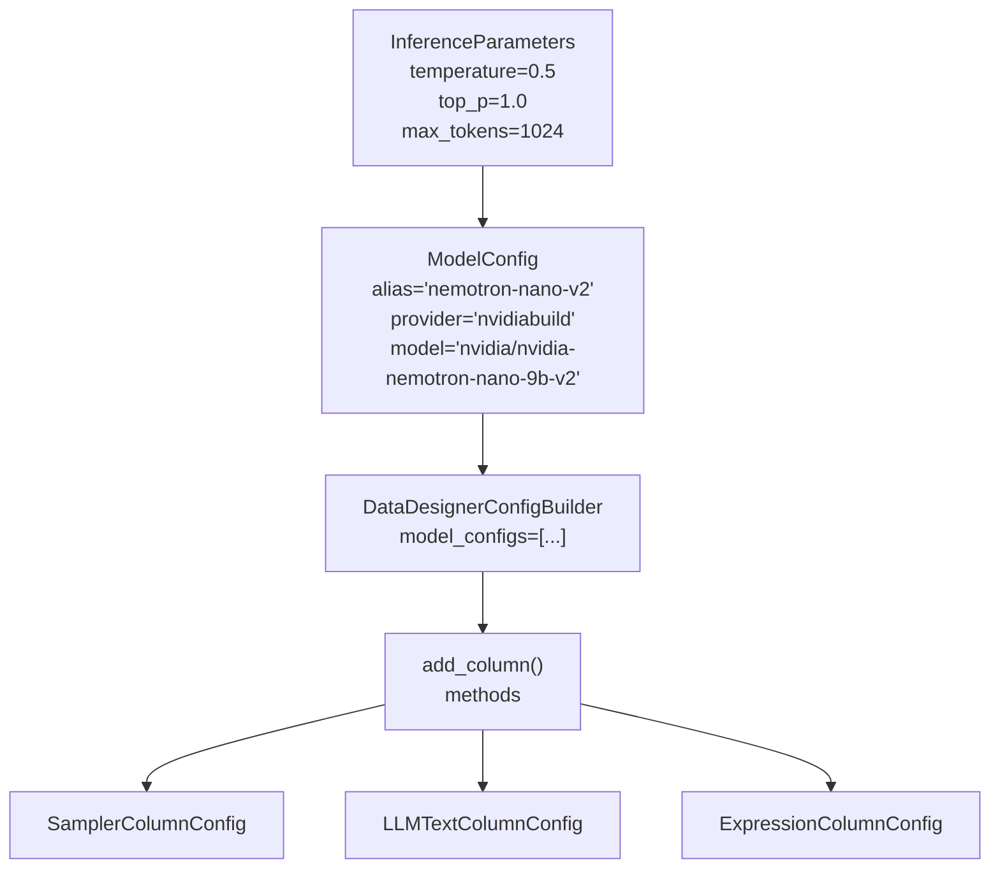
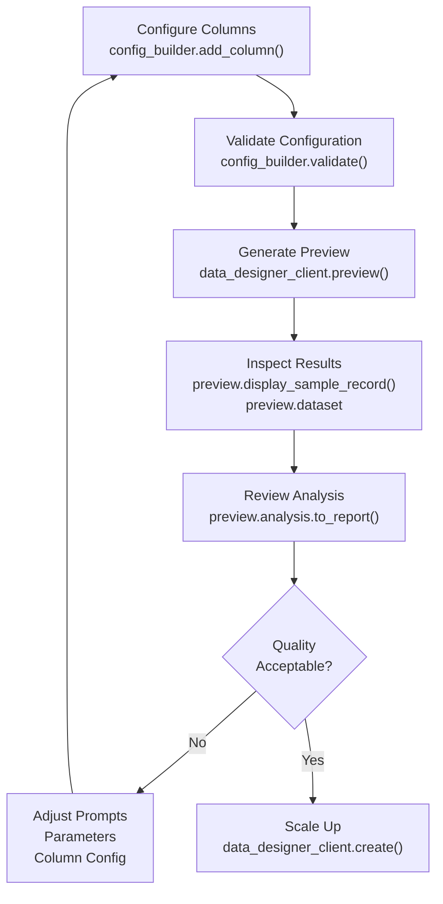
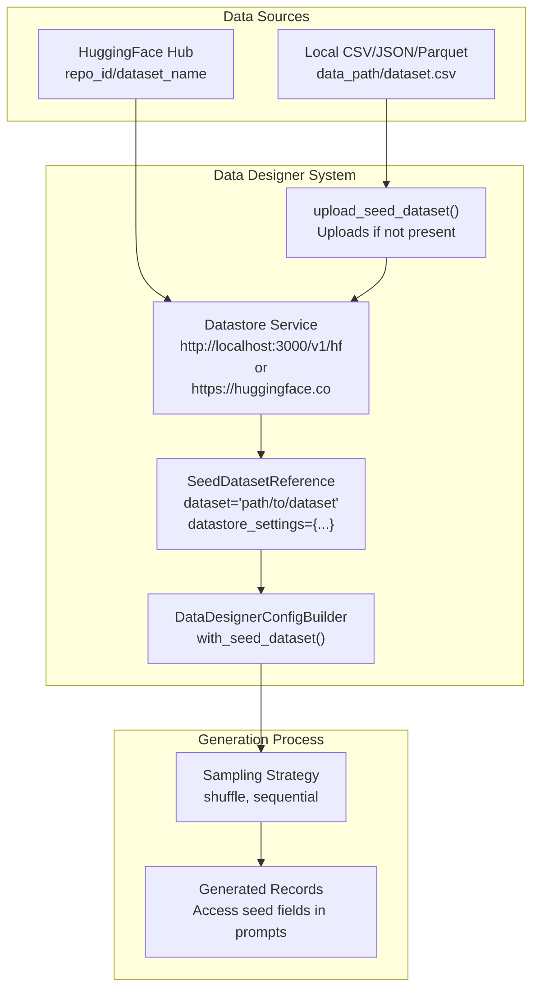
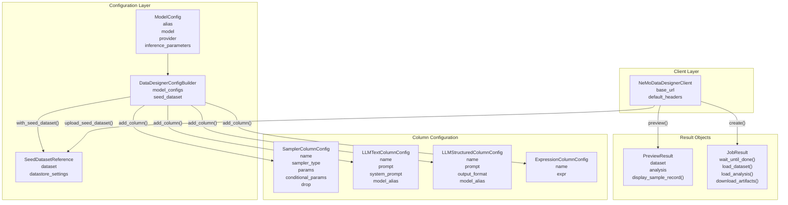
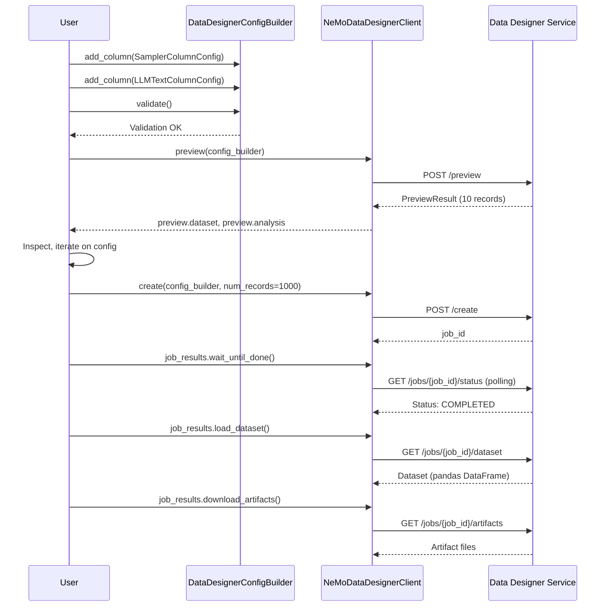

<!-- source: DeepWiki mcp.deepwiki.com · repo NVIDIA/GenerativeAIExamples · page 2.2 Core Tutorials · fetched 2026-10-26 -->

# Core Tutorials

<details>
<summary>Relevant source files</summary>

The following files were used as context for generating this wiki page:

- [.gitignore](.gitignore)
- [nemo/NeMo-Data-Designer/managed-service-tutorials/getting-started/1-the-basics.ipynb](nemo/NeMo-Data-Designer/managed-service-tutorials/getting-started/1-the-basics.ipynb)
- [nemo/NeMo-Data-Designer/managed-service-tutorials/getting-started/2-structured-outputs-and-jinja-expressions.ipynb](nemo/NeMo-Data-Designer/managed-service-tutorials/getting-started/2-structured-outputs-and-jinja-expressions.ipynb)
- [nemo/NeMo-Data-Designer/managed-service-tutorials/getting-started/3-seeding-with-a-dataset.ipynb](nemo/NeMo-Data-Designer/managed-service-tutorials/getting-started/3-seeding-with-a-dataset.ipynb)
- [nemo/NeMo-Data-Designer/self-hosted-tutorials/getting-started/1-the-basics.ipynb](nemo/NeMo-Data-Designer/self-hosted-tutorials/getting-started/1-the-basics.ipynb)
- [nemo/NeMo-Data-Designer/self-hosted-tutorials/getting-started/2-structured-outputs-and-jinja-expressions.ipynb](nemo/NeMo-Data-Designer/self-hosted-tutorials/getting-started/2-structured-outputs-and-jinja-expressions.ipynb)
- [nemo/NeMo-Data-Designer/self-hosted-tutorials/getting-started/3-seeding-with-a-dataset.ipynb](nemo/NeMo-Data-Designer/self-hosted-tutorials/getting-started/3-seeding-with-a-dataset.ipynb)
- [nemo/NeMo-Data-Designer/self-hosted-tutorials/getting-started/README.md](nemo/NeMo-Data-Designer/self-hosted-tutorials/getting-started/README.md)

</details>


## Purpose and Scope

The Core Tutorials provide foundational instruction for using NeMo Data Designer to generate synthetic datasets. These tutorials cover essential operations including sampler-based data generation, LLM-driven text synthesis, structured output generation with Pydantic models, Jinja template expressions, and seeding generation processes with external datasets.

These tutorials are located in two variants:
- **Self-hosted tutorials**: [nemo/NeMo-Data-Designer/self-hosted-tutorials/getting-started/]() - Assumes Data Designer microservice deployed locally
- **Managed service tutorials**: [nemo/NeMo-Data-Designer/managed-service-tutorials/getting-started/]() - Connects to the hosted Data Designer API at `https://ai.api.nvidia.com/v1/nemo/dd`

For advanced domain-specific generation patterns, see Domain-Specific Data Generation (#2.3). For code generation use cases, see Text-to-Code Data Generation (#2.4).

---

## Tutorial Progression

The getting-started tutorials follow a progressive learning structure, introducing capabilities incrementally:



**Tutorial Dependencies**

| Tutorial | File | Prerequisites | Key Concepts Introduced |
|----------|------|---------------|------------------------|
| 1: The Basics | `1-the-basics.ipynb` | None | Samplers, LLM text generation, basic workflow |
| 2: Structured Outputs | `2-structured-outputs-and-jinja-expressions.ipynb` | Tutorial 1 | Pydantic schemas, Jinja templates, conditional logic |
| 3: Seeding with Datasets | `3-seeding-with-a-dataset.ipynb` | Tutorial 1 | Seed datasets, datastore endpoints, field references |

Sources: [nemo/NeMo-Data-Designer/self-hosted-tutorials/getting-started/README.md:15-19]()

---

## Tutorial 1: The Basics

### Overview

Tutorial 1 demonstrates core Data Designer functionality by building a product review dataset. It introduces the fundamental workflow: configure columns, preview results, iterate on prompts, and scale up generation.

**Example Dataset**: Product reviews with customer information, product categories, and review text

### Client Initialization

Data generation begins by instantiating `NeMoDataDesignerClient`:

```python
# Self-hosted deployment
data_designer_client = NeMoDataDesignerClient(base_url="http://localhost:8080")

# Managed service
data_designer_client = NeMoDataDesignerClient(
    base_url="https://ai.api.nvidia.com/v1/nemo/dd",
    default_headers={"Authorization": f"Bearer {api_key}"}
)
```

The client handles job submission, status polling, and artifact retrieval through methods like `preview()`, `create()`, `wait_until_done()`, `load_dataset()`.

Sources: [nemo/NeMo-Data-Designer/self-hosted-tutorials/getting-started/1-the-basics.ipynb:67-76](), [nemo/NeMo-Data-Designer/managed-service-tutorials/getting-started/1-the-basics.ipynb:80-87]()

### Configuration Builder and Model Setup



The `DataDesignerConfigBuilder` accepts a list of `ModelConfig` objects that define available LLMs. Each config specifies:
- **alias**: Reference name used in column definitions
- **model**: Model identifier (e.g., from build.nvidia.com)
- **provider**: Model hosting service
- **inference_parameters**: Generation settings (`temperature`, `top_p`, `max_tokens`)

Sources: [nemo/NeMo-Data-Designer/self-hosted-tutorials/getting-started/1-the-basics.ipynb:95-146]()

### Sampler Columns

Samplers generate deterministic or statistical data without LLM invocations. They provide diversity control and reduce generation costs.

**Sampler Types**

| Sampler Type | Purpose | Example Configuration | Parameters |
|--------------|---------|----------------------|------------|
| `CATEGORY` | Random selection from list | Product categories | `CategorySamplerParams(values=[...], weights=[...])` |
| `SUBCATEGORY` | Hierarchical category selection | Product subcategories | `SubcategorySamplerParams(category="parent", values={...})` |
| `PERSON` | Synthetic US Census-based personas | Customer demographics | `PersonSamplerParams(age_range=[18, 70])` |
| `UNIFORM` | Uniform distribution sampling | Rating values | `UniformSamplerParams(low=1, high=5)` |
| `UUID` | Unique identifier generation | Patient IDs | `UUIDSamplerParams(prefix="PT-", short_form=True)` |
| `DATETIME` | Date/time generation | Visit dates | `DatetimeSamplerParams(start="2024-01-01", end="2024-12-31")` |
| `TIMEDELTA` | Time offset calculation | Follow-up dates | `TimedeltaSamplerParams(dt_min=1, dt_max=30, reference_column_name="...")` |

**Example: Category and Subcategory Samplers**

```python
config_builder.add_column(
    SamplerColumnConfig(
        name="product_category",
        sampler_type=SamplerType.CATEGORY,
        params=CategorySamplerParams(
            values=["Electronics", "Clothing", "Home & Kitchen", "Books", "Home Office"]
        )
    )
)

config_builder.add_column(
    SamplerColumnConfig(
        name="product_subcategory",
        sampler_type=SamplerType.SUBCATEGORY,
        params=SubcategorySamplerParams(
            category="product_category",  # Parent column reference
            values={
                "Electronics": ["Smartphones", "Laptops", "Headphones", "Cameras"],
                "Clothing": ["Men's Clothing", "Women's Clothing", "Winter Coats"],
                # ...
            }
        )
    )
)
```

The `SUBCATEGORY` sampler references the `product_category` column to select appropriate subcategories, creating hierarchical relationships.

Sources: [nemo/NeMo-Data-Designer/self-hosted-tutorials/getting-started/1-the-basics.ipynb:179-303]()

**Person Sampler**

The `PERSON` sampler generates synthetic demographic data based on US Census statistics:

```python
config_builder.add_column(
    SamplerColumnConfig(
        name="customer",
        sampler_type=SamplerType.PERSON,
        params=PersonSamplerParams(age_range=[18, 70])
    )
)
```

Generated fields include: `first_name`, `last_name`, `age`, `birth_date`, `city`, `state`, `email_address`. These fields are accessed using dot notation in subsequent columns.

Sources: [nemo/NeMo-Data-Designer/self-hosted-tutorials/getting-started/1-the-basics.ipynb:273-280]()

### LLM Text Columns

`LLMTextColumnConfig` generates freeform text using LLM inference. Prompts can reference other columns via Jinja templating.

```python
config_builder.add_column(
    LLMTextColumnConfig(
        name="customer_review",
        prompt=(
            "You are a customer named {{ customer.first_name }} from {{ customer.city }}, {{ customer.state }}. "
            "You are {{ customer.age }} years old and recently purchased a product called {{ product_name }}. "
            "Write a review of this product, which you gave a rating of {{ number_of_stars }} stars. "
            "The style of the review should be '{{ review_style }}'."
        ),
        system_prompt=SYSTEM_PROMPT,
        model_alias=MODEL_ALIAS
    )
)
```

**Template Variable Access**:
- Simple columns: `{{ column_name }}`
- Nested object fields: `{{ customer.first_name }}`, `{{ customer.city }}`

The `model_alias` parameter references a model from the `ModelConfig` list provided to `DataDesignerConfigBuilder`.

Sources: [nemo/NeMo-Data-Designer/self-hosted-tutorials/getting-started/1-the-basics.ipynb:324-353]()

### Preview and Iteration Workflow



The `preview()` method generates 10 sample records for rapid evaluation without committing to large-scale generation:

```python
preview = data_designer_client.preview(config_builder)

# Cycle through preview records
preview.display_sample_record()

# Access as DataFrame
df = preview.dataset

# View statistical analysis
preview.analysis.to_report()
```

Once satisfied, use `create()` for full-scale generation:

```python
job_results = data_designer_client.create(config_builder, num_records=1000)
job_results.wait_until_done()

dataset = job_results.load_dataset()
analysis = job_results.load_analysis()
job_results.download_artifacts(output_path="./output", artifacts_folder_name="run-1")
```

Sources: [nemo/NeMo-Data-Designer/self-hosted-tutorials/getting-started/1-the-basics.ipynb:372-480]()

---

## Tutorial 2: Structured Outputs and Jinja Expressions

### Overview

Tutorial 2 extends basic concepts with:
- **Pydantic schemas** for structured JSON outputs
- **Advanced Jinja expressions** with conditionals and nested field access
- **Conditional parameters** that modify sampler behavior based on column values
- **Expression columns** for derived data without LLM calls

### Pydantic Models for Structured Outputs

Data Designer accepts Pydantic `BaseModel` subclasses to enforce strict output schemas:

```python
from pydantic import BaseModel, Field
from decimal import Decimal
from typing import Literal

class Product(BaseModel):
    name: str = Field(description="The name of the product")
    description: str = Field(description="A description of the product")
    price: Decimal = Field(
        description="The price of the product",
        ge=10,  # Greater than or equal to 10
        le=1000,  # Less than or equal to 1000
        decimal_places=2
    )

class ProductReview(BaseModel):
    rating: int = Field(description="The rating of the product", ge=1, le=5)
    customer_mood: Literal["irritated", "mad", "happy", "neutral", "excited"] = Field(
        description="The mood of the customer"
    )
    review: str = Field(description="A review of the product")
```

These models define:
- **Type constraints**: `str`, `int`, `Decimal`, `Literal`
- **Value constraints**: `ge` (greater/equal), `le` (less/equal), `decimal_places`
- **Descriptions**: Used by LLM to understand field semantics

Sources: [nemo/NeMo-Data-Designer/self-hosted-tutorials/getting-started/2-structured-outputs-and-jinja-expressions.ipynb:179-200]()

### Structured Output Columns

`LLMStructuredColumnConfig` generates JSON conforming to Pydantic schemas:

```python
config_builder.add_column(
    LLMStructuredColumnConfig(
        name="product",
        prompt=(
            "Create a product in the '{{ product_category }}' category, focusing on products "
            "related to '{{ product_subcategory }}'. The target age range of the ideal customer is "
            "{{ target_age_range }} years old. The product should be priced between $10 and $1000."
        ),
        system_prompt=SYSTEM_PROMPT,
        output_format=Product,  # Pydantic model
        model_alias=MODEL_ALIAS
    )
)
```

The generated `product` column contains nested JSON with `name`, `description`, and `price` fields, accessible via dot notation: `{{ product.name }}`, `{{ product.price }}`.

Sources: [nemo/NeMo-Data-Designer/self-hosted-tutorials/getting-started/2-structured-outputs-and-jinja-expressions.ipynb:361-395]()

### Expression Columns

`ExpressionColumnConfig` derives values from other columns using Jinja expressions without invoking LLMs:

```python
config_builder.add_column(
    ExpressionColumnConfig(
        name="customer_name",
        expr="{{ customer.first_name }} {{ customer.last_name }}"
    )
)

config_builder.add_column(
    ExpressionColumnConfig(
        name="customer_age",
        expr="{{ customer.age }}"
    )
)
```

**Use Cases**:
- Extracting nested fields for readability
- Concatenating values
- Formatting data
- Creating composite keys

Sources: [nemo/NeMo-Data-Designer/self-hosted-tutorials/getting-started/2-structured-outputs-and-jinja-expressions.ipynb:348-359]()

### Advanced Jinja Templates with Conditionals

Jinja supports control flow statements for dynamic prompt construction:

```python
config_builder.add_column(
    LLMStructuredColumnConfig(
        name="customer_review",
        prompt=(
            "Your task is to write a review for the following product:\n\n"
            "Product Name: {{ product.name }}\n"
            "Product Description: {{ product.description }}\n"
            "Price: {{ product.price }}\n\n"
            "Imagine your name is {{ customer_name }} and you are from {{ customer.city }}, {{ customer.state }}. "
            "Write the review in a style that is '{{ review_style }}'."
            ""
            "Make sure the review is more informal and conversational."
            ""
            "Make sure the review is more formal and structured."
            ""
        ),
        output_format=ProductReview,
        model_alias=MODEL_ALIAS
    )
)
```

**Jinja Constructs Supported**:
- Variable access: `{{ variable }}`
- Conditionals: `......`
- Field access: `{{ object.nested_field }}`
- Comparisons: `==`, `!=`, `>`, `<`, `>=`, `<=`

Sources: [nemo/NeMo-Data-Designer/self-hosted-tutorials/getting-started/2-structured-outputs-and-jinja-expressions.ipynb:375-395]()

### Conditional Sampler Parameters

Sampler columns support `conditional_params` to modify behavior based on other column values:

```python
config_builder.add_column(
    SamplerColumnConfig(
        name="review_style",
        sampler_type=SamplerType.CATEGORY,
        params=CategorySamplerParams(
            values=["rambling", "brief", "detailed", "structured with bullet points"],
            weights=[1, 2, 2, 1]  # Default weights
        ),
        conditional_params={
            "target_age_range == '18-25'": CategorySamplerParams(values=["rambling"])
        }
    )
)
```

When `target_age_range` equals `'18-25'`, the sampler only selects `"rambling"`, overriding default behavior. This enables complex conditional logic without LLM calls.

Sources: [nemo/NeMo-Data-Designer/self-hosted-tutorials/getting-started/2-structured-outputs-and-jinja-expressions.ipynb:309-321]()

### Dropping Intermediate Columns

Columns used only for intermediate calculations can be excluded from final output:

```python
config_builder.add_column(
    SamplerColumnConfig(
        name="customer",
        sampler_type=SamplerType.PERSON,
        params=PersonSamplerParams(age_range=[18, 65]),
        drop=True  # Exclude from final dataset
    )
)
```

The `customer` column is accessible in prompts/expressions but not saved, reducing output size when only specific fields are needed.

Sources: [nemo/NeMo-Data-Designer/self-hosted-tutorials/getting-started/2-structured-outputs-and-jinja-expressions.ipynb:224-231]()

---

## Tutorial 3: Seeding with Datasets

### Overview

Tutorial 3 demonstrates using external datasets to guide synthetic data generation. Seed datasets provide real-world context and diversity, enabling generation of domain-specific synthetic records that mirror actual data distributions.

**Example**: Generating synthetic patient notes seeded with symptom-diagnosis pairs from `gretelai/symptom_to_diagnosis` dataset.

### Seed Dataset Configuration



Sources: [nemo/NeMo-Data-Designer/self-hosted-tutorials/getting-started/3-seeding-with-a-dataset.ipynb:145-191]()

### Uploading and Referencing Seed Data

**Self-Hosted Datastore Approach**:

```python
from tutorial_helpers.helpers import data_path

seed_dataset_reference = data_designer_client.upload_seed_dataset(
    dataset=data_path / "gretelai_symptom_to_diagnosis.csv",
    repo_id="data-designer/demo",
    datastore_settings={"endpoint": "http://localhost:3000/v1/hf"}
)

config_builder.with_seed_dataset(seed_dataset_reference)
```

**Managed Service / HuggingFace Hub Approach**:

```python
from nemo_microservices.data_designer.essentials import SeedDatasetReference

config_builder.with_seed_dataset(
    dataset_reference=SeedDatasetReference(
        dataset="gretelai/symptom_to_diagnosis/train.jsonl",
        datastore_settings={"endpoint": "https://huggingface.co"}
    ),
    sampling_strategy="shuffle"
)
```

**Sampling Strategies**:
- `"shuffle"`: Random sampling from seed dataset
- `"sequential"`: Ordered traversal of seed records
- `with_replacement`: Controls whether records can be reused (default: `True`)

Sources: [nemo/NeMo-Data-Designer/self-hosted-tutorials/getting-started/3-seeding-with-a-dataset.ipynb:180-191](), [nemo/NeMo-Data-Designer/managed-service-tutorials/getting-started/3-seeding-with-a-dataset.ipynb:153-159]()

### Accessing Seed Data in Prompts

Seed dataset fields are directly accessible in Jinja templates:

```python
# Seed dataset has 'input_text' (patient_summary) and 'output_text' (diagnosis)

config_builder.add_column(
    name="physician_notes",
    column_type="llm-text",
    prompt="""
You are a primary-care physician who just had an appointment with {{ first_name }} {{ last_name }},
who has been struggling with symptoms from {{ output_text }} since {{ symptom_onset_date }}.
The date of today's visit is {{ date_of_visit }}.

{{ input_text }}

Write careful notes about your visit with {{ first_name }},
as Dr. {{ doctor_sampler.first_name }} {{ doctor_sampler.last_name }}.

Format the notes as a busy doctor might.
""",
    model_alias=model_alias
)
```

In this example:
- `{{ output_text }}`: References `diagnosis` field from seed data
- `{{ input_text }}`: References `patient_summary` field from seed data
- `{{ first_name }}`, `{{ date_of_visit }}`: Generated columns
- `{{ doctor_sampler.first_name }}`: Nested field from generated sampler

Sources: [nemo/NeMo-Data-Designer/self-hosted-tutorials/getting-started/3-seeding-with-a-dataset.ipynb:308-326]()

### Shorthand Column Configuration

Tutorial 3 demonstrates an alternative configuration syntax using keyword arguments instead of typed config objects:

```python
# Shorthand: keyword arguments
config_builder.add_column(
    name="patient_sampler",
    column_type="sampler",
    sampler_type="person",
    drop=True
)

# Equivalent: typed config object
config_builder.add_column(
    SamplerColumnConfig(
        name="patient_sampler",
        sampler_type=SamplerType.PERSON,
        drop=True
    )
)
```

Both approaches are valid; typed objects provide better IDE autocomplete and type checking.

Sources: [nemo/NeMo-Data-Designer/self-hosted-tutorials/getting-started/3-seeding-with-a-dataset.ipynb:236-285]()

---

## Common SDK Patterns and Components

### Core Client and Builder Classes



**Key Classes**

| Class | Purpose | Key Methods/Attributes |
|-------|---------|----------------------|
| `NeMoDataDesignerClient` | Submits generation requests, manages jobs | `preview()`, `create()`, `upload_seed_dataset()` |
| `DataDesignerConfigBuilder` | Constructs dataset schema configuration | `add_column()`, `with_seed_dataset()`, `validate()` |
| `ModelConfig` | Defines LLM model configuration | `alias`, `model`, `provider`, `inference_parameters` |
| `SamplerColumnConfig` | Configures non-LLM data generation | `name`, `sampler_type`, `params`, `conditional_params`, `drop` |
| `LLMTextColumnConfig` | Configures freeform text generation | `name`, `prompt`, `system_prompt`, `model_alias` |
| `LLMStructuredColumnConfig` | Configures structured JSON generation | `name`, `prompt`, `output_format`, `model_alias` |
| `ExpressionColumnConfig` | Configures derived columns | `name`, `expr` |
| `SeedDatasetReference` | References external seed data | `dataset`, `datastore_settings` |
| `PreviewResult` | Contains preview generation results | `dataset`, `analysis`, `display_sample_record()` |
| `JobResult` | Contains full generation job results | `wait_until_done()`, `load_dataset()`, `load_analysis()`, `download_artifacts()` |

Sources: [nemo/NeMo-Data-Designer/self-hosted-tutorials/getting-started/1-the-basics.ipynb:42-55](), [nemo/NeMo-Data-Designer/self-hosted-tutorials/getting-started/2-structured-outputs-and-jinja-expressions.ipynb:44-56]()

### Generation Workflow Methods



**Method Reference**

| Method | Object | Purpose | Returns |
|--------|--------|---------|---------|
| `preview(config_builder)` | `NeMoDataDesignerClient` | Generate 10 sample records | `PreviewResult` |
| `create(config_builder, num_records)` | `NeMoDataDesignerClient` | Submit full generation job | `JobResult` |
| `wait_until_done()` | `JobResult` | Block until job completes | None |
| `load_dataset()` | `PreviewResult` / `JobResult` | Load generated records | `pandas.DataFrame` |
| `load_analysis()` | `PreviewResult` / `JobResult` | Load statistical analysis | `Analysis` |
| `download_artifacts(output_path, artifacts_folder_name)` | `JobResult` | Save artifacts to disk | None |
| `display_sample_record()` | `PreviewResult` | Cycle through preview records | None |

Sources: [nemo/NeMo-Data-Designer/self-hosted-tutorials/getting-started/1-the-basics.ipynb:376-480]()

### Column Type and Parameter Matrix

**Column Types and Required Configurations**

| Column Type | Config Class | Required Parameters | Optional Parameters | LLM Invoked? |
|-------------|--------------|---------------------|---------------------|--------------|
| Sampler | `SamplerColumnConfig` | `name`, `sampler_type`, `params` | `drop`, `convert_to`, `conditional_params` | No |
| LLM Text | `LLMTextColumnConfig` | `name`, `prompt`, `model_alias` | `system_prompt` | Yes |
| LLM Structured | `LLMStructuredColumnConfig` | `name`, `prompt`, `output_format`, `model_alias` | `system_prompt` | Yes |
| Expression | `ExpressionColumnConfig` | `name`, `expr` | None | No |

**Sampler Parameter Classes**

| Sampler Type | Parameter Class | Key Parameters |
|--------------|----------------|----------------|
| `PERSON` | `PersonSamplerParams` | `age_range` |
| `CATEGORY` | `CategorySamplerParams` | `values`, `weights` |
| `SUBCATEGORY` | `SubcategorySamplerParams` | `category`, `values` |
| `UNIFORM` | `UniformSamplerParams` | `low`, `high` |
| `UUID` | `UUIDSamplerParams` | `prefix`, `short_form`, `uppercase` |
| `DATETIME` | `DatetimeSamplerParams` | `start`, `end` |
| `TIMEDELTA` | `TimedeltaSamplerParams` | `dt_min`, `dt_max`, `reference_column_name` |

Sources: [nemo/NeMo-Data-Designer/self-hosted-tutorials/getting-started/1-the-basics.ipynb:162-168](), [nemo/NeMo-Data-Designer/self-hosted-tutorials/getting-started/2-structured-outputs-and-jinja-expressions.ipynb:44-56]()

---

## File Locations and Variants

**Tutorial Notebooks**

| Tutorial | Self-Hosted Path | Managed Service Path |
|----------|-----------------|---------------------|
| The Basics | `nemo/NeMo-Data-Designer/self-hosted-tutorials/getting-started/1-the-basics.ipynb` | `nemo/NeMo-Data-Designer/managed-service-tutorials/getting-started/1-the-basics.ipynb` |
| Structured Outputs | `nemo/NeMo-Data-Designer/self-hosted-tutorials/getting-started/2-structured-outputs-and-jinja-expressions.ipynb` | `nemo/NeMo-Data-Designer/managed-service-tutorials/getting-started/2-structured-outputs-and-jinja-expressions.ipynb` |
| Seeding with Datasets | `nemo/NeMo-Data-Designer/self-hosted-tutorials/getting-started/3-seeding-with-a-dataset.ipynb` | `nemo/NeMo-Data-Designer/managed-service-tutorials/getting-started/3-seeding-with-a-dataset.ipynb` |

**Key Differences**

| Aspect | Self-Hosted | Managed Service |
|--------|-------------|-----------------|
| Base URL | `http://localhost:8080` | `https://ai.api.nvidia.com/v1/nemo/dd` |
| Authentication | None (local) | API key in `Authorization` header |
| Model Config Required | Yes (explicit `ModelConfig` list) | No (pre-configured models, reference by alias) |
| Datastore | Local deployment at `http://localhost:3000/v1/hf` | HuggingFace Hub at `https://huggingface.co` |
| Seed Dataset Upload | `upload_seed_dataset()` with local file | Direct reference to HuggingFace datasets |

Sources: [nemo/NeMo-Data-Designer/self-hosted-tutorials/getting-started/1-the-basics.ipynb:67-76](), [nemo/NeMo-Data-Designer/managed-service-tutorials/getting-started/1-the-basics.ipynb:80-87](), [nemo/NeMo-Data-Designer/self-hosted-tutorials/getting-started/3-seeding-with-a-dataset.ipynb:180-191]()

---

