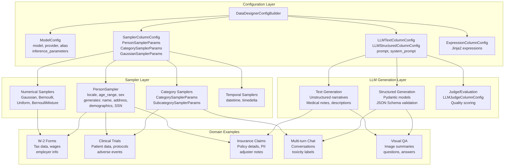
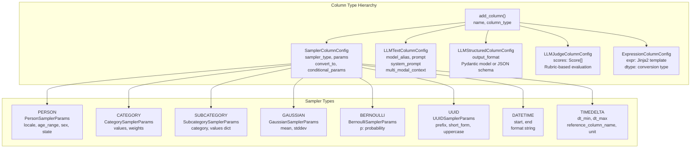
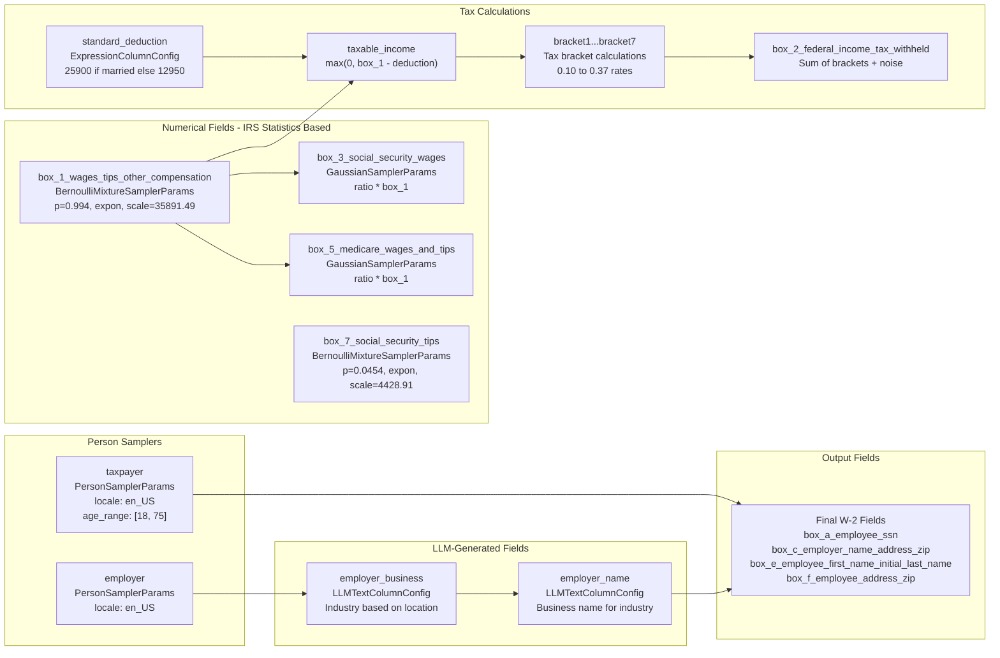
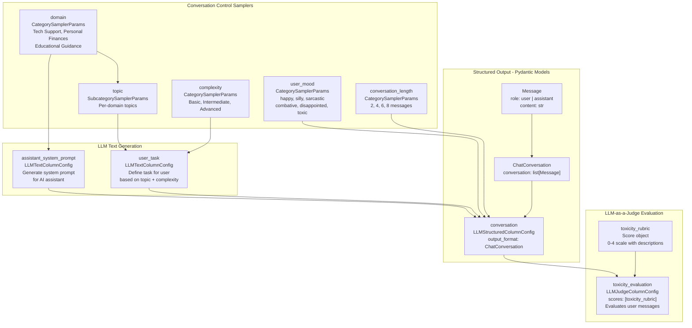
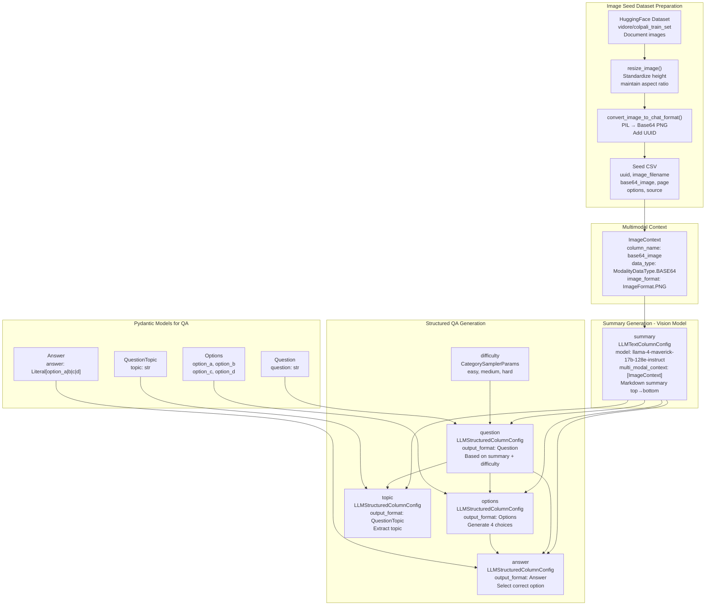

<!-- source: DeepWiki mcp.deepwiki.com · repo NVIDIA/GenerativeAIExamples · page 2.3 Domain-Specific Data Generation · fetched 2026-10-26 -->

# Domain-Specific Data Generation

<details>
<summary>Relevant source files</summary>

The following files were used as context for generating this wiki page:

- [nemo/NeMo-Data-Designer/self-hosted-tutorials/community-contributions/forms/w2-dataset.ipynb](nemo/NeMo-Data-Designer/self-hosted-tutorials/community-contributions/forms/w2-dataset.ipynb)
- [nemo/NeMo-Data-Designer/self-hosted-tutorials/community-contributions/healthcare-datasets/clinical-trials.ipynb](nemo/NeMo-Data-Designer/self-hosted-tutorials/community-contributions/healthcare-datasets/clinical-trials.ipynb)
- [nemo/NeMo-Data-Designer/self-hosted-tutorials/community-contributions/healthcare-datasets/insurance-claims.ipynb](nemo/NeMo-Data-Designer/self-hosted-tutorials/community-contributions/healthcare-datasets/insurance-claims.ipynb)
- [nemo/NeMo-Data-Designer/self-hosted-tutorials/community-contributions/healthcare-datasets/physician-notes-with-realistic-personal-details.ipynb](nemo/NeMo-Data-Designer/self-hosted-tutorials/community-contributions/healthcare-datasets/physician-notes-with-realistic-personal-details.ipynb)
- [nemo/NeMo-Data-Designer/self-hosted-tutorials/community-contributions/multi-turn-chat/multi-turn-conversation.ipynb](nemo/NeMo-Data-Designer/self-hosted-tutorials/community-contributions/multi-turn-chat/multi-turn-conversation.ipynb)
- [nemo/NeMo-Data-Designer/self-hosted-tutorials/community-contributions/multimodal/visual-question-answering-using-vlm.ipynb](nemo/NeMo-Data-Designer/self-hosted-tutorials/community-contributions/multimodal/visual-question-answering-using-vlm.ipynb)
- [nemo/NeMo-Data-Designer/self-hosted-tutorials/community-contributions/person-samplers/person-sampler-tutorial.ipynb](nemo/NeMo-Data-Designer/self-hosted-tutorials/community-contributions/person-samplers/person-sampler-tutorial.ipynb)
- [nemo/NeMo-Data-Designer/tutorial_helpers/__init__.py](nemo/NeMo-Data-Designer/tutorial_helpers/__init__.py)
- [nemo/NeMo-Data-Designer/tutorial_helpers/helpers.py](nemo/NeMo-Data-Designer/tutorial_helpers/helpers.py)

</details>


## Purpose and Scope

This document covers domain-specific synthetic data generation using NeMo Data Designer. Domain-specific generation involves creating realistic datasets tailored to particular industries, use cases, or document types by combining structured samplers, LLM-based text generation, and multimodal capabilities.

The examples demonstrate generating datasets for financial documents (W-2 forms), healthcare records (clinical trials, physician notes, insurance claims), conversational AI training data, and multimodal visual question answering. For basic Data Designer operations and configuration, see [Core Tutorials](#2.2). For code generation tasks, see [Text-to-Code Data Generation](#2.4).

---

## Architecture Overview

Domain-specific data generation combines multiple Data Designer capabilities to produce realistic, internally consistent datasets that mirror real-world scenarios. The system orchestrates samplers, LLMs, and domain knowledge to generate structured records.

### Domain-Specific Generation Pipeline



**Domain-Specific Generation Pipeline**: The configuration layer defines columns using samplers and LLM-based generation. Samplers provide structured, deterministic data generation (person details, numerical values, categories). LLM generation creates unstructured text or validates structured outputs. Domain examples combine these components to produce realistic datasets.

Sources: [nemo/NeMo-Data-Designer/self-hosted-tutorials/community-contributions/forms/w2-dataset.ipynb:51-66](), [nemo/NeMo-Data-Designer/self-hosted-tutorials/community-contributions/healthcare-datasets/clinical-trials.ipynb:47-62]()

---

## Key Components and Column Types

Domain-specific generation relies on several column types that work together to create realistic, consistent datasets.

### Column Type Architecture



**Column Types and Samplers**: `DataDesignerConfigBuilder.add_column()` accepts different column configurations. `SamplerColumnConfig` generates deterministic synthetic data using various sampler types. `LLMTextColumnConfig` and `LLMStructuredColumnConfig` generate text content. `ExpressionColumnConfig` derives values from other columns using Jinja2 templates.

Sources: [nemo/NeMo-Data-Designer/self-hosted-tutorials/community-contributions/forms/w2-dataset.ipynb:51-66](), [nemo/NeMo-Data-Designer/self-hosted-tutorials/community-contributions/healthcare-datasets/clinical-trials.ipynb:47-62]()

---

## W-2 Tax Form Dataset Generation

The W-2 dataset demonstrates generating structured financial documents with realistic numerical distributions based on IRS statistics. The example combines person samplers for taxpayer information, numerical samplers based on real-world distributions, and expression columns for calculated fields.

### W-2 Dataset Schema and Components



**W-2 Form Generation Flow**: Person samplers generate taxpayer and employer information. Numerical samplers create wage fields based on IRS statistical distributions. Expression columns calculate tax withholding using federal tax brackets. LLM columns generate contextual employer information.

### Person Sampler Configuration

The W-2 example creates person samplers for the taxpayer (employee) and employer entities:

[nemo/NeMo-Data-Designer/self-hosted-tutorials/community-contributions/forms/w2-dataset.ipynb:186-204]()

The `PersonSamplerParams` with `locale="en_US"` generates realistic American taxpayer data including:
- `first_name`, `middle_name`, `last_name`
- `birth_date`, `age`
- `ssn` (Social Security Number)
- `street_number`, `street_name`, `city`, `state`, `postcode`
- `marital_status`, `email_address`, `phone_number`

### Statistical Distributions for Wage Data

Box 1 (wages) uses a Bernoulli-Exponential mixture to model the distribution where 99.4% of W-2 forms have non-zero wages, with an average of $35,891.49:

[nemo/NeMo-Data-Designer/self-hosted-tutorials/community-contributions/forms/w2-dataset.ipynb:243-258]()

The `BernoulliMixtureSamplerParams` generates either zero (with probability 0.006) or a sample from an exponential distribution with the specified scale parameter.

### Tax Bracket Calculations

Federal tax withholding is calculated using expression columns for each 2022 tax bracket:

[nemo/NeMo-Data-Designer/self-hosted-tutorials/community-contributions/forms/w2-dataset.ipynb:266-301]()

The expressions use Jinja2 template syntax to calculate the tax owed at each bracket rate, considering the standard deduction and taxable income. The `min` and `max` filters ensure correct bracket boundaries.

### LLM-Generated Employer Information

The employer business type and name are generated using LLM text columns that reference the person sampler data:

[nemo/NeMo-Data-Designer/self-hosted-tutorials/community-contributions/forms/w2-dataset.ipynb:435-459]()

The system prompt guides the LLM to generate realistic industry categories consistent with the employer's location, then generates a specific business name for that industry.

Sources: [nemo/NeMo-Data-Designer/self-hosted-tutorials/community-contributions/forms/w2-dataset.ipynb:1-647]()

---

## Healthcare Dataset Generation

Healthcare datasets demonstrate complex scenarios with multiple person entities, temporal relationships, regulatory compliance fields, and narrative text generation. Three examples showcase different aspects of healthcare data.

### Clinical Trials Dataset Architecture

```mermaid
graph TB
    subgraph "Person Entities"
        PARTICIPANT["participant<br/>PersonSamplerParams<br/>locale: en_US"]
        INVESTIGATOR["investigator<br/>PersonSamplerParams<br/>locale: en_US"]
        COORDINATOR["coordinator<br/>PersonSamplerParams<br/>locale: en_US"]
        SPONSOR["sponsor<br/>PersonSamplerParams<br/>locale: en_US"]
    end
    
    subgraph "Trial Metadata"
        STUDY_ID["study_id<br/>UUIDSamplerParams<br/>prefix: CT-"]
        PHASE["trial_phase<br/>CategorySamplerParams<br/>Phase I-IV"]
        AREA["therapeutic_area<br/>CategorySamplerParams<br/>Oncology, Cardiology..."]
        DESIGN["study_design<br/>SubcategorySamplerParams<br/>Design per phase"]
        DATES["trial_start_date<br/>trial_end_date<br/>datetime sampler"]
    end
    
    subgraph "Participant Data"
        PID["participant_id<br/>UUID: PT-"]
        ENROLL["enrollment_date<br/>timedelta from trial_start_date<br/>dt_min: 0, dt_max: 60"]
        STATUS["participant_status<br/>Active, Completed, Withdrawn"]
        ARM["treatment_arm<br/>Treatment, Placebo, Standard"]
    end
    
    subgraph "Clinical Measurements"
        BASELINE["baseline_measurement<br/>GaussianSamplerParams<br/>mean: 100, stddev: 15"]
        FINAL["final_measurement<br/>GaussianSamplerParams<br/>mean: 85, stddev: 20"]
        CHANGE["percent_change<br/>ExpressionColumnConfig<br/>(final - baseline) / baseline * 100"]
    end
    
    subgraph "Adverse Events"
        HAS_AE["has_adverse_event<br/>BernoulliSamplerParams<br/>p: 0.3"]
        AE_TYPE["adverse_event_type<br/>conditional on has_adverse_event<br/>Headache, Nausea, Fatigue..."]
        AE_SEV["adverse_event_severity<br/>Mild, Moderate, Severe"]
        AE_REL["adverse_event_relatedness<br/>Unrelated to Definitely related"]
    end
    
    subgraph "Narrative Fields - LLM Generated"
        DOC_STYLE["documentation_style<br/>Formal, Concise, Descriptive"]
        MED_OBS["medical_observations<br/>LLMTextColumnConfig<br/>Style-based prompts"]
        AE_DESC["adverse_event_description<br/>LLMTextColumnConfig<br/>Conditional generation"]
        PROTOCOL["protocol_deviation<br/>LLMTextColumnConfig<br/>If compliance < 0.85"]
    end
    
    PHASE --> DESIGN
    STUDY_ID --> ENROLL
    DATES --> ENROLL
    HAS_AE --> AE_TYPE
    HAS_AE --> AE_SEV
    HAS_AE --> AE_REL
    
    PARTICIPANT --> MED_OBS
    INVESTIGATOR --> MED_OBS
    BASELINE --> CHANGE
    FINAL --> CHANGE
    CHANGE --> MED_OBS
    
    DOC_STYLE --> MED_OBS
    DOC_STYLE --> PROTOCOL
    HAS_AE --> AE_DESC
```



**Clinical Trials Architecture**: Person samplers create multiple roles (participant, investigator, coordinator). UUID samplers generate unique identifiers. Category and subcategory samplers create metadata fields. Gaussian samplers generate clinical measurements. Conditional sampling handles adverse events. LLM text generation creates narrative fields with style variations.

### Trial Metadata with Subcategory Sampling

Clinical trials use `SubcategorySamplerParams` to ensure study design matches the trial phase:

[nemo/NeMo-Data-Designer/self-hosted-tutorials/community-contributions/healthcare-datasets/clinical-trials.ipynb:278-313]()

The `SubcategorySamplerParams` references the `trial_phase` category column and selects appropriate design types. For example, Phase I trials use "Dose Escalation" or "First-in-Human" designs, while Phase III uses "Randomized Controlled" or "Multi-Center" designs.

### Temporal Relationships

The enrollment date uses a `timedelta` sampler to ensure it falls within a valid window after trial start:

[nemo/NeMo-Data-Designer/self-hosted-tutorials/community-contributions/healthcare-datasets/clinical-trials.ipynb:390-401]()

The `reference_column_name` parameter creates a dependency on `trial_start_date`, and `dt_min`/`dt_max` specify the offset range in days.

### Conditional Sampling for Adverse Events

Adverse event details are conditionally generated based on whether an event occurred:

[nemo/NeMo-Data-Designer/self-hosted-tutorials/community-contributions/healthcare-datasets/clinical-trials.ipynb:626-699]()

The `conditional_params` dictionary specifies different sampling parameters when `has_adverse_event == 0`, defaulting to "None" or "NA" values.

### Style-Varied Narrative Generation

Medical observations are generated with different writing styles using conditional Jinja2 prompts:

[nemo/NeMo-Data-Designer/self-hosted-tutorials/community-contributions/healthcare-datasets/clinical-trials.ipynb:742-775]()

The `` blocks create different prompt templates for each style, ensuring diversity in the generated text while maintaining consistency within each record.

Sources: [nemo/NeMo-Data-Designer/self-hosted-tutorials/community-contributions/healthcare-datasets/clinical-trials.ipynb:1-1207]()

### Physician Notes Dataset with Seed Data

The physician notes example demonstrates integrating seed datasets to guide generation:

[nemo/NeMo-Data-Designer/self-hosted-tutorials/community-contributions/healthcare-datasets/physician-notes-with-realistic-personal-details.ipynb:194-223]()

The seed dataset (symptom-to-diagnosis pairs) is uploaded to the datastore and referenced during generation. The `SeedDatasetReference` enables prompt templates to access seed data fields using Jinja2 syntax like `{{ diagnosis }}` and `{{ patient_summary }}`.

### Physician Notes Generation

The LLM generates realistic physician notes by combining patient information, seed data, and temporal context:

[nemo/NeMo-Data-Designer/self-hosted-tutorials/community-contributions/healthcare-datasets/physician-notes-with-realistic-personal-details.ipynb:374-394]()

The prompt references:
- Person sampler fields: `{{ first_name }}`, `{{ last_name }}`
- Seed data fields: `{{ diagnosis }}`, `{{ patient_summary }}`
- Temporal fields: `{{ symptom_onset_date }}`, `{{ date_of_visit }}`
- Expression-derived fields: `{{ physician }}`

Sources: [nemo/NeMo-Data-Designer/self-hosted-tutorials/community-contributions/healthcare-datasets/physician-notes-with-realistic-personal-details.ipynb:1-537]()

### Insurance Claims Dataset

The insurance claims example generates complex records with policy information, claimant details, and adjuster notes:

[nemo/NeMo-Data-Designer/self-hosted-tutorials/community-contributions/healthcare-datasets/insurance-claims.ipynb:186-217]()

Four person samplers create distinct roles: policyholder, claimant, adjuster, and physician. The dataset models scenarios where the claimant may differ from the policyholder:

[nemo/NeMo-Data-Designer/self-hosted-tutorials/community-contributions/healthcare-datasets/insurance-claims.ipynb:491-522]()

The `is_claimant_policyholder` Bernoulli sampler (70% probability of true) controls whether separate claimant information is used.

Sources: [nemo/NeMo-Data-Designer/self-hosted-tutorials/community-contributions/healthcare-datasets/insurance-claims.ipynb:1-738]()

---

## Multi-Turn Conversational Data Generation

Multi-turn conversation generation demonstrates structured output using Pydantic models, LLM-as-a-judge evaluation, and controlling conversation characteristics through categorical samplers.

### Conversation Generation Architecture



**Multi-Turn Conversation Pipeline**: Category samplers control conversation characteristics (domain, topic, complexity, mood, length). LLM text columns generate the system prompt and user task. `LLMStructuredColumnConfig` with Pydantic models ensures the conversation follows the `Message` and `ChatConversation` schemas. `LLMJudgeColumnConfig` evaluates user toxicity using a defined rubric.

### Pydantic Models for Structured Outputs

The conversation schema is defined using Pydantic models:

[nemo/NeMo-Data-Designer/self-hosted-tutorials/community-contributions/multi-turn-chat/multi-turn-conversation.ipynb:178-220]()

The `Message` model enforces role typing with `Literal["user", "assistant"]`. The `ChatConversation` model contains a list of messages with documentation specifying conversation rules. The `UserToxicityScore` model defines the structure for evaluation results.

### Structured Conversation Generation

The conversation is generated using `LLMStructuredColumnConfig` with the Pydantic model as the output format:

[nemo/NeMo-Data-Designer/self-hosted-tutorials/community-contributions/multi-turn-chat/multi-turn-conversation.ipynb:359-378]()

The prompt references sampler columns (`{{ user_mood }}`, `{{ conversation_length }}`) and LLM-generated columns (`{{ user_task }}`, `{{ assistant_system_prompt }}`) to control the conversation characteristics. The `output_format=ChatConversation` parameter enforces the Pydantic schema.

### LLM-as-a-Judge for Quality Assessment

The toxicity evaluation uses `LLMJudgeColumnConfig` with a defined rubric:

[nemo/NeMo-Data-Designer/self-hosted-tutorials/community-contributions/multi-turn-chat/multi-turn-conversation.ipynb:402-438]()

The `Score` object defines the rubric with options mapped to numeric scores (0-4). The `LLMJudgeColumnConfig` applies this rubric to evaluate the conversation, focusing only on user messages. The prompt instructs the model to analyze context and be consistent in assessment.

Sources: [nemo/NeMo-Data-Designer/self-hosted-tutorials/community-contributions/multi-turn-chat/multi-turn-conversation.ipynb:1-591]()

---

## Multimodal Visual Question Answering

The visual QA example demonstrates multimodal data generation by combining image processing, vision-language models, and structured output generation to create question-answering datasets from visual documents.

### Multimodal Generation Pipeline



**Multimodal QA Generation Flow**: Images are loaded from HuggingFace, resized, and encoded as Base64. The seed dataset is uploaded to the datastore. `ImageContext` specifies how to pass images to the vision model. The LLM generates a Markdown summary of the image. Structured columns generate questions, options, answers, and topics based on the summary, using Pydantic models for validation.

### Image Processing and Base64 Encoding

Images are processed and converted to a format suitable for vision models:

[nemo/NeMo-Data-Designer/self-hosted-tutorials/community-contributions/multimodal/visual-question-answering-using-vlm.ipynb:232-271]()

The `resize_image()` function maintains aspect ratio while standardizing height. The `convert_image_to_chat_format()` function converts PIL images to Base64 PNG strings and adds a UUID for tracking.

### ImageContext for Multimodal Prompts

The `ImageContext` object specifies how to include images in prompts:

[nemo/NeMo-Data-Designer/self-hosted-tutorials/community-contributions/multimodal/visual-question-answering-using-vlm.ipynb:362-379]()

The `multi_modal_context` parameter takes a list of `ImageContext` objects. Each specifies:
- `column_name`: The column containing the image data
- `data_type`: `ModalityDataType.BASE64` for Base64-encoded images
- `image_format`: `ImageFormat.PNG` for PNG images

The vision model receives both the text prompt and the image, generating a detailed Markdown summary of the document from top to bottom.

### Structured QA Generation from Summaries

Questions and answers are generated using structured outputs with Pydantic models:

[nemo/NeMo-Data-Designer/self-hosted-tutorials/community-contributions/multimodal/visual-question-answering-using-vlm.ipynb:477-536]()

Each column uses `LLMStructuredColumnConfig` with a specific Pydantic model:
- `Question` model for the question text
- `Options` model with four fields (`option_a` through `option_d`)
- `Answer` model with a `Literal` type restricting values to valid option names
- `QuestionTopic` model for extracting the topic

The prompts reference the `{{ summary }}` field generated by the vision model and control difficulty using the sampler column `{{ difficulty }}`.

Sources: [nemo/NeMo-Data-Designer/self-hosted-tutorials/community-contributions/multimodal/visual-question-answering-using-vlm.ipynb:1-704]()

---

## Person Sampler Deep Dive

The `PersonSampler` is a critical component for domain-specific generation, providing consistent, realistic person records with demographic attributes. It supports both US Census-based generation (`locale="en_US"`) and Faker-based generation for other locales.

### Person Sampler Attributes

| Attribute | Description | Example |
|-----------|-------------|---------|
| `first_name` | Given name | "John" |
| `middle_name` | Middle name (may be None) | "Robert" |
| `last_name` | Family name | "Smith" |
| `sex` | Sex designation | "Male", "Female" |
| `age` | Age in years | 42 |
| `birth_date` | Date of birth | "1980-05-15" |
| `email_address` | Email address | "john.smith@example.com" |
| `phone_number` | Phone number | "+1 (555) 123-4567" |
| `street_number` | Street number | "123" |
| `street_name` | Street name | "Main Street" |
| `unit` | Apartment/unit number | "Apt 4B" |
| `city` | City name | "Chicago" |
| `state` | State/province code | "IL" |
| `county` | County name | "Cook" |
| `postcode` | Postal/ZIP code | "60601" |
| `country` | Country name | "United States" |
| `ssn` | Social Security Number (US only) | "123-45-6789" |
| `occupation` | Occupation | "Software Engineer" |
| `marital_status` | Marital status | "married_present", "single" |
| `education_level` | Education level | "Bachelor's Degree" |
| `ethnic_background` | Ethnicity | "Caucasian" |
| `uuid` | Unique identifier | "550e8400-e29b-41d4-a716-446655440000" |

### PersonSamplerParams Configuration

The person sampler accepts several configuration parameters:

```python
PersonSamplerParams(
    locale="en_US",           # Locale (en_US uses Census data, others use Faker)
    age_range=[18, 75],       # Age range constraint
    sex="Male",               # Sex constraint (optional)
    state="CA",               # State constraint (US only)
    city="San Francisco"      # City constraint (optional)
)
```

[nemo/NeMo-Data-Designer/self-hosted-tutorials/community-contributions/person-samplers/person-sampler-tutorial.ipynb:258-286]()

The parameters enable precise control over demographic distributions. When `locale="en_US"`, the sampler uses a probabilistic graphical model trained on US Census data to ensure realistic correlations between attributes (e.g., age, occupation, education level). Other locales use the Faker library for name and address generation.

### Accessing Person Attributes

Person sampler columns create nested objects. Use `ExpressionColumnConfig` to extract specific attributes:

[nemo/NeMo-Data-Designer/self-hosted-tutorials/community-contributions/person-samplers/person-sampler-tutorial.ipynb:215-236]()

The Jinja2 template syntax `{{ person.first_name }}` accesses nested attributes. String concatenation and formatting are supported within expressions.

### Multiple Person Samplers

Domain-specific scenarios often require multiple person entities with different roles:

[nemo/NeMo-Data-Designer/self-hosted-tutorials/community-contributions/person-samplers/person-sampler-tutorial.ipynb:370-400]()

Each person sampler generates independent, consistent records. The example creates doctor, patient, nurse, and international doctor entities with role-appropriate constraints (age ranges, sex, locale).

### Person Data with LLM Generation

Person samplers integrate seamlessly with LLM text generation for contextual narratives:

[nemo/NeMo-Data-Designer/self-hosted-tutorials/community-contributions/person-samplers/person-sampler-tutorial.ipynb:456-530]()

The prompt references person sampler attributes (`{{ patient.first_name }}`, `{{ doctor.age }}`) and category sampler fields (`{{ medical_condition }}`) to generate realistic medical notes that incorporate the structured person data.

Sources: [nemo/NeMo-Data-Designer/self-hosted-tutorials/community-contributions/person-samplers/person-sampler-tutorial.ipynb:1-598]()

---

## Common Patterns and Best Practices

### Pattern 1: Layered Generation

Complex datasets benefit from generating data in layers, where early columns provide context for later columns:

```
Layer 1: Categorical samplers (domain, type, phase)
    ↓
Layer 2: Subcategory samplers (specific details based on Layer 1)
    ↓
Layer 3: Person samplers and numerical samplers
    ↓
Layer 4: Expression columns (calculated fields)
    ↓
Layer 5: LLM text generation (narratives referencing all prior layers)
    ↓
Layer 6: LLM judge/evaluation (quality assessment)
```

This pattern appears in the clinical trials example, where trial phase determines study design, which influences the types of observations documented.

### Pattern 2: Conditional Sampling

Use `conditional_params` to generate different data based on earlier columns:

```python
SamplerColumnConfig(
    name="adverse_event_type",
    sampler_type=SamplerType.CATEGORY,
    params=CategorySamplerParams(
        values=["Headache", "Nausea", "Fatigue", "Rash"]
    ),
    conditional_params={
        "has_adverse_event == 0": CategorySamplerParams(values=["None"])
    }
)
```

This ensures data consistency (e.g., only generating adverse event details when an event occurred).

### Pattern 3: Statistical Grounding

When generating numerical data, use real-world statistics to parameterize samplers:

```python
# Based on IRS Publication 5385 (2021 W-2 Statistics)
# 99.4% of forms had non-zero Box 1, average $35,891.49
BernoulliMixtureSamplerParams(
    p=0.994,                    # Probability of non-zero
    dist_name="expon",          # Distribution type
    dist_params={"scale": 35891.49}  # Distribution parameter
)
```

This grounds synthetic data in reality, making it suitable for testing scenarios that mirror production data distributions.

### Pattern 4: Style Variation with Conditional Prompts

Generate diverse text styles using categorical samplers and conditional Jinja2 blocks:

```python
SamplerColumnConfig(
    name="documentation_style",
    sampler_type=SamplerType.CATEGORY,
    params=CategorySamplerParams(
        values=["Formal and Technical", "Concise and Direct", "Detailed and Descriptive"]
    )
)

LLMTextColumnConfig(
    name="notes",
    prompt=(
        ""
        "Write formal, technical documentation..."
        ""
        "Write brief, direct notes..."
        ""
        "Write detailed, descriptive documentation..."
        ""
    )
)
```

This ensures controlled variation in generated text while maintaining consistency within each record.

### Pattern 5: Temporal Consistency

Use `datetime` and `timedelta` samplers to create temporally consistent records:

```python
# Incident occurs first
SamplerColumnConfig(
    name="incident_date",
    sampler_type=SamplerType.DATETIME,
    params={"start": "2023-01-01", "end": "2023-12-31"}
)

# Filing occurs 1-30 days after incident
config_builder.add_column(
    name="filing_date",
    column_type="sampler",
    sampler_type="timedelta",
    params={
        "dt_min": 1,
        "dt_max": 30,
        "reference_column_name": "incident_date",
        "unit": "D"
    }
)
```

The `reference_column_name` parameter creates a dependency, ensuring logical temporal ordering.

### Pattern 6: Seed Data Integration

Use seed datasets to inject domain-specific knowledge and ensure realistic diversity:

```python
# Upload seed dataset
seed_ref = data_designer_client.upload_seed_dataset(
    dataset=df_seed,
    repo_id="data-designer/domain-data",
    datastore_settings={"endpoint": "http://localhost:3000/v1/hf"}
)

# Reference in configuration
config_builder.with_seed_dataset(seed_ref)

# Use in prompts
LLMTextColumnConfig(
    name="narrative",
    prompt="Write about {{ seed_field_1 }} in the context of {{ seed_field_2 }}"
)
```

Seed datasets are sampled (randomly or sequentially) during generation, and their fields are accessible in prompt templates.

### Preview-Iterate-Scale Workflow

All domain-specific examples follow this workflow:

1. **Configure**: Define columns using `DataDesignerConfigBuilder`
2. **Preview**: Generate small batches with `data_designer_client.preview(config_builder)`
3. **Inspect**: Review `preview.dataset` and `preview.analysis.to_report()`
4. **Iterate**: Adjust prompts, parameters, or structure
5. **Scale**: Generate full datasets with `data_designer_client.create(config_builder, num_records=N)`
6. **Download**: Retrieve results with `job_results.download_artifacts()`

The preview step enables rapid iteration without consuming significant API credits or compute resources.

Sources: [nemo/NeMo-Data-Designer/self-hosted-tutorials/community-contributions/forms/w2-dataset.ipynb:497-533](), [nemo/NeMo-Data-Designer/self-hosted-tutorials/community-contributions/healthcare-datasets/clinical-trials.ipynb:843-885]()

---

## Configuration Components Reference

### NeMoDataDesignerClient

The client interface for submitting generation requests:

```python
client = NeMoDataDesignerClient(base_url="http://localhost:8080")

# Preview (small batch, quick feedback)
preview = client.preview(config_builder)

# Create job (large batch, asynchronous)
job_results = client.create(config_builder, num_records=1000)
job_results.wait_until_done()
dataset = job_results.load_dataset()

# Upload seed data
seed_ref = client.upload_seed_dataset(
    dataset=df_or_filepath,
    repo_id="namespace/dataset-name",
    datastore_settings={"endpoint": "http://localhost:3000/v1/hf"}
)
```

### ModelConfig

Defines LLM models available for generation:

```python
ModelConfig(
    alias="model-name",                    # Reference name in columns
    model="nvidia/nvidia-nemotron-nano-9b-v2",  # Model ID from provider
    provider="nvidiabuild",                # Provider name (from deployment config)
    inference_parameters=InferenceParameters(
        temperature=0.6,
        top_p=0.95,
        max_tokens=1024
    )
)
```

### DataDesignerConfigBuilder

Orchestrates column definitions:

```python
config_builder = DataDesignerConfigBuilder(model_configs=[model_config])

# Add sampler column
config_builder.add_column(SamplerColumnConfig(...))

# Add LLM text column
config_builder.add_column(LLMTextColumnConfig(...))

# Add structured LLM column
config_builder.add_column(LLMStructuredColumnConfig(...))

# Add expression column
config_builder.add_column(ExpressionColumnConfig(...))

# Add judge column
config_builder.add_column(LLMJudgeColumnConfig(...))

# Attach seed dataset
config_builder.with_seed_dataset(seed_dataset_reference, sampling_strategy="random")
```

### Column Configuration Classes

| Class | Purpose | Key Parameters |
|-------|---------|----------------|
| `SamplerColumnConfig` | Non-LLM deterministic sampling | `sampler_type`, `params`, `conditional_params`, `convert_to` |
| `LLMTextColumnConfig` | Unstructured text generation | `model_alias`, `prompt`, `system_prompt`, `multi_modal_context` |
| `LLMStructuredColumnConfig` | Structured output (JSON/Pydantic) | `model_alias`, `prompt`, `output_format` |
| `LLMJudgeColumnConfig` | Quality evaluation with rubric | `model_alias`, `prompt`, `scores: list[Score]` |
| `ExpressionColumnConfig` | Derived/calculated fields | `expr` (Jinja2 template), `dtype` |

Sources: [nemo/NeMo-Data-Designer/self-hosted-tutorials/community-contributions/forms/w2-dataset.ipynb:51-137](), [nemo/NeMo-Data-Designer/self-hosted-tutorials/community-contributions/healthcare-datasets/clinical-trials.ipynb:47-133]()

---

