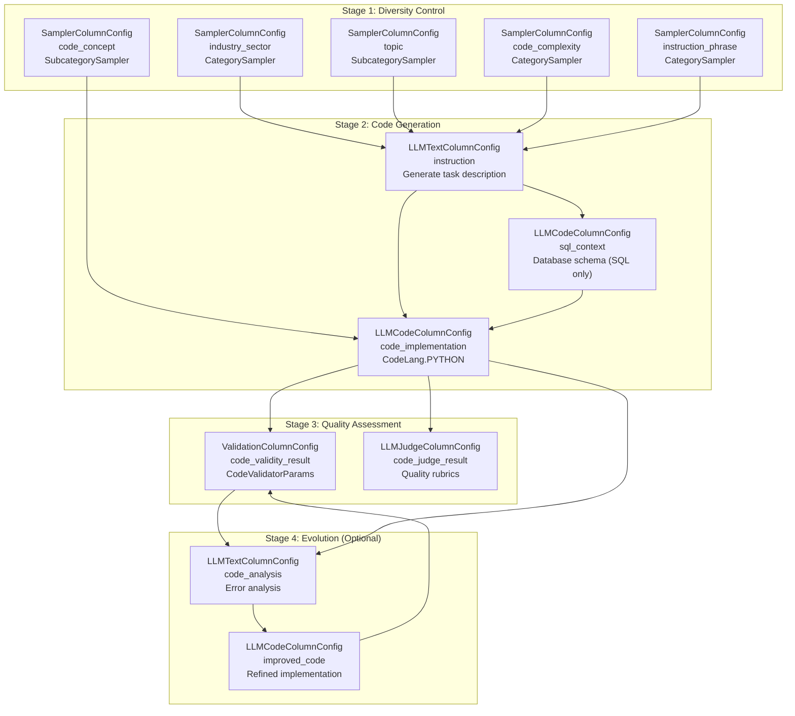
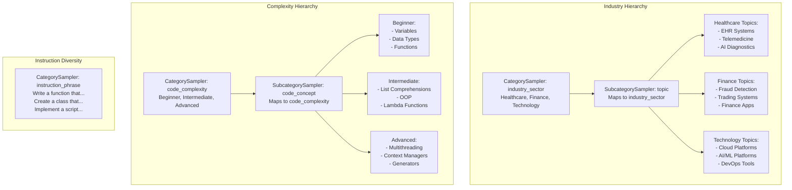
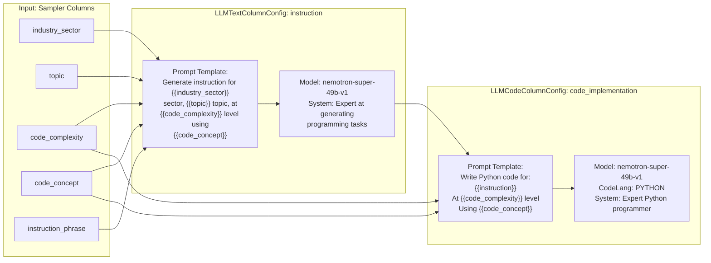
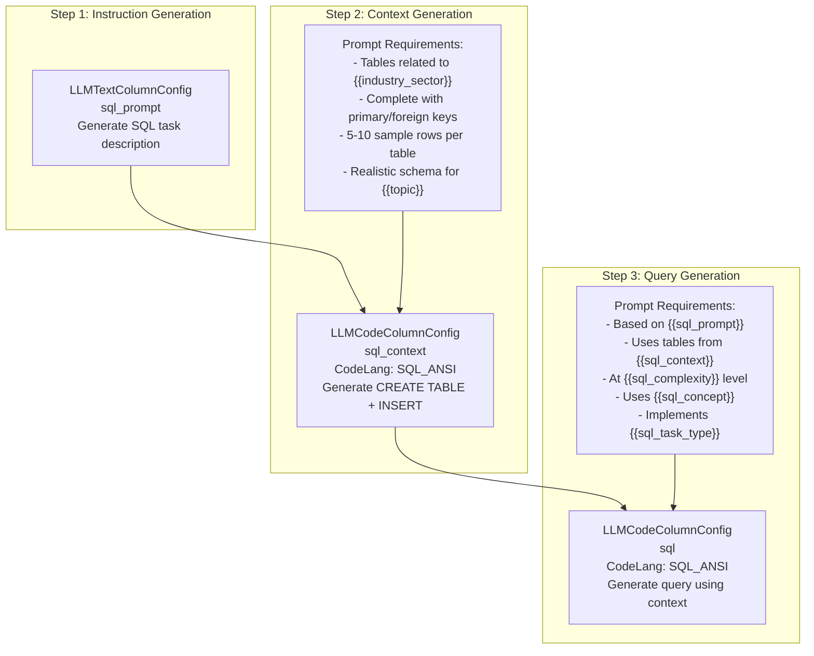
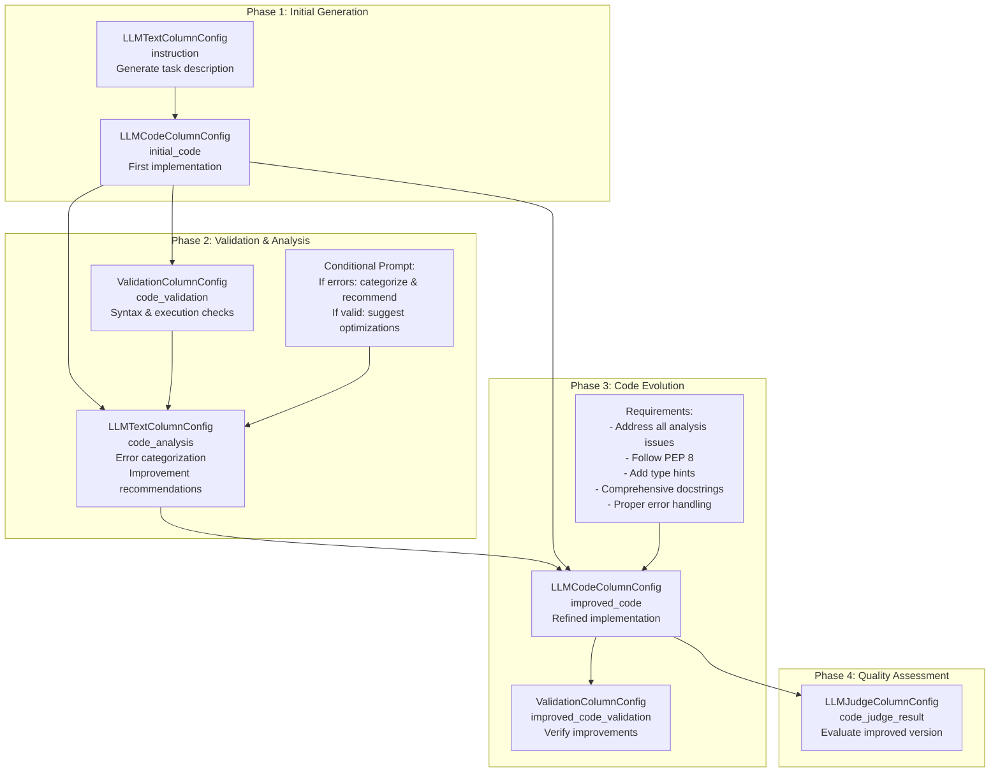

<!-- source: DeepWiki mcp.deepwiki.com · repo NVIDIA/GenerativeAIExamples · page 2.4 Text-to-Code Data Generation · fetched 2026-10-26 -->

# Text-to-Code Data Generation

<details>
<summary>Relevant source files</summary>

The following files were used as context for generating this wiki page:

- [nemo/NeMo-Data-Designer/self-hosted-tutorials/community-contributions/qa-generation/product-question-answer-generator.ipynb](nemo/NeMo-Data-Designer/self-hosted-tutorials/community-contributions/qa-generation/product-question-answer-generator.ipynb)
- [nemo/NeMo-Data-Designer/self-hosted-tutorials/community-contributions/rag-examples/generate-rag-generation-eval-dataset.ipynb](nemo/NeMo-Data-Designer/self-hosted-tutorials/community-contributions/rag-examples/generate-rag-generation-eval-dataset.ipynb)
- [nemo/NeMo-Data-Designer/self-hosted-tutorials/community-contributions/reasoning/reasoning-traces.ipynb](nemo/NeMo-Data-Designer/self-hosted-tutorials/community-contributions/reasoning/reasoning-traces.ipynb)
- [nemo/NeMo-Data-Designer/self-hosted-tutorials/community-contributions/text-to-code/text-to-python-evol.ipynb](nemo/NeMo-Data-Designer/self-hosted-tutorials/community-contributions/text-to-code/text-to-python-evol.ipynb)
- [nemo/NeMo-Data-Designer/self-hosted-tutorials/community-contributions/text-to-code/text-to-python.ipynb](nemo/NeMo-Data-Designer/self-hosted-tutorials/community-contributions/text-to-code/text-to-python.ipynb)
- [nemo/NeMo-Data-Designer/self-hosted-tutorials/community-contributions/text-to-code/text-to-sql.ipynb](nemo/NeMo-Data-Designer/self-hosted-tutorials/community-contributions/text-to-code/text-to-sql.ipynb)

</details>


## Purpose and Scope

This page documents the use of NeMo Data Designer to generate synthetic datasets for training text-to-code models. The system supports generating Python code, SQL queries, and evolved versions of code with quality assessment. These datasets are designed for fine-tuning language models on code generation tasks with controlled diversity across complexity levels, programming concepts, and industry domains.

For information about generating other types of domain-specific data (e.g., healthcare, W-2 forms), see [Domain-Specific Data Generation](#2.3). For information about RAG evaluation datasets, see related examples in the community contributions folder.

## Architecture Overview

The text-to-code generation workflow consists of four primary stages: diversity control through sampler columns, code generation via LLM columns, quality assessment through validation and judging, and optional iterative improvement.



**Sources:** [nemo/NeMo-Data-Designer/self-hosted-tutorials/community-contributions/text-to-code/text-to-python.ipynb:1-647](), [nemo/NeMo-Data-Designer/self-hosted-tutorials/community-contributions/text-to-code/text-to-sql.ipynb:1-695](), [nemo/NeMo-Data-Designer/self-hosted-tutorials/community-contributions/text-to-code/text-to-python-evol.ipynb:1-745]()

## Client Initialization

All text-to-code workflows begin by initializing the `NeMoDataDesignerClient` and configuring model parameters:

```python
from nemo_microservices.data_designer.essentials import (
    NeMoDataDesignerClient,
    ModelConfig,
    DataDesignerConfigBuilder
)

data_designer_client = NeMoDataDesignerClient(
    base_url="http://localhost:8080"
)

model_configs = [
    ModelConfig(
        alias="nemotron-super-49b-v1",
        model="nvidia/llama-3.3-nemotron-super-49b-v1",
        provider="nvidiabuild",
        inference_parameters=InferenceParameters(
            temperature=0.6,
            top_p=0.95,
            max_tokens=1024,
            timeout=300
        )
    )
]

config_builder = DataDesignerConfigBuilder(model_configs=model_configs)
```

**Sources:** [nemo/NeMo-Data-Designer/self-hosted-tutorials/community-contributions/text-to-code/text-to-python.ipynb:77-158](), [nemo/NeMo-Data-Designer/self-hosted-tutorials/community-contributions/text-to-code/text-to-sql.ipynb:77-158]()

## Dataset Schema Design

### Diversity Control Through Sampler Columns

The text-to-code workflows use hierarchical sampler columns to control data diversity. The primary diversity dimensions are industry sector, code complexity, and instruction phrasing.



The Python workflow configures these samplers as follows:

| Column Name | Sampler Type | Values |
|-------------|-------------|---------|
| `industry_sector` | `CATEGORY` | Healthcare, Finance, Technology |
| `topic` | `SUBCATEGORY` | Industry-specific topics (3 per sector) |
| `code_complexity` | `CATEGORY` | Beginner, Intermediate, Advanced |
| `code_concept` | `SUBCATEGORY` | Complexity-specific concepts (3-5 per level) |
| `instruction_phrase` | `CATEGORY` | 5 different instruction templates |

**Sources:** [nemo/NeMo-Data-Designer/self-hosted-tutorials/community-contributions/text-to-code/text-to-python.ipynb:173-284](), [nemo/NeMo-Data-Designer/self-hosted-tutorials/community-contributions/text-to-code/text-to-sql.ipynb:173-291]()

### SQL-Specific Sampler Columns

The text-to-SQL workflow includes additional dimensions for SQL-specific diversity:

| Column Name | Sampler Type | Values |
|-------------|-------------|---------|
| `sql_complexity` | `CATEGORY` | Beginner, Intermediate, Advanced |
| `sql_concept` | `SUBCATEGORY` | SELECT, JOINs (Beginner); Aggregations, Subqueries (Intermediate); CTEs, Window Functions (Advanced) |
| `sql_task_type` | `CATEGORY` | Data Retrieval, Data Manipulation, Analytics, Transformation |

**Sources:** [nemo/NeMo-Data-Designer/self-hosted-tutorials/community-contributions/text-to-code/text-to-sql.ipynb:217-291]()

## Code Generation Workflow

### Text-to-Python Generation

The Python code generation workflow consists of two LLM-generated columns: an instruction describing the task, and the Python implementation.



The instruction generation prompt enforces several guidelines:
- Industry relevance to the specified sector and topic
- Code complexity tailored to the specified level
- Clarity and specificity in problem statement
- Exclusion of formatting markers

The code generation prompt enforces:
- Clean, complete, self-contained code
- Executable validity without errors
- Proper library imports
- Appropriate complexity level with specified concepts

**Sources:** [nemo/NeMo-Data-Designer/self-hosted-tutorials/community-contributions/text-to-code/text-to-python.ipynb:298-343]()

### Text-to-SQL with Database Context

The SQL workflow adds an intermediate context generation step that creates realistic database schemas before generating queries:



The three-column structure ensures generated SQL queries have realistic database contexts rather than referencing non-existent tables.

**Sources:** [nemo/NeMo-Data-Designer/self-hosted-tutorials/community-contributions/text-to-code/text-to-sql.ipynb:310-385]()

## Code Validation System

NeMo Data Designer includes a built-in code validator that performs syntactic and executable validation. The validator is configured via `ValidationColumnConfig` with `CodeValidatorParams`:

| Supported Languages | CodeLang Enum |
|---------------------|---------------|
| Python | `CodeLang.PYTHON` |
| ANSI SQL | `CodeLang.SQL_ANSI` |
| MySQL | `CodeLang.SQL_MYSQL` |
| PostgreSQL | `CodeLang.SQL_POSTGRES` |
| SQLite | `CodeLang.SQL_SQLITE` |
| T-SQL | `CodeLang.SQL_TSQL` |
| BigQuery | `CodeLang.SQL_BIGQUERY` |

Configuration example:

```python
config_builder.add_column(
    ValidationColumnConfig(
        name="code_validity_result",
        validator_type=ValidatorType.CODE,
        target_columns=["code_implementation"],
        validator_params=CodeValidatorParams(
            code_lang=CodeLang.PYTHON
        ),
        batch_size=100
    )
)
```

The validator returns a list of validation errors including:
- Syntax errors with line numbers
- Import errors for missing dependencies
- Runtime errors from static analysis

**Sources:** [nemo/NeMo-Data-Designer/self-hosted-tutorials/community-contributions/text-to-code/text-to-python.ipynb:442-494](), [nemo/NeMo-Data-Designer/self-hosted-tutorials/community-contributions/text-to-code/text-to-sql.ipynb:488-542]()

## Quality Assessment via LLM-as-a-Judge

Both Python and SQL workflows implement multi-dimensional quality assessment using `LLMJudgeColumnConfig` with scoring rubrics.

### Python Code Quality Rubrics

The Python judge evaluates four dimensions:

| Dimension | Score Range | Criteria |
|-----------|-------------|----------|
| **Relevance** | 0-4 | Adherence to instructions and context |
| **Pythonic** | 0-4 | Use of Python idioms, PEP compliance, standard library usage |
| **Readability** | 0-4 | PEP 8 compliance, docstrings (Google format), meaningful names |
| **Efficiency** | 0-4 | Algorithm selection, data structures, time/space complexity |

Example judge configuration:

```python
python_scoring = [
    Score(
        name="Relevance",
        description="Adherence to INSTRUCTIONS and CONTEXT",
        options={
            "4": "Perfectly meets all specified requirements.",
            "3": "Meets most requirements with minor deviations.",
            "2": "Moderate deviation from the instructions.",
            "1": "Significant deviations from the instructions.",
            "0": "Does not adhere to the instructions."
        }
    ),
    # ... additional scores
]

config_builder.add_column(
    LLMJudgeColumnConfig(
        name="code_judge_result",
        model_alias=MODEL_ALIAS,
        prompt=TEXT_TO_PYTHON_JUDGE_TEMPLATE,
        scores=python_scoring
    )
)
```

**Sources:** [nemo/NeMo-Data-Designer/self-hosted-tutorials/community-contributions/text-to-code/text-to-python.ipynb:367-438]()

### SQL Query Quality Rubrics

The SQL judge evaluates four dimensions specific to query quality:

| Dimension | Score Range | Criteria |
|-----------|-------------|----------|
| **Relevance** | 0-4 | Adherence to natural language prompt |
| **SQL Correctness** | 0-4 | Syntax validity, join correctness, NULL handling, semantic correctness |
| **Readability** | 0-4 | Formatting, aliases, CTE usage, structure clarity |
| **Efficiency** | 0-4 | Sargable predicates, index usage, early filtering, avoiding SELECT * |

The judge prompt includes the natural language prompt, database context, and generated SQL to provide complete evaluation context.

**Sources:** [nemo/NeMo-Data-Designer/self-hosted-tutorials/community-contributions/text-to-code/text-to-sql.ipynb:408-484]()

## Evolutionary Code Improvement Workflow

The evolutionary workflow (`text-to-python-evol.ipynb`) extends basic code generation with iterative refinement through validation-driven improvement.



### Code Analysis Column

The analysis column uses conditional Jinja templating to provide different feedback based on validation results:

```python
LLMTextColumnConfig(
    name="code_analysis",
    model_alias=MODEL_ALIAS,
    prompt=(
        "Analyze the following Python code and its validation results:\n"
        "INSTRUCTION:\n{{ instruction }}\n"
        "INITIAL CODE:\n{{ initial_code }}\n"
        "VALIDATION RESULTS:\n{{ code_validation }}\n"
        "\n"
        "Provide:\n"
        "1. Detailed analysis of each error\n"
        "2. Specific recommendations\n"
        "3. Implementation plan\n"
        "4. PEP 8 improvements\n"
        "\n"
        "Provide potential optimizations for:\n"
        "1. Code readability\n"
        "2. Performance\n"
        "3. Best practices\n"
        "4. Documentation\n"
        "\n"
    )
)
```

**Sources:** [nemo/NeMo-Data-Designer/self-hosted-tutorials/community-contributions/text-to-code/text-to-python-evol.ipynb:395-423]()

### Improved Code Generation

The improved code column incorporates feedback from both the initial implementation and the analysis:

```python
LLMCodeColumnConfig(
    name="improved_code",
    model_alias=MODEL_ALIAS,
    code_lang=CodeLang.PYTHON,
    prompt=(
        "Rewrite and improve the following Python code...\n"
        "ORIGINAL INSTRUCTION:\n{{instruction}}\n"
        "INITIAL CODE:\n{{initial_code}}\n"
        "CODE ANALYSIS:\n{{code_analysis}}\n"
        "Your task is to:\n"
        "1. Address all analysis issues\n"
        "2. Follow PEP 8 systematically\n"
        "3. Eliminate anti-patterns\n"
        "4. Add comprehensive docstrings\n"
        "5. Use type hints\n"
        "6. Implement error handling\n"
        "7. Organize imports properly\n"
    )
)
```

**Sources:** [nemo/NeMo-Data-Designer/self-hosted-tutorials/community-contributions/text-to-code/text-to-python-evol.ipynb:442-472]()

## Job Execution and Results

### Preview and Iteration

All workflows support rapid iteration through the `preview()` method:

```python
# Generate 2 sample records
preview = data_designer_client.preview(config_builder, num_records=2)

# Display a sample record
preview.display_sample_record()

# View statistical analysis
preview.analysis.to_report()
```

**Sources:** [nemo/NeMo-Data-Designer/self-hosted-tutorials/community-contributions/text-to-code/text-to-python.ipynb:514-555]()

### Production-Scale Generation

After validation through previews, larger jobs are submitted via `create()`:

```python
# Submit generation job
job_results = data_designer_client.create(config_builder, num_records=20)

# Wait for completion
job_results.wait_until_done()

# Load results
dataset = job_results.load_dataset()  # pandas DataFrame
analysis = job_results.load_analysis()  # Statistical report

# Download artifacts
job_results.download_artifacts(
    output_path="output",
    artifacts_folder_name="text-to-python-artifacts"
)
```

The generated dataset contains all specified columns including sampler values, generated code, validation results, and quality scores.

**Sources:** [nemo/NeMo-Data-Designer/self-hosted-tutorials/community-contributions/text-to-code/text-to-python.ipynb:570-622]()

## Data Designer SDK Components

The following table maps the key SDK components used across text-to-code workflows:

| Component | Purpose | Key Parameters |
|-----------|---------|----------------|
| `NeMoDataDesignerClient` | Client for job submission | `base_url` |
| `DataDesignerConfigBuilder` | Configuration builder | `model_configs` |
| `ModelConfig` | Model specification | `alias`, `model`, `provider`, `inference_parameters` |
| `SamplerColumnConfig` | Non-LLM column generation | `sampler_type`, `params` |
| `LLMTextColumnConfig` | Text generation via LLM | `model_alias`, `prompt`, `system_prompt` |
| `LLMCodeColumnConfig` | Code generation via LLM | `model_alias`, `code_lang`, `prompt` |
| `ValidationColumnConfig` | Code validation | `validator_type`, `target_columns`, `validator_params` |
| `LLMJudgeColumnConfig` | Quality evaluation | `model_alias`, `prompt`, `scores` |
| `CategorySamplerParams` | Categorical sampling | `values`, `weights` (optional) |
| `SubcategorySamplerParams` | Hierarchical sampling | `category`, `values` (dict) |
| `CodeValidatorParams` | Validator configuration | `code_lang` |
| `Score` | Rubric definition | `name`, `description`, `options` |

**Sources:** [nemo/NeMo-Data-Designer/self-hosted-tutorials/community-contributions/text-to-code/text-to-python.ipynb:47-64](), [nemo/NeMo-Data-Designer/self-hosted-tutorials/community-contributions/text-to-code/text-to-sql.ipynb:47-64](), [nemo/NeMo-Data-Designer/self-hosted-tutorials/community-contributions/text-to-code/text-to-python-evol.ipynb:47-65]()

---

