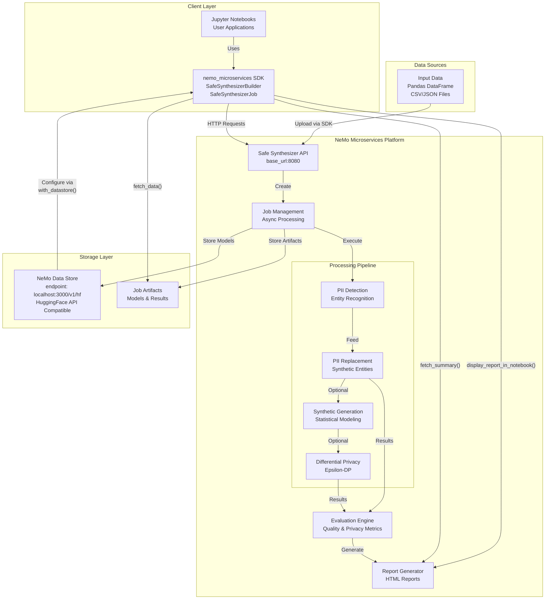
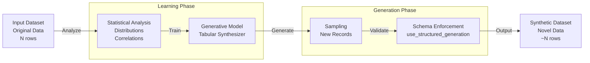
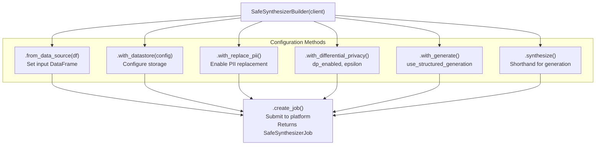
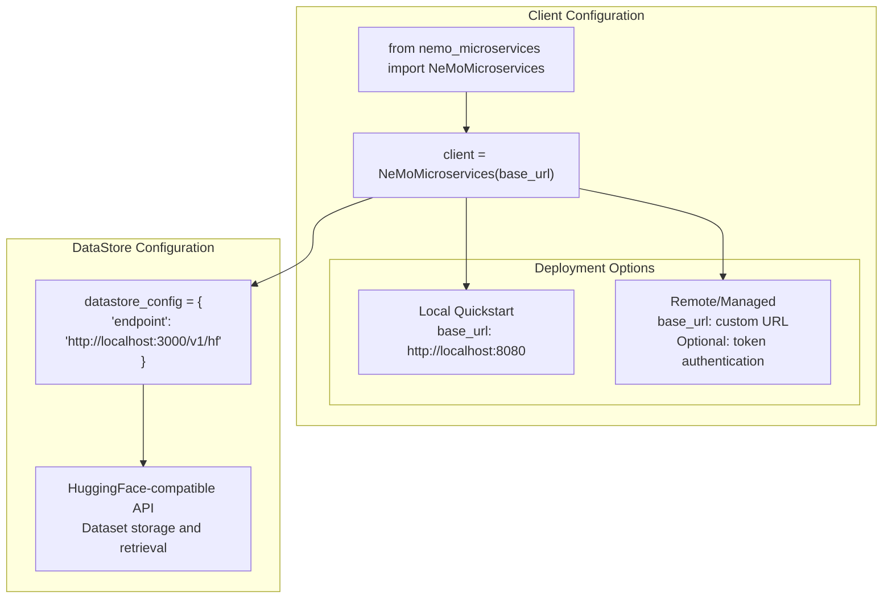
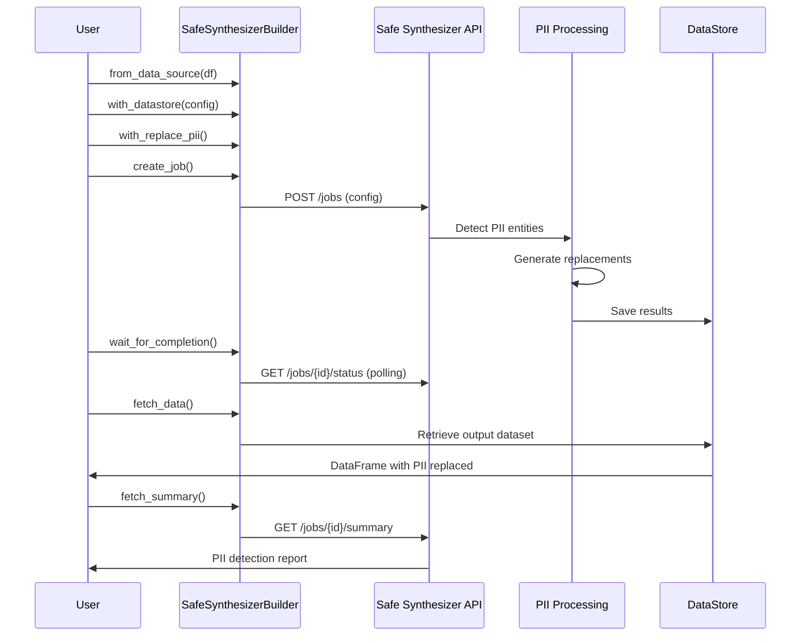
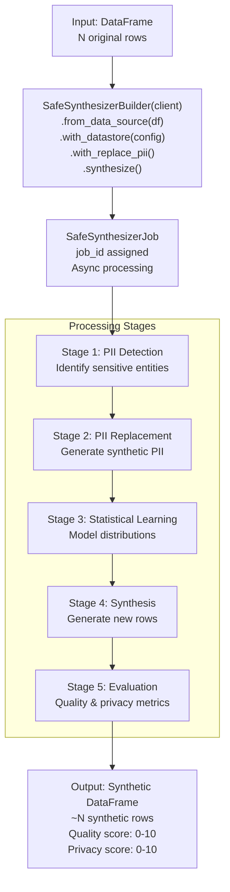
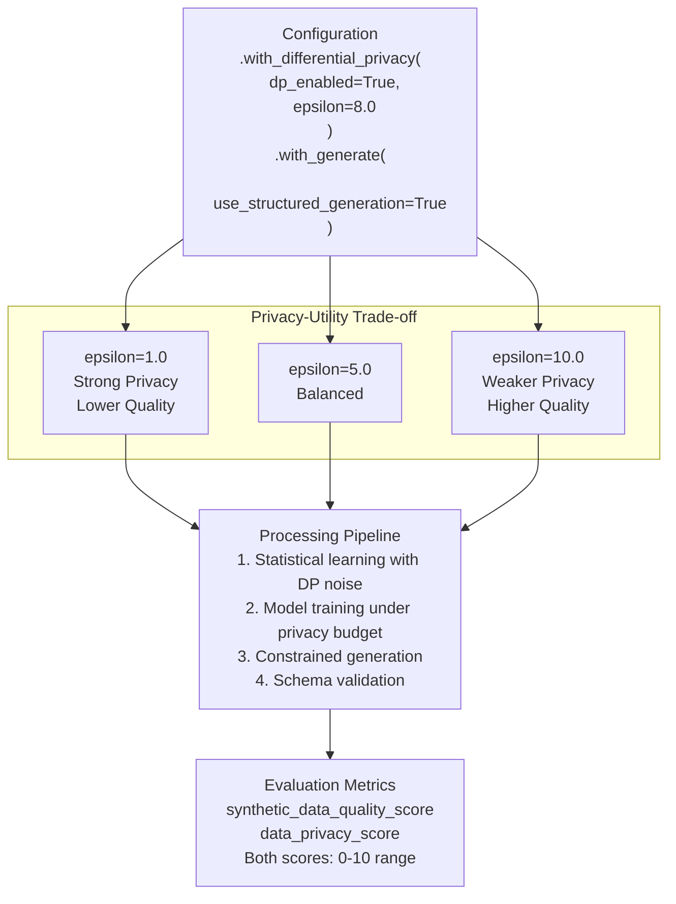
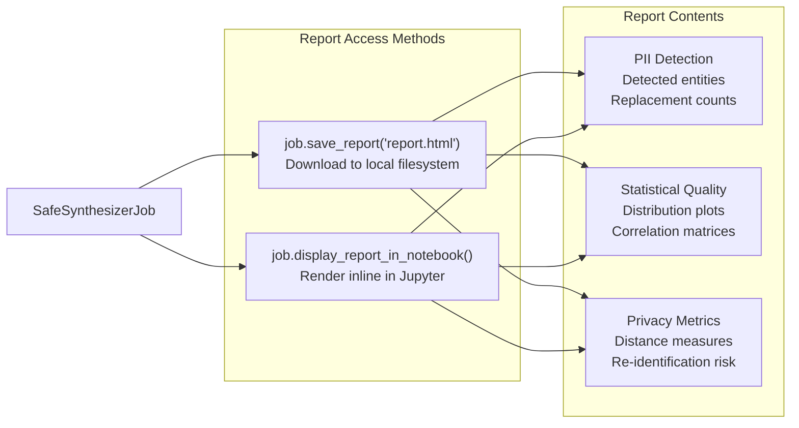
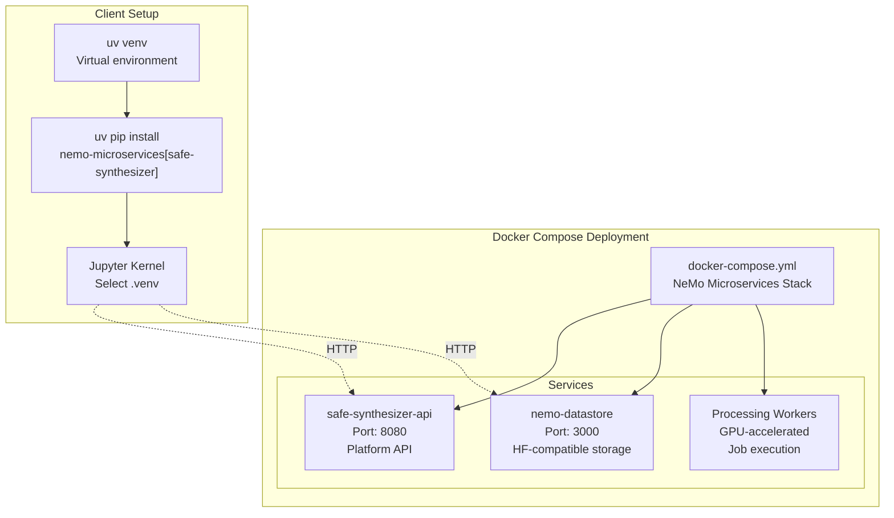
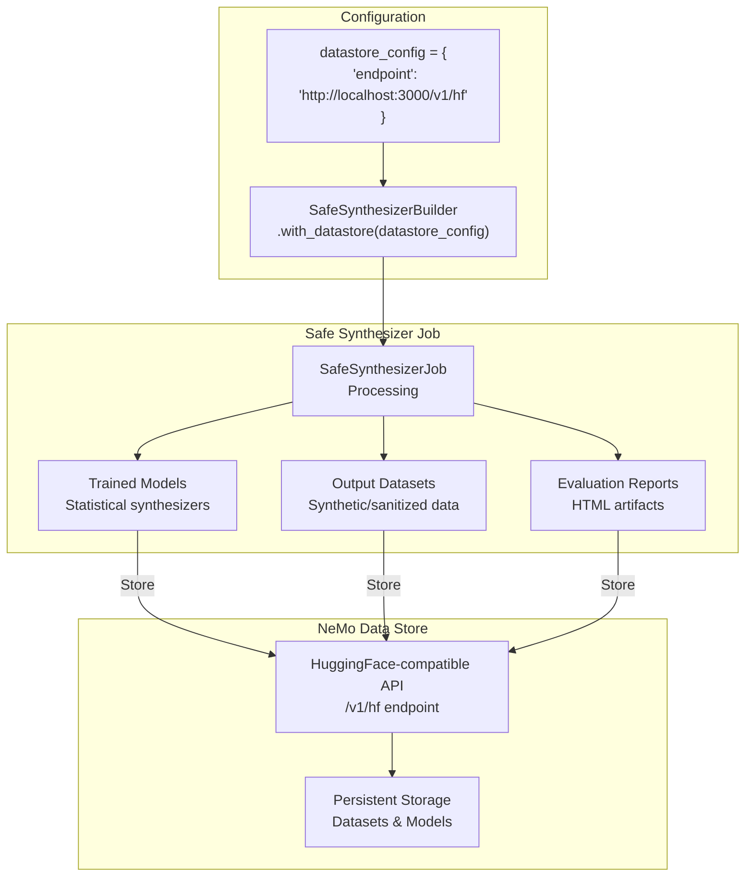

<!-- source: DeepWiki mcp.deepwiki.com · repo NVIDIA/GenerativeAIExamples · page 3 NeMo Safe Synthesizer · fetched 2026-10-26 -->

# NeMo Safe Synthesizer

<details>
<summary>Relevant source files</summary>

The following files were used as context for generating this wiki page:

- [nemo/NeMo-Safe-Synthesizer/README.md](nemo/NeMo-Safe-Synthesizer/README.md)
- [nemo/NeMo-Safe-Synthesizer/advanced/advanced_privacy.ipynb](nemo/NeMo-Safe-Synthesizer/advanced/advanced_privacy.ipynb)
- [nemo/NeMo-Safe-Synthesizer/advanced/replace_pii_only.ipynb](nemo/NeMo-Safe-Synthesizer/advanced/replace_pii_only.ipynb)
- [nemo/NeMo-Safe-Synthesizer/intro/safe_synthesizer_101.ipynb](nemo/NeMo-Safe-Synthesizer/intro/safe_synthesizer_101.ipynb)

</details>


## Purpose and Scope

NeMo Safe Synthesizer is a microservice in the NeMo Microservices Platform that generates privacy-protected synthetic tabular data. It provides capabilities for detecting and replacing Personally Identifiable Information (PII) in datasets, generating novel synthetic data that preserves statistical properties of the original data, and applying differential privacy guarantees. This document covers the architecture, SDK usage patterns, core capabilities, and deployment options for Safe Synthesizer.

> **Note**: Safe Synthesizer is currently in Early Access and not recommended for production use.

For information about generating synthetic text data using LLMs, see [NeMo Data Designer](#2). For model fine-tuning workflows, see [NeMo Data Flywheel](#4).

Sources: [nemo/NeMo-Safe-Synthesizer/intro/safe_synthesizer_101.ipynb:7-19](), [nemo/NeMo-Safe-Synthesizer/README.md:1-4]()

## Architecture Overview

Safe Synthesizer operates as a standalone microservice within the NeMo Microservices Platform ecosystem. It consumes tabular data, processes it through privacy protection pipelines, and produces synthetic datasets with automatic quality and privacy evaluation.



**Architecture: Safe Synthesizer Components and Data Flow**

Safe Synthesizer follows a builder pattern for job configuration and an asynchronous processing model for execution. The SDK provides a high-level interface through `SafeSynthesizerBuilder` and `SafeSynthesizerJob` classes, abstracting the underlying REST API communication. Jobs execute through a multi-stage pipeline that can perform PII detection and replacement, synthetic data generation, and differential privacy application depending on configuration.

Sources: [nemo/NeMo-Safe-Synthesizer/intro/safe_synthesizer_101.ipynb:38-90](), [nemo/NeMo-Safe-Synthesizer/advanced/replace_pii_only.ipynb:51-88]()

## Core Capabilities

### PII Detection and Replacement

Safe Synthesizer automatically detects and replaces Personally Identifiable Information in text columns. Detected PII entities include names, locations, ages, physical characteristics, and other identifying information. Replacement values are generated to maintain data semantics while removing real personal information.

| Capability | Description |
|------------|-------------|
| Entity Detection | Identifies PII entities in text fields using NLP models |
| Replacement Strategy | Generates contextually appropriate synthetic replacements |
| Report Generation | Creates detailed reports showing detected and replaced PII |
| Schema Preservation | Maintains original data structure and column types |

The PII replacement feature can be used standalone without synthetic data generation, allowing users to sanitize existing datasets while preserving the original row structure.

Sources: [nemo/NeMo-Safe-Synthesizer/advanced/replace_pii_only.ipynb:7-18](), [nemo/NeMo-Safe-Synthesizer/intro/safe_synthesizer_101.ipynb:96-102]()

### Synthetic Data Generation

When configured for synthesis, Safe Synthesizer learns statistical patterns and correlations in the input dataset to generate novel synthetic records. The synthetic data preserves important statistical properties including distributions, correlations, and conditional dependencies while generating entirely new records.



**Workflow: Synthetic Data Generation Process**

The generation process supports structured generation mode (`use_structured_generation=True`) which enforces schema constraints during sampling, ensuring generated values match expected types and ranges from the input data.

Sources: [nemo/NeMo-Safe-Synthesizer/intro/safe_synthesizer_101.ipynb:96-102](), [nemo/NeMo-Safe-Synthesizer/advanced/advanced_privacy.ipynb:155-167]()

### Differential Privacy

Safe Synthesizer implements differential privacy (DP) to provide formal privacy guarantees. When enabled, the system adds calibrated noise to the learned statistical model, ensuring that the presence or absence of any individual record in the training data cannot be reliably inferred from the synthetic output.

| Parameter | Description | Default |
|-----------|-------------|---------|
| `dp_enabled` | Enable differential privacy | False |
| `epsilon` | Privacy budget (lower = stronger privacy) | N/A |
| Trade-off | Lower epsilon increases privacy but may reduce data quality | Configurable |

The epsilon parameter controls the privacy-utility trade-off. Lower epsilon values provide stronger privacy guarantees but may result in lower quality synthetic data. Typical epsilon values range from 1.0 (strong privacy) to 10.0 (weaker privacy).

Sources: [nemo/NeMo-Safe-Synthesizer/advanced/advanced_privacy.ipynb:7-19](), [nemo/NeMo-Safe-Synthesizer/advanced/advanced_privacy.ipynb:155-167]()

## SDK and API Structure

### SafeSynthesizerBuilder Pattern

The SDK uses a fluent builder pattern for job configuration. The `SafeSynthesizerBuilder` class provides method chaining to configure all aspects of a Safe Synthesizer job before submission.



**Diagram: SafeSynthesizerBuilder Configuration API**

The builder pattern enables clear, readable configuration:

```python
job = (
    SafeSynthesizerBuilder(client)
    .from_data_source(df)
    .with_datastore(datastore_config)
    .with_replace_pii()
    .with_differential_privacy(dp_enabled=True, epsilon=8.0)
    .with_generate(use_structured_generation=True)
    .create_job()
)
```

Sources: [nemo/NeMo-Safe-Synthesizer/intro/safe_synthesizer_101.ipynb:132-162](), [nemo/NeMo-Safe-Synthesizer/advanced/advanced_privacy.ipynb:155-185]()

### SafeSynthesizerJob Interface

Once a job is created, the `SafeSynthesizerJob` object provides methods for monitoring, data retrieval, and report access.

| Method | Return Type | Description |
|--------|-------------|-------------|
| `job.job_id` | str | Unique job identifier |
| `job.wait_for_completion()` | None | Block until job finishes |
| `job.fetch_status()` | str | Current job status |
| `job.fetch_data()` | DataFrame | Retrieve output dataset |
| `job.fetch_summary()` | Summary | Quality and privacy scores |
| `job.save_report(path)` | None | Download HTML report |
| `job.display_report_in_notebook()` | None | Render report inline |

Jobs are persistent on the microservices platform. If a notebook session ends, you can reconnect to an existing job:

```python
from nemo_microservices.beta.safe_synthesizer.sdk.job import SafeSynthesizerJob
job = SafeSynthesizerJob(job_id="<job_id>", client=client)
```

Sources: [nemo/NeMo-Safe-Synthesizer/intro/safe_synthesizer_101.ipynb:148-183](), [nemo/NeMo-Safe-Synthesizer/advanced/replace_pii_only.ipynb:136-169]()

### Client Initialization

The SDK requires a `NeMoMicroservices` client configured with the platform base URL.



**Diagram: Client and DataStore Configuration**

The default local quickstart deployment uses `http://localhost:8080` as the base URL and `http://localhost:3000/v1/hf` as the DataStore endpoint. For managed deployments, these URLs must be configured appropriately.

Sources: [nemo/NeMo-Safe-Synthesizer/intro/safe_synthesizer_101.ipynb:49-90](), [nemo/NeMo-Safe-Synthesizer/advanced/replace_pii_only.ipynb:51-88]()

## Operational Workflows

### PII Replacement Only Workflow

This workflow sanitizes an existing dataset by replacing PII without generating new rows. The output contains the same number of rows as the input, with PII entities replaced by synthetic values.



**Sequence: PII Replacement Only Workflow**

Key configuration for this workflow:
- Include `.with_replace_pii()` to enable PII detection and replacement
- Omit `.synthesize()` or `.with_generate()` to skip synthetic data generation
- Result is same row count as input, with PII sanitized

Sources: [nemo/NeMo-Safe-Synthesizer/advanced/replace_pii_only.ipynb:123-154](), [nemo/NeMo-Safe-Synthesizer/advanced/replace_pii_only.ipynb:176-225]()

### Standard Synthesis Workflow

The standard synthesis workflow generates novel synthetic records that preserve statistical properties of the input data while protecting privacy through PII replacement.



**Workflow: Standard Synthesis Pipeline**

The `.synthesize()` method is a convenience method that internally calls `.with_generate()` with default parameters. For more control, use `.with_generate(use_structured_generation=True)` explicitly.

Sources: [nemo/NeMo-Safe-Synthesizer/intro/safe_synthesizer_101.ipynb:132-167](), [nemo/NeMo-Safe-Synthesizer/intro/safe_synthesizer_101.ipynb:188-205]()

### Advanced Privacy Workflow with Differential Privacy

The advanced privacy workflow adds differential privacy guarantees to the synthetic data generation process. This provides formal mathematical privacy protection but may impact data quality.



**Workflow: Differential Privacy Configuration**

When differential privacy is enabled, the system applies noise calibrated to the epsilon parameter during the statistical learning phase. This noise ensures that individual records cannot be identified in the synthetic output, providing formal privacy guarantees. The evaluation report includes both quality and privacy scores to help assess the trade-off.

Sources: [nemo/NeMo-Safe-Synthesizer/advanced/advanced_privacy.ipynb:155-190](), [nemo/NeMo-Safe-Synthesizer/advanced/advanced_privacy.ipynb:7-19]()

## Evaluation and Reporting

### Automatic Evaluation

Every Safe Synthesizer job automatically generates an evaluation comparing synthetic data to the input data. The evaluation produces two primary metrics accessible programmatically:

| Metric | Range | Description |
|--------|-------|-------------|
| `synthetic_data_quality_score` | 0-10 | Higher values indicate better statistical similarity to original data |
| `data_privacy_score` | 0-10 | Higher values indicate better privacy protection |

Access these metrics via the job summary:

```python
summary = job.fetch_summary()
print(f"Quality: {summary.synthetic_data_quality_score}")
print(f"Privacy: {summary.data_privacy_score}")
```

Sources: [nemo/NeMo-Safe-Synthesizer/intro/safe_synthesizer_101.ipynb:222-234](), [nemo/NeMo-Safe-Synthesizer/advanced/advanced_privacy.ipynb:244-257]()

### HTML Evaluation Reports

Safe Synthesizer generates comprehensive HTML reports with charts and detailed metrics. Reports include:

- **PII Detection Summary**: Entities detected and replacement statistics
- **Statistical Comparisons**: Distribution plots comparing original and synthetic data
- **Correlation Analysis**: Comparison of feature correlations
- **Privacy Assessment**: Distance metrics and re-identification risk analysis
- **Quality Metrics**: Column-by-column quality scores



**Diagram: Report Generation and Access**

Reports are generated automatically upon job completion. For PII replacement only jobs, the report focuses on detected entities and replacement statistics. For synthesis jobs, the report includes full statistical and privacy analyses.

Sources: [nemo/NeMo-Safe-Synthesizer/intro/safe_synthesizer_101.ipynb:236-256](), [nemo/NeMo-Safe-Synthesizer/advanced/replace_pii_only.ipynb:194-225]()

## Deployment and Environment Setup

### Local Deployment with Docker Compose

Safe Synthesizer can be deployed locally using Docker Compose for development and testing. The quickstart deployment includes all required services:

- Safe Synthesizer API service (port 8080)
- NeMo Data Store service (port 3000)
- Job management infrastructure
- GPU support for processing



**Diagram: Local Deployment Architecture**

Setup steps for local deployment:

1. Install `uv` package manager
2. Create virtual environment: `uv venv`
3. Activate environment: `source .venv/bin/activate`
4. Install SDK: `uv pip install nemo-microservices[safe-synthesizer]`
5. Deploy services using quickstart Docker Compose guide
6. Configure notebook kernel to use `.venv`

Sources: [nemo/NeMo-Safe-Synthesizer/README.md:6-20](), [nemo/NeMo-Safe-Synthesizer/README.md:21-32]()

### Helm Deployment for Production

For production deployments, Safe Synthesizer is deployed as part of the NeMo Microservices Platform using Helm charts. This deployment mode supports:

- Multi-node Kubernetes clusters
- High availability configurations
- Scalable job processing
- Enterprise authentication and authorization
- Persistent storage backends

Client configuration for Helm deployments requires specifying the correct base URLs and authentication tokens:

```python
client = NeMoMicroservices(
    base_url="https://nemo-platform.example.com",
    token="<auth_token>"
)

datastore_config = {
    "endpoint": "https://nemo-datastore.example.com/v1/hf",
}
```

Sources: [nemo/NeMo-Safe-Synthesizer/README.md:30-32](), [nemo/NeMo-Safe-Synthesizer/intro/safe_synthesizer_101.ipynb:53-67]()

## Integration with NeMo Ecosystem

### Data Store Integration

Safe Synthesizer integrates with NeMo Data Store for artifact persistence. The DataStore provides a HuggingFace-compatible API for dataset storage and retrieval.



**Diagram: Data Store Integration Architecture**

The DataStore integration is configured via the `.with_datastore()` method on the builder. All job artifacts including trained models, output datasets, and evaluation reports are persisted through the DataStore API.

Sources: [nemo/NeMo-Safe-Synthesizer/intro/safe_synthesizer_101.ipynb:74-90](), [nemo/NeMo-Safe-Synthesizer/advanced/replace_pii_only.ipynb:75-88]()

### Data Designer Integration

Safe Synthesizer works in conjunction with NeMo Data Designer in the data generation pipeline. The typical integration pattern:

1. Data Designer generates initial synthetic text data using LLMs
2. Safe Synthesizer processes Data Designer output to replace PII
3. Protected datasets are used for model training via NeMo Customizer
4. Trained models deployed through NIM serve production workloads

This creates a privacy-preserving data pipeline where synthetic data from Data Designer can be further sanitized before use in training workflows. See [NeMo Data Designer](#2) for details on text-based synthetic data generation and [NeMo Data Flywheel](#4) for the complete training pipeline.

Sources: High-level architecture diagrams (Diagram 2)

## Example Use Cases

### Tabular Data Sanitization

Organizations with sensitive customer data can use Safe Synthesizer to remove PII before sharing datasets with analytics teams or external partners:

```python
# Load sensitive customer data
customer_df = pd.read_csv("customer_data.csv")

# Configure PII replacement only (no synthesis)
job = (
    SafeSynthesizerBuilder(client)
    .from_data_source(customer_df)
    .with_datastore(datastore_config)
    .with_replace_pii()
    .create_job()
)

# Retrieve sanitized dataset
sanitized_df = job.fetch_data()
```

The output preserves all rows and columns but replaces names, locations, and other PII with synthetic values.

Sources: [nemo/NeMo-Safe-Synthesizer/advanced/replace_pii_only.ipynb:7-18](), [nemo/NeMo-Safe-Synthesizer/advanced/replace_pii_only.ipynb:95-116]()

### Privacy-Preserving Data Augmentation

Machine learning teams can generate additional training data while maintaining privacy guarantees:

```python
# Load training dataset
train_df = pd.read_csv("training_data.csv")

# Generate synthetic data with differential privacy
job = (
    SafeSynthesizerBuilder(client)
    .from_data_source(train_df)
    .with_datastore(datastore_config)
    .with_replace_pii()
    .with_differential_privacy(dp_enabled=True, epsilon=5.0)
    .synthesize()
    .create_job()
)

# Retrieve augmented dataset
synthetic_df = job.fetch_data()
augmented_df = pd.concat([train_df, synthetic_df])
```

The synthetic records preserve statistical patterns useful for training while providing formal privacy guarantees through differential privacy.

Sources: [nemo/NeMo-Safe-Synthesizer/advanced/advanced_privacy.ipynb:155-190](), [nemo/NeMo-Safe-Synthesizer/intro/safe_synthesizer_101.ipynb:132-167]()

### Healthcare and Financial Data Compliance

Industries with strict privacy regulations (HIPAA, GDPR, CCPA) can use Safe Synthesizer to create compliant datasets for testing, development, and research:

- Healthcare: Generate synthetic patient records for algorithm development
- Finance: Create synthetic transaction data for fraud detection testing
- Retail: Produce synthetic customer behavior data for analytics

The combination of PII replacement and differential privacy helps organizations meet regulatory requirements while maintaining data utility for analytics and model development.

Sources: [nemo/NeMo-Safe-Synthesizer/advanced/advanced_privacy.ipynb:7-19](), [nemo/NeMo-Safe-Synthesizer/intro/safe_synthesizer_101.ipynb:96-102]()

---

