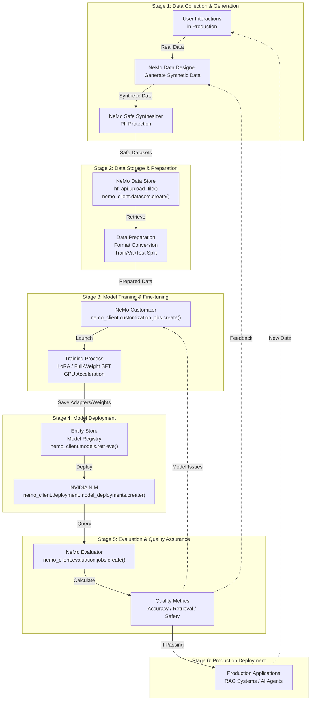
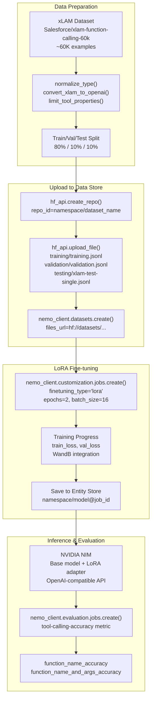
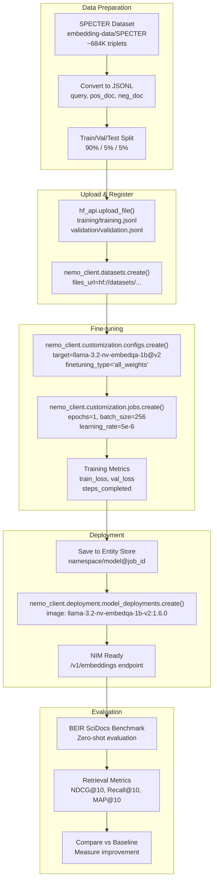
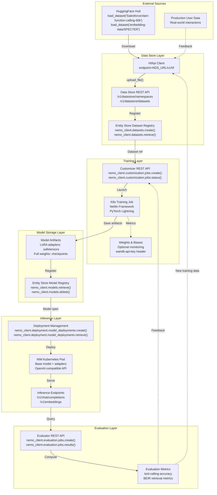

<!-- source: DeepWiki mcp.deepwiki.com · repo NVIDIA/GenerativeAIExamples · page 4 NeMo Data Flywheel · fetched 2026-10-26 -->

# NeMo Data Flywheel

<details>
<summary>Relevant source files</summary>

The following files were used as context for generating this wiki page:

- [nemo/data-flywheel/README.md](nemo/data-flywheel/README.md)
- [nemo/data-flywheel/embedding-finetuning/1_data_preparation.ipynb](nemo/data-flywheel/embedding-finetuning/1_data_preparation.ipynb)
- [nemo/data-flywheel/embedding-finetuning/2_finetuning_and_inference.ipynb](nemo/data-flywheel/embedding-finetuning/2_finetuning_and_inference.ipynb)
- [nemo/data-flywheel/embedding-finetuning/3_evaluation.ipynb](nemo/data-flywheel/embedding-finetuning/3_evaluation.ipynb)
- [nemo/data-flywheel/embedding-finetuning/README.md](nemo/data-flywheel/embedding-finetuning/README.md)
- [nemo/data-flywheel/embedding-finetuning/config.py](nemo/data-flywheel/embedding-finetuning/config.py)
- [nemo/data-flywheel/embedding-finetuning/img/e2e-embedding-ft.png](nemo/data-flywheel/embedding-finetuning/img/e2e-embedding-ft.png)
- [nemo/data-flywheel/embedding-finetuning/requirements.txt](nemo/data-flywheel/embedding-finetuning/requirements.txt)
- [nemo/data-flywheel/tool-calling/1_data_preparation.ipynb](nemo/data-flywheel/tool-calling/1_data_preparation.ipynb)
- [nemo/data-flywheel/tool-calling/2_finetuning_and_inference.ipynb](nemo/data-flywheel/tool-calling/2_finetuning_and_inference.ipynb)
- [nemo/data-flywheel/tool-calling/3_model_evaluation.ipynb](nemo/data-flywheel/tool-calling/3_model_evaluation.ipynb)
- [nemo/data-flywheel/tool-calling/4_adding_safety_guardrails.ipynb](nemo/data-flywheel/tool-calling/4_adding_safety_guardrails.ipynb)
- [nemo/data-flywheel/tool-calling/README.md](nemo/data-flywheel/tool-calling/README.md)
- [nemo/data-flywheel/tool-calling/config.py](nemo/data-flywheel/tool-calling/config.py)
- [nemo/data-flywheel/tool-calling/img/end-to-end-diagram.png](nemo/data-flywheel/tool-calling/img/end-to-end-diagram.png)
- [nemo/data-flywheel/tool-calling/img/tool-use.png](nemo/data-flywheel/tool-calling/img/tool-use.png)
- [nemo/data-flywheel/tool-calling/requirements.txt](nemo/data-flywheel/tool-calling/requirements.txt)

</details>


## Purpose and Scope

The NeMo Data Flywheel is a continuous model improvement pipeline that orchestrates iterative cycles of data collection, model fine-tuning, deployment, and evaluation within the NeMo Microservices platform. This document covers the architecture, workflows, and implementation details of the Data Flywheel concept as applied to two primary use cases: tool calling fine-tuning and embedding model fine-tuning.

For information about individual NeMo Microservices components (Data Designer, Safe Synthesizer, Customizer, Evaluator), see their respective sections ([2](#2), [3](#3), [5](#5)). For RAG implementations and industry solutions that consume Data Flywheel outputs, see sections [6](#6) and [7](#7).

## Overview and Architecture

The Data Flywheel implements a feedback loop where production data informs model improvements, which are then deployed and evaluated, generating new insights that further refine the models. The cycle consists of six stages: data collection/generation, data storage/preparation, model training/fine-tuning, model deployment, evaluation/quality assurance, and production deployment.



Sources: [nemo/data-flywheel/README.md:1-3](), [nemo/data-flywheel/tool-calling/README.md:159-183](), [nemo/data-flywheel/embedding-finetuning/README.md:19-27]()

## Core Components

### NeMo Data Store

The Data Store manages datasets using a HuggingFace-compatible API. It serves as the central repository for training, validation, and test data.

**Key Operations:**
- Repository creation: `hf_api.create_repo(repo_id, repo_type='dataset')`
- File upload: `hf_api.upload_file(path_or_fileobj, path_in_repo, repo_id, repo_type)`
- Dataset registration: `nemo_client.datasets.create(name, namespace, files_url)`

The Data Store organizes files into subdirectories (`training/`, `validation/`, `testing/`) where multiple `.jsonl` files in the same subdirectory are automatically merged during customization.

Sources: [nemo/data-flywheel/tool-calling/2_finetuning_and_inference.ipynb:277-456](), [nemo/data-flywheel/embedding-finetuning/2_finetuning_and_inference.ipynb:286-507]()

### Entity Store

The Entity Store functions as a model registry, storing model metadata, configurations, and artifacts (LoRA adapters or full weights).

**Key Operations:**
- Namespace management: `nemo_client.namespaces.create(id)`, `nemo_client.namespaces.retrieve(namespace_id)`
- Model retrieval: `nemo_client.models.retrieve(namespace, model_name)`
- Model deletion: `nemo_client.models.delete(namespace, model_name)`

Sources: [nemo/data-flywheel/tool-calling/2_finetuning_and_inference.ipynb:152-267](), [nemo/data-flywheel/embedding-finetuning/2_finetuning_and_inference.ipynb:162-279]()

### NeMo Customizer

The Customizer orchestrates fine-tuning jobs with support for LoRA (Low-Rank Adaptation) and full-weight supervised fine-tuning (SFT).

**Configuration Creation:**
```python
nemo_client.customization.configs.create(
    name=config_name,
    namespace=namespace,
    target=f"{base_model}@{version}",
    training_options=[{
        "training_type": "sft",
        "finetuning_type": "lora",  # or "all_weights"
        "num_gpus": 1,
        "micro_batch_size": 8
    }],
    training_precision="bf16",
    max_seq_length=4096
)
```

**Job Creation:**
```python
nemo_client.customization.jobs.create(
    config=config_name,
    dataset={"name": dataset_name, "namespace": namespace},
    hyperparameters={
        "training_type": "sft",
        "finetuning_type": "lora",
        "epochs": 2,
        "batch_size": 16,
        "learning_rate": 0.0001
    },
    output_model=output_model_name
)
```

**Job Status Polling:**
- Status check: `nemo_client.customization.jobs.status(job_id)`
- Status values: `["created", "pending", "running", "completed", "failed"]`
- Progress tracking: `job.status_details.percentage_done`

Sources: [nemo/data-flywheel/tool-calling/2_finetuning_and_inference.ipynb:541-661](), [nemo/data-flywheel/embedding-finetuning/2_finetuning_and_inference.ipynb:516-760]()

### Deployment Management Service

The Deployment Management Service deploys fine-tuned models as NIMs (NVIDIA Inference Microservices).

**Deployment Creation:**
```python
nemo_client.deployment.model_deployments.create(
    namespace=namespace,
    model_name=model_name,
    deployment_config={
        "image_name": nim_image_name,
        "image_tag": nim_image_tag,
        "gpu_count": 1,
        "pvc_size": "50Gi"
    }
)
```

**Deployment Status:**
- Status check: `nemo_client.deployment.model_deployments.retrieve(namespace, model_name)`
- Status values: `["pending", "running", "ready", "failed"]`

Sources: [nemo/data-flywheel/embedding-finetuning/2_finetuning_and_inference.ipynb:809-1029]()

### NeMo Evaluator

The Evaluator assesses model performance using various metrics and benchmarks.

**Evaluation Job Creation:**
```python
nemo_client.evaluation.jobs.create(
    config={
        "type": "custom",
        "tasks": {
            "task_name": {
                "type": "chat-completion",
                "dataset": {"files_url": dataset_url, "limit": 50},
                "metrics": {
                    "tool-calling-accuracy": {
                        "type": "tool-calling",
                        "params": {"tool_calls_ground_truth": "{{ item.tool_calls | tojson }}"}
                    }
                }
            }
        }
    },
    target={"type": "model", "model": model_name}
)
```

**Results Retrieval:**
- Results: `nemo_client.evaluation.jobs.results(job_id)`
- Status polling: `nemo_client.evaluation.jobs.retrieve(job_id)`

Sources: [nemo/data-flywheel/tool-calling/3_model_evaluation.ipynb:210-485](), [nemo/data-flywheel/embedding-finetuning/3_evaluation.ipynb:121-274]()

## Tool Calling Workflow

The tool calling workflow fine-tunes LLMs to perform function calling - mapping natural language queries to specific functions with correctly populated parameters.

### Data Format

Tool calling training data uses OpenAI's chat completions format with `messages` and `tools`:

```json
{
    "messages": [
        {
            "role": "user",
            "content": "What will the weather be in Berlin on November 7, 2025?"
        },
        {
            "role": "assistant",
            "tool_calls": [{
                "id": "call_weather",
                "type": "function",
                "function": {
                    "name": "get_weather",
                    "arguments": "{\"location\": \"Berlin\", \"date\": \"2025-11-07\"}"
                }
            }]
        }
    ],
    "tools": [{
        "type": "function",
        "function": {
            "name": "get_weather",
            "description": "Get the weather for a given location and date.",
            "parameters": {
                "type": "object",
                "properties": {
                    "location": {"type": "string"},
                    "date": {"type": "string"}
                },
                "required": ["location", "date"]
            }
        }
    }]
}
```

Sources: [nemo/data-flywheel/tool-calling/README.md:32-154](), [nemo/data-flywheel/tool-calling/1_data_preparation.ipynb:183-246]()

### Workflow Stages



### Configuration Details

**Base Model:** `meta/llama-3.2-1b-instruct`
**Fine-tuning Type:** LoRA (Low-Rank Adaptation)
**LoRA Parameters:**
- `adapter_dim`: 32
- `adapter_dropout`: 0.1
- `alpha`: 16

**Training Hyperparameters:**
- `epochs`: 2
- `batch_size`: 16
- `learning_rate`: 0.0001
- `micro_batch_size`: 1

**Evaluation Metrics:**
- `function_name_accuracy`: Percentage of correct function selections
- `function_name_and_args_accuracy`: Percentage of correct function selections with correct arguments

Sources: [nemo/data-flywheel/tool-calling/README.md:1-289](), [nemo/data-flywheel/tool-calling/2_finetuning_and_inference.ipynb:587-614](), [nemo/data-flywheel/tool-calling/3_model_evaluation.ipynb:216-242](), [nemo/data-flywheel/tool-calling/config.py:1-25]()

### Data Preparation Pipeline

The data preparation process converts xLAM dataset format to OpenAI format through several helper functions:

**Key Functions:**
- `normalize_type(param_type: str) -> str`: Converts Python type hints to OpenAI spec types (e.g., `str` → `string`, `int` → `integer`)
- `convert_xlam_to_openai(xlam_item: dict) -> dict`: Transforms xLAM data structure into OpenAI chat completions format
- `limit_tool_properties(tools: list, max_properties: int) -> list`: Limits tool parameter count to avoid NIM response freezing (max 8 parameters)

Sources: [nemo/data-flywheel/tool-calling/1_data_preparation.ipynb:253-622]()

## Embedding Fine-tuning Workflow

The embedding fine-tuning workflow adapts embedding models to domain-specific data using contrastive learning with query-positive-negative triplets.

### Data Format

Embedding fine-tuning uses JSONL format with triplets:

```json
{
    "query": "Deep Residual Learning for Image Recognition",
    "pos_doc": "Identity Mappings in Deep Residual Networks",
    "neg_doc": ["Attention Is All You Need"]
}
```

During training, the model learns to maximize similarity between `query` and `pos_doc` while minimizing similarity between `query` and `neg_doc`.

Sources: [nemo/data-flywheel/embedding-finetuning/README.md:45-61](), [nemo/data-flywheel/embedding-finetuning/1_data_preparation.ipynb:136-196]()

### Workflow Stages



### Configuration Details

**Base Model:** `nvidia/llama-3.2-nv-embedqa-1b@v2`
**NIM Image:** `nvcr.io/nim/nvidia/llama-3.2-nv-embedqa-1b-v2:1.6.0`
**Fine-tuning Type:** Full-weight SFT (all_weights)

**Training Hyperparameters:**
- `epochs`: 1
- `batch_size`: 256
- `learning_rate`: 5e-6
- `micro_batch_size`: 8
- `optimizer`: "adamw_with_cosine_annealing"
- `warmup_steps`: 200

**Evaluation Benchmark:** BEIR SciDocs
**Retrieval Metrics:**
- `NDCG@10`: Normalized Discounted Cumulative Gain at rank 10
- `Recall@10`: Fraction of relevant documents retrieved in top 10
- `MAP@10`: Mean Average Precision at rank 10

Sources: [nemo/data-flywheel/embedding-finetuning/README.md:1-142](), [nemo/data-flywheel/embedding-finetuning/2_finetuning_and_inference.ipynb:535-645](), [nemo/data-flywheel/embedding-finetuning/3_evaluation.ipynb:107-274](), [nemo/data-flywheel/embedding-finetuning/config.py:1-28]()

### Deployment Process

The embedding model deployment involves two steps:

1. **Create Deployment Configuration:**
```python
nemo_client.deployment.model_deployments.create(
    namespace=namespace,
    model_name=model_name,
    deployment_config={
        "image_name": "nvcr.io/nim/nvidia/llama-3.2-nv-embedqa-1b-v2",
        "image_tag": "1.6.0",
        "gpu_count": 1,
        "pvc_size": "50Gi"
    }
)
```

2. **Wait for Readiness:**
Status polling until `deployment.status == "ready"`, typically takes 5-10 minutes for model download and initialization.

Sources: [nemo/data-flywheel/embedding-finetuning/2_finetuning_and_inference.ipynb:809-1029]()

## Data Flow Architecture

The following diagram shows how data flows through the Data Flywheel components with specific code entry points:



Sources: [nemo/data-flywheel/tool-calling/2_finetuning_and_inference.ipynb:1-2467](), [nemo/data-flywheel/embedding-finetuning/2_finetuning_and_inference.ipynb:1-2106]()

## Namespace Management

Both workflows use namespaces to isolate resources and organize artifacts:

**Namespace Creation:**
```python
# Entity Store namespace
nemo_client.namespaces.create(id=namespace)

# Data Store namespace (via REST API)
requests.post(f"{NDS_URL}/v1/datastore/namespaces", data={"namespace": namespace})
```

**Namespace Verification:**
```python
# Entity Store
namespace_obj = nemo_client.namespaces.retrieve(namespace_id=namespace)

# Data Store
response = requests.get(f"{NDS_URL}/v1/datastore/namespaces/{namespace}")
```

**Namespace Deletion:**
```python
# Entity Store
nemo_client.namespaces.delete(namespace)

# Data Store
requests.delete(f"{NDS_URL}/v1/datastore/namespaces/{namespace}")
```

Sources: [nemo/data-flywheel/tool-calling/2_finetuning_and_inference.ipynb:152-267](), [nemo/data-flywheel/embedding-finetuning/2_finetuning_and_inference.ipynb:162-279]()

## Evaluation Metrics

### Tool Calling Metrics

The `tool-calling-accuracy` metric evaluates two aspects:

1. **function_name_accuracy**: Percentage of queries where the model selected the correct function(s)
2. **function_name_and_args_accuracy**: Percentage of queries where the model selected correct function(s) AND populated correct arguments

Evaluation configuration:
```python
{
    "type": "custom",
    "tasks": {
        "custom-tool-calling": {
            "type": "chat-completion",
            "dataset": {
                "files_url": "hf://datasets/namespace/dataset/testing/xlam-test-single.jsonl",
                "limit": 50
            },
            "metrics": {
                "tool-calling-accuracy": {
                    "type": "tool-calling",
                    "params": {"tool_calls_ground_truth": "{{ item.tool_calls | tojson }}"}
                }
            }
        }
    }
}
```

Sources: [nemo/data-flywheel/tool-calling/3_model_evaluation.ipynb:210-485]()

### Embedding Retrieval Metrics

The BEIR SciDocs benchmark evaluates retrieval performance:

**Target Configuration:**
```python
{
    "type": "retriever",
    "retriever": {
        "pipeline": {
            "query_embedding_model": {
                "api_endpoint": {
                    "url": f"{NIM_URL}/v1/embeddings",
                    "model_id": embedding_model_name
                }
            },
            "index_embedding_model": {
                "api_endpoint": {
                    "url": f"{NIM_URL}/v1/embeddings",
                    "model_id": embedding_model_name
                }
            },
            "top_k": 10
        }
    }
}
```

**Evaluation Configuration:**
```python
{
    "type": "beir",
    "beir": {
        "benchmark": "scidocs",
        "split": "test"
    }
}
```

**Metrics Computed:**
- NDCG@10 (Normalized Discounted Cumulative Gain)
- Recall@10 (Fraction of relevant documents retrieved)
- MAP@10 (Mean Average Precision)

Sources: [nemo/data-flywheel/embedding-finetuning/3_evaluation.ipynb:121-274]()

## Job Monitoring and Status Tracking

### Customization Job Monitoring

Both workflows use similar job monitoring patterns:

**Status Polling Function:**
```python
def wait_job(nemo_client, job_id: str, polling_interval: int = 10, timeout: int = 6000):
    start_time = time()
    job = nemo_client.customization.jobs.retrieve(job_id=job_id)
    status = job.status
    
    while (status in ["pending", "created", "running"]):
        if time() - start_time > timeout:
            raise RuntimeError(f"Took more than {timeout} seconds.")
        
        sleep(polling_interval)
        job = nemo_client.customization.jobs.retrieve(job_id=job_id)
        status = job.status
        
        if status == "running" and job.status_details:
            progress = job.status_details.percentage_done or 0.0
        elif status == "completed":
            progress = 100
        
        print(f"Job status: {status} after {time() - start_time:.2f} seconds. Progress: {progress}%")
    
    return job
```

**Job Cancellation:**
```python
nemo_client.customization.jobs.cancel(job_id=job_id)
```

Sources: [nemo/data-flywheel/tool-calling/2_finetuning_and_inference.ipynb:962-997](), [nemo/data-flywheel/embedding-finetuning/2_finetuning_and_inference.ipynb:762-826]()

### Evaluation Job Monitoring

**Status Polling Function:**
```python
def wait_eval_job(nemo_client, job_id: str, polling_interval: int = 10, timeout: int = 6000):
    start_time = time()
    job = nemo_client.evaluation.jobs.retrieve(job_id=job_id)
    status = job.status
    
    while (status in ["pending", "created", "running"]):
        if time() - start_time > timeout:
            raise RuntimeError(f"Took more than {timeout} seconds.")
        
        sleep(polling_interval)
        job = nemo_client.evaluation.jobs.retrieve(job_id=job_id)
        status = job.status
        
        if status == "running" and job.status_details:
            progress = job.status_details.progress or 0
        elif status == "completed":
            progress = 100
        
        print(f"Job status: {status} after {time() - start_time:.2f} seconds. Progress: {progress}%")
    
    return job
```

Sources: [nemo/data-flywheel/tool-calling/3_model_evaluation.ipynb:304-342]()

## Configuration Files

### Tool Calling Configuration

The tool calling workflow uses `config.py` for centralized configuration:

| Variable | Description | Example Value |
|----------|-------------|---------------|
| `NDS_URL` | Data Store endpoint | `"http://data-store.test"` |
| `NEMO_URL` | Customizer/Entity Store/Evaluator endpoint | `"http://nemo.test"` |
| `NIM_URL` | NIM inference endpoint | `"http://nim.test"` |
| `HF_TOKEN` | HuggingFace access token | User-provided |
| `WANDB_API_KEY` | Weights & Biases API key (optional) | User-provided |
| `NMS_NAMESPACE` | Namespace for tutorial assets | `"xlam-tutorial-ns"` |
| `DATASET_NAME` | Dataset name | `"xlam-ft-dataset"` |
| `BASE_MODEL` | Base model identifier | `"meta/llama-3.2-1b-instruct"` |
| `BASE_MODEL_VERSION` | Base model version | `"v1.0.0+80GB"` |
| `CUSTOM_MODEL` | Output custom model name | `"namespace/llama-3.2-1b-xlam-run1@v1"` |

Sources: [nemo/data-flywheel/tool-calling/config.py:1-25]()

### Embedding Fine-tuning Configuration

The embedding workflow uses similar configuration structure:

| Variable | Description | Example Value |
|----------|-------------|---------------|
| `NDS_URL` | Data Store endpoint | `"http://data-store.test"` |
| `NEMO_URL` | Customizer/Entity Store/Evaluator endpoint | `"http://nemo.test"` |
| `NIM_URL` | NIM inference endpoint | `"http://nim.test"` |
| `HF_TOKEN` | HuggingFace access token | User-provided |
| `WANDB_API_KEY` | Weights & Biases API key (optional) | User-provided |
| `NMS_NAMESPACE` | Namespace for tutorial assets | `"embed-sft-ns"` |
| `DATASET_NAME` | Dataset name | `"embed-sft-data"` |
| `BASE_MODEL` | Base model identifier | `"nvidia/llama-3.2-nv-embedqa-1b"` |
| `BASE_MODEL_VERSION` | Base model version | `"v2"` |
| `BASE_MODEL_IMAGE_NAME_EMBEDDING` | NIM image name | `"nvcr.io/nim/nvidia/llama-3.2-nv-embedqa-1b-v2"` |
| `BASE_MODEL_IMAGE_TAG_EMBEDDING` | NIM image tag | `"1.6.0"` |
| `OUTPUT_MODEL_NAME_EMBEDDING` | Output model name | `"fullweight_sft_embedding"` |

Sources: [nemo/data-flywheel/embedding-finetuning/config.py:1-28]()

## Feedback Loop Implementation

The Data Flywheel's continuous improvement cycle is implemented through programmatic feedback mechanisms:

### Evaluation-Driven Iteration

After evaluation completes, metrics inform the next iteration:

```python
# Retrieve evaluation results
results = nemo_client.evaluation.jobs.results(job_id=eval_job_id)
base_accuracy = results.tasks["custom-tool-calling"].metrics["tool-calling-accuracy"].scores["function_name_and_args_accuracy"].value

# Compare fine-tuned model performance
custom_results = nemo_client.evaluation.jobs.results(job_id=custom_eval_job_id)
custom_accuracy = custom_results.tasks["custom-tool-calling"].metrics["tool-calling-accuracy"].scores["function_name_and_args_accuracy"].value

# Improvement calculation
improvement = (custom_accuracy - base_accuracy) / base_accuracy * 100
print(f"Improvement: {improvement:.2f}%")
```

### Production Data Collection

Production applications feed new data back into the Data Store:

1. Log user interactions and model responses
2. Identify edge cases and failure patterns
3. Generate synthetic data for those patterns using Data Designer
4. Add to training dataset for next iteration
5. Trigger new fine-tuning job

Sources: [nemo/data-flywheel/tool-calling/3_model_evaluation.ipynb:475-560](), [nemo/data-flywheel/embedding-finetuning/3_evaluation.ipynb:169-247]()

## Prerequisites and Requirements

### Infrastructure Requirements

**GPU Requirements:**
- Tool Calling: Minimum 2 GPUs (1 for fine-tuning, 1 for inference)
- Embedding Fine-tuning: Minimum 2 GPUs (1 for fine-tuning, 1 for inference)

**Supported NeMo Microservices Versions:**
- Tool Calling: NeMo Microservices 25.1.0+
- Embedding Fine-tuning: NeMo Microservices 25.8.0+ (embedding fine-tuning support added)

### Client-Side Requirements

**Python Dependencies:**
- `nemo-microservices` SDK
- `huggingface_hub` (for dataset download and Data Store interaction)
- `datasets` (for HuggingFace dataset loading)
- `openai` (for inference API)
- `jupyterlab` (for notebook execution)

**Installation:**
```bash
pip install -r requirements.txt
```

Sources: [nemo/data-flywheel/tool-calling/requirements.txt:1-8](), [nemo/data-flywheel/embedding-finetuning/requirements.txt:1-8](), [nemo/data-flywheel/tool-calling/README.md:185-246](), [nemo/data-flywheel/embedding-finetuning/README.md:62-96]()

## Safety and Guardrails Integration

The tool calling workflow includes optional safety guardrails integration using NeMo Guardrails with content safety models.

### Guardrails Configuration Creation

```python
nemo_client.guardrail.configs.create(
    name="toolcalling",
    namespace=namespace,
    data={
        "models": [{
            "type": "content_safety",
            "engine": "nim",
            "model": "nvidia/llama-3.1-nemoguard-8b-content-safety"
        }],
        "rails": {
            "input": {
                "flows": ["content safety check input $model=content_safety"]
            }
        }
    }
)
```

The guardrails configuration defines content safety checks that run before LLM inference, detecting and blocking unsafe content across 24 categories (S1-S24) including violence, PII, hate speech, and malware.

Sources: [nemo/data-flywheel/tool-calling/4_adding_safety_guardrails.ipynb:146-260]()

---

