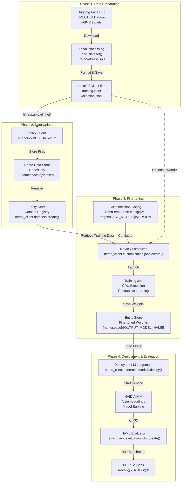
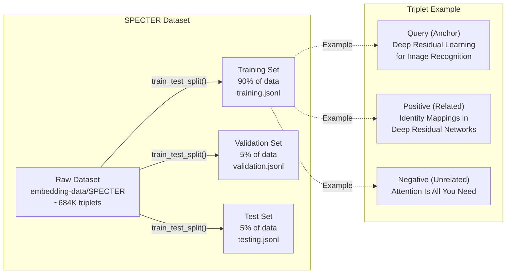
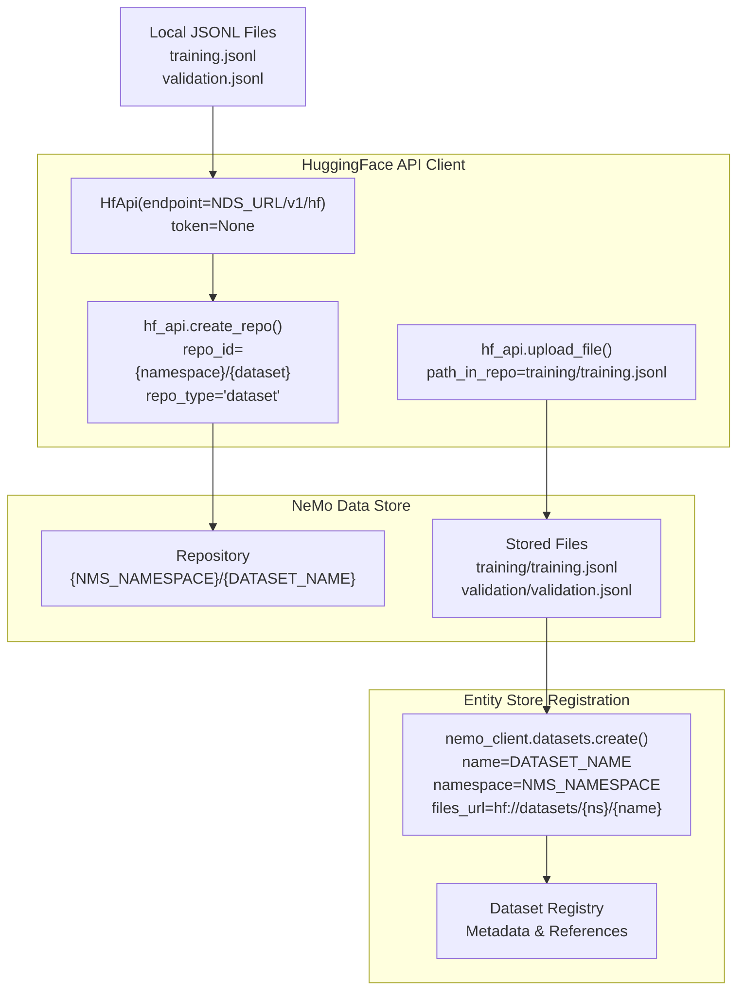
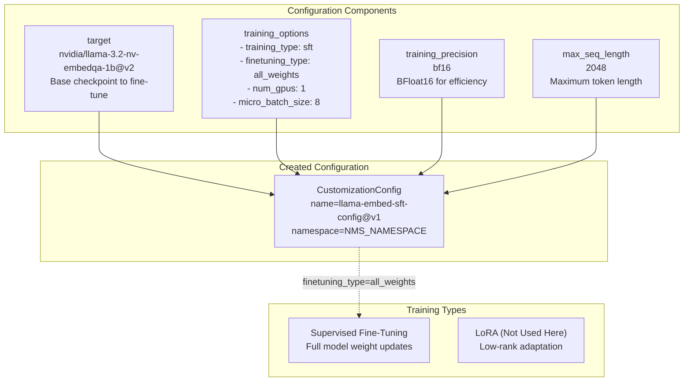
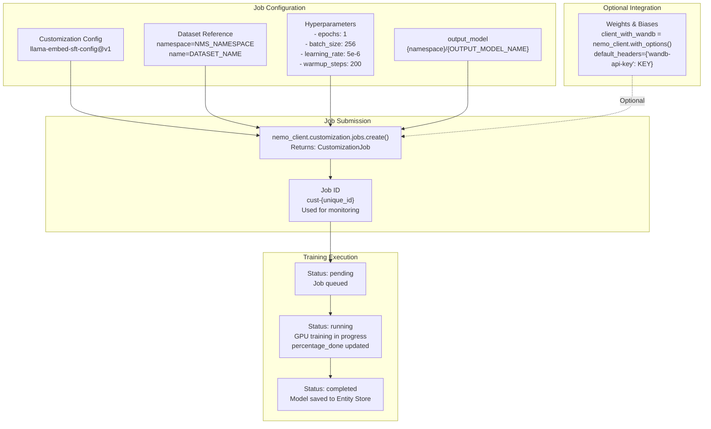
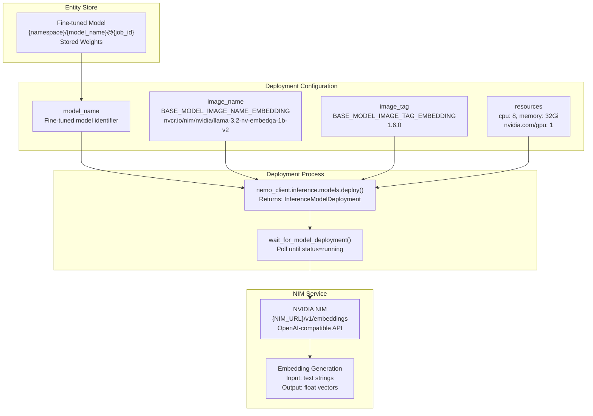
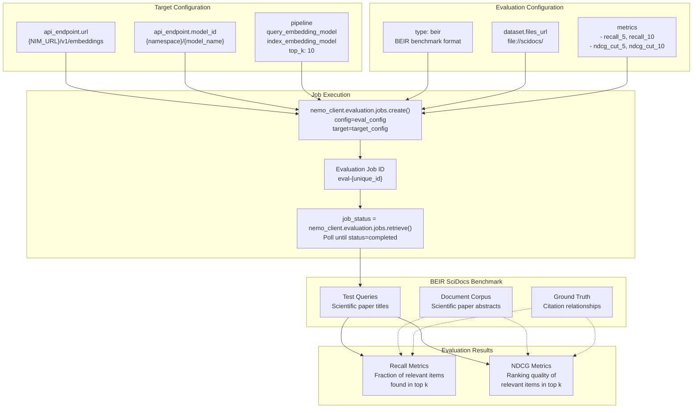

<!-- source: DeepWiki mcp.deepwiki.com · repo NVIDIA/GenerativeAIExamples · page 4.2 Embedding Fine-tuning Workflow · fetched 2026-10-26 -->

# Embedding Fine-tuning Workflow

<details>
<summary>Relevant source files</summary>

The following files were used as context for generating this wiki page:

- [nemo/data-flywheel/README.md](nemo/data-flywheel/README.md)
- [nemo/data-flywheel/embedding-finetuning/1_data_preparation.ipynb](nemo/data-flywheel/embedding-finetuning/1_data_preparation.ipynb)
- [nemo/data-flywheel/embedding-finetuning/2_finetuning_and_inference.ipynb](nemo/data-flywheel/embedding-finetuning/2_finetuning_and_inference.ipynb)
- [nemo/data-flywheel/embedding-finetuning/3_evaluation.ipynb](nemo/data-flywheel/embedding-finetuning/3_evaluation.ipynb)
- [nemo/data-flywheel/embedding-finetuning/README.md](nemo/data-flywheel/embedding-finetuning/README.md)
- [nemo/data-flywheel/embedding-finetuning/config.py](nemo/data-flywheel/embedding-finetuning/config.py)
- [nemo/data-flywheel/embedding-finetuning/img/e2e-embedding-ft.png](nemo/data-flywheel/embedding-finetuning/img/e2e-embedding-ft.png)
- [nemo/data-flywheel/embedding-finetuning/requirements.txt](nemo/data-flywheel/embedding-finetuning/requirements.txt)

</details>


## Purpose and Scope

This page documents the end-to-end workflow for fine-tuning embedding models using NeMo Microservices to improve retrieval quality on domain-specific data. The workflow covers data preparation, supervised fine-tuning (SFT), deployment as NVIDIA Inference Microservices (NIM), and evaluation using the BEIR benchmark suite.

This workflow is distinct from the tool calling fine-tuning workflow documented in [Tool Calling Workflow](#4.1), which focuses on function calling capabilities rather than semantic embedding quality. Both workflows share the same underlying NeMo Microservices infrastructure but target different model capabilities.

**Key Capabilities:**
- Adapt pre-trained embedding models to domain-specific vocabulary and context
- Support contrastive learning with query-document triplets
- Evaluate zero-shot generalization using industry-standard benchmarks
- Deploy fine-tuned models as production-ready inference services

**Target Models:** The workflow is designed for embedding models like `nvidia/llama-3.2-nv-embedqa-1b-v2`, a multilingual model optimized for text question-answering retrieval tasks.

Sources: [nemo/data-flywheel/embedding-finetuning/README.md:1-44]()

## Workflow Architecture

The embedding fine-tuning workflow orchestrates four major phases across NeMo Microservices components. Each phase involves distinct services and data flows.



**Phase Flow:**
1. **Data Preparation**: Downloads and formats the SPECTER dataset locally into query-document triplets
2. **Data Upload**: Transfers formatted data to NeMo Data Store using HuggingFace-compatible API
3. **Fine-tuning**: Executes GPU training job with contrastive learning objective
4. **Deployment & Evaluation**: Deploys model as NIM and evaluates using BEIR benchmarks

Sources: [nemo/data-flywheel/embedding-finetuning/README.md:15-27](), [nemo/data-flywheel/embedding-finetuning/2_finetuning_and_inference.ipynb:1-100]()

## Data Preparation Process

### Dataset Format Requirements

NeMo Customizer requires embedding training data in a specific JSONL format where each line represents a training triplet for contrastive learning.

**Required JSONL Structure:**
```json
{
    "query": "query text",
    "pos_doc": "positive document text",
    "neg_doc": ["negative document text 1", "negative document text 2", ...]
}
```

The training objective maximizes similarity between `query` and `pos_doc` while minimizing similarity with documents in `neg_doc`.

Sources: [nemo/data-flywheel/embedding-finetuning/1_data_preparation.ipynb:142-150]()

### SPECTER Dataset Structure



**Dataset Characteristics:**
- **Source**: Scientific paper titles from citation relationships
- **Size**: ~684,000 triplets (configurable via `FRACTION` parameter)
- **Domain**: Scientific literature (papers that cite each other)
- **Split Ratios**: 90% training, 5% validation, 5% testing

**Processing Steps** ([1_data_preparation.ipynb:44-197]()):
1. Load dataset using `load_dataset("embedding-data/SPECTER")`
2. Optional sampling via `USE_FRACTION` and `FRACTION` parameters
3. Split using `train_test_split(test_size=0.10, seed=SEED)`
4. Convert to JSONL format with proper field names
5. Save to `data/specter_{fraction}pct/` directory structure

Sources: [nemo/data-flywheel/embedding-finetuning/README.md:45-60](), [nemo/data-flywheel/embedding-finetuning/1_data_preparation.ipynb:44-197]()

### Data Upload Pipeline



**Key Implementation Details:**

1. **Repository Creation** ([2_finetuning_and_inference.ipynb:318-346]()):
   - Uses `HfApi` client configured to point to NeMo Data Store endpoint
   - Repository ID follows pattern: `{namespace}/{dataset_name}`
   - Repository type must be set to `'dataset'`

2. **File Upload** ([2_finetuning_and_inference.ipynb:382-425]()):
   - Uploads files with specific path structure: `training/training.jsonl`, `validation/validation.jsonl`
   - Returns `CommitInfo` object with upload confirmation

3. **Dataset Registration** ([2_finetuning_and_inference.ipynb:446-468]()):
   - Registers dataset in Entity Store for reference by other services
   - Provides `files_url` in HuggingFace URL format: `hf://datasets/{namespace}/{name}`
   - Enables dataset to be referenced by name in customization and evaluation jobs

Sources: [nemo/data-flywheel/embedding-finetuning/2_finetuning_and_inference.ipynb:288-507]()

## Fine-tuning Configuration and Execution

### Customization Configuration

NeMo Customizer requires a configuration object that defines the base model, hardware requirements, and training hyperparameters.



**Configuration Creation** ([2_finetuning_and_inference.ipynb:538-582]()):
```python
sft_config = nemo_client.customization.configs.create(
    name="llama-embed-sft-config@v1",
    namespace=NMS_NAMESPACE,
    target=f"{BASE_MODEL}@{BASE_MODEL_VERSION}",
    training_options=[{
        "training_type": "sft",
        "finetuning_type": "all_weights",
        "num_gpus": 1,
        "num_nodes": 1,
        "micro_batch_size": 8,
        "tensor_parallel_size": 1,
        "pipeline_parallel_size": 1
    }],
    training_precision="bf16",
    max_seq_length=2048
)
```

**Key Parameters:**
- `target`: Base model identifier registered with NeMo Customizer
- `finetuning_type: "all_weights"`: Full model fine-tuning (not LoRA)
- `num_gpus: 1`: Single GPU training for 1B parameter model
- `micro_batch_size: 8`: Batch size per GPU
- `training_precision: "bf16"`: BFloat16 for memory efficiency

Sources: [nemo/data-flywheel/embedding-finetuning/2_finetuning_and_inference.ipynb:516-582]()

### Training Job Submission



**Job Creation** ([2_finetuning_and_inference.ipynb:605-645]()):
```python
customization = client_with_wandb.customization.jobs.create(
    name="llama-3.2-1b-embed-sft",
    config=f"{NMS_NAMESPACE}/{sft_config.name}",
    dataset={
        "namespace": NMS_NAMESPACE,
        "name": DATASET_NAME, 
    },
    hyperparameters={
        "training_type": "sft",
        "finetuning_type": "all_weights",
        "epochs": 1,
        "batch_size": 256,
        "learning_rate": 0.000005,
    },
    output_model=f"{NMS_NAMESPACE}/{OUTPUT_MODEL_NAME_EMBEDDING}"
)
```

**Training Job Lifecycle:**

1. **Job Creation**: Returns `CustomizationJob` object with unique `id`
2. **Status Monitoring** ([2_finetuning_and_inference.ipynb:754-760]()):
   - Poll using `nemo_client.customization.jobs.status(job_id=customization.id)`
   - Status progression: `created` → `pending` → `running` → `completed`
   - Progress tracked via `status_details.percentage_done`
3. **Duration**: Approximately 45 minutes for 1 epoch on SPECTER dataset (10% sample)
4. **Model Storage**: Fine-tuned weights saved to Entity Store at `{namespace}/{output_model_name}@{job_id}`

**Optional WandB Integration:**
- Enable by setting `WANDB_API_KEY` in configuration
- Training metrics logged to WandB project "nvidia-nemo-customizer"
- Run ID matches customization job ID

Sources: [nemo/data-flywheel/embedding-finetuning/2_finetuning_and_inference.ipynb:589-760]()

### Job Monitoring and Management

**Status Retrieval** ([2_finetuning_and_inference.ipynb:715-760]()):
```python
job_status = nemo_client.customization.jobs.status(job_id=customization.id)
# Returns: CustomizationStatusDetails with fields:
#   - status: current job status
#   - percentage_done: training progress
#   - epochs_completed: completed epochs
#   - steps_completed: completed training steps
#   - train_loss, val_loss: loss metrics
#   - status_logs: timestamped status messages
```

**Job Cancellation** (if needed):
```python
nemo_client.customization.jobs.cancel(job_id=customization.id)
```

**Model Deletion** (if job was incorrectly scheduled):
```python
model = nemo_client.models.delete(
    namespace=NMS_NAMESPACE, 
    model_name=CUSTOMIZED_MODEL.split('/')[1]
)
```

Sources: [nemo/data-flywheel/embedding-finetuning/2_finetuning_and_inference.ipynb:689-702](), [nemo/data-flywheel/embedding-finetuning/2_finetuning_and_inference.ipynb:715-760]()

## Model Deployment as NIM

After fine-tuning completes, the model must be deployed as a NVIDIA Inference Microservice (NIM) to serve embedding requests.



**Deployment Code** ([2_finetuning_and_inference.ipynb:851-949]()):
```python
model_deployment = nemo_client.inference.models.deploy(
    model_name=CUSTOMIZED_MODEL,
    image_name=BASE_MODEL_IMAGE_NAME_EMBEDDING,
    image_tag=BASE_MODEL_IMAGE_TAG_EMBEDDING,
    resources={
        'cpu': 8,
        'memory': '32Gi',
        'nvidia.com/gpu': 1
    }
)
```

**Deployment Verification:**
1. **List Available Models** ([2_finetuning_and_inference.ipynb:1007-1016]()):
   ```python
   models = nemo_client.inference.models.list()
   model_names = [model.id for model in models.data]
   ```

2. **Check Deployment Status** ([2_finetuning_and_inference.ipynb:964-1005]()):
   - Poll using `nemo_client.inference.models.get_deployment(model_name=CUSTOMIZED_MODEL)`
   - Status progression: `pending` → `running`
   - Deployment time: ~2-3 minutes

3. **Test Inference** ([2_finetuning_and_inference.ipynb:1032-1066]()):
   ```python
   embedding_client = OpenAI(base_url=EMBEDDING_URL, api_key="dummy")
   response = embedding_client.embeddings.create(
       input=["Sample query text"],
       model=EMBEDDING_MODEL_NAME
   )
   ```

**NIM API Compatibility:**
- Exposes OpenAI-compatible `/v1/embeddings` endpoint
- Accepts standard embedding API request format
- Returns embedding vectors in OpenAI response format

Sources: [nemo/data-flywheel/embedding-finetuning/2_finetuning_and_inference.ipynb:761-1066]()

## Evaluation with NeMo Evaluator

### Evaluation Architecture

NeMo Evaluator assesses embedding quality using the BEIR (Benchmarking Information Retrieval) framework with the SciDocs benchmark.



Sources: [nemo/data-flywheel/embedding-finetuning/3_evaluation.ipynb:1-280]()

### Target and Evaluation Configuration

**Target Configuration** ([3_evaluation.ipynb:130-169]()):
```python
retriever_target_config = {
  "type": "retriever",
  "retriever": {
    "pipeline": {
      "query_embedding_model": {
        "api_endpoint": {
          "url": f"{NIM_URL}/v1/embeddings",
          "model_id": EMBEDDING_MODEL_NAME,
          "api_key": ""
        }
      },
      "index_embedding_model": {
        "api_endpoint": {
          "url": f"{NIM_URL}/v1/embeddings",
          "model_id": EMBEDDING_MODEL_NAME,
          "api_key": ""
        }
      },
      "top_k": 10
    }
  }
}
```

**Evaluation Configuration** ([3_evaluation.ipynb:196-220]()):
```python
retriever_eval_config_scidocs = {
    "type": "retriever",
    "namespace": NMS_NAMESPACE,
    "tasks": {
        "my-beir-task": {
            "type": "beir",
            "dataset": {
                "files_url": "file://scidocs/"
            },
            "metrics": {
                "recall_5": {"type": "recall_5"},
                "ndcg_cut_5": {"type": "ndcg_cut_5"},
                "recall_10": {"type": "recall_10"},
                "ndcg_cut_10": {"type": "ndcg_cut_10"}
            }
        }
    }
}
```

**Key Configuration Elements:**
- **Target Type**: `"retriever"` for embedding model evaluation
- **Pipeline Components**: Both query and index use the same fine-tuned model
- **Benchmark Type**: `"beir"` for BEIR-compatible evaluation
- **Dataset**: SciDocs benchmark data (automatically downloaded by evaluator)
- **Metrics**: Recall and NDCG at cutoffs k=5 and k=10

Sources: [nemo/data-flywheel/embedding-finetuning/3_evaluation.ipynb:120-220]()

### Evaluation Metrics

**Recall@k** ([3_evaluation.ipynb:226-231]()):
- Measures the fraction of all relevant items successfully found within the top k results
- Formula: `(Relevant items in top k) / (Total relevant items)`
- Higher values indicate better coverage of relevant documents

**NDCG@k** (Normalized Discounted Cumulative Gain):
- Evaluates ranking quality by assigning more value to placing highly relevant items at the top
- Accounts for position: items higher in the ranking contribute more to the score
- Normalized to [0, 1] range for interpretability

**Why These Metrics:**
- Recall measures coverage (did we find the relevant documents?)
- NDCG measures ranking quality (did we rank them well?)
- Both are standard in information retrieval benchmarks

Sources: [nemo/data-flywheel/embedding-finetuning/3_evaluation.ipynb:226-232]()

### Job Execution and Results

**Job Creation** ([3_evaluation.ipynb:245-265]()):
```python
eval_job = nemo_client.evaluation.jobs.create(
    config=retriever_eval_config_scidocs,
    target=retriever_target_config
)
```

**Monitoring** ([3_evaluation.ipynb:279-317]()):
```python
def wait_eval_job(nemo_client, job_id: str, polling_interval: int = 10, timeout: int = 6000):
    """Poll evaluation job status until completion."""
    job = nemo_client.evaluation.jobs.retrieve(job_id=job_id)
    while job.status in ["pending", "created", "running"]:
        sleep(polling_interval)
        job = nemo_client.evaluation.jobs.retrieve(job_id=job_id)
        # Track progress percentage if available
    return job
```

**Results Retrieval** ([3_evaluation.ipynb:354-388]()):
```python
eval_results = nemo_client.evaluation.jobs.retrieve(job_id=eval_job.id)

# Example results structure:
# {
#   "my-beir-task": {
#     "recall_5": 0.7234,
#     "ndcg_cut_5": 0.6891,
#     "recall_10": 0.8123,
#     "ndcg_cut_10": 0.7456
#   }
# }
```

**Evaluation Duration**: 10-12 minutes for SciDocs benchmark

**Results Interpretation:**
- Compare fine-tuned model metrics against baseline model metrics
- Higher recall indicates better retrieval coverage
- Higher NDCG indicates better ranking quality
- Results demonstrate zero-shot generalization to SciDocs (different from training data)

Sources: [nemo/data-flywheel/embedding-finetuning/3_evaluation.ipynb:236-388]()

## Service Integration and API Endpoints

This diagram maps the workflow to specific API endpoints and SDK methods used to interact with NeMo Microservices.

```mermaid
graph TB
    subgraph "NeMo Data Store API"
        CreateNS["POST /v1/datastore/namespaces<br/>data: {namespace: NMS_NAMESPACE}"]
        GetNS["GET /v1/datastore/namespaces/{namespace}<br/>Verify namespace exists"]
        HfEndpoint["HfApi(endpoint=NDS_URL/v1/hf)<br/>HuggingFace-compatible API"]
        CreateRepo["hf_api.create_repo()<br/>Create dataset repository"]
        UploadFile["hf_api.upload_file()<br/>Upload training files"]
    end
    
    subgraph "Entity Store API"
        NSCreate["nemo_client.namespaces.create()<br/>id=namespace"]
        NSRetrieve["nemo_client.namespaces.retrieve()<br/>namespace_id=namespace"]
        DatasetCreate["nemo_client.datasets.create()<br/>name, namespace, files_url"]
        DatasetRetrieve["nemo_client.datasets.retrieve()<br/>namespace, dataset_name"]
    end
    
    subgraph "Customizer API"
        ConfigCreate["nemo_client.customization.configs.create()<br/>name, target, training_options"]
        JobCreate["nemo_client.customization.jobs.create()<br/>config, dataset, hyperparameters"]
        JobStatus["nemo_client.customization.jobs.status()<br/>job_id"]
        JobCancel["nemo_client.customization.jobs.cancel()<br/>job_id"]
    end
    
    subgraph "Inference API (NIM)"
        ModelsDeploy["nemo_client.inference.models.deploy()<br/>model_name, image_name, resources"]
        ModelsList["nemo_client.inference.models.list()<br/>List deployed models"]
        GetDeployment["nemo_client.inference.models.get_deployment()<br/>model_name"]
        Embeddings["POST {NIM_URL}/v1/embeddings<br/>OpenAI-compatible endpoint<br/>input: [texts], model: model_id"]
    end
    
    subgraph "Evaluator API"
        EvalCreate["nemo_client.evaluation.jobs.create()<br/>config, target"]
        EvalRetrieve["nemo_client.evaluation.jobs.retrieve()<br/>job_id"]
    end
    
    subgraph "SDK Client Initialization"
        Client["NeMoMicroservices(<br/>  base_url=NEMO_URL,<br/>  inference_base_url=NIM_URL<br/>)"]
    end
    
    Client --> NSCreate
    Client --> DatasetCreate
    Client --> ConfigCreate
    Client --> JobCreate
    Client --> ModelsDeploy
    Client --> EvalCreate
```



**API Endpoint Summary:**

| Service | Endpoint/Method | Purpose | Source Code |
|---------|-----------------|---------|-------------|
| **Data Store** | `POST /v1/datastore/namespaces` | Create namespace | [2_finetuning_and_inference.ipynb:202-222]() |
| **Data Store** | `HfApi(endpoint=/v1/hf)` | HuggingFace-compatible API | [2_finetuning_and_inference.ipynb:336-346]() |
| **Entity Store** | `nemo_client.namespaces.create()` | Register namespace | [2_finetuning_and_inference.ipynb:202-222]() |
| **Entity Store** | `nemo_client.datasets.create()` | Register dataset | [2_finetuning_and_inference.ipynb:446-468]() |
| **Customizer** | `nemo_client.customization.configs.create()` | Create training config | [2_finetuning_and_inference.ipynb:538-582]() |
| **Customizer** | `nemo_client.customization.jobs.create()` | Submit training job | [2_finetuning_and_inference.ipynb:605-645]() |
| **Customizer** | `nemo_client.customization.jobs.status()` | Monitor training | [2_finetuning_and_inference.ipynb:715-760]() |
| **NIM** | `nemo_client.inference.models.deploy()` | Deploy model | [2_finetuning_and_inference.ipynb:851-949]() |
| **NIM** | `POST {NIM_URL}/v1/embeddings` | Generate embeddings | [2_finetuning_and_inference.ipynb:1032-1066]() |
| **Evaluator** | `nemo_client.evaluation.jobs.create()` | Create eval job | [3_evaluation.ipynb:245-265]() |
| **Evaluator** | `nemo_client.evaluation.jobs.retrieve()` | Get eval results | [3_evaluation.ipynb:279-317]() |

Sources: [nemo/data-flywheel/embedding-finetuning/2_finetuning_and_inference.ipynb:1-1066](), [nemo/data-flywheel/embedding-finetuning/3_evaluation.ipynb:1-388](), [nemo/data-flywheel/embedding-finetuning/config.py:1-28]()

## Configuration Management

The workflow uses centralized configuration in [config.py:1-28]() to manage service endpoints, credentials, and model specifications.

**Required Configuration:**
```python
# Service Endpoints
NDS_URL = "http://data-store.test"  # NeMo Data Store
NEMO_URL = "http://nemo.test"       # Customizer, Entity Store, Evaluator
NIM_URL = "http://nim.test"         # NIM inference service

# Credentials
HF_TOKEN = ""                        # HuggingFace token for dataset download
WANDB_API_KEY = ""                   # Optional: WandB integration
```

**Model Configuration:**
```python
# Base Model (must be registered with NeMo Customizer)
BASE_MODEL = "nvidia/llama-3.2-nv-embedqa-1b"
BASE_MODEL_VERSION = "v2"

# NIM Container Image
BASE_MODEL_IMAGE_NAME_EMBEDDING = "nvcr.io/nim/nvidia/llama-3.2-nv-embedqa-1b-v2"
BASE_MODEL_IMAGE_TAG_EMBEDDING = "1.6.0"
```

**Resource Organization:**
```python
# Namespace for resource isolation
NMS_NAMESPACE = "embed-sft-ns"
DATASET_NAME = "embed-sft-data"

# Output model name
OUTPUT_MODEL_NAME_EMBEDDING = "fullweight_sft_embedding"
```

**Configuration Notes:**
- Service URLs follow the pattern from Minikube demo setup: `http://{service-name}.test`
- Base model must be registered with NeMo Customizer via Helm configuration
- NIM image tag corresponds to specific release version (1.6.0 released 2025-05-01)
- Namespaces provide logical isolation for multi-tenant environments

Sources: [nemo/data-flywheel/embedding-finetuning/config.py:1-28](), [nemo/data-flywheel/embedding-finetuning/README.md:64-87]()

## Prerequisites and Environment Setup

### System Requirements

**GPU Requirements** ([README.md:64-71]()):
- **Minimum**: 2 NVIDIA GPUs
  - 1 GPU for fine-tuning the 1B parameter model
  - 1 GPU for deploying the fine-tuned NIM
- **Deployment**: NeMo Microservices on Kubernetes cluster
  - Demo setup: Minikube with GPU support
  - Production: Full Kubernetes cluster with NVIDIA GPU Operator

**NeMo Microservices Version:**
- Minimum version: 25.8.0 (first version with embedding fine-tuning support)
- Must deploy using Helm chart version 25.8.0 or later

**Base Model Registration** ([README.md:76-87]()):
```bash
helm upgrade nemo nmp/nemo-microservices-helm-chart \
  --namespace default \
  --reuse-values \
  --set customizer.customizationTargets.overrideExistingTargets=false \
  --set 'customizer.customizationTargets.targets.nvidia/llama-3\.2-nv-embedqa-1b@v2.enabled=true'

kubectl delete pod -n default -l app.kubernetes.io/name=nemo-customizer
kubectl wait --for=condition=ready pod -l app.kubernetes.io/name=nemo-customizer -n default --timeout=5m
```

This command registers the `nvidia/llama-3.2-nv-embedqa-1b@v2` model as a customization target. The base checkpoint downloads from NGC on first use.

Sources: [nemo/data-flywheel/embedding-finetuning/README.md:62-88]()

### Client-Side Setup

**Python Environment** ([README.md:96-113]()):
```bash
# Install uv package manager
curl -LsSf https://astral.sh/uv/install.sh | sh

# Create virtual environment
uv venv nemo_env
source nemo_env/bin/activate

# Install dependencies
uv pip install -r requirements.txt
```

**Required Dependencies** ([requirements.txt:1-8]()):
- `huggingface_hub`: Dataset download and Data Store integration
- `datasets`: Dataset loading and processing
- `openai`: OpenAI-compatible client for NIM
- `jupyterlab`: Interactive notebook environment
- `nemo-microservices`: Official SDK for NeMo Microservices

**Configuration** ([README.md:115-133]()):
1. Update service URLs in `config.py`:
   - Obtain URLs from Minikube setup: `cat /etc/hosts`
   - Set `NDS_URL`, `NEMO_URL`, `NIM_URL`

2. Set HuggingFace token:
   - Generate at https://huggingface.co/settings/tokens
   - Required for downloading SPECTER dataset

3. Optional: Set `WANDB_API_KEY` for training metrics

**Launch Jupyter** ([README.md:135-139]()):
```bash
uv run jupyter lab --ip 0.0.0.0 --port=8888 --allow-root
```

Sources: [nemo/data-flywheel/embedding-finetuning/README.md:89-142](), [nemo/data-flywheel/embedding-finetuning/requirements.txt:1-8]()

## Workflow Execution Timeline

This table summarizes the expected duration for each phase of the workflow:

| Phase | Component | Duration | Notes |
|-------|-----------|----------|-------|
| **Data Preparation** | Local processing | ~2-5 minutes | Depends on dataset size and network speed |
| **Data Upload** | NeMo Data Store | ~1-2 minutes | Two files: training.jsonl (~15.8 MB), validation.jsonl (~882 KB) |
| **Configuration** | NeMo Customizer | ~1 minute | Config and job creation |
| **Fine-tuning** | Training Job | ~45 minutes | 1 epoch on 10% of SPECTER dataset (single GPU) |
| **Deployment** | NIM Service | ~2-3 minutes | Model loading and service initialization |
| **Evaluation** | NeMo Evaluator | ~10-12 minutes | BEIR SciDocs benchmark execution |
| **Total** | End-to-end | ~60-70 minutes | Excluding optional experimentation time |

**Notes:**
- Training duration scales linearly with dataset size and number of epochs
- Using full SPECTER dataset (~684K triplets) requires several hours of training
- Evaluation time depends on benchmark size and model inference speed
- Multiple GPU training reduces fine-tuning time proportionally

Sources: [nemo/data-flywheel/embedding-finetuning/README.md:1-142](), [nemo/data-flywheel/embedding-finetuning/2_finetuning_and_inference.ipynb:589-645](), [nemo/data-flywheel/embedding-finetuning/3_evaluation.ipynb:270-278]()

## Troubleshooting and Management Operations

### Common Operations

**Namespace Management** ([2_finetuning_and_inference.ipynb:272-279]()):
```python
# Delete namespace (removes all resources in namespace)
nemo_client.namespaces.delete(namespace_id=NMS_NAMESPACE)
```

**Dataset Management** ([2_finetuning_and_inference.ipynb:475-485]()):
```python
# Delete dataset
nemo_client.datasets.delete(
    namespace=NMS_NAMESPACE,
    dataset_name=DATASET_NAME
)

# Delete dataset repository from Data Store
hf_api.delete_repo(
    repo_id=f"{NMS_NAMESPACE}/{DATASET_NAME}",
    repo_type='dataset'
)
```

**Training Job Management** ([2_finetuning_and_inference.ipynb:689-702]()):
```python
# Cancel running job
nemo_client.customization.jobs.cancel(job_id=customization.id)

# Delete incorrectly trained model
model_name = CUSTOMIZED_MODEL.split('/')[1]
nemo_client.models.delete(namespace=NMS_NAMESPACE, model_name=model_name)
```

**Deployment Management:**
```python
# List deployed models
models = nemo_client.inference.models.list()
for model in models.data:
    print(f"Model: {model.id}, Status: {model.status}")

# Undeploy model (free GPU resources)
nemo_client.inference.models.undeploy(model_name=CUSTOMIZED_MODEL)
```

Sources: [nemo/data-flywheel/embedding-finetuning/2_finetuning_and_inference.ipynb:162-702]()

### Status Monitoring Patterns

**Polling with Timeout:**
```python
def wait_with_timeout(check_func, timeout=3600, interval=5):
    """Generic wait pattern used throughout workflow."""
    start_time = time()
    while time() - start_time < timeout:
        status = check_func()
        if status in ["completed", "running"]:
            return status
        sleep(interval)
    raise TimeoutError(f"Operation exceeded {timeout} seconds")
```

This pattern is used for:
- Training job completion monitoring
- Deployment readiness checks
- Evaluation job completion

Sources: [nemo/data-flywheel/embedding-finetuning/2_finetuning_and_inference.ipynb:964-1005](), [nemo/data-flywheel/embedding-finetuning/3_evaluation.ipynb:279-317]()

## Integration with Data Flywheel

The embedding fine-tuning workflow is a specialized implementation of the broader Data Flywheel concept documented in [NeMo Data Flywheel](#4). The workflow demonstrates the complete loop:

1. **Data Collection**: Download and prepare domain-specific training data (SPECTER dataset)
2. **Model Training**: Fine-tune base embedding model on domain data using NeMo Customizer
3. **Deployment**: Deploy fine-tuned model as production NIM service
4. **Evaluation**: Measure performance improvements using standardized benchmarks
5. **Iteration**: Use evaluation results to inform next training iteration

**Key Differences from Tool Calling Workflow (#4.1):**
- **Objective**: Semantic similarity (embeddings) vs. function calling capabilities
- **Training Data Format**: Query-document triplets vs. tool calling examples
- **Evaluation**: Information retrieval metrics vs. function calling accuracy
- **Model Type**: Embedding models vs. instruction-following LLMs

Both workflows share the same infrastructure components (Data Store, Customizer, Entity Store, NIM, Evaluator) but configure them differently based on the fine-tuning objective.

Sources: [nemo/data-flywheel/embedding-finetuning/README.md:1-44](), [nemo/data-flywheel/README.md:1-3]()

---

