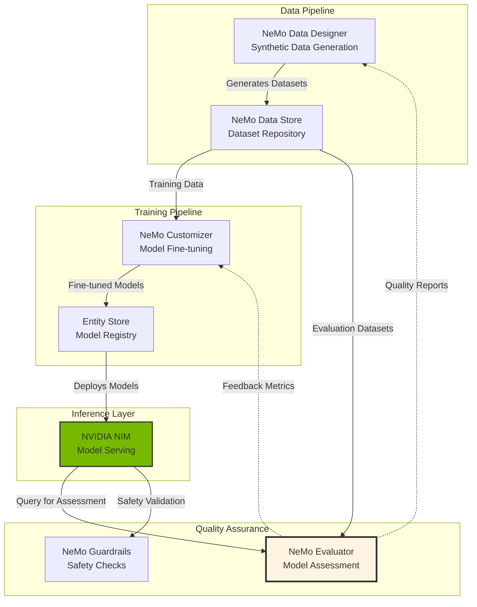
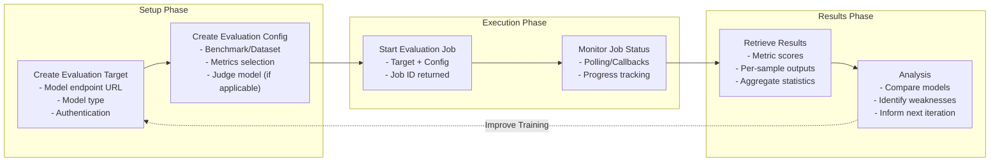
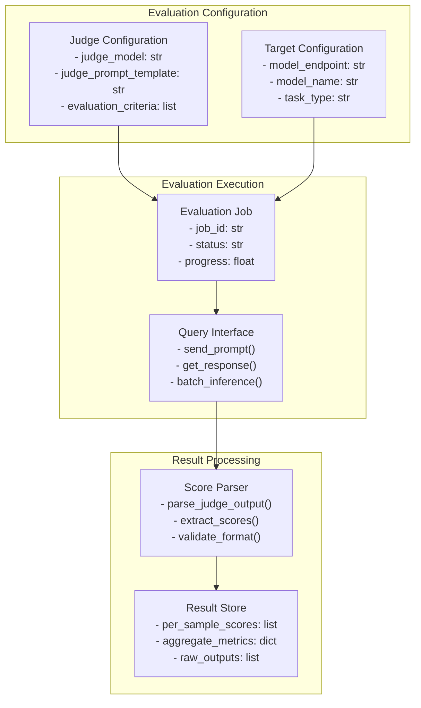
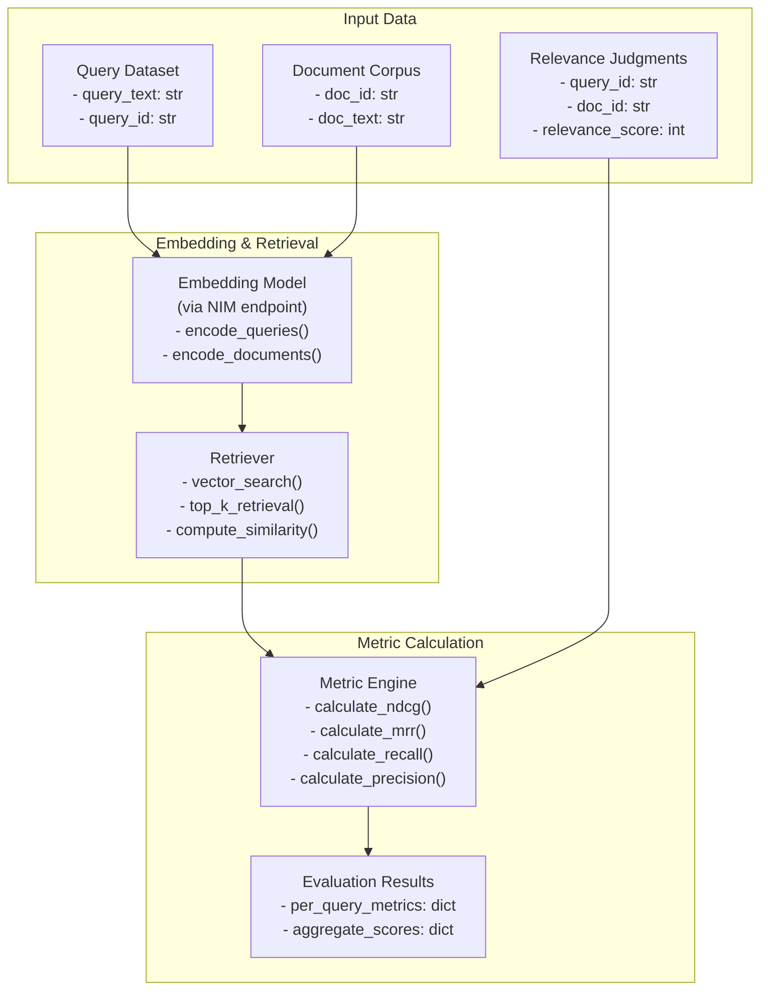
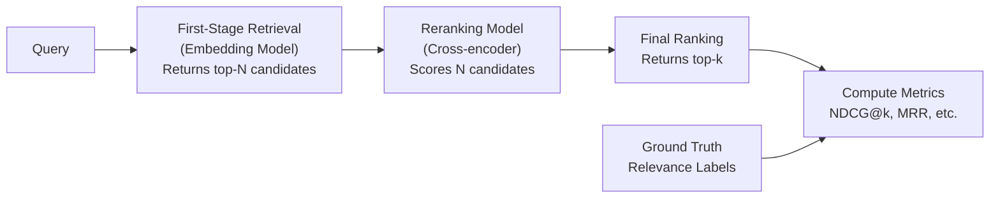
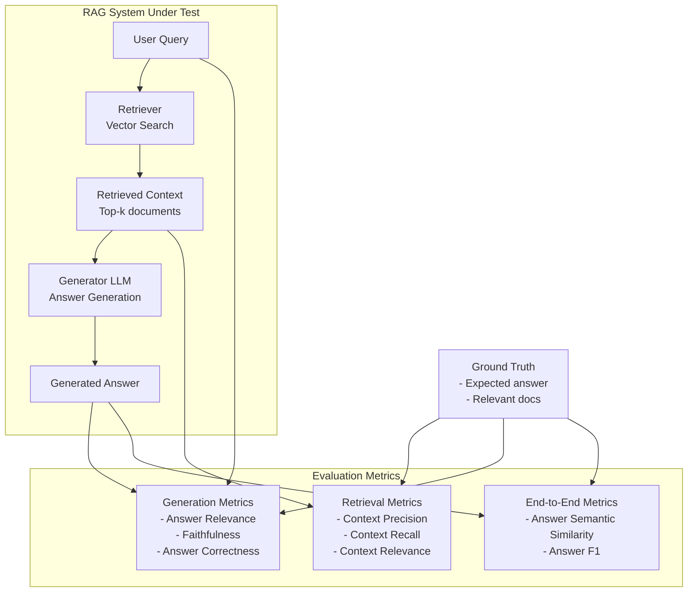
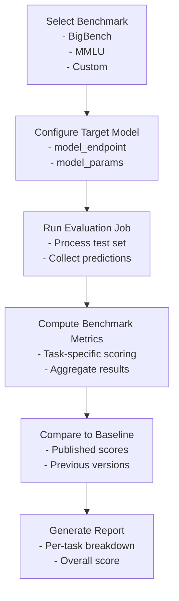
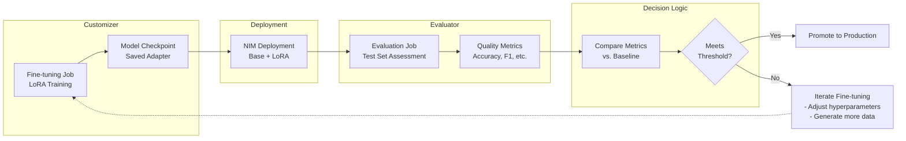
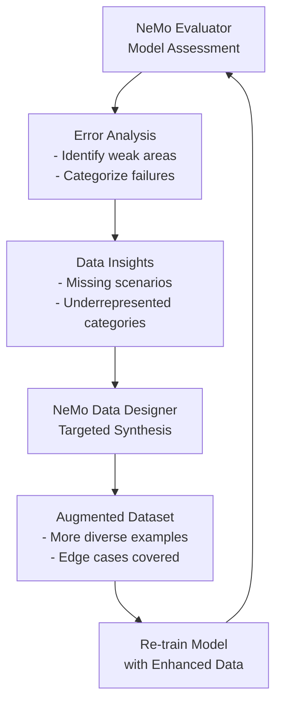
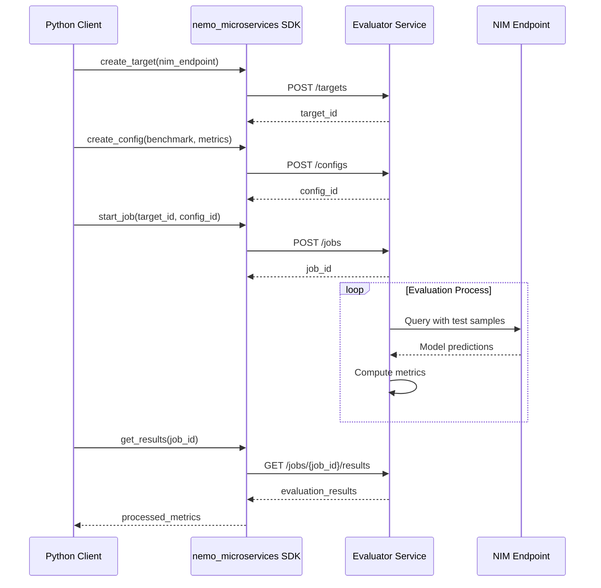

<!-- source: DeepWiki mcp.deepwiki.com · repo NVIDIA/GenerativeAIExamples · page 5 NeMo Evaluator · fetched 2026-10-26 -->

# NeMo Evaluator

<details>
<summary>Relevant source files</summary>

The following files were used as context for generating this wiki page:

- [nemo/Evaluator/README.md](nemo/Evaluator/README.md)

</details>


## Purpose and Scope

NeMo Evaluator is a microservice within the NeMo Microservices Platform that provides comprehensive model assessment capabilities. This document covers the architecture, evaluation types, integration patterns, and usage workflows for NeMo Evaluator.

NeMo Evaluator supports three primary evaluation categories:
- **LLM-as-a-Judge evaluation**: Using language models to assess the quality of generated outputs
- **Retrieval evaluation**: Measuring the performance of embedding models and retriever systems
- **RAG evaluation**: End-to-end assessment of Retrieval-Augmented Generation pipelines

For information about fine-tuning models that are subsequently evaluated, see [Tool Calling Workflow](#4.1) and [Embedding Fine-tuning Workflow](#4.2). For information about the continuous improvement cycle that uses evaluator results, see [NeMo Data Flywheel](#4).

Sources: [nemo/Evaluator/README.md:1-30]()

---

## Architecture Overview

NeMo Evaluator operates as a standalone microservice that queries deployed models through NVIDIA NIM endpoints and computes quality metrics. It integrates with the Data Flywheel to provide feedback for iterative model improvement.

### Position in NeMo Microservices Ecosystem



**Diagram: NeMo Evaluator in the Microservices Ecosystem** - Shows how Evaluator receives evaluation datasets from Data Store, queries models through NIM, and provides feedback to Customizer and Data Designer for continuous improvement.

Sources: High-level architecture diagrams (Diagram 2, Diagram 3)

---

## Evaluation Workflow

The standard evaluation workflow involves creating an evaluation target (the model to assess), defining an evaluation configuration (metrics and datasets), and executing evaluation jobs.



**Diagram: Standard Evaluation Workflow** - The evaluation process from target creation through result analysis, with a feedback loop for model improvement.

Sources: [nemo/Evaluator/README.md:6-10]()

---

## Evaluation Capabilities

### LLM-as-a-Judge Evaluation

LLM-as-a-Judge uses a language model to assess the quality of outputs from another model. This approach enables subjective quality assessment that traditional metrics cannot capture.

**Key Concepts:**
- **Judge Model**: A capable LLM (e.g., GPT-4, Llama 3.1 70B) that evaluates outputs
- **Judge Prompt**: A prompt template instructing the judge on evaluation criteria
- **Evaluation Target**: The model being assessed
- **Reference Dataset**: Input prompts with optional reference outputs

**Code Entity Mapping:**



**Diagram: LLM-as-a-Judge Code Components** - Maps evaluation concepts to code entities involved in judge-based evaluation.

**Use Cases:**
- Summarization quality assessment
- Creative content evaluation
- Instruction following accuracy
- Style and tone adherence

Sources: [nemo/Evaluator/README.md:12-17]()

### Retrieval Evaluation

Retrieval evaluation measures how effectively an embedding model or retriever system finds relevant documents for a given query.

**Standard Retrieval Metrics:**

| Metric | Description | Use Case |
|--------|-------------|----------|
| **NDCG@k** | Normalized Discounted Cumulative Gain at k | Ranking quality with graded relevance |
| **MRR** | Mean Reciprocal Rank | Position of first relevant result |
| **Recall@k** | Fraction of relevant docs in top-k | Coverage assessment |
| **Precision@k** | Fraction of top-k that are relevant | Accuracy assessment |
| **MAP** | Mean Average Precision | Overall retrieval performance |

**Evaluation Process:**



**Diagram: Retrieval Evaluation Pipeline** - Shows the flow from query/corpus data through embedding and retrieval to metric computation.

**Supported Datasets:**
- FiQA (Financial Question Answering)
- MS MARCO (Microsoft MAchine Reading COmprehension)
- Custom datasets with query-document pairs

Sources: [nemo/Evaluator/README.md:19-28]()

### Retriever + Reranking Evaluation

Reranking evaluation assesses two-stage retrieval systems where an initial retriever produces candidates and a reranker model refines the ranking.



**Diagram: Two-Stage Retrieval Evaluation** - The reranking evaluation pipeline with first-stage retrieval and cross-encoder reranking.

**Key Differences from Single-Stage:**
- Evaluates combined retrieval + reranking performance
- Measures improvement from reranking stage
- Requires reranker model endpoint in addition to embedding endpoint

Sources: [nemo/Evaluator/README.md:24]()

### RAG Evaluation

RAG evaluation assesses end-to-end Retrieval-Augmented Generation systems, measuring both retrieval quality and generation quality.

**RAG Evaluation Components:**



**Diagram: RAG Evaluation Metrics** - Shows the three categories of RAG metrics: retrieval quality, generation quality, and end-to-end performance.

**Ragas Framework Integration:**

NeMo Evaluator integrates with Ragas (RAG Assessment) metrics for comprehensive RAG evaluation:

| Metric | Category | Description |
|--------|----------|-------------|
| **Context Precision** | Retrieval | Measures if retrieved contexts are relevant to the query |
| **Context Recall** | Retrieval | Measures if all necessary information is retrieved |
| **Faithfulness** | Generation | Measures if the answer is grounded in retrieved context |
| **Answer Relevance** | Generation | Measures if the answer addresses the query |
| **Answer Correctness** | End-to-End | Compares answer to ground truth (factual + semantic) |
| **Answer Semantic Similarity** | End-to-End | Cosine similarity with ground truth answer |

**Evaluation Datasets:**
- FiQA with RAG setup
- Synthetic datasets generated by Data Designer
- Custom domain-specific datasets

Sources: [nemo/Evaluator/README.md:20-27]()

---

## Benchmark Evaluation

NeMo Evaluator supports standard benchmarks for comparing models against established baselines.

**Supported Benchmarks:**

| Benchmark | Task Type | Metrics | Use Case |
|-----------|-----------|---------|----------|
| **BigBench** | Diverse Tasks | Accuracy, F1 | General capability assessment |
| **MMLU** | Multi-task Language Understanding | Accuracy | Knowledge and reasoning |
| **GSM8K** | Math Word Problems | Exact Match | Mathematical reasoning |
| **HumanEval** | Code Generation | Pass@k | Programming capability |
| **TruthfulQA** | Truthfulness | MC1, MC2 | Factual accuracy |

**Benchmark Evaluation Flow:**



**Diagram: Benchmark Evaluation Workflow** - Standard flow for evaluating models on established benchmarks.

Sources: [nemo/Evaluator/README.md:8]()

---

## Integration Patterns

### Integration with NeMo Customizer

NeMo Evaluator provides feedback to the fine-tuning process by evaluating customized models:



**Diagram: Evaluator-Customizer Integration** - Shows how evaluation results inform the fine-tuning iteration loop.

Sources: High-level architecture diagrams (Diagram 3)

### Integration with Data Designer

Evaluation results guide synthetic data generation priorities:



**Diagram: Evaluator-Data Designer Feedback Loop** - Evaluation insights drive targeted synthetic data generation.

Sources: High-level architecture diagrams (Diagram 2, Diagram 3)

---

## API and Client Usage

### NeMo Microservices SDK Integration

NeMo Evaluator is accessed through the `nemo_microservices` Python SDK:

**Key SDK Components:**

| Component | Purpose | Key Methods |
|-----------|---------|-------------|
| `EvaluatorClient` | Main client interface | `create_target()`, `create_config()`, `start_job()` |
| `EvaluationTarget` | Model endpoint configuration | `from_nim_endpoint()`, `set_auth()` |
| `EvaluationConfig` | Evaluation parameters | `add_benchmark()`, `add_metric()`, `set_dataset()` |
| `EvaluationJob` | Job management | `wait_for_completion()`, `get_results()`, `cancel()` |
| `ResultsProcessor` | Result analysis | `get_aggregate_metrics()`, `get_per_sample()` |

**Typical Usage Pattern:**



**Diagram: SDK-Evaluator Interaction Sequence** - Shows the API call sequence for running an evaluation job through the SDK.

Sources: [nemo/Evaluator/README.md:6-27]()

---

## Example Notebooks

The NeMo Evaluator includes three example notebooks demonstrating different evaluation scenarios:

### Getting Started Notebook

**Location:** [nemo/Evaluator/GettingStarted/Getting Started with NeMo Evaluator.ipynb]()

**Covers:**
- Basic NeMo Evaluator usage patterns
- Evaluating Llama 3.1 8B Instruct on BigBench
- Evaluating customized models on title-generation tasks
- ROUGE metric computation
- Creating evaluation targets and configurations

**Key Concepts Demonstrated:**
- Baseline model evaluation
- Custom task evaluation
- Standard metric usage

Sources: [nemo/Evaluator/README.md:5-10]()

### LLM-as-a-Judge Notebook

**Location:** [nemo/Evaluator/LLMAsAJudge/LLM As a Judge.ipynb]()

**Covers:**
- Setting up judge-based evaluation for summarization
- Creating custom judge prompts
- Configuring judge models
- Analyzing subjective quality metrics
- Result interpretation

**Key Concepts Demonstrated:**
- Judge model selection
- Prompt engineering for judges
- Subjective quality assessment

Sources: [nemo/Evaluator/README.md:12-17]()

### Retriever and RAG Evaluation Notebook

**Location:** [nemo/Evaluator/EmbeddingAndRAG/NeMo_Evaluator_Retriever_and_RAG_Evaluation.ipynb]()

**Covers:**
- Retriever model evaluation on FiQA dataset
- Two-stage retrieval with reranking on FiQA
- RAG system evaluation with Ragas metrics
- Synthetic dataset evaluation for RAG
- Custom dataset integration

**Key Concepts Demonstrated:**
- Retrieval metric computation
- Reranking evaluation
- End-to-end RAG assessment
- Synthetic vs. real data comparison

Sources: [nemo/Evaluator/README.md:19-28]()

---

## File Structure

```
nemo/Evaluator/
├── README.md                                    # Overview and navigation
├── GettingStarted/
│   └── Getting Started with NeMo Evaluator.ipynb   # Basic usage tutorial
├── LLMAsAJudge/
│   └── LLM As a Judge.ipynb                    # Judge-based evaluation
└── EmbeddingAndRAG/
    └── NeMo_Evaluator_Retriever_and_RAG_Evaluation.ipynb  # Retrieval & RAG
```

Sources: [nemo/Evaluator/README.md:1-30]()

---

## Summary

NeMo Evaluator provides comprehensive model assessment capabilities across three primary domains:

1. **LLM Evaluation**: Benchmark testing, judge-based assessment, and task-specific metrics
2. **Retrieval Evaluation**: Embedding model assessment, reranking evaluation, and standard IR metrics
3. **RAG Evaluation**: End-to-end pipeline assessment with retrieval and generation metrics

The service integrates with other NeMo Microservices to enable the Data Flywheel's continuous improvement cycle, providing feedback to both the Customizer (for fine-tuning iterations) and Data Designer (for targeted data generation). Access is provided through the `nemo_microservices` SDK with a consistent API for creating targets, configurations, and evaluation jobs.

Sources: [nemo/Evaluator/README.md:1-30](), High-level architecture diagrams

---

