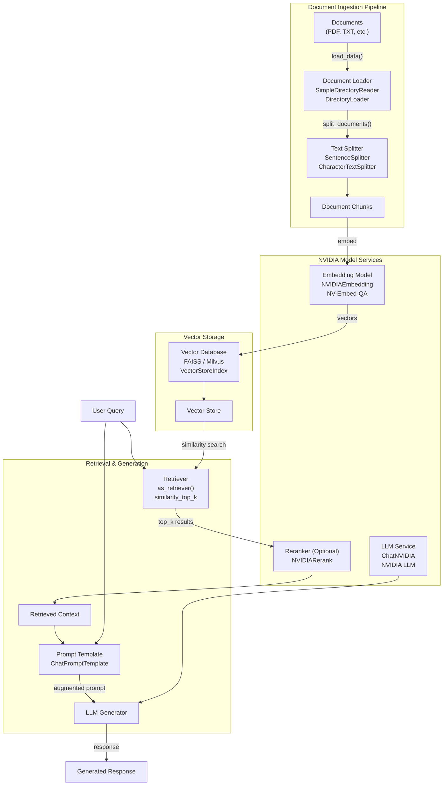
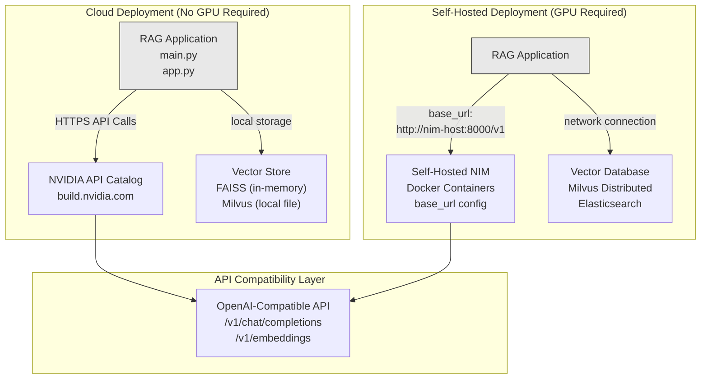
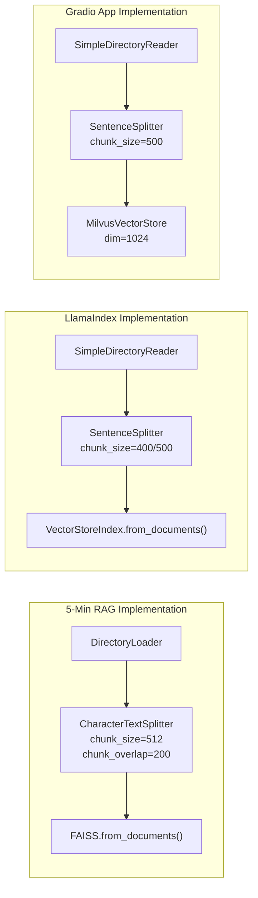
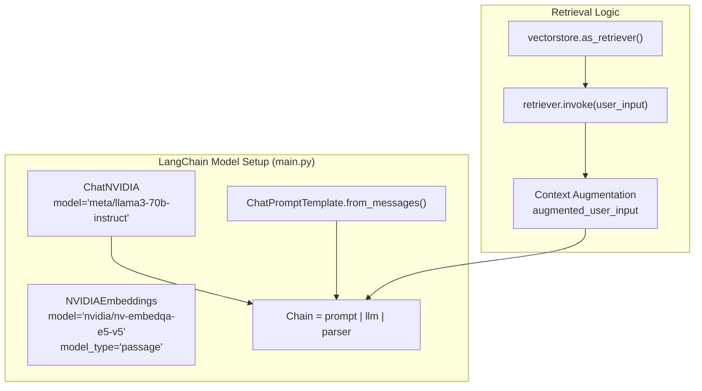
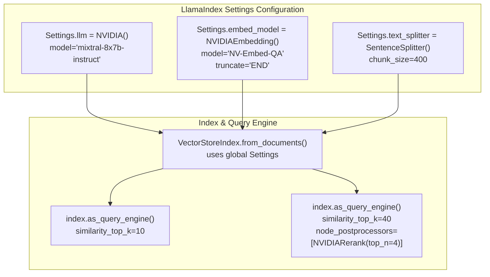
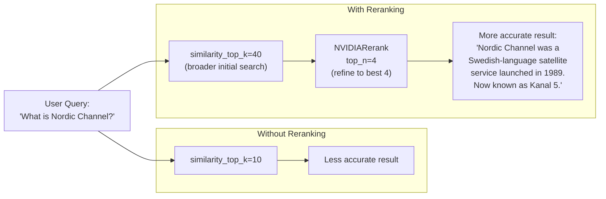
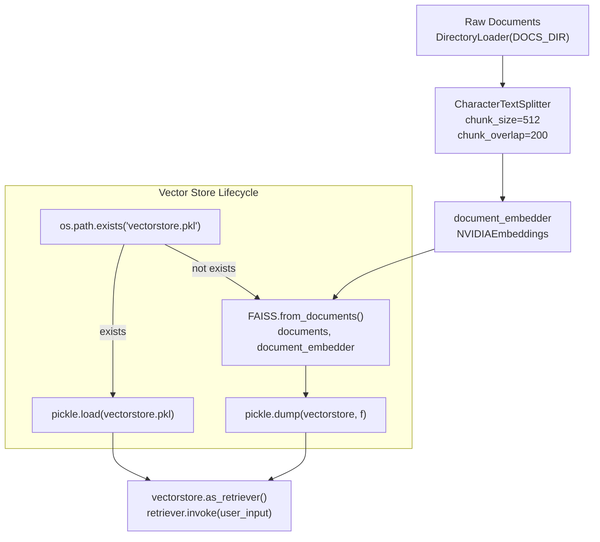
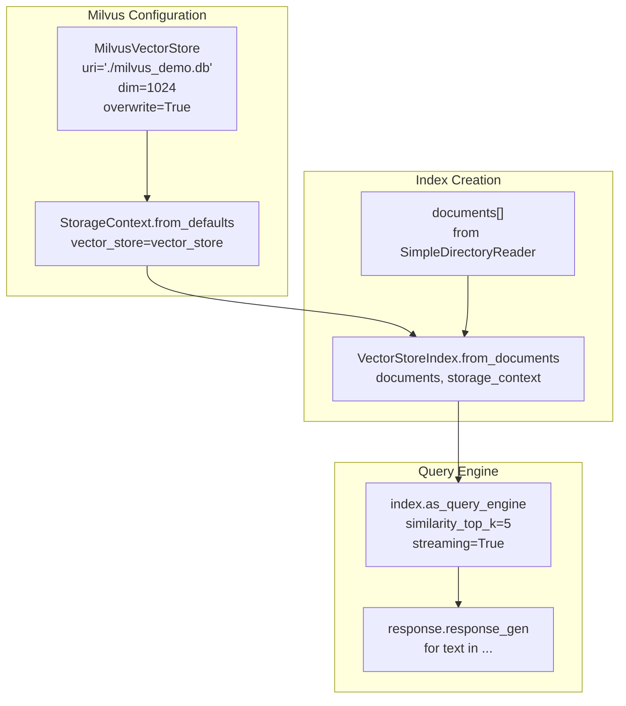

<!-- source: DeepWiki mcp.deepwiki.com · repo NVIDIA/GenerativeAIExamples · page 6 RAG Implementations · fetched 2026-10-26 -->

# RAG Implementations

<details>
<summary>Relevant source files</summary>

The following files were used as context for generating this wiki page:

- [RAG/notebooks/llamaindex/llamaindex_basic_RAG.ipynb](RAG/notebooks/llamaindex/llamaindex_basic_RAG.ipynb)
- [community/5_mins_rag_no_gpu/README.md](community/5_mins_rag_no_gpu/README.md)
- [community/5_mins_rag_no_gpu/main.py](community/5_mins_rag_no_gpu/main.py)
- [community/5_mins_rag_no_gpu/requirements.txt](community/5_mins_rag_no_gpu/requirements.txt)
- [community/llm_video_series/video_1_llm_assistant_cloud_app/README.md](community/llm_video_series/video_1_llm_assistant_cloud_app/README.md)
- [community/llm_video_series/video_1_llm_assistant_cloud_app/app.py](community/llm_video_series/video_1_llm_assistant_cloud_app/app.py)
- [community/llm_video_series/video_1_llm_assistant_cloud_app/requirements.txt](community/llm_video_series/video_1_llm_assistant_cloud_app/requirements.txt)

</details>


## Purpose and Scope

This document provides an overview of Retrieval-Augmented Generation (RAG) implementations available in the repository. RAG is a technique for augmenting large language model (LLM) knowledge with external data sources, enabling models to reason about private data or information introduced after their training cutoff date.

The repository contains RAG implementations across three categories:
- **Quick Start Examples**: Minimal setup examples requiring no local GPU, covered in [Quick Start RAG Examples](#6.1)
- **Framework-Based RAG**: Implementations using LlamaIndex, LangChain, and Haystack, detailed in [Framework-Based RAG](#6.2)
- **Multimodal RAG**: Systems processing text, images, and audio, documented in [Multimodal RAG](#6.3)

For model evaluation and quality assessment of RAG systems, see [NeMo Evaluator](#5). For fine-tuning embedding models to improve retrieval quality, see [Embedding Fine-tuning Workflow](#4.2).

## RAG Architecture Overview

All RAG implementations in the repository follow a common architectural pattern that can be deployed using either cloud-hosted services or self-hosted infrastructure.

### Core RAG Pipeline



**Sources:** [RAG/notebooks/llamaindex/llamaindex_basic_RAG.ipynb:16-62](), [community/5_mins_rag_no_gpu/main.py:16-28]()

### Deployment Architecture Options



**Sources:** [RAG/notebooks/llamaindex/llamaindex_basic_RAG.ipynb:397-416](), [community/5_mins_rag_no_gpu/README.md:1-49]()

## Implementation Comparison

The repository provides RAG implementations with varying complexity levels, deployment requirements, and framework choices:

| Example | Framework | UI | Vector Store | GPU Required | Key Features |
|---------|-----------|----|--------------|--------------| -------------|
| 5-min RAG No GPU | LangChain | Streamlit | FAISS | No | Minimal setup, document upload, cloud-only |
| LlamaIndex Basic RAG | LlamaIndex | Jupyter Notebook | In-memory | No | Educational, step-by-step, reranking demo |
| LLM Assistant Cloud App | LlamaIndex | Gradio | Milvus | No | Streaming responses, multi-file upload |

**Sources:** [community/5_mins_rag_no_gpu/main.py:1-123](), [RAG/notebooks/llamaindex/llamaindex_basic_RAG.ipynb:1-441](), [community/llm_video_series/video_1_llm_assistant_cloud_app/app.py:1-126]()

## Component Architecture

### Document Processing Components

All RAG implementations follow a similar document processing flow with configurable chunking strategies:



**Sources:** [community/5_mins_rag_no_gpu/main.py:56-73](), [RAG/notebooks/llamaindex/llamaindex_basic_RAG.ipynb:222-228](), [community/llm_video_series/video_1_llm_assistant_cloud_app/app.py:29-69]()

### Model Configuration Patterns

#### LangChain Pattern

The LangChain-based implementation uses `langchain_nvidia_ai_endpoints` for NVIDIA model integration:



**Sources:** [community/5_mins_rag_no_gpu/main.py:48-98]()

#### LlamaIndex Pattern

The LlamaIndex-based implementations use global `Settings` configuration with NVIDIA integrations:



**Sources:** [RAG/notebooks/llamaindex/llamaindex_basic_RAG.ipynb:166-194](), [community/llm_video_series/video_1_llm_assistant_cloud_app/app.py:28-32]()

## Reranking Enhancement

Reranking improves retrieval accuracy by refining the initial similarity search results. The LlamaIndex implementation demonstrates this pattern:



**Sources:** [RAG/notebooks/llamaindex/llamaindex_basic_RAG.ipynb:340-390]()

The reranking workflow retrieves more candidates initially (`similarity_top_k=40`) and then uses `NVIDIARerank` to select the most relevant subset (`top_n=4`). This two-stage approach is configured via `node_postprocessors` parameter in `index.as_query_engine()`.

## API Key Management

All implementations require an NVIDIA API key for accessing cloud-hosted models:

| Implementation | Configuration Method | Code Location |
|----------------|---------------------|---------------|
| 5-Min RAG | Environment variable `NVIDIA_API_KEY` | [community/5_mins_rag_no_gpu/main.py:1-50]() |
| LlamaIndex Notebook | `getpass.getpass()` with validation | [RAG/notebooks/llamaindex/llamaindex_basic_RAG.ipynb:129-136]() |
| Gradio App | Environment variable check with error | [community/llm_video_series/video_1_llm_assistant_cloud_app/app.py:35-36]() |

API keys are obtained from [build.nvidia.com](https://build.nvidia.com/explore/discover) and must start with the prefix `nvapi-`.

**Sources:** [community/5_mins_rag_no_gpu/README.md:29-35](), [RAG/notebooks/llamaindex/llamaindex_basic_RAG.ipynb:106-136]()

## Vector Store Implementations

### FAISS In-Memory Store

The 5-minute RAG example uses FAISS for lightweight, local vector storage with persistence:



**Sources:** [community/5_mins_rag_no_gpu/main.py:52-80]()

### Milvus Vector Store

The Gradio app uses Milvus for more robust vector storage with configurable dimensions:



**Sources:** [community/llm_video_series/video_1_llm_assistant_cloud_app/app.py:64-72]()

## User Interface Patterns

### Streamlit-Based Interface

The 5-minute RAG implementation uses Streamlit for a simple file upload and chat interface:

- **Sidebar**: Document upload with `st.file_uploader()` and `st.form()`
- **Main Area**: Chat interface with `st.chat_message()` and `st.chat_input()`
- **Session State**: Conversation history stored in `st.session_state.messages`
- **Streaming**: LLM responses streamed via `chain.stream()`

**Sources:** [community/5_mins_rag_no_gpu/main.py:32-122]()

### Gradio-Based Interface

The Gradio app provides a more interactive experience with real-time feedback:

- **File Input**: Multi-file upload with `gr.File(file_count="multiple")`
- **Load Button**: `load_btn.click()` triggers document processing
- **Chatbot**: `gr.Chatbot()` with streaming responses via `stream_response()`
- **Progress**: Document loading status displayed in `gr.Textbox()`

**Sources:** [community/llm_video_series/video_1_llm_assistant_cloud_app/app.py:104-126]()

## Self-Hosted NIM Integration

All NVIDIA model connectors support self-hosted NIMs by configuring the `base_url` parameter:

```python
# LlamaIndex pattern
llm = NVIDIA(
    model="meta/llama3-8b-instruct",
    base_url="http://your-nim-host-address:8000/v1"
)

# LangChain pattern (same OpenAI-compatible API)
llm = ChatNVIDIA(
    model="meta/llama3-8b-instruct",
    base_url="http://your-nim-host-address:8000/v1"
)
```

This enables migration from cloud to on-premises deployment without code changes beyond the `base_url` configuration.

**Sources:** [RAG/notebooks/llamaindex/llamaindex_basic_RAG.ipynb:397-416]()

## Dependencies and Requirements

### Core Dependencies Across Implementations

| Package | 5-Min RAG | LlamaIndex Notebook | Gradio App |
|---------|-----------|---------------------|------------|
| `langchain` | 0.1.20 | - | - |
| `langchain-nvidia-ai-endpoints` | ✓ | - | - |
| `llama-index-core` | - | 0.10.50 | 0.10.58 |
| `llama-index-llms-nvidia` | - | 0.1.3 | 0.1.4 |
| `llama-index-embeddings-nvidia` | - | 0.1.4 | 0.1.4 |
| `llama-index-postprocessor-nvidia-rerank` | - | 0.1.2 | - |
| `faiss-cpu` | 1.7.4 | - | - |
| `llama-index-vector-stores-milvus` | - | - | 0.1.20 |
| `pymilvus` | - | - | 2.4.4 |
| `streamlit` | 1.30.0 | - | - |
| `gradio` | - | - | 4.37.2 |

**Sources:** [community/5_mins_rag_no_gpu/requirements.txt:1-6](), [community/llm_video_series/video_1_llm_assistant_cloud_app/requirements.txt:1-7]()

## Common Implementation Patterns

### Document Loading Pattern

All implementations follow a consistent pattern for loading documents:

1. Define document directory path
2. Use framework-specific loader (`DirectoryLoader` or `SimpleDirectoryReader`)
3. Load documents with `.load_data()` or `.load()`
4. Apply text splitting based on chunk size configuration

**Sources:** [community/5_mins_rag_no_gpu/main.py:56-57](), [RAG/notebooks/llamaindex/llamaindex_basic_RAG.ipynb:222-228](), [community/llm_video_series/video_1_llm_assistant_cloud_app/app.py:54-66]()

### Query Execution Pattern

The query flow is similar across implementations with framework-specific APIs:

1. User submits query via UI
2. Query is embedded using the same embedding model
3. Vector store performs similarity search
4. Top-k results are retrieved (optionally reranked)
5. Retrieved context is combined with query in prompt template
6. LLM generates response based on augmented prompt
7. Response is streamed or returned to user

**Sources:** [community/5_mins_rag_no_gpu/main.py:99-122](), [RAG/notebooks/llamaindex/llamaindex_basic_RAG.ipynb:273-315](), [community/llm_video_series/video_1_llm_assistant_cloud_app/app.py:78-102]()

## Extension Points

Each RAG implementation provides extension points for customization:

- **Model Selection**: Change LLM, embedding, or reranking model via model parameter
- **Chunk Size**: Adjust text splitting parameters for document processing
- **Retrieval Parameters**: Configure `similarity_top_k` and reranking thresholds
- **Vector Store**: Swap vector database backend (FAISS, Milvus, Chroma, etc.)
- **UI Framework**: Choose Streamlit, Gradio, or build custom interface
- **Deployment**: Use cloud API Catalog or self-hosted NIMs

These extension points allow developers to adapt the examples to specific use cases while maintaining compatibility with the NVIDIA ecosystem.

**Sources:** [RAG/notebooks/llamaindex/llamaindex_basic_RAG.ipynb:35-62](), [community/llm_video_series/video_1_llm_assistant_cloud_app/README.md:72-79]()

---

