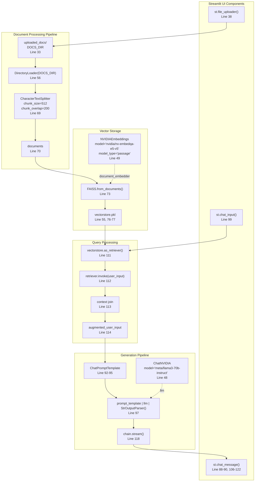
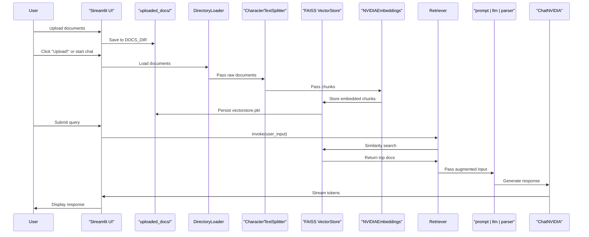

<!-- source: DeepWiki mcp.deepwiki.com · repo NVIDIA/GenerativeAIExamples · page 6.1 Quick Start RAG Examples · fetched 2026-10-26 -->

# Quick Start RAG Examples

<details>
<summary>Relevant source files</summary>

The following files were used as context for generating this wiki page:

- [community/5_mins_rag_no_gpu/README.md](community/5_mins_rag_no_gpu/README.md)
- [community/5_mins_rag_no_gpu/main.py](community/5_mins_rag_no_gpu/main.py)
- [community/5_mins_rag_no_gpu/requirements.txt](community/5_mins_rag_no_gpu/requirements.txt)

</details>


This page documents minimal RAG (Retrieval-Augmented Generation) examples that can be deployed in minutes without requiring local GPUs. These examples use the NVIDIA API Catalog (build.nvidia.com) to access hosted language models and embeddings, providing a zero-infrastructure path to experimenting with RAG systems. For framework-based implementations, see page 6.2. For multimodal RAG, see page 6.3.

## Overview

Quick Start RAG examples demonstrate how to build functional retrieval-augmented generation pipelines with minimal setup. The primary example, "5-Minute RAG No GPU", showcases a complete RAG system using:

- **NVIDIA API Catalog**: Cloud-hosted models accessible via API keys (no local GPU required)
- **Streamlit**: Simple web UI for document upload and chat interaction
- **LangChain**: Framework for orchestrating LLM and embedding components
- **FAISS**: Local vector storage for semantic search

The example implements the standard RAG pattern: document ingestion → chunking → embedding → vector storage → retrieval → augmented generation.

Sources: [community/5_mins_rag_no_gpu/README.md:1-13](), [community/5_mins_rag_no_gpu/main.py:16-18]()

## 5-Minute RAG Architecture

The following diagram maps the RAG pipeline to code entities in `main.py`:



Sources: [community/5_mins_rag_no_gpu/main.py:31-122]()

## Component Details

The 5-Minute RAG example uses the following LangChain components integrated with NVIDIA API Catalog:

| Component | Class/Function | Configuration | Line Reference |
|-----------|---------------|---------------|----------------|
| **LLM** | `ChatNVIDIA` | `model="meta/llama3-70b-instruct"` | [community/5_mins_rag_no_gpu/main.py:48]() |
| **Embedding Model** | `NVIDIAEmbeddings` | `model="nvidia/nv-embedqa-e5-v5"`<br/>`model_type="passage"` | [community/5_mins_rag_no_gpu/main.py:49]() |
| **Document Loader** | `DirectoryLoader` | Loads from `DOCS_DIR` | [community/5_mins_rag_no_gpu/main.py:56]() |
| **Text Splitter** | `CharacterTextSplitter` | `chunk_size=512`<br/>`chunk_overlap=200` | [community/5_mins_rag_no_gpu/main.py:69]() |
| **Vector Store** | `FAISS` | In-memory with pickle persistence | [community/5_mins_rag_no_gpu/main.py:73, 76-77]() |
| **Prompt Template** | `ChatPromptTemplate` | System message + user input | [community/5_mins_rag_no_gpu/main.py:92-95]() |
| **Output Parser** | `StrOutputParser` | Extracts string from LLM response | [community/5_mins_rag_no_gpu/main.py:97]() |

Sources: [community/5_mins_rag_no_gpu/main.py:48-97]()

## Implementation Walkthrough

### Document Upload and Storage

The application uses Streamlit's sidebar for document management:

```python
# Component #1 - Document Upload (Lines 31-45)
```

The `st.file_uploader()` component allows uploading multiple files. Uploaded files are saved to the `uploaded_docs/` directory (`DOCS_DIR` at line 33). The `st.form()` context ensures clean submission handling with the "Upload!" button clearing the form after submission.

Sources: [community/5_mins_rag_no_gpu/main.py:31-45]()

### Model Initialization

Both the LLM and embedding model are initialized at module level using `langchain_nvidia_ai_endpoints`:

```python
# Component #2 - Embedding Model and LLM (Lines 47-49)
llm = ChatNVIDIA(model="meta/llama3-70b-instruct")
document_embedder = NVIDIAEmbeddings(model="nvidia/nv-embedqa-e5-v5", model_type="passage")
```

These clients connect to the NVIDIA API Catalog via the `NVIDIA_API_KEY` environment variable. The embedding model uses `model_type="passage"` for document encoding.

Sources: [community/5_mins_rag_no_gpu/main.py:47-49]()

### Vector Store Creation

The vector store creation logic includes persistence via pickle:

```python
# Component #3 - Vector Database Store (Lines 52-80)
```

The application provides a radio button (`use_existing_vector_store`) to control whether to load a cached vector store or rebuild from scratch. The workflow:

1. Load documents using `DirectoryLoader(DOCS_DIR).load()` (line 56)
2. Split documents with `CharacterTextSplitter(chunk_size=512, chunk_overlap=200)` (line 69)
3. Create FAISS index: `FAISS.from_documents(documents, document_embedder)` (line 73)
4. Persist to disk: `pickle.dump(vectorstore, f)` at `vectorstore.pkl` (line 76-77)

The persistence mechanism enables faster startup on subsequent runs by avoiding re-embedding.

Sources: [community/5_mins_rag_no_gpu/main.py:52-80]()

### Query Pipeline with Context Augmentation

The chat interface implements streaming responses with retrieval augmentation:

```python
# Component #4 - LLM Response Generation and Chat (Lines 82-122)
```

**Sequence of operations**:

1. User submits query via `st.chat_input()` (line 99)
2. Query is added to `st.session_state.messages` for history (line 102)
3. If vector store exists, retrieve context:
   - Create retriever: `vectorstore.as_retriever()` (line 111)
   - Invoke retrieval: `retriever.invoke(user_input)` (line 112)
   - Join contexts: `"\n\n".join([doc.page_content for doc in docs])` (line 113)
   - Augment query: `f"Context: {context}\n\nQuestion: {user_input}\n"` (line 114)
4. Stream response through chain:
   - Chain definition: `prompt_template | llm | StrOutputParser()` (line 97)
   - Streaming: `chain.stream({"input": augmented_user_input})` (line 118)
5. Display with live updating placeholder (lines 119-121)

The prompt template at lines 92-95 defines a system message identifying the assistant as "Envie" with instructions to use context if available.

Sources: [community/5_mins_rag_no_gpu/main.py:82-122]()

### Execution Flow Diagram



Sources: [community/5_mins_rag_no_gpu/main.py:31-122]()

## Setup Instructions

### Prerequisites

1. **NVIDIA API Key**: Obtain from [NVIDIA API Catalog](https://build.nvidia.com/explore/)
   - Select any model and click "Get API Key"
   - Free credits available for 10K requests
   
2. **Python Environment**: Python 3.8+ with virtual environment

Sources: [community/5_mins_rag_no_gpu/README.md:29-35]()

### Installation Steps

1. Create and activate a virtual environment:
   ```bash
   python3 -m virtualenv genai
   source genai/bin/activate
   ```

2. Install dependencies:
   ```bash
   pip install -r community/5_mins_rag_no_gpu/requirements.txt
   ```

   Key dependencies:
   - `streamlit==1.30.0`: Web UI framework
   - `faiss-cpu==1.7.4`: Vector similarity search
   - `langchain==0.1.20`: LLM orchestration
   - `langchain-nvidia-ai-endpoints`: NVIDIA API integrations
   - `unstructured[all-docs]==0.11.2`: Document parsing

3. Set API key environment variable:
   ```bash
   export NVIDIA_API_KEY="nvapi-*"
   ```

4. Run the application:
   ```bash
   streamlit run community/5_mins_rag_no_gpu/main.py
   ```

5. Access the UI at `http://<host_ip>:8501`

Sources: [community/5_mins_rag_no_gpu/README.md:14-43](), [community/5_mins_rag_no_gpu/requirements.txt:1-6]()

### Usage Workflow

1. **Document Ingestion**:
   - Click "Browse Files" in the sidebar
   - Select knowledge source documents (PDF, TXT, etc.)
   - Click "Upload!" to process and embed documents
   - Vector store is saved to `vectorstore.pkl` for reuse

2. **Chat Interaction**:
   - Type queries in the chat input box
   - The system retrieves relevant context from uploaded documents
   - Responses stream in real-time with visual feedback
   - Chat history is maintained in session state

3. **Vector Store Management**:
   - Use "Yes" to load existing vector store on subsequent runs
   - Use "No" to rebuild from documents (useful after document updates)

Sources: [community/5_mins_rag_no_gpu/README.md:43-48](), [community/5_mins_rag_no_gpu/main.py:52-64]()

## Key Design Decisions

### LangChain Integration

The example uses `langchain_nvidia_ai_endpoints` package for NVIDIA API Catalog integration:

- **`ChatNVIDIA`**: LangChain-compatible chat model wrapper (line 48)
- **`NVIDIAEmbeddings`**: LangChain embeddings interface (line 49)
- **OpenAI-compatible API**: Uses standard `/v1/chat/completions` and `/v1/embeddings` endpoints

This enables drop-in compatibility with existing LangChain applications. Users can swap OpenAI models for NVIDIA models by changing the model class and API key.

Sources: [community/5_mins_rag_no_gpu/main.py:21, 48-49]()

### FAISS for Local Storage

The example uses FAISS CPU version for vector storage:

- **In-memory operation**: Fast similarity search without database setup
- **Pickle persistence**: Simple serialization to `vectorstore.pkl` (lines 76-77)
- **No external dependencies**: No need for Milvus, Pinecone, or other vector databases
- **Limitation**: Not suitable for large-scale production deployments

For production systems requiring distributed storage, see page 6.2 for Milvus and other vector database integrations.

Sources: [community/5_mins_rag_no_gpu/main.py:55-77](), [community/5_mins_rag_no_gpu/requirements.txt:2]()

### Streaming Response Pattern

The implementation uses LangChain's streaming capability for real-time feedback:

```python
# Lines 118-121
for response in chain.stream({"input": augmented_user_input}):
    full_response += response
    message_placeholder.markdown(full_response + "▌")
```

The streaming pattern provides better user experience by showing token-by-token generation. The `▌` character creates a typing indicator that's removed on completion (line 121).

Sources: [community/5_mins_rag_no_gpu/main.py:118-121]()

## Configuration Options

### Chunk Size Tuning

The `CharacterTextSplitter` configuration affects retrieval quality:

```python
# Line 69
text_splitter = CharacterTextSplitter(chunk_size=512, chunk_overlap=200)
```

- **`chunk_size=512`**: Character count per chunk. Larger chunks provide more context but less granular retrieval.
- **`chunk_overlap=200`**: Overlap prevents context loss at chunk boundaries. Should be 20-40% of chunk size.

**Trade-offs**:
- Smaller chunks (256-512): More precise retrieval, fits more chunks in context window
- Larger chunks (1024-2048): More context per chunk, better for complex questions
- Higher overlap (30-50%): Better boundary handling, more storage required

Sources: [community/5_mins_rag_no_gpu/main.py:69]()

### Model Selection

The example uses specific model choices that can be modified:

| Model Type | Current Selection | Alternative Options |
|------------|-------------------|---------------------|
| **LLM** | `meta/llama3-70b-instruct` | `meta/llama-3.1-405b-instruct`<br/>`mistralai/mixtral-8x7b-instruct-v0.1`<br/>`meta/llama-3.1-8b-instruct` |
| **Embeddings** | `nvidia/nv-embedqa-e5-v5` | `nvidia/nv-embed-v1`<br/>`snowflake/arctic-embed-l` |

To change models, modify lines 48-49. Browse available models at [build.nvidia.com/explore](https://build.nvidia.com/explore/).

Sources: [community/5_mins_rag_no_gpu/main.py:48-49](), [community/5_mins_rag_no_gpu/README.md:5-7]()

### Prompt Template Customization

The system prompt at lines 92-95 can be modified for different behaviors:

```python
prompt_template = ChatPromptTemplate.from_messages([
    ("system", "You are a helpful AI assistant named Envie. If provided with context, use it to inform your responses. If no context is available, use your general knowledge to provide a helpful response."),
    ("human", "{input}")
])
```

**Customization examples**:
- Add role-specific instructions: "You are a technical support assistant..."
- Enforce citation: "Always cite the source document when using context..."
- Control verbosity: "Provide concise answers in 2-3 sentences..."

Sources: [community/5_mins_rag_no_gpu/main.py:92-95]()

## Limitations and Considerations

### API Rate Limits

NVIDIA API Catalog provides free credits with rate limits:
- 10,000 requests for initial credits
- Rate limiting may apply during peak usage
- Production deployments should consider self-hosted NIMs (see page 6.2)

### Scalability Constraints

This quick start example has specific limitations:

| Aspect | Limitation | Solution |
|--------|-----------|----------|
| **Vector Storage** | FAISS in-memory, single process | Migrate to Milvus, Pinecone, or Weaviate |
| **Concurrency** | Streamlit single-user session state | Deploy with session management or stateless architecture |
| **Document Volume** | Limited by RAM for FAISS | Use distributed vector database |
| **GPU Requirements** | None (uses API Catalog) | Self-host NIMs for high throughput |

Sources: [community/5_mins_rag_no_gpu/main.py:73](), [community/5_mins_rag_no_gpu/README.md:12-13]()

### Context Window Management

The current implementation doesn't limit the number of retrieved documents:

```python
# Line 111-113: Default retrieval without top-k limit
retriever = vectorstore.as_retriever()
docs = retriever.invoke(user_input)
```

For production use, configure `search_kwargs` to limit results:

```python
retriever = vectorstore.as_retriever(search_kwargs={"k": 5})
```

This prevents context window overflow when using models with limited context capacity.

Sources: [community/5_mins_rag_no_gpu/main.py:111-113]()

## Using Self-hosted NIM Services

While the examples use NVIDIA API Catalog's hosted models, you can also use self-hosted NVIDIA Inference Microservices (NIMs):

```python
# Example code for using self-hosted NIM
from llama_index.llms.nvidia import NVIDIA
llm = NVIDIA(model="meta/llama3-8b-instruct", base_url="http://your-nim-host-address:8000/v1")
```

This allows deployment on your own infrastructure when needed for production environments, data privacy, or custom models.

Sources: [RAG/notebooks/llamaindex/llamaindex_basic_RAG.ipynb:391-416]()

---

