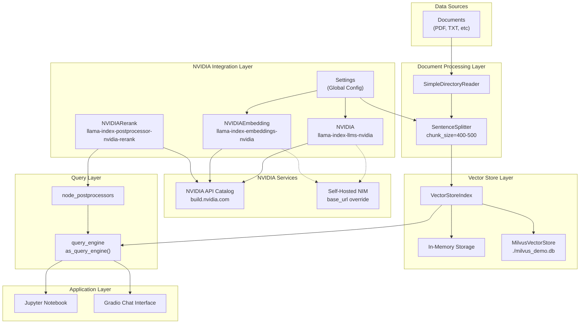
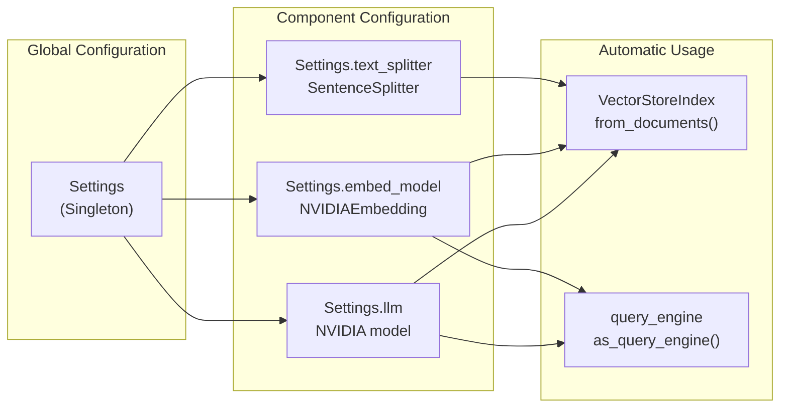
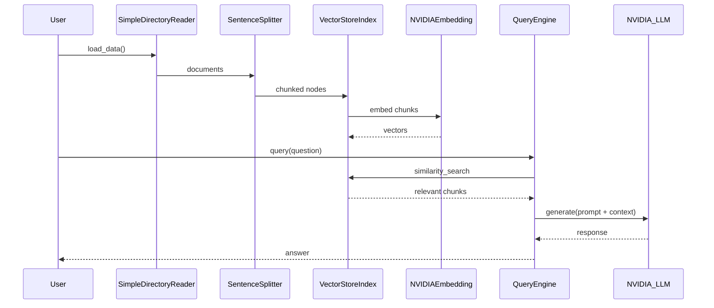
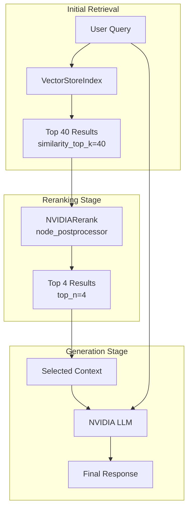
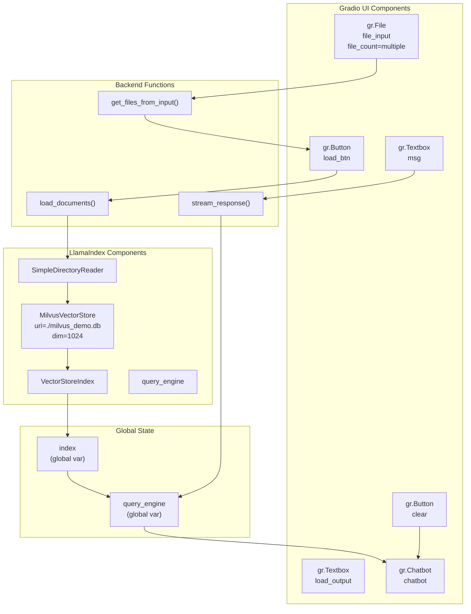
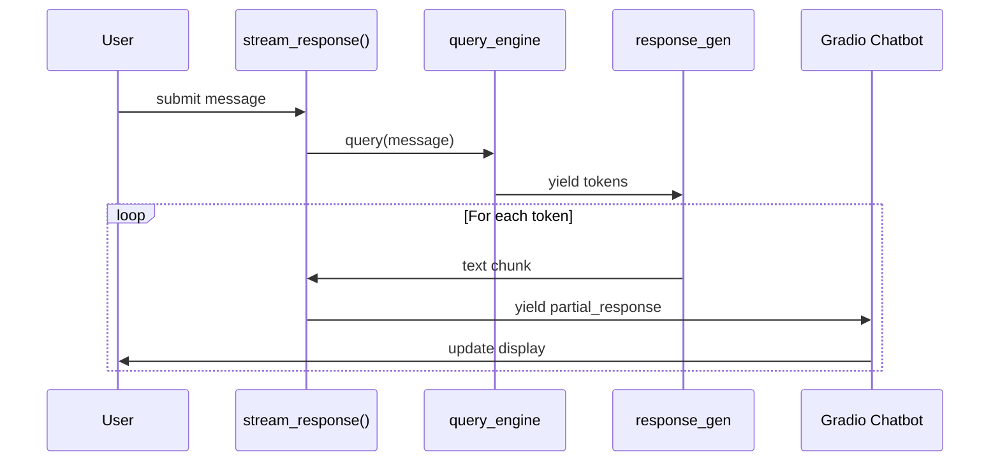
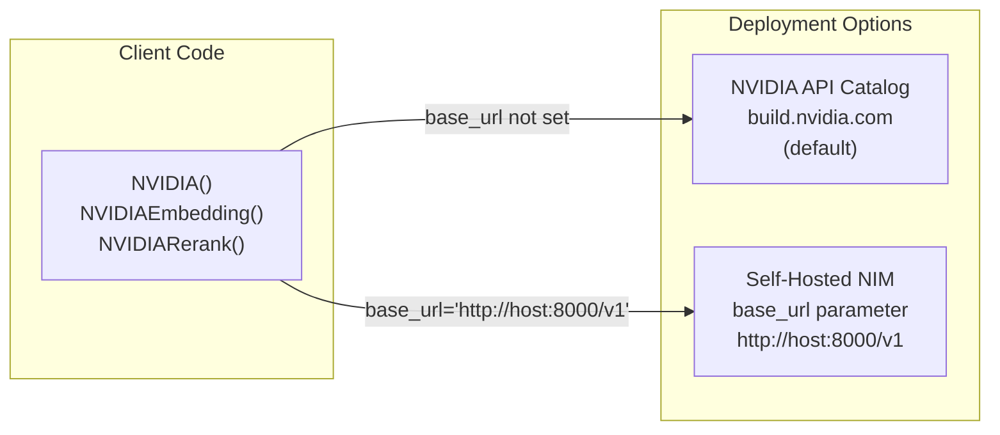

<!-- source: DeepWiki mcp.deepwiki.com · repo NVIDIA/GenerativeAIExamples · page 6.2 Framework-Based RAG · fetched 2026-10-26 -->

# Framework-Based RAG

<details>
<summary>Relevant source files</summary>

The following files were used as context for generating this wiki page:

- [RAG/notebooks/llamaindex/llamaindex_basic_RAG.ipynb](RAG/notebooks/llamaindex/llamaindex_basic_RAG.ipynb)
- [community/llm_video_series/video_1_llm_assistant_cloud_app/README.md](community/llm_video_series/video_1_llm_assistant_cloud_app/README.md)
- [community/llm_video_series/video_1_llm_assistant_cloud_app/app.py](community/llm_video_series/video_1_llm_assistant_cloud_app/app.py)
- [community/llm_video_series/video_1_llm_assistant_cloud_app/requirements.txt](community/llm_video_series/video_1_llm_assistant_cloud_app/requirements.txt)

</details>


## Purpose and Scope

This document covers Retrieval-Augmented Generation (RAG) implementations using established Python frameworks that integrate with NVIDIA NIMs and the NVIDIA API Catalog. These implementations provide production-ready patterns for building RAG applications with frameworks like LlamaIndex, LangChain, and Haystack.

For minimal RAG examples that require no local GPU setup, see [Quick Start RAG Examples](#6.1). For RAG systems that process images, audio, and video, see [Multimodal RAG](#6.3).

**Sources:** [RAG/notebooks/llamaindex/llamaindex_basic_RAG.ipynb:1-440](), [community/llm_video_series/video_1_llm_assistant_cloud_app/README.md:1-86]()

## Architecture Overview

Framework-based RAG implementations in this repository leverage the LlamaIndex framework with NVIDIA-specific integrations. The architecture follows a standard RAG pipeline pattern where documents are indexed into vector stores, user queries retrieve relevant context, and NVIDIA NIMs generate responses.

### System Architecture



**Sources:** [RAG/notebooks/llamaindex/llamaindex_basic_RAG.ipynb:86-261](), [community/llm_video_series/video_1_llm_assistant_cloud_app/app.py:17-75]()

## LlamaIndex Integration Components

### Core NVIDIA Integration Packages

Framework-based RAG implementations use three primary NVIDIA integration packages for LlamaIndex:

| Package | Purpose | Key Classes |
|---------|---------|-------------|
| `llama-index-llms-nvidia` | LLM inference | `NVIDIA` |
| `llama-index-embeddings-nvidia` | Text embeddings | `NVIDIAEmbedding` |
| `llama-index-postprocessor-nvidia-rerank` | Result reranking | `NVIDIARerank` |

These packages provide OpenAI-compatible interfaces while connecting to NVIDIA NIMs either via the API Catalog or self-hosted endpoints.

**Sources:** [RAG/notebooks/llamaindex/llamaindex_basic_RAG.ipynb:91-98](), [community/llm_video_series/video_1_llm_assistant_cloud_app/requirements.txt:1-7]()

### Settings Configuration Pattern



The `Settings` object provides global configuration that is automatically used by LlamaIndex components. This pattern simplifies code by eliminating the need to pass configuration to every component.

**Sources:** [RAG/notebooks/llamaindex/llamaindex_basic_RAG.ipynb:166-194](), [community/llm_video_series/video_1_llm_assistant_cloud_app/app.py:27-31]()

## Basic RAG Implementation

### Document Processing Pipeline

The basic RAG implementation follows a standard pipeline:

1. **Document Loading**: `SimpleDirectoryReader` loads documents from a directory or file paths
2. **Text Splitting**: `SentenceSplitter` chunks documents into smaller segments (typically 400-500 characters)
3. **Embedding**: `NVIDIAEmbedding` converts chunks to vector representations
4. **Indexing**: `VectorStoreIndex` stores vectors for retrieval
5. **Query**: `query_engine` retrieves relevant chunks and generates responses



**Sources:** [RAG/notebooks/llamaindex/llamaindex_basic_RAG.ipynb:216-315]()

### Configuration Example: Notebook Implementation

The notebook implementation at [RAG/notebooks/llamaindex/llamaindex_basic_RAG.ipynb:166-315]() demonstrates the basic pattern:

**Step 1: Configure LLM**
```python
# Settings.llm = NVIDIA(model="mistralai/mixtral-8x7b-instruct-v0.1")
```
Uses the `mistralai/mixtral-8x7b-instruct-v0.1` model from the NVIDIA API Catalog.

**Step 2: Configure Embeddings**
```python
# Settings.embed_model = NVIDIAEmbedding(model="NV-Embed-QA", truncate="END")
```
Uses the `NV-Embed-QA` embedding model with truncation strategy.

**Step 3: Configure Text Splitter**
```python
# Settings.text_splitter = SentenceSplitter(chunk_size=400)
```
Splits documents into 400-character chunks.

**Step 4: Load and Index Documents**
```python
# documents = SimpleDirectoryReader(TOY_DATA_PATH).load_data()
# index = VectorStoreIndex.from_documents(documents)
```
The `from_documents()` method automatically applies the configured splitter and embedding model.

**Step 5: Create Query Engine**
```python
# query_engine = index.as_query_engine(similarity_top_k=10)
```
Retrieves the top 10 most similar chunks for each query.

**Sources:** [RAG/notebooks/llamaindex/llamaindex_basic_RAG.ipynb:160-315]()

## Advanced RAG with Reranking

### Reranking Architecture

Reranking improves retrieval accuracy by applying a more sophisticated model to a large initial retrieval set. The pattern involves:

1. Initial retrieval of many candidates (e.g., `similarity_top_k=40`)
2. Reranking to select the best subset (e.g., `top_n=4`)
3. Using only the reranked results for LLM context



**Implementation Pattern:**
```python
# reranker_query_engine = index.as_query_engine(
#     similarity_top_k=40, 
#     node_postprocessors=[NVIDIARerank(top_n=4)]
# )
```

The reranker is specified in the `node_postprocessors` list, which processes retrieved nodes before they are sent to the LLM.

**Sources:** [RAG/notebooks/llamaindex/llamaindex_basic_RAG.ipynb:326-390]()

### Reranking Use Cases

The notebook demonstrates reranking for enhancing accuracy when retrieving from a single data source. The example query "What is Nordic Channel?" shows improved results:

- **Without reranking**: [RAG/notebooks/llamaindex/llamaindex_basic_RAG.ipynb:340-345]() - Produces an uncertain response
- **With reranking**: [RAG/notebooks/llamaindex/llamaindex_basic_RAG.ipynb:379-390]() - Produces an accurate, confident response

Reranking is particularly valuable for:
- Complex queries requiring precise information
- Combining results from multiple data sources
- Improving retrieval accuracy for single data sources

**Sources:** [RAG/notebooks/llamaindex/llamaindex_basic_RAG.ipynb:348-390]()

## Gradio-Based Interactive Application

### Application Architecture

The Gradio application at [community/llm_video_series/video_1_llm_assistant_cloud_app/app.py:1-126]() provides an interactive chat interface with document upload capabilities.



**Sources:** [community/llm_video_series/video_1_llm_assistant_cloud_app/app.py:17-126]()

### Document Loading Implementation

The `load_documents()` function at [community/llm_video_series/video_1_llm_assistant_cloud_app/app.py:48-75]() implements the document processing workflow:

**Key Implementation Details:**

1. **File Path Extraction**: [app.py:43-46]() - Converts Gradio file objects to file paths
2. **Document Loading**: [app.py:56-59]() - Iterates through files using `SimpleDirectoryReader`
3. **Vector Store Creation**: [app.py:65-66]() - Initializes `MilvusVectorStore` with local SQLite-based storage (`./milvus_demo.db`)
4. **Index Creation**: [app.py:69]() - Creates `VectorStoreIndex` with `overwrite=True` to refresh on each load
5. **Query Engine Setup**: [app.py:72]() - Configures query engine with `similarity_top_k=5` and streaming enabled

The function uses `overwrite=True` to reset the vector store on each document load, ensuring clean state.

**Sources:** [community/llm_video_series/video_1_llm_assistant_cloud_app/app.py:43-75]()

### Streaming Response Implementation

The `stream_response()` function at [community/llm_video_series/video_1_llm_assistant_cloud_app/app.py:89-102]() implements token-by-token streaming:



The implementation:
1. Checks if `query_engine` is initialized
2. Calls `query_engine.query()` which returns a streaming response
3. Iterates through `response.response_gen` to get token chunks
4. Accumulates tokens in `partial_response`
5. Yields updated history with partial response for progressive UI updates

**Sources:** [community/llm_video_series/video_1_llm_assistant_cloud_app/app.py:89-102]()

## Vector Store Options

Framework-based RAG implementations support multiple vector storage backends through LlamaIndex's `VectorStoreIndex`:

| Vector Store | Configuration | Use Case |
|--------------|---------------|----------|
| In-Memory | `VectorStoreIndex.from_documents(documents)` | Prototyping, notebooks, temporary data |
| Milvus | `MilvusVectorStore(uri="./milvus_demo.db", dim=1024, overwrite=True)` | Persistent local storage, production applications |
| Milvus (Remote) | `MilvusVectorStore(host="...", port=19530)` | Distributed deployments |

### In-Memory Vector Store

The notebook implementation at [RAG/notebooks/llamaindex/llamaindex_basic_RAG.ipynb:257-261]() uses the default in-memory storage:

```python
# index = VectorStoreIndex.from_documents(documents)
```

This approach stores all vectors in memory and is suitable for:
- Interactive development and testing
- Small datasets that fit in RAM
- Scenarios where persistence is not required

**Sources:** [RAG/notebooks/llamaindex/llamaindex_basic_RAG.ipynb:257-261]()

### Milvus Vector Store

The Gradio application uses Milvus with SQLite-based local storage:

```python
# vector_store = MilvusVectorStore(uri="./milvus_demo.db", dim=1024, overwrite=True)
# storage_context = StorageContext.from_defaults(vector_store=vector_store)
# index = VectorStoreIndex.from_documents(documents, storage_context=storage_context)
```

Configuration parameters:
- `uri="./milvus_demo.db"`: Local SQLite file path for persistence
- `dim=1024`: Vector dimensionality (matches `NV-Embed-QA` output)
- `overwrite=True`: Replaces existing collection on each load

**Sources:** [community/llm_video_series/video_1_llm_assistant_cloud_app/app.py:65-69]()

## Self-Hosted NIM Support

All NVIDIA integration classes support both cloud-hosted and self-hosted NIMs through the `base_url` parameter.

### API Endpoint Configuration



### Self-Hosted NIM Example

The notebook provides an example of connecting to a self-hosted NIM at [RAG/notebooks/llamaindex/llamaindex_basic_RAG.ipynb:406-416]():

```python
# llm = NVIDIA(model="meta/llama3-8b-instruct", base_url="http://your-nim-host-address:8000/v1")
```

**Configuration Requirements:**
- `model`: Model identifier compatible with the NIM endpoint
- `base_url`: Full URL to the self-hosted NIM including `/v1` suffix
- NVIDIA API key still required for authentication (or removed for local auth)

The same pattern applies to `NVIDIAEmbedding` and `NVIDIARerank` for self-hosted deployment.

**Sources:** [RAG/notebooks/llamaindex/llamaindex_basic_RAG.ipynb:397-416]()

## Authentication and API Key Management

### API Key Setup

Framework-based implementations require an NVIDIA API key for accessing hosted NIMs:

**Method 1: Environment Variable**
```python
# os.environ["NVIDIA_API_KEY"] = nvidia_api_key
```

**Method 2: Interactive Input**
```python
# nvidia_api_key = getpass.getpass("Enter your NVIDIA API key: ")
# assert nvidia_api_key.startswith("nvapi-"), f"{nvidia_api_key[:5]}... is not a valid key"
# os.environ["NVIDIA_API_KEY"] = nvidia_api_key
```

The Gradio application validates the environment variable at startup:
```python
# if os.getenv('NVIDIA_API_KEY') is None:
#     raise ValueError("NVIDIA_API_KEY environment variable is not set")
```

**API Key Acquisition:**
1. Create account at [build.nvidia.com](https://build.nvidia.com/explore/discover)
2. Select a model
3. Navigate to Python tab under Input
4. Click "Get API Key" then "Generate Key"
5. Copy the generated key (starts with `nvapi-`)

**Sources:** [RAG/notebooks/llamaindex/llamaindex_basic_RAG.ipynb:104-136](), [community/llm_video_series/video_1_llm_assistant_cloud_app/app.py:34-36]()

## Deployment Patterns

Framework-based RAG implementations support two primary deployment patterns:

### Pattern 1: Jupyter Notebook Development

**Characteristics:**
- Interactive development environment
- Cell-by-cell execution for testing
- In-memory vector storage
- Manual document loading
- Direct query execution

**Use Cases:**
- Prototyping and experimentation
- Data exploration
- Algorithm testing
- Educational demonstrations

**Sources:** [RAG/notebooks/llamaindex/llamaindex_basic_RAG.ipynb:1-440]()

### Pattern 2: Gradio Web Application

**Characteristics:**
- Web-based user interface
- Persistent vector storage (Milvus)
- Multi-file upload support
- Streaming responses
- Chat history management

**Use Cases:**
- Internal demos and proof-of-concepts
- User-facing applications
- Team collaboration
- Production deployments

**Sources:** [community/llm_video_series/video_1_llm_assistant_cloud_app/README.md:1-86](), [community/llm_video_series/video_1_llm_assistant_cloud_app/app.py:1-126]()

## Configuration Reference

### Model Selection

The implementations support any model available in the NVIDIA API Catalog:

**LLM Models:**
- `mistralai/mixtral-8x7b-instruct-v0.1` - Used in notebook example
- `meta/llama3-70b-instruct` - Used in Gradio application
- `meta/llama3-8b-instruct` - Example for self-hosted NIM

**Embedding Models:**
- `NV-Embed-QA` - Optimized for question-answering tasks
- Output dimension: 1024

**Reranking Models:**
- Default model from `NVIDIARerank()` - Accessed via API Catalog

**Sources:** [RAG/notebooks/llamaindex/llamaindex_basic_RAG.ipynb:156-194](), [community/llm_video_series/video_1_llm_assistant_cloud_app/app.py:29-31]()

### Query Engine Parameters

Common `query_engine` configuration parameters:

| Parameter | Purpose | Example Values |
|-----------|---------|----------------|
| `similarity_top_k` | Number of chunks to retrieve | `5`, `10`, `40` |
| `streaming` | Enable token streaming | `True`, `False` |
| `node_postprocessors` | Post-retrieval processing | `[NVIDIARerank(top_n=4)]` |

**Example Configurations:**

Basic query engine:
```python
# query_engine = index.as_query_engine(similarity_top_k=10)
```

Streaming query engine:
```python
# query_engine = index.as_query_engine(similarity_top_k=5, streaming=True)
```

Query engine with reranking:
```python
# query_engine = index.as_query_engine(
#     similarity_top_k=40, 
#     node_postprocessors=[NVIDIARerank(top_n=4)]
# )
```

**Sources:** [RAG/notebooks/llamaindex/llamaindex_basic_RAG.ipynb:272-390](), [community/llm_video_series/video_1_llm_assistant_cloud_app/app.py:72]()

### Text Splitting Configuration

The `SentenceSplitter` controls document chunking:

| Parameter | Purpose | Notebook Value | Gradio App Value |
|-----------|---------|----------------|------------------|
| `chunk_size` | Maximum characters per chunk | 400 | 500 |

Smaller chunks provide more precise retrieval but may fragment context. Larger chunks preserve context but may include irrelevant information.

**Sources:** [RAG/notebooks/llamaindex/llamaindex_basic_RAG.ipynb:225-227](), [community/llm_video_series/video_1_llm_assistant_cloud_app/app.py:29]()

## Dependencies and Requirements

### Core Dependencies

Framework-based RAG implementations require the following packages:

**Notebook Environment:**
```
llama-index-core==0.10.50
llama-index-readers-file==0.1.25
llama-index-llms-nvidia==0.1.3
llama-index-embeddings-nvidia==0.1.4
llama-index-postprocessor-nvidia-rerank==0.1.2
ipywidgets==8.1.3
```

**Gradio Application:**
```
llama-index-core==0.10.58
llama-index-readers-file==0.1.30
llama-index-llms-nvidia==0.1.4
llama-index-embeddings-nvidia==0.1.4
llama-index-vector-stores-milvus==0.1.20
pymilvus==2.4.4
gradio==4.37.2
```

**Python Version:** 3.10.14 (notebook), 3.9+ (Gradio application)

**Sources:** [RAG/notebooks/llamaindex/llamaindex_basic_RAG.ipynb:91-99](), [community/llm_video_series/video_1_llm_assistant_cloud_app/requirements.txt:1-7]()

### Installation Commands

**Notebook Setup:**
```bash
pip install --upgrade pip
pip install llama-index-core==0.10.50
pip install llama-index-readers-file==0.1.25
pip install llama-index-llms-nvidia==0.1.3
pip install llama-index-embeddings-nvidia==0.1.4
pip install llama-index-postprocessor-nvidia-rerank==0.1.2
pip install ipywidgets==8.1.3
```

**Gradio Application Setup:**
```bash
pip install -r requirements.txt
```

**Sources:** [RAG/notebooks/llamaindex/llamaindex_basic_RAG.ipynb:91-99](), [community/llm_video_series/video_1_llm_assistant_cloud_app/README.md:32-35]()

---

