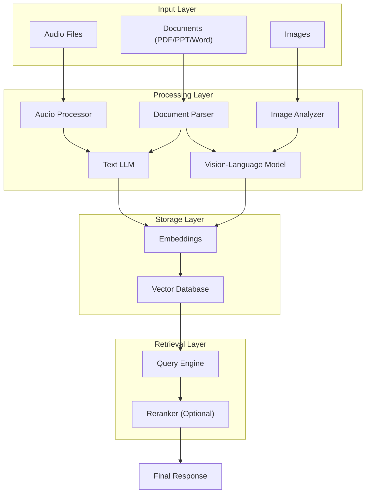
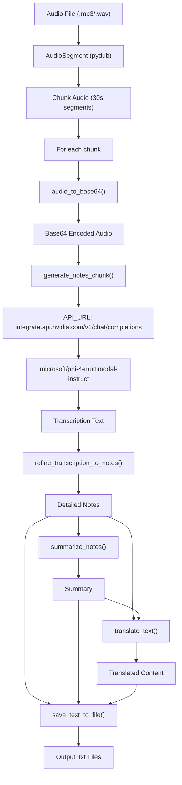
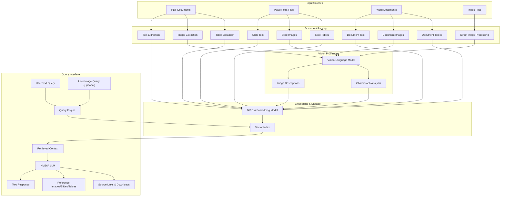
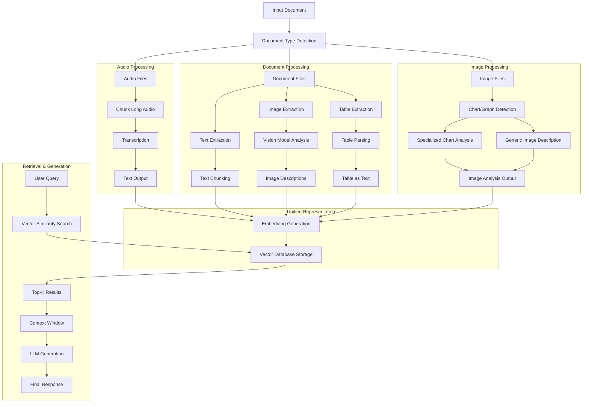
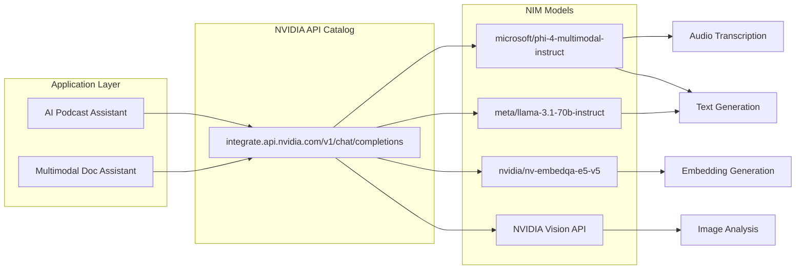

<!-- source: DeepWiki mcp.deepwiki.com · repo NVIDIA/GenerativeAIExamples · page 6.3 Multimodal RAG · fetched 2026-10-26 -->

# Multimodal RAG

<details>
<summary>Relevant source files</summary>

The following files were used as context for generating this wiki page:

- [RAG/notebooks/llamaindex/llamaindex_basic_RAG.ipynb](RAG/notebooks/llamaindex/llamaindex_basic_RAG.ipynb)
- [community/README.md](community/README.md)
- [community/ai-podcast-assistant/README.md](community/ai-podcast-assistant/README.md)
- [community/ai-podcast-assistant/ai-podcast-assistant-phi4-mulitmodal.ipynb](community/ai-podcast-assistant/ai-podcast-assistant-phi4-mulitmodal.ipynb)
- [community/dgx-spark-demo/README.md](community/dgx-spark-demo/README.md)
- [community/dgx-spark-demo/openwebui_interface.png](community/dgx-spark-demo/openwebui_interface.png)
- [community/llm_video_series/video_1_llm_assistant_cloud_app/README.md](community/llm_video_series/video_1_llm_assistant_cloud_app/README.md)
- [community/llm_video_series/video_1_llm_assistant_cloud_app/app.py](community/llm_video_series/video_1_llm_assistant_cloud_app/app.py)
- [community/llm_video_series/video_1_llm_assistant_cloud_app/requirements.txt](community/llm_video_series/video_1_llm_assistant_cloud_app/requirements.txt)

</details>


Multimodal RAG extends traditional text-based RAG systems to process and retrieve information from multiple data modalities. This page documents RAG implementations that handle text, images, audio, tables, and mixed-content documents using NVIDIA NIM microservices and vision-language models.

For basic text-only RAG implementations, see page 6.1. For framework-based RAG using LlamaIndex and LangChain, see page 6.2.

## Overview of Multimodal Processing

Multimodal RAG systems process multiple data types:

- **Text**: Documents, articles, technical specifications
- **Audio**: Podcasts, recordings, spoken content
- **Images**: Diagrams, photographs, charts
- **Tables**: Structured data from PDFs, slides, spreadsheets
- **Mixed Content**: PDFs, PowerPoint presentations, Word documents

The repository provides several multimodal examples:

| Example | Modalities | Key Features | Location |
|---------|-----------|--------------|----------|
| AI Podcast Assistant | Audio, Text | Transcription, summarization, translation | [community/ai-podcast-assistant]() |
| Multimodal RAG Assistant | Text, Images, Tables | PDF/PPT/Word ingestion, visual Q&A | [community/multimodal_assistant]() |
| ORAN Chatbot | Text, Technical Specs | Technical document processing | [community/oran-chatbot-multimodal]() |

Sources:
- [community/README.md:54-98]()
- [community/ai-podcast-assistant/README.md:1-93]()

## General Multimodal RAG Architecture

### Diagram: Multimodal RAG System Architecture



Multimodal RAG systems follow a general pattern:

1. **Input Layer**: Accepts various file types (audio, documents, images)
2. **Processing Layer**: Extracts content using specialized processors and models
3. **Storage Layer**: Creates embeddings and stores them for retrieval
4. **Retrieval Layer**: Searches and ranks relevant content to generate responses

Sources:
- [community/README.md:54-98]()
- [community/ai-podcast-assistant/README.md:5-25]()

## Audio Processing: AI Podcast Assistant

The AI Podcast Assistant demonstrates multimodal RAG for audio content using the Phi-4-Multimodal LLM through NVIDIA NIM microservices. It processes podcast audio to generate notes, summaries, and translations.

### Diagram: AI Podcast Assistant Architecture



### Audio Processing Pipeline

The system processes long audio files through these steps:

1. **Audio Chunking**: `generate_detailed_notes()` splits audio into manageable segments using `pydub.AudioSegment`
   - Default chunk duration: 30 seconds (30000ms)
   - Handles files of any length by dividing into chunks

2. **Base64 Encoding**: `audio_to_base64()` converts audio segments to base64 strings for API transmission
   - Exports audio to MP3 format in memory
   - Encodes as base64 for inclusion in API requests

3. **Transcription**: `generate_notes_chunk()` sends each chunk to Phi-4-Multimodal
   - Model: `microsoft/phi-4-multimodal-instruct`
   - Parameters: 5.6B parameters, 128K context length
   - Supports multilingual audio (English, Chinese, German, French, etc.)

4. **Notes Generation**: `refine_transcription_to_notes()` formats raw transcription into structured notes
   - Removes system prompt artifacts
   - Organizes content with bullet points and paragraphs

5. **Summarization**: `summarize_notes()` creates concise summaries from detailed notes
   - Captures key points in paragraph form
   - Uses lower max_tokens (512) for brevity

6. **Translation**: `translate_text()` translates content to target languages
   - Preserves formatting and structure
   - Handles notes and summaries independently

Sources:
- [community/ai-podcast-assistant/README.md:1-93]()
- [community/ai-podcast-assistant/ai-podcast-assistant-phi4-mulitmodal.ipynb:59-250]()

### Implementation Example

The core transcription function processes individual audio chunks:

```python
# Defined in ai-podcast-assistant-phi4-mulitmodal.ipynb
def generate_notes_chunk(audio_chunk, api_key, chunk_index, total_chunks):
    audio_b64 = audio_to_base64(audio_chunk)
    prompt = (
        f"Transcribe the following audio accurately. "
        f"This is segment {chunk_index+1} of {total_chunks}. "
        "Please do not include any system commentary or self-referential text."
    )
    prompt += f' <audio src="data:audio/wav;base64,{audio_b64}" />'
    
    payload = {
        "model": "microsoft/phi-4-multimodal-instruct",
        "messages": [
            {"role": "system", "content": "You're a transcription assistant."},
            {"role": "user", "content": prompt}
        ],
        "max_tokens": 1024,
        "temperature": 0.1,
        "top_p": 0.7,
        "stream": False
    }
    
    response = requests.post(API_URL, headers=headers, json=payload)
    return result["choices"][0]["message"]["content"].strip()
```

Key implementation details:
- Audio embedded directly in prompt as base64 data URI
- Low temperature (0.1) for accurate transcription
- Context includes chunk position for coherent processing
- Error handling for robustness

Sources:
- [community/ai-podcast-assistant/ai-podcast-assistant-phi4-mulitmodal.ipynb:78-114]()

### Usage Instructions

Setup and execution steps:

1. **Installation**:
   ```bash
   pip install pydub requests Pillow
   ```

2. **API Key Configuration**:
   - Obtain NVIDIA API key from [build.nvidia.com](https://build.nvidia.com/microsoft/phi-4-multimodal-instruct?api_key=true)
   - Set in notebook: `API_KEY = "your_api_key_here"`

3. **Process Audio**:
   ```python
   podcast_audio_path = "podcast_audio.mp3"
   transcription = generate_detailed_notes(podcast_audio_path, API_KEY, chunk_duration_ms=30000)
   detailed_notes = refine_transcription_to_notes(transcription, API_KEY)
   summary = summarize_notes(detailed_notes, API_KEY)
   ```

4. **Translation** (optional):
   ```python
   target_language = "Spanish"
   translated_text = translate_text(combined_text, target_language, API_KEY)
   ```

5. **Save Results**:
   ```python
   save_text_to_file(combined_text, "podcast_detailed_notes.txt")
   save_text_to_file(translated_text, "podcast_transcription_translated.txt")
   ```

Sources:
- [community/ai-podcast-assistant/README.md:36-74]()
- [community/ai-podcast-assistant/ai-podcast-assistant-phi4-mulitmodal.ipynb:260-314]()

### Model Specifications

Phi-4-Multimodal LLM specifications:

| Property | Value |
|----------|-------|
| Parameters | 5.6B |
| Input Modalities | Text, Image, Audio |
| Context Length | 128K tokens |
| Training Data | 5T text tokens, 2.3M speech hours, 1.1T image-text tokens |
| Supported Languages | Multilingual (English, Chinese, German, French, etc.) |
| API Endpoint | `https://integrate.api.nvidia.com/v1/chat/completions` |

Sources:
- [community/ai-podcast-assistant/ai-podcast-assistant-phi4-mulitmodal.ipynb:9-15]()
- [community/ai-podcast-assistant/README.md:75-83]()

## Document Processing: Multimodal RAG Assistant

The Multimodal RAG Assistant handles complex document types including PDFs, PowerPoint presentations, and Word documents. It extracts and processes text, images, and tables for unified retrieval.

### Key Features

The assistant provides comprehensive document understanding:

- **Multi-format Support**: PDFs, PowerPoint slides, Word documents
- **Content Extraction**: Text, images, tables, and slides
- **Visual Analysis**: Image and chart understanding using vision-language models
- **Interactive Q&A**: Text and optional image queries with visual responses
- **Source Attribution**: Links and downloads to original content

The system can ingest documents with complex data formats and respond with both text and reference images/slides/tables along with source links.

Sources:
- [community/README.md:62-64]()

### Multimodal Document Assistant Architecture



This architecture enables:
- Multi-format document ingestion and parsing
- Vision-language model integration for visual content
- Unified vector representation for all content types
- Interactive querying with optional image inputs
- Rich responses with visual references and sources

Sources:
- [community/README.md:62-64]()

## Common Patterns in Multimodal RAG

Multimodal RAG systems share common design patterns for processing diverse content types and creating unified retrieval systems.

### Diagram: General Multimodal Processing Pipeline



### Processing Patterns

**Audio Processing**:
- Long audio files are chunked into segments (typically 30 seconds)
- Each chunk is transcribed independently
- Transcriptions are concatenated and refined into structured notes
- Final output can be summarized or translated

**Document Processing**:
- Text is extracted and chunked for manageable context windows
- Images are extracted and analyzed using vision-language models
- Tables are parsed and converted to text representations
- All modalities contribute to the unified index

**Image Processing**:
- Standalone images are analyzed directly
- Charts and graphs may receive specialized processing
- Vision models generate detailed descriptions
- Descriptions are embedded alongside text content

**Unified Representation**:
- All modalities are converted to text (transcription, description, extraction)
- Text representations are embedded using embedding models
- Embeddings are stored in vector databases (Milvus, FAISS, etc.)
- Retrieval uses semantic similarity across all content types

Sources:
- [community/ai-podcast-assistant/ai-podcast-assistant-phi4-mulitmodal.ipynb:116-175]()
- [community/README.md:62-64]()

## Integration with NVIDIA NIM Microservices

Multimodal RAG implementations leverage NVIDIA NIM microservices for model inference:

### NIM Integration Architecture



### Model Selection

Common models used in multimodal RAG:

| Model | Purpose | Context | Parameters |
|-------|---------|---------|------------|
| `microsoft/phi-4-multimodal-instruct` | Audio transcription, multimodal understanding | 128K tokens | 5.6B |
| `meta/llama-3.1-70b-instruct` | Text generation, Q&A | 128K tokens | 70B |
| `nvidia/nv-embedqa-e5-v5` | Text embedding | - | - |
| NVIDIA Vision API | Image description, chart analysis | - | - |

### API Configuration

Applications connect to NIM using OpenAI-compatible API:

```python
# API endpoint configuration
API_URL = "https://integrate.api.nvidia.com/v1/chat/completions"

# Model specification in requests
payload = {
    "model": "microsoft/phi-4-multimodal-instruct",  # or other NIM model
    "messages": [...],
    "max_tokens": 1024,
    "temperature": 0.1,
    "top_p": 0.7
}

# Authentication
headers = {
    "Authorization": f"Bearer {api_key}",
    "Accept": "application/json"
}
```

API keys are obtained from [build.nvidia.com](https://build.nvidia.com) and set as environment variables or passed directly to applications.

Sources:
- [community/ai-podcast-assistant/ai-podcast-assistant-phi4-mulitmodal.ipynb:69-108]()
- [community/ai-podcast-assistant/README.md:44-47]()

## Vector Store Options

Multimodal RAG systems use vector databases to store and retrieve embeddings:

### Vector Store Comparison

| Vector Store | Use Case | Features | Setup |
|--------------|----------|----------|-------|
| **FAISS** | Local development, small datasets | In-memory, CPU/GPU support | No external service required |
| **Milvus** | Production, large datasets | Distributed, GPU-accelerated search | Docker container or cloud service |
| **MongoDB** | Document-centric, mixed storage | Native document storage + vectors | MongoDB Atlas or self-hosted |

### FAISS Example

FAISS (Facebook AI Similarity Search) is used for simple, local implementations:

```python
# Simple in-memory vector store (no external service needed)
from llama_index.core import VectorStoreIndex, SimpleDirectoryReader

documents = SimpleDirectoryReader(input_files=["file.pdf"]).load_data()
index = VectorStoreIndex.from_documents(documents)  # Uses in-memory storage
query_engine = index.as_query_engine()
```

Sources:
- [RAG/notebooks/llamaindex/llamaindex_basic_RAG.ipynb:250-261]()

### Milvus Example

Milvus provides scalable vector search for production deployments:

```python
# Milvus vector store configuration
from llama_index.vector_stores.milvus import MilvusVectorStore
from llama_index.core import StorageContext, VectorStoreIndex

vector_store = MilvusVectorStore(
    uri="./milvus_demo.db",  # Local file or remote URI
    dim=1024,                # Embedding dimension
    overwrite=True           # Recreate on each run
)

storage_context = StorageContext.from_defaults(vector_store=vector_store)
index = VectorStoreIndex.from_documents(documents, storage_context=storage_context)
```

Configuration in `docker-compose.yml`:
```yaml
services:
  milvus:
    image: milvusdb/milvus:latest
    ports:
      - "19530:19530"
    volumes:
      - milvus-data:/var/lib/milvus
```

Sources:
- [community/llm_video_series/video_1_llm_assistant_cloud_app/app.py:64-69]()

## Conclusion

Multimodal RAG extends traditional RAG capabilities to handle diverse data types, providing more comprehensive information retrieval and generation. The NVIDIA GenerativeAIExamples repository offers two implementations:

1. A comprehensive system using LangGraph, MongoDB, and container-based deployment
2. A streamlined application using LlamaIndex, Milvus, and Streamlit

These implementations demonstrate how to:
- Process and analyze text, images, and tables
- Create unified vector representations for multimodal content
- Deploy scalable retrieval systems for complex document understanding
- Leverage NVIDIA and other models for vision and text processing

The provided code examples serve as a foundation for building custom multimodal RAG systems tailored to specific use cases and requirements.

---

