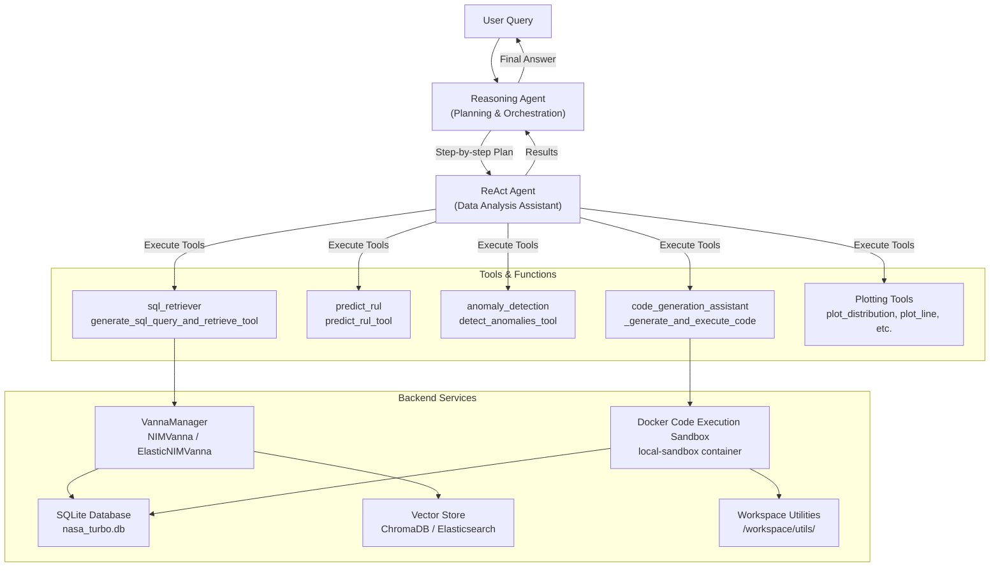
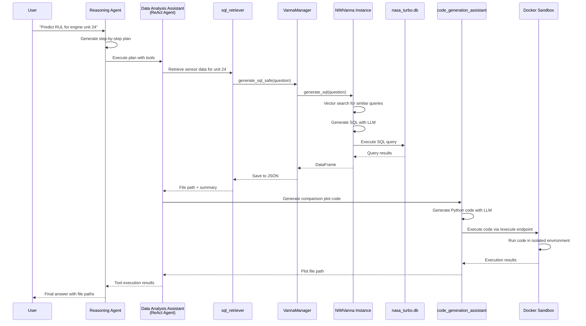
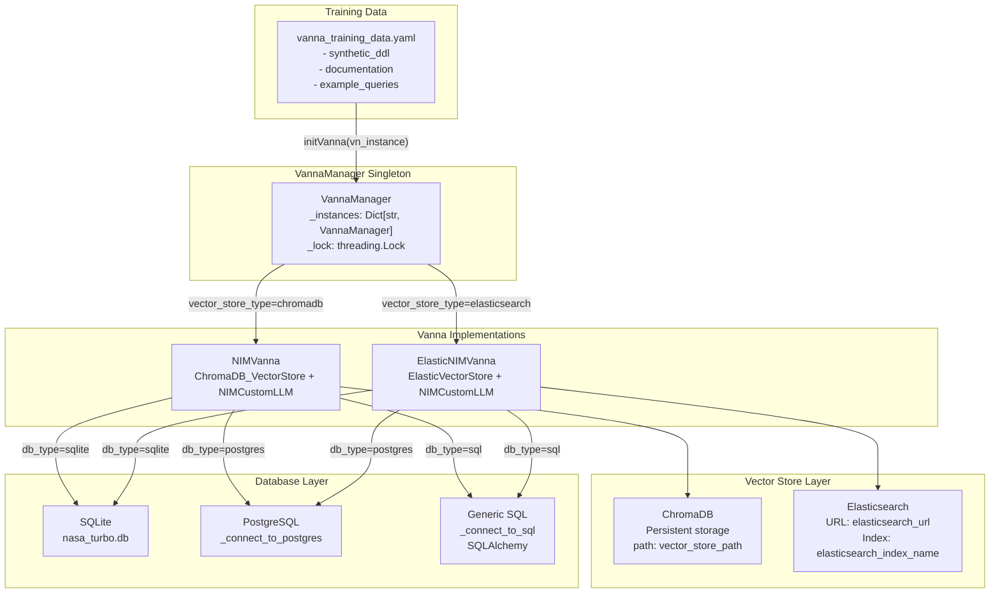
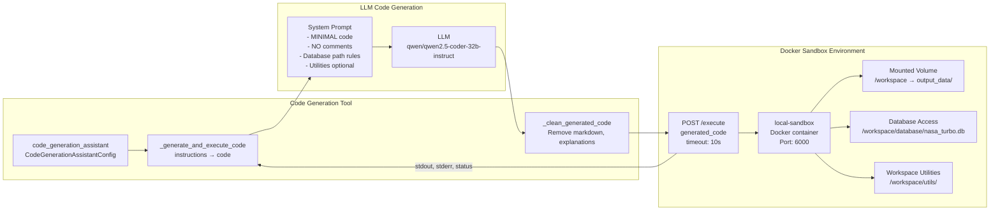
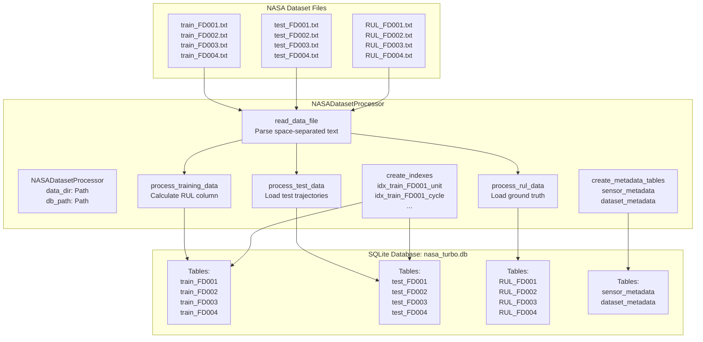
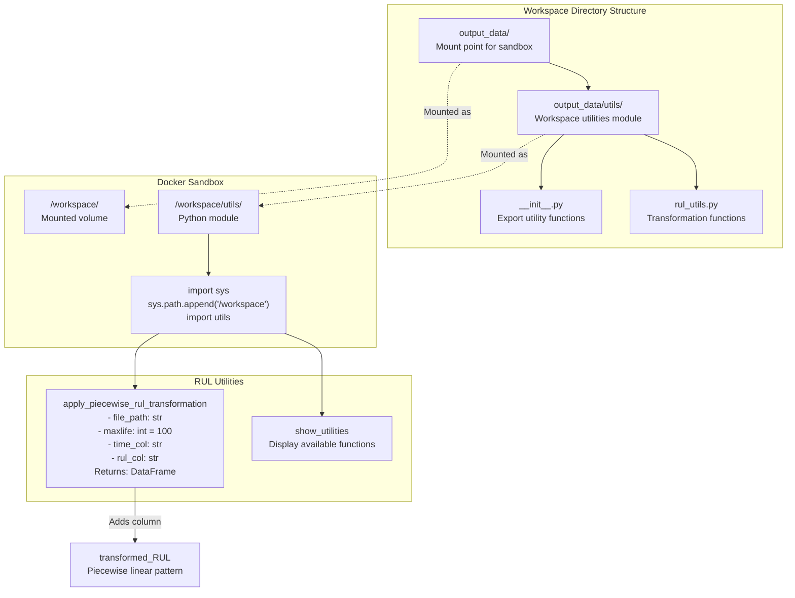
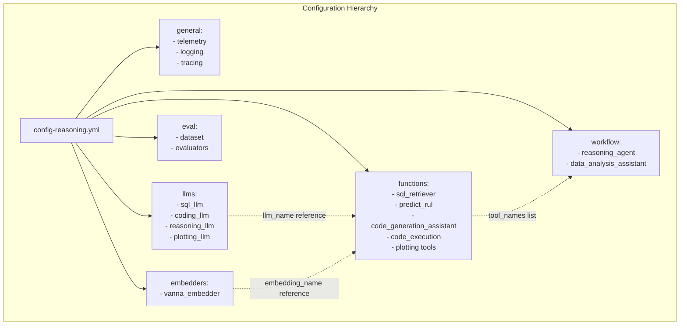

<!-- source: DeepWiki mcp.deepwiki.com · repo NVIDIA/GenerativeAIExamples · page 7.1 Asset Lifecycle Management Agent · fetched 2026-10-26 -->

# Asset Lifecycle Management Agent

<details>
<summary>Relevant source files</summary>

The following files were used as context for generating this wiki page:

- [industries/asset_lifecycle_management_agent/.cursor.rules.md](industries/asset_lifecycle_management_agent/.cursor.rules.md)
- [industries/asset_lifecycle_management_agent/.gitignore](industries/asset_lifecycle_management_agent/.gitignore)
- [industries/asset_lifecycle_management_agent/README.md](industries/asset_lifecycle_management_agent/README.md)
- [industries/asset_lifecycle_management_agent/env_template.txt](industries/asset_lifecycle_management_agent/env_template.txt)
- [industries/asset_lifecycle_management_agent/pyproject.toml](industries/asset_lifecycle_management_agent/pyproject.toml)
- [industries/asset_lifecycle_management_agent/setup_database.py](industries/asset_lifecycle_management_agent/setup_database.py)
- [industries/asset_lifecycle_management_agent/src/asset_lifecycle_management_agent/__init__.py](industries/asset_lifecycle_management_agent/src/asset_lifecycle_management_agent/__init__.py)
- [industries/asset_lifecycle_management_agent/src/asset_lifecycle_management_agent/plotting/code_generation_assistant.py](industries/asset_lifecycle_management_agent/src/asset_lifecycle_management_agent/plotting/code_generation_assistant.py)
- [industries/asset_lifecycle_management_agent/src/asset_lifecycle_management_agent/retrievers/generate_sql_query_and_retrieve_tool.py](industries/asset_lifecycle_management_agent/src/asset_lifecycle_management_agent/retrievers/generate_sql_query_and_retrieve_tool.py)
- [industries/asset_lifecycle_management_agent/src/asset_lifecycle_management_agent/retrievers/vanna_manager.py](industries/asset_lifecycle_management_agent/src/asset_lifecycle_management_agent/retrievers/vanna_manager.py)
- [industries/asset_lifecycle_management_agent/src/asset_lifecycle_management_agent/retrievers/vanna_util.py](industries/asset_lifecycle_management_agent/src/asset_lifecycle_management_agent/retrievers/vanna_util.py)

</details>


## Purpose and Scope

The Asset Lifecycle Management Agent is a production-ready agentic system for industrial asset monitoring and predictive maintenance. This implementation demonstrates the Operation & Maintenance phase of Asset Lifecycle Management using the NASA C-MAPSS turbofan engine degradation dataset.

The system combines **NeMo Agent Toolkit (NAT)** for multi-agent orchestration, **Vanna AI** for natural language to SQL translation, **XGBoost** for remaining useful life (RUL) prediction, and **MOMENT** time series foundation models for anomaly detection. It operates through a reasoning-and-acting agent pattern with specialized tools for data retrieval, prediction, and visualization.

**Scope**: This page covers the multi-agent architecture, core components, database integration, tool implementations, and the workspace utilities system. For broader RAG implementations, see [6](#6). For SQL Server enterprise integration, see [7.2](#7.2). For NeMo Agent Toolkit fundamentals and evaluation systems, refer to other NAT-based workflows in the repository.

Sources: [industries/asset_lifecycle_management_agent/README.md:1-28](), [industries/asset_lifecycle_management_agent/.cursor.rules.md:1-22]()

## System Architecture

### Multi-Agent Orchestration Pattern

The system implements a hierarchical agent architecture where a **Reasoning Agent** decomposes complex maintenance queries into executable plans, and a **ReAct Agent** (Data Analysis Assistant) executes those plans using specialized tools.



**Architecture Overview: Multi-Agent Tool Execution Flow**

The Reasoning Agent generates execution plans while the ReAct Agent invokes tools. Each tool integrates with backend services: `VannaManager` handles SQL generation with vector-augmented retrieval, the Docker sandbox executes generated Python code with workspace utilities, and specialized prediction/anomaly tools process time series data.

Sources: [industries/asset_lifecycle_management_agent/README.md:19-33](), [industries/asset_lifecycle_management_agent/.cursor.rules.md:64-86]()

### Component Interaction Flow



**Component Interaction: End-to-End Query Processing**

When a user submits a query, the Reasoning Agent creates a plan and delegates to the ReAct Agent. The ReAct Agent invokes `sql_retriever`, which uses `VannaManager` to manage a `NIMVanna` instance. The instance performs vector similarity search for similar queries, generates SQL with an LLM, and executes against the database. Results are saved and passed to downstream tools like `code_generation_assistant`, which generates Python code and executes it in the Docker sandbox.

Sources: [industries/asset_lifecycle_management_agent/src/asset_lifecycle_management_agent/retrievers/generate_sql_query_and_retrieve_tool.py:89-273](), [industries/asset_lifecycle_management_agent/src/asset_lifecycle_management_agent/retrievers/vanna_manager.py:28-300]()

## Core Components

### NeMo Agent Toolkit (NAT) Integration

The system is built on NAT 1.3.0, which provides configuration-driven agent orchestration, dependency injection through the `Builder` pattern, and function registration decorators.

**Function Registration Pattern**:
```python
@register_function(config_type=YourToolConfig, framework_wrappers=[LLMFrameworkEnum.LANGCHAIN])
async def your_tool(config: YourToolConfig, builder: Builder):
    yield FunctionInfo.from_fn(fn=_inner_function, description="Tool description")
```

All tools follow this pattern: [industries/asset_lifecycle_management_agent/src/asset_lifecycle_management_agent/plotting/code_generation_assistant.py:42-45](), [industries/asset_lifecycle_management_agent/src/asset_lifecycle_management_agent/retrievers/generate_sql_query_and_retrieve_tool.py:89-92]()

**Configuration Structure**:
Tools are configured in YAML with typed references:
- `llm_name`: References LLM configurations
- `embedding_name`: References embedding model configurations  
- `code_execution_tool`: References other function components

Configuration classes inherit from `FunctionBaseConfig` with pydantic field validation: [industries/asset_lifecycle_management_agent/src/asset_lifecycle_management_agent/plotting/code_generation_assistant.py:30-40]()

**Builder Dependency Injection**:
The `Builder` retrieves components and manages their lifecycle:
```python
llm = await builder.get_llm(config.llm_name, wrapper_type=LLMFrameworkEnum.LANGCHAIN)
code_execution_fn = builder.get_function(config.code_execution_tool)
```

Sources: [industries/asset_lifecycle_management_agent/.cursor.rules.md:19-59](), [industries/asset_lifecycle_management_agent/pyproject.toml:1-80]()

### Vanna SQL Query Generation

The SQL retrieval system uses **Vanna AI** with NVIDIA NIM LLMs for natural language to SQL translation. The implementation supports both ChromaDB and Elasticsearch as vector stores.



**Vanna Architecture: Vector-Augmented SQL Generation**

`VannaManager` implements a singleton pattern per configuration and manages either `NIMVanna` (ChromaDB) or `ElasticNIMVanna` (Elasticsearch). Both inherit from `NIMCustomLLM` for LLM operations and their respective vector store classes. Training data from YAML files is loaded during initialization via `initVanna()`.

**Key Classes**:

| Class | Purpose | File Location |
|-------|---------|---------------|
| `VannaManager` | Singleton manager for Vanna instances | [vanna_manager.py:28-553]() |
| `NIMVanna` | ChromaDB + NIM LLM implementation | [vanna_util.py:112-118]() |
| `ElasticNIMVanna` | Elasticsearch + NIM LLM implementation | [vanna_util.py:523-551]() |
| `NIMCustomLLM` | Custom LLM wrapper for NVIDIA NIM | [vanna_util.py:27-111]() |
| `ElasticVectorStore` | Elasticsearch vector operations | [vanna_util.py:120-521]() |
| `NVIDIAEmbeddingFunction` | Embedding generation with format fixes | [vanna_util.py:554-708]() |

**Vector Store Selection**:
The `vector_store_type` configuration determines the backend:
- `"chromadb"`: Uses persistent local storage at `vector_store_path`
- `"elasticsearch"`: Connects to Elasticsearch at `elasticsearch_url` with index `elasticsearch_index_name`

Configuration: [industries/asset_lifecycle_management_agent/src/asset_lifecycle_management_agent/retrievers/generate_sql_query_and_retrieve_tool.py:31-88]()

**SQL Generation Flow**:
1. User question → `generate_sql_query_and_retrieve_tool`
2. `VannaManager.generate_sql_safe(question)` invoked
3. Vanna instance performs vector similarity search for related DDL, documentation, and example queries
4. LLM generates SQL using retrieved context
5. SQL executed against database
6. Results returned as DataFrame and saved to JSON

Implementation: [industries/asset_lifecycle_management_agent/src/asset_lifecycle_management_agent/retrievers/vanna_manager.py:429-451](), [industries/asset_lifecycle_management_agent/src/asset_lifecycle_management_agent/retrievers/generate_sql_query_and_retrieve_tool.py:175-253]()

**Training Data Structure**:
The system automatically loads training data on startup from YAML:
- `synthetic_ddl`: Table schemas for all NASA datasets
- `documentation`: Domain-specific knowledge about database structure
- `example_queries`: Question-SQL pairs for few-shot learning

Training initialization: [industries/asset_lifecycle_management_agent/src/asset_lifecycle_management_agent/retrievers/vanna_util.py:767-873]()

Sources: [industries/asset_lifecycle_management_agent/src/asset_lifecycle_management_agent/retrievers/vanna_manager.py:1-553](), [industries/asset_lifecycle_management_agent/src/asset_lifecycle_management_agent/retrievers/vanna_util.py:16-873]()

### MOMENT Time Series Foundation Models

The system integrates the **MOMENT-1-small** foundation model for time series anomaly detection. This model is sourced from the `moment` library cloned during installation and referenced via editable installation.

**Installation Configuration**:
```toml
[tool.uv.sources]
momentfm = { path = "./moment", editable = true }
```

The library is modified to update NumPy and Transformers dependencies for compatibility: [industries/asset_lifecycle_management_agent/pyproject.toml:59-60](), [industries/asset_lifecycle_management_agent/README.md:126-152]()

**Model Usage**:
The MOMENT model is invoked by the `anomaly_detection` tool (not shown in provided files but referenced in architecture) to detect unusual patterns in sensor time series data. The model provides pre-trained representations for industrial sensor data without requiring domain-specific fine-tuning.

Sources: [industries/asset_lifecycle_management_agent/pyproject.toml:1-80](), [industries/asset_lifecycle_management_agent/README.md:126-152]()

### Code Execution Sandbox

The `code_generation_assistant` generates Python code and executes it in an isolated Docker sandbox. This provides secure code execution with filesystem access to the workspace.



**Code Execution Sandbox: Isolated Python Environment**

The `code_generation_assistant` generates Python code using an LLM with strict prompts (no comments, minimal code). The code is cleaned and sent to the Docker sandbox via HTTP POST to `/execute`. The sandbox mounts the output directory at `/workspace`, providing access to database files and workspace utilities.

**Key Configuration Parameters**:

| Parameter | Purpose | Default |
|-----------|---------|---------|
| `llm_name` | LLM for code generation | Configured in YAML |
| `code_execution_tool` | Reference to execution sandbox | Configured in YAML |
| `output_folder` | Mounted workspace path | `/output_data` |
| `max_retries` | Retry attempts on failure | 0 |

Configuration class: [industries/asset_lifecycle_management_agent/src/asset_lifecycle_management_agent/plotting/code_generation_assistant.py:30-40]()

**System Prompt Structure**:
The prompt enforces strict code generation rules:
- Output only executable Python code
- No comments, docstrings, or explanations
- Database path: `/workspace/database/nasa_turbo.db`
- Optional utilities: `import sys; sys.path.append("/workspace"); import utils`
- File paths: Use only filename, not `output_data/filename`

System prompt: [industries/asset_lifecycle_management_agent/src/asset_lifecycle_management_agent/plotting/code_generation_assistant.py:67-104]()

**Execution Flow with Retry Logic**:
1. Generate code with LLM
2. Clean code (remove markdown, explanations)
3. Check for incomplete code (truncation detection)
4. Execute in sandbox via HTTP POST
5. Parse results (process_status, stdout, stderr)
6. On failure and retries available: generate corrected code
7. Return execution results and file paths

Implementation: [industries/asset_lifecycle_management_agent/src/asset_lifecycle_management_agent/plotting/code_generation_assistant.py:54-258]()

**File Path Extraction**:
Generated files are detected from stdout using regex patterns:
```python
patterns = [
    r'saved to[:\s]+([^\s\n]+\.(?:html|png|jpg|jpeg|pdf|csv|json))',
    r'([^\s\n]+\.(?:html|png|jpg|jpeg|pdf|csv|json))',
    ...
]
```

Helper function: [industries/asset_lifecycle_management_agent/src/asset_lifecycle_management_agent/plotting/code_generation_assistant.py:334-360]()

**Docker Sandbox Startup**:
The sandbox is started separately using a shell script:
```bash
./local_sandbox/start_local_sandbox.sh local-sandbox /path/to/output_data/
```

This mounts `output_data/` to `/workspace` in the container, providing access to database files, utilities, and output storage.

Documentation: [industries/asset_lifecycle_management_agent/README.md:395-432]()

Sources: [industries/asset_lifecycle_management_agent/src/asset_lifecycle_management_agent/plotting/code_generation_assistant.py:1-360](), [industries/asset_lifecycle_management_agent/README.md:395-432]()

## Database Integration

### NASA C-MAPSS Turbofan Dataset

The system uses the **NASA Turbofan Engine Degradation Simulation Dataset (C-MAPSS)** stored in SQLite. The database contains training data (run-to-failure trajectories), test data (partial trajectories), and ground truth RUL values.



**Database Processing Pipeline**

The `NASADatasetProcessor` class handles conversion from text files to SQLite tables. Training data includes calculated RUL values, test data contains partial trajectories, and separate RUL tables store ground truth values. Metadata tables provide sensor descriptions and dataset information.

**Database Schema**:

All train/test tables share this structure:

| Column | Type | Description |
|--------|------|-------------|
| `unit_number` | INTEGER | Engine unit identifier |
| `time_in_cycles` | INTEGER | Operational time cycles |
| `operational_setting_1` | REAL | Flight condition setting 1 |
| `operational_setting_2` | REAL | Flight condition setting 2 |
| `operational_setting_3` | REAL | Flight condition setting 3 |
| `sensor_measurement_1` to `sensor_measurement_21` | REAL | 21 sensor readings (temperature, pressure, etc.) |
| `RUL` | INTEGER | Remaining useful life (training only) |

Schema implementation: [industries/asset_lifecycle_management_agent/setup_database.py:64-74]()

**RUL Calculation for Training Data**:
```python
df['RUL'] = df.groupby('unit_number')['time_in_cycles'].transform('max') - df['time_in_cycles']
```

For each engine unit, RUL equals the maximum cycle time minus the current cycle time, creating a decreasing value as the engine approaches failure.

Implementation: [industries/asset_lifecycle_management_agent/setup_database.py:134]()

**Sensor Descriptions**:
The `sensor_metadata` table maps sensor columns to physical measurements:
- `sensor_measurement_1`: Total temperature at fan inlet (°R)
- `sensor_measurement_8`: Physical fan speed (rpm)
- `sensor_measurement_11`: Static pressure at HPC outlet (psia)
- ... (21 total sensors)

Metadata creation: [industries/asset_lifecycle_management_agent/setup_database.py:188-208]()

**Database Indexing**:
Performance indexes are created on frequently queried columns:
```sql
CREATE INDEX idx_train_FD001_unit ON train_FD001(unit_number)
CREATE INDEX idx_train_FD001_cycle ON train_FD001(time_in_cycles)
```

Index creation: [industries/asset_lifecycle_management_agent/setup_database.py:210-234]()

**Setup Script**:
The database is initialized by running:
```bash
python setup_database.py --data-dir data --db-path database/nasa_turbo.db
```

This processes text files and creates the complete SQLite database with all tables, indexes, and metadata.

Script entry point: [industries/asset_lifecycle_management_agent/setup_database.py:329-362]()

Sources: [industries/asset_lifecycle_management_agent/setup_database.py:1-362](), [industries/asset_lifecycle_management_agent/README.md:11-17]()

## Agent Workflow

### Reasoning and Acting Pattern

The system implements a two-tier agent architecture:

1. **Reasoning Agent**: High-level planning and orchestration
2. **ReAct Agent (Data Analysis Assistant)**: Tool execution and result synthesis

**Configuration References**:
- Reasoning Agent: Configured in workflow YAML as main orchestrator
- ReAct Agent: Configured as `data_analysis_assistant` with tool references

The ReAct Agent has access to these tools:
- `sql_retriever`: Database query generation and execution
- `predict_rul`: RUL prediction using XGBoost
- `detect_anomalies`: Anomaly detection with MOMENT
- `code_generation_assistant`: Custom Python code generation
- Multiple plotting functions: `plot_distribution`, `plot_line`, `plot_scatter`, etc.

Tool configuration pattern: [industries/asset_lifecycle_management_agent/src/asset_lifecycle_management_agent/retrievers/generate_sql_query_and_retrieve_tool.py:31-88]()

### Tool Selection Guidelines

The Reasoning Agent provides tool selection guidance to the ReAct Agent through system prompts:

**SQL Retrieval**:
- Use for: Database queries, data extraction, filtering by unit/sensor/time
- Input: Natural language question
- Output: JSON file with results + summary

**Prediction Tools**:
- Use for: RUL forecasting, anomaly detection in sensor data
- Input: Time series data (from SQL retrieval)
- Output: Predictions with confidence scores

**Plotting Tools**:
- Use for: Data visualization after retrieval or prediction
- Input: Data file paths
- Output: HTML/PNG plots

**Code Generation**:
- Use for: Custom processing, complex transformations, multi-step operations
- Input: Detailed instructions with context
- Output: Execution results + generated files

System prompt structure: [industries/asset_lifecycle_management_agent/src/asset_lifecycle_management_agent/retrievers/generate_sql_query_and_retrieve_tool.py:107-130]()

Sources: [industries/asset_lifecycle_management_agent/.cursor.rules.md:505-521](), [industries/asset_lifecycle_management_agent/README.md:19-33]()

## Workspace Utilities System

### Design Philosophy

The workspace utilities system solves a critical problem in multi-agent systems: **instruction degradation through agent chains**. When complex algorithms are passed as pseudo-code from Reasoning Agent → ReAct Agent → Code Generation Agent, context is lost and implementation becomes unreliable.

**Traditional Approach (Problematic)**:
```
Reasoning Agent: "Apply piecewise linear RUL transformation with knee at threshold"
    ↓
ReAct Agent: "Generate code for piecewise transformation..."
    ↓
Code Generation: *attempts to implement from degraded instructions*
    ↓
Result: Inconsistent or incorrect implementation
```

**Utilities Approach (Robust)**:
```
Reasoning Agent: "Use RUL transformation utility"
    ↓
ReAct Agent: "Import utils.apply_piecewise_rul_transformation"
    ↓
Code Generation: *uses pre-tested function*
    ↓
Result: Consistent, reliable transformation
```

Design rationale: [industries/asset_lifecycle_management_agent/README.md:434-483](), [industries/asset_lifecycle_management_agent/.cursor.rules.md:223-280]()

### Available Utilities



**Workspace Utilities Architecture**

Utilities are located in `output_data/utils/` on the host, mounted as `/workspace/utils/` in the Docker sandbox. Generated code imports utilities only when needed for specific transformations, avoiding unnecessary dependencies.

**Core Utility Functions**:

| Function | Purpose | Parameters | Return Type |
|----------|---------|------------|-------------|
| `apply_piecewise_rul_transformation` | Transform RUL with knee pattern | `file_path`, `maxlife=100`, `time_col`, `rul_col` | `pd.DataFrame` |
| `show_utilities` | Display available utilities | None | `str` |

**RUL Transformation Pattern**:
The piecewise transformation creates realistic "knee" patterns where RUL stays constant at `MAXLIFE` until remaining cycles drop below a threshold, then decreases linearly to 0:

```
RUL Pattern:
    MAXLIFE |--------+
            |        |
            |        |\
            |        | \
          0 |        |  +-------
            +--------+-----------> Time
               Early   Knee   Late
```

This matches real-world degradation patterns where wear accelerates as components approach failure.

Documentation: [industries/asset_lifecycle_management_agent/README.md:449-460]()

### Integration with Code Generation

The `code_generation_assistant` includes utilities in its system prompt:

**Conditional Import Pattern**:
```python
# System prompt excerpt
**UTILITIES (OPTIONAL - ONLY FOR RUL TRANSFORMATIONS):**
ONLY IF the task involves piecewise RUL transformation, you may use:
- utils.apply_piecewise_rul_transformation(df, maxlife=100, time_col='time_in_cycles', rul_col='RUL')

To use utilities (ONLY if needed for RUL transformation):
```python
import sys
sys.path.append("/workspace")
import utils

df_transformed = utils.apply_piecewise_rul_transformation(df, maxlife=100)
```

DO NOT import utils unless specifically needed for RUL transformation tasks.
```

Prompt structure: [industries/asset_lifecycle_management_agent/src/asset_lifecycle_management_agent/plotting/code_generation_assistant.py:77-93]()

**Setup Requirements**:
```bash
# Copy template utilities to output directory
cp -r utils_template output_data/utils
```

This ensures utilities are available in the mounted workspace when the sandbox starts.

Setup instructions: [industries/asset_lifecycle_management_agent/README.md:259-292]()

Sources: [industries/asset_lifecycle_management_agent/README.md:434-508](), [industries/asset_lifecycle_management_agent/src/asset_lifecycle_management_agent/plotting/code_generation_assistant.py:67-104]()

## Configuration and Deployment

### YAML Configuration Structure

All components are defined declaratively in `configs/config-reasoning.yml`:



**Configuration Architecture: Component References**

The YAML configuration uses typed references: LLMs and embedders are defined once and referenced by name in functions. Functions are referenced by name in agent tool lists. This dependency injection pattern is managed by NAT's `Builder` class.

**Component Reference Types** (NAT 1.3.0):

| Configuration Field | Type | Used In |
|---------------------|------|---------|
| `llm_name` | `LLMRef` | All tools requiring LLM access |
| `embedding_name` | `EmbedderRef` | SQL retriever, vector operations |
| `code_execution_tool` | `FunctionRef` | Code generation assistant |
| `tool_names` | `List[str]` | ReAct agent configuration |

Type definitions: [industries/asset_lifecycle_management_agent/.cursor.rules.md:545-656]()

**String Quoting Requirement**:
With pydantic 2.10+, all string references must be quoted in YAML:
```yaml
functions:
  sql_retriever:
    llm_name: "sql_llm"              # Quoted
    embedding_name: "vanna_embedder"  # Quoted
    vector_store_type: "chromadb"     # Quoted
    db_type: "sqlite"                 # Quoted
```

This prevents validation errors during configuration parsing.

Documentation: [industries/asset_lifecycle_management_agent/.cursor.rules.md:580-596]()

### Environment Configuration

Required environment variables are defined in `.env`:

| Variable | Purpose | Required |
|----------|---------|----------|
| `NVIDIA_API_KEY` | NVIDIA NIM API access | Yes |
| `OPENAI_API_KEY` | OpenAI API access (if using OpenAI endpoints) | Optional |
| `CATALYST_ACCESS_KEY` | RAGA AI observability | Optional |
| `CATALYST_SECRET_KEY` | RAGA AI observability | Optional |
| `CATALYST_ENDPOINT` | RAGA AI endpoint URL | Optional |

Template: [industries/asset_lifecycle_management_agent/env_template.txt:1-17]()

**Setup Process**:
```bash
# Copy template and edit
cp env_template.txt .env
# Edit .env with actual keys
source .env
```

Usage: [industries/asset_lifecycle_management_agent/README.md:317-345]()

### Server Deployment

The system is deployed through NAT's built-in FastAPI server:

```bash
nat serve --config_file=configs/config-reasoning.yml
```

This starts:
1. FastAPI server on `http://localhost:8000`
2. Automatic Vanna training from `vanna_training_data.yaml`
3. WebSocket endpoints for streaming responses
4. Health check endpoints

During startup, `VannaManager` automatically initializes vector stores and loads training data: [industries/asset_lifecycle_management_agent/src/asset_lifecycle_management_agent/retrievers/vanna_manager.py:99-115]()

**Frontend Options**:

**Option 1: Custom Modern UI** (Recommended):
```bash
cd frontend
npm install
npm start  # http://localhost:3000
```

Features: NVIDIA-branded design, embedded visualizations, example prompts, dark/light themes.

**Option 2: Generic NeMo Agent Toolkit UI**:
```bash
git clone https://github.com/NVIDIA/NeMo-Agent-Toolkit-UI.git
cd NeMo-Agent-Toolkit-UI
npm ci
npm run dev  # http://localhost:3000
```

UI documentation: [industries/asset_lifecycle_management_agent/README.md:347-536]()

Sources: [industries/asset_lifecycle_management_agent/README.md:347-433](), [industries/asset_lifecycle_management_agent/.cursor.rules.md:296-343]()

## Key Code Constructs

### VannaManager Singleton Pattern

The `VannaManager` class implements thread-safe singleton behavior per configuration:

```python
class VannaManager:
    _instances: Dict[str, 'VannaManager'] = {}
    _lock = threading.Lock()
    
    def __new__(cls, config_key: str):
        with cls._lock:
            if config_key not in cls._instances:
                cls._instances[config_key] = super().__new__(cls)
                cls._instances[config_key]._initialized = False
            return cls._instances[config_key]
```

**Configuration Key Generation**:
```python
def create_config_key(vanna_llm_config, vanna_embedder_config, 
                     vector_store_type: str, vector_store_path: str, 
                     elasticsearch_url: str, db_connection_string_or_path: str, 
                     db_type: str = "sqlite") -> str:
    vector_id = vector_store_path if vector_store_type == "chromadb" else elasticsearch_url
    config_str = f"{vanna_llm_config.model_name}_{vanna_embedder_config.model_name}_{vector_store_type}_{vector_id}_{db_connection_string_or_path}_{db_type}"
    return hashlib.md5(config_str.encode()).hexdigest()[:12]
```

This ensures only one Vanna instance exists per unique configuration combination.

Implementation: [industries/asset_lifecycle_management_agent/src/asset_lifecycle_management_agent/retrievers/vanna_manager.py:28-52](), [industries/asset_lifecycle_management_agent/src/asset_lifecycle_management_agent/retrievers/vanna_manager.py:532-553]()

### NVIDIAEmbeddingFunction Interface Fixes

The `NVIDIAEmbeddingFunction` class solves critical interface compatibility issues between ChromaDB and NVIDIA embeddings:

**Problem 1: Input Format Mismatch**
```python
# ChromaDB passes list: ['query text']
# But langchain_nvidia expects string: 'query text'
# Solution:
if isinstance(input, list):
    if len(input) == 1:
        query_text = input[0]
    else:
        raise ValueError("Expected single string or list with one element")
else:
    query_text = input
```

**Problem 2: Output Format Mismatch**
```python
# ChromaDB expects: [[embedding_vector]]
# But langchain returns: [embedding_vector]
# Solution:
embeddings = self.embeddings.embed_query(query_text)
return [embeddings]  # Wrap in list
```

These fixes prevent `TypeError: 'float' object cannot be converted to 'Sequence'` and API 500 errors.

Implementation: [industries/asset_lifecycle_management_agent/src/asset_lifecycle_management_agent/retrievers/vanna_util.py:554-684]()

### Code Cleaning and Validation

The code generation assistant performs multiple validation and cleaning steps:

**Markdown Removal**:
```python
def _clean_generated_code(raw_code: str) -> str:
    code = raw_code.strip()
    if code.startswith("```python"):
        code = code[9:]
    elif code.startswith("```"):
        code = code[3:]
    if code.endswith("```"):
        code = code[:-3]
    return code.strip()
```

**Truncation Detection**:
```python
def is_code_incomplete(code):
    is_truncated = (not code.endswith(')') and not code.endswith('"') and 
                  not code.endswith("'") and not code.endswith(';'))
    has_incomplete_fig_write = 'fig.write' in code and not 'fig.write_html(' in code
    return is_truncated or has_incomplete_fig_write
```

This prevents execution of incomplete code and triggers retry logic when code generation is truncated.

Implementation: [industries/asset_lifecycle_management_agent/src/asset_lifecycle_management_agent/plotting/code_generation_assistant.py:274-332](), [industries/asset_lifecycle_management_agent/src/asset_lifecycle_management_agent/plotting/code_generation_assistant.py:138-152]()

### Database Connection Abstraction

The `VannaManager` supports multiple database backends through type-based dispatching:

**SQLite Connection** (with workaround for Vanna 0.7.9 URL detection bug):
```python
if self.db_type == "sqlite":
    db_path = self.db_connection_string_or_path
    if not os.path.isabs(db_path):
        db_path = os.path.abspath(db_path)
    
    if os.path.exists(db_path):
        import sqlite3
        def run_sql_sqlite(sql: str):
            conn = sqlite3.connect(db_path)
            try:
                df = pd.read_sql_query(sql, conn)
                return df
            finally:
                conn.close()
        vn_instance.run_sql = run_sql_sqlite
        vn_instance.run_sql_is_set = True
```

**PostgreSQL Connection**:
```python
def _connect_to_postgres(self, vn_instance: NIMVanna, connection_string: str):
    if connection_string.startswith("postgresql://"):
        vn_instance.connect_to_postgres(url=connection_string)
    else:
        vn_instance.connect_to_postgres(url=f"postgresql://{connection_string}")
```

**Generic SQL (SQLAlchemy)**:
```python
def _connect_to_sql(self, vn_instance: NIMVanna, connection_string: str):
    from sqlalchemy import create_engine
    engine = create_engine(connection_string)
    vn_instance.connect_to_sqlalchemy(engine)
```

This abstraction allows the same tool configuration to work with SQLite, PostgreSQL, MySQL, SQL Server, or Oracle by changing `db_type` and `db_connection_string_or_path`.

Implementation: [industries/asset_lifecycle_management_agent/src/asset_lifecycle_management_agent/retrievers/vanna_manager.py:238-368]()

Sources: [industries/asset_lifecycle_management_agent/src/asset_lifecycle_management_agent/retrievers/vanna_manager.py:1-553](), [industries/asset_lifecycle_management_agent/src/asset_lifecycle_management_agent/retrievers/vanna_util.py:554-708](), [industries/asset_lifecycle_management_agent/src/asset_lifecycle_management_agent/plotting/code_generation_assistant.py:1-360]()

---

