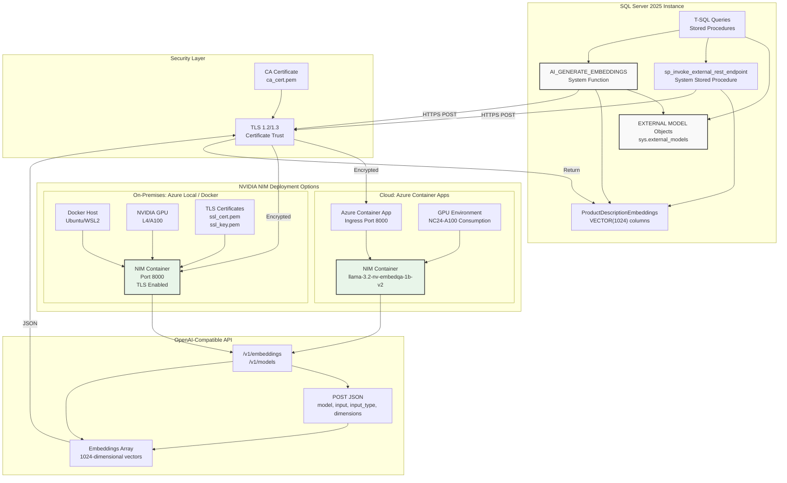
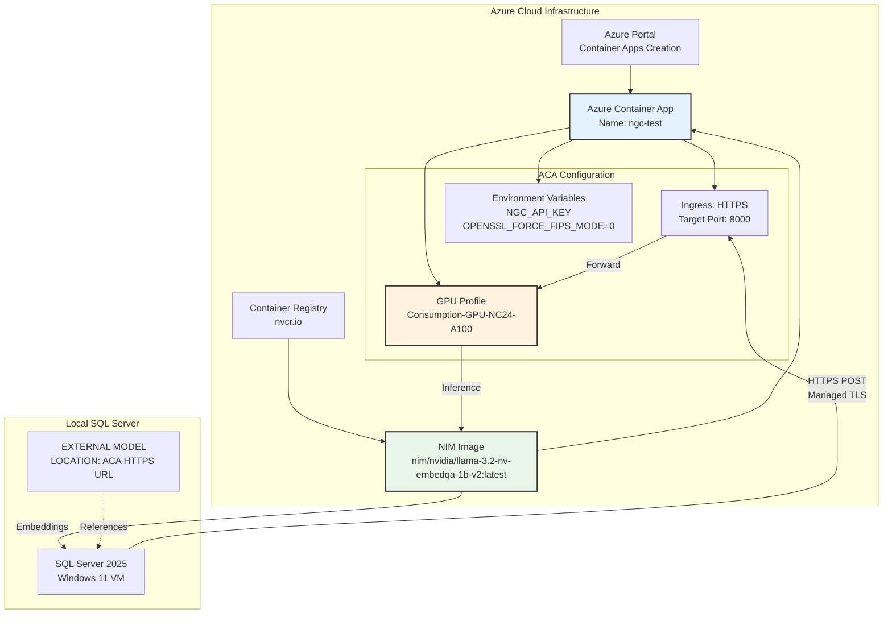
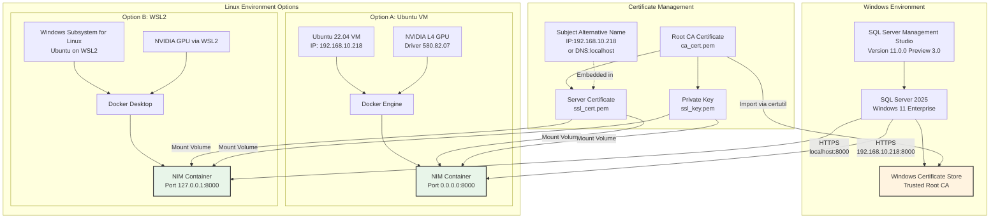
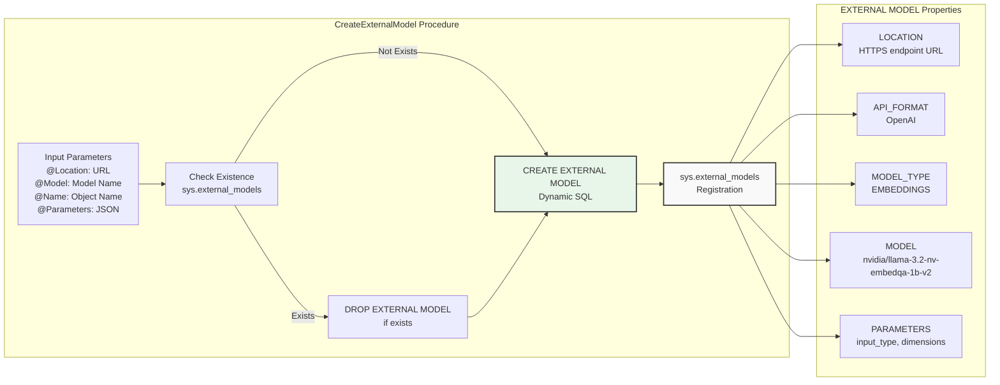
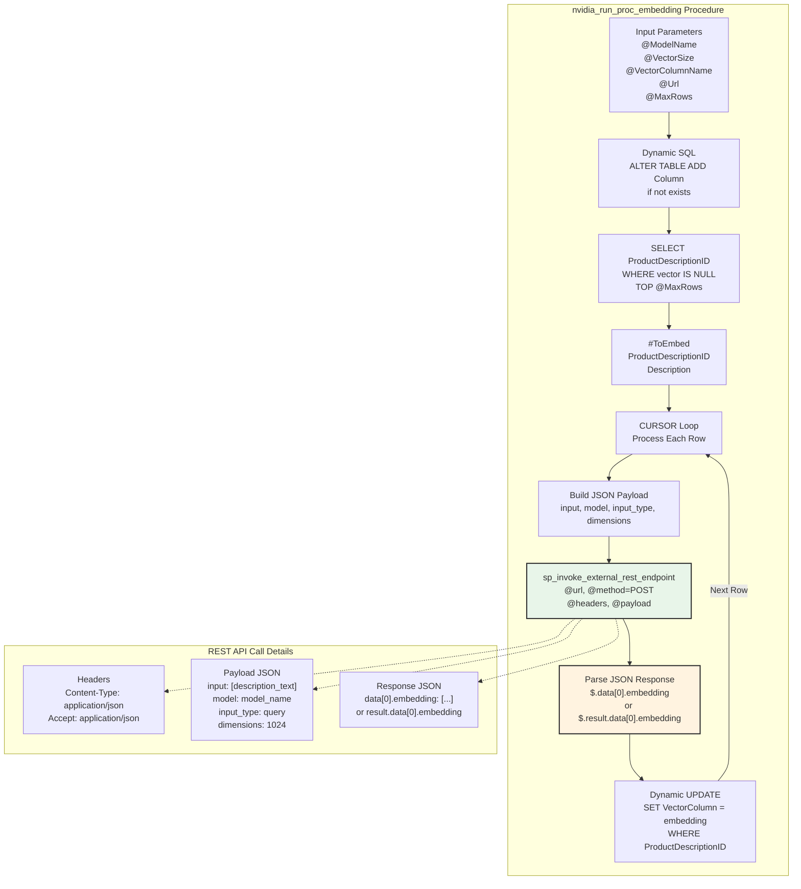
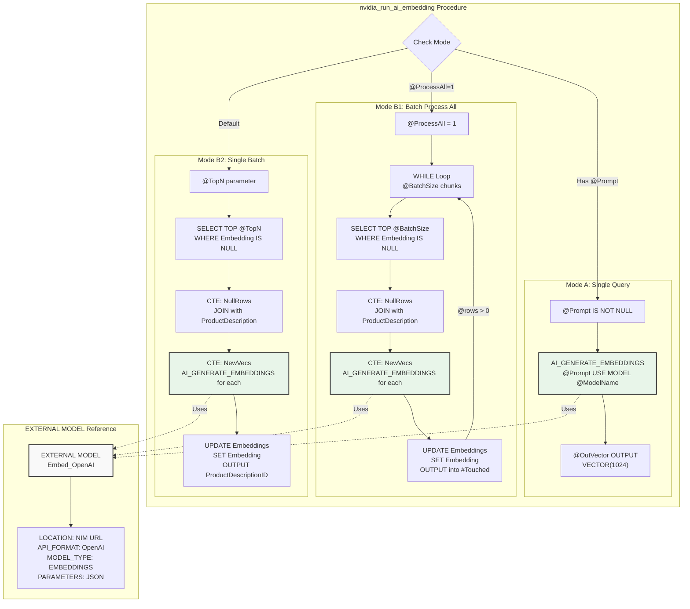
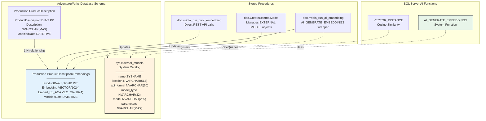
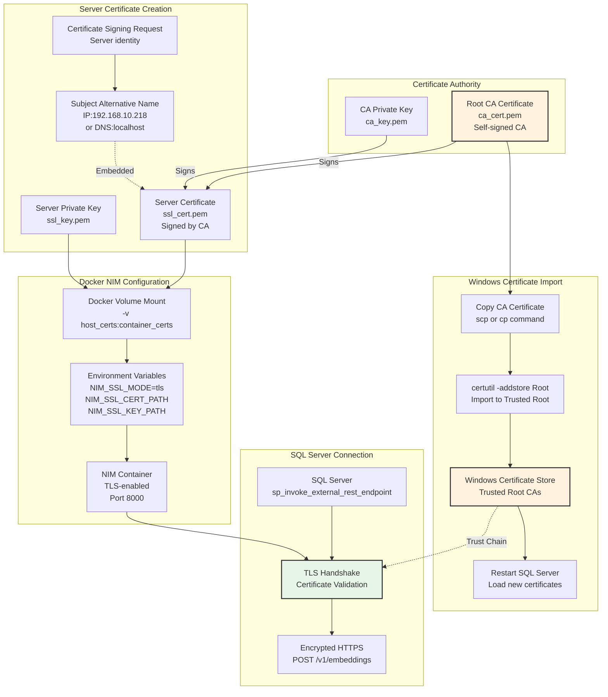
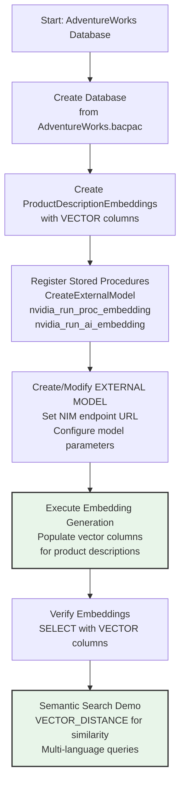

<!-- source: DeepWiki mcp.deepwiki.com · repo NVIDIA/GenerativeAIExamples · page 7.2 SQL Server AI Integration · fetched 2026-10-26 -->

# SQL Server AI Integration

<details>
<summary>Relevant source files</summary>

The following files were used as context for generating this wiki page:

- [community/SQLServer_AI_with_NVIDIA_NIM/README.md](community/SQLServer_AI_with_NVIDIA_NIM/README.md)
- [community/SQLServer_AI_with_NVIDIA_NIM/local.md](community/SQLServer_AI_with_NVIDIA_NIM/local.md)
- [community/SQLServer_AI_with_NVIDIA_NIM/remote.md](community/SQLServer_AI_with_NVIDIA_NIM/remote.md)
- [community/SQLServer_AI_with_NVIDIA_NIM/scripts/2_proc_ai_embedding.sql](community/SQLServer_AI_with_NVIDIA_NIM/scripts/2_proc_ai_embedding.sql)
- [community/SQLServer_AI_with_NVIDIA_NIM/scripts/2_proc_create_external_model.sql](community/SQLServer_AI_with_NVIDIA_NIM/scripts/2_proc_create_external_model.sql)
- [community/SQLServer_AI_with_NVIDIA_NIM/scripts/2_proc_embedding.sql](community/SQLServer_AI_with_NVIDIA_NIM/scripts/2_proc_embedding.sql)
- [community/SQLServer_AI_with_NVIDIA_NIM/scripts/3_ChangeExternalModel.sql](community/SQLServer_AI_with_NVIDIA_NIM/scripts/3_ChangeExternalModel.sql)
- [community/SQLServer_AI_with_NVIDIA_NIM/scripts/4_Execute_ai_embedding.sql](community/SQLServer_AI_with_NVIDIA_NIM/scripts/4_Execute_ai_embedding.sql)

</details>


## Purpose and Scope

This document describes the integration of NVIDIA NIM microservices with Microsoft SQL Server 2025's new AI capabilities for enterprise database applications. The system enables SQL Server to generate and query vector embeddings using GPU-accelerated inference models, supporting semantic search and AI-enhanced analytics directly within the database.

This integration demonstrates deploying NVIDIA embedding NIMs in both cloud (Azure Container Apps) and on-premises (Azure Local) environments, establishing secure TLS communication, and using SQL Server 2025's `EXTERNAL MODEL`, `AI_GENERATE_EMBEDDINGS`, and `sp_invoke_external_rest_endpoint` features.

For general RAG pipeline implementations, see [RAG Implementations](#6). For other industry-specific solutions, see [Asset Lifecycle Management Agent](#7.1).

---

## System Overview

The SQL Server AI Integration enables Microsoft SQL Server 2025 to leverage NVIDIA NIM inference microservices for embedding generation. The system supports two deployment architectures:

1. **Cloud Deployment**: Azure Container Apps hosting NIM containers with GPU acceleration
2. **On-Premises Deployment**: Azure Local or local GPU servers running NIM via Docker

Both architectures use OpenAI-compatible REST APIs over HTTPS, allowing SQL Server to invoke external AI models through standard T-SQL commands and stored procedures.

**Sources:** [community/SQLServer_AI_with_NVIDIA_NIM/README.md:1-65]()

---

## Architecture Overview



**Architecture Diagram: SQL Server AI Integration Components**

The architecture consists of three main layers:

1. **SQL Server Layer**: T-SQL interfaces including `EXTERNAL MODEL` objects, `AI_GENERATE_EMBEDDINGS` function, and `sp_invoke_external_rest_endpoint` procedure
2. **Security Layer**: TLS-encrypted HTTPS communication with certificate trust validation
3. **Inference Layer**: NVIDIA NIM containers serving OpenAI-compatible embedding endpoints

**Sources:** [community/SQLServer_AI_with_NVIDIA_NIM/README.md:32-64]()

---

## Deployment Scenarios

### Cloud Deployment with Azure Container Apps



**Deployment Diagram: Azure Container Apps Setup**

The cloud deployment uses Azure Container Apps to host NIM containers with GPU acceleration. Key configuration points:

- **Image Source**: Docker Hub registry `nvcr.io` with private authentication
- **GPU Profile**: `Consumption-GPU-NC24-A100` provides on-demand NVIDIA A100 access
- **Ingress**: HTTPS endpoint on port 8000, auto-managed TLS certificates
- **Environment Variables**: `NGC_API_KEY` for model access, `OPENSSL_FORCE_FIPS_MODE=0` for compatibility
- **Cost Model**: Pay only for compute time during active inference requests

**Sources:** [community/SQLServer_AI_with_NVIDIA_NIM/remote.md:1-30]()

---

### On-Premises Deployment Architecture



**Deployment Diagram: On-Premises Configuration Options**

On-premises deployment supports two configurations:

**Ubuntu VM Deployment:**
- Dedicated IP address (e.g., `192.168.10.218`)
- Certificate SAN includes `IP:192.168.10.218`
- Docker container binds to `0.0.0.0:8000` for network access
- Certificate transfer via `scp`

**WSL2 Deployment:**
- Localhost-only communication
- Certificate SAN includes `DNS:localhost, IP:127.0.0.1`
- Docker Desktop integration on Windows
- Certificate access via `/mnt/c/` mount

Both require importing the CA certificate into Windows Trusted Root Certificate Authorities store using `certutil`.

**Sources:** [community/SQLServer_AI_with_NVIDIA_NIM/local.md:1-68]()

---

## SQL Server Configuration

### Enabling External REST Endpoints

SQL Server 2025 introduces the `sp_invoke_external_rest_endpoint` stored procedure and `AI_GENERATE_EMBEDDINGS` function. These features must be explicitly enabled:

```sql
-- Enable REST endpoint functionality
EXEC sp_configure 'external rest endpoint enabled', 1;
RECONFIGURE WITH OVERRIDE;

-- Grant permission to non-sysadmin users
GRANT EXECUTE ANY EXTERNAL ENDPOINT TO [YourLogin];
```

**Sources:** [community/SQLServer_AI_with_NVIDIA_NIM/local.md:42-47]()

---

### EXTERNAL MODEL Object Management



**Code Entity Diagram: EXTERNAL MODEL Creation Workflow**

The `CreateExternalModel` stored procedure manages SQL Server's `EXTERNAL MODEL` objects, which define connections to external AI services.

**Procedure Implementation:** [community/SQLServer_AI_with_NVIDIA_NIM/scripts/2_proc_create_external_model.sql:22-64]()

Key parameters:
- **@Location**: HTTPS endpoint URL (Azure Container Apps or local NIM)
- **@Model**: Model identifier (e.g., `nvidia/llama-3.2-nv-embedqa-1b-v2`)
- **@ApiFormat**: Always `'OpenAI'` for NIM compatibility
- **@ModelType**: `EMBEDDINGS` for embedding generation endpoints
- **@Parameters**: JSON with `input_type` and `dimensions` fields

**Example Usage:** [community/SQLServer_AI_with_NVIDIA_NIM/scripts/3_ChangeExternalModel.sql:17-24]()

```sql
EXEC dbo.CreateExternalModel
    @Location = N'https://192.168.10.218:8000/v1/embeddings',
    @Model = N'nvidia/llama-3.2-nv-embedqa-1b-v2',
    @Name = 'Embed_OpenAI';
```

**Sources:** [community/SQLServer_AI_with_NVIDIA_NIM/scripts/2_proc_create_external_model.sql:22-64](), [community/SQLServer_AI_with_NVIDIA_NIM/scripts/3_ChangeExternalModel.sql:17-24]()

---

## Embedding Generation Workflows

The system provides two approaches for generating embeddings: direct REST API invocation and SQL Server's native AI functions.

### Workflow 1: Direct REST Endpoint Invocation



**Workflow Diagram: Direct REST Endpoint Embedding Generation**

The `nvidia_run_proc_embedding` stored procedure uses `sp_invoke_external_rest_endpoint` to directly call the NIM REST API for each description.

**Implementation:** [community/SQLServer_AI_with_NVIDIA_NIM/scripts/2_proc_embedding.sql:24-145]()

**Key Steps:**

1. **Column Creation** [lines 35-45]: Dynamically adds vector column if it doesn't exist
2. **Target Selection** [lines 60-74]: Identifies rows with NULL embeddings (up to `@MaxRows`)
3. **Cursor Processing** [lines 91-144]: Iterates through each description
4. **Payload Construction** [lines 98-104]: Builds OpenAI-compatible JSON with `input`, `model`, `input_type`, and `dimensions`
5. **REST Invocation** [lines 108-113]: Calls `sp_invoke_external_rest_endpoint` with POST method
6. **Response Parsing** [lines 120-123]: Extracts embedding array from JSON response (supports both `$.data[0].embedding` and `$.result.data[0].embedding` paths)
7. **Vector Storage** [lines 128-138]: Updates table with parsed embedding vector

**Sources:** [community/SQLServer_AI_with_NVIDIA_NIM/scripts/2_proc_embedding.sql:24-145]()

---

### Workflow 2: Native AI_GENERATE_EMBEDDINGS Function



**Workflow Diagram: AI_GENERATE_EMBEDDINGS Function Usage Modes**

The `nvidia_run_ai_embedding` stored procedure leverages SQL Server's native `AI_GENERATE_EMBEDDINGS` function, which internally calls the configured `EXTERNAL MODEL`.

**Implementation:** [community/SQLServer_AI_with_NVIDIA_NIM/scripts/2_proc_ai_embedding.sql:22-174]()

**Three Operating Modes:**

**Mode A: Single Query** [lines 42-60]
- Used when `@Prompt IS NOT NULL`
- Returns single embedding vector via `@OutVector OUTPUT` parameter
- Direct SQL: `AI_GENERATE_EMBEDDINGS(@Prompt USE MODEL [ModelName])`

**Mode B1: Batch Sweep** [lines 65-122]
- Used when `@ProcessAll = 1`
- Processes entire table in chunks of `@BatchSize`
- Continues until no NULL embeddings remain
- Uses CTE structure: `NullRows` → `NewVecs` → `UPDATE`

**Mode B2: Single Batch** [lines 127-173]
- Default mode with `@TopN` parameter
- Processes limited number of rows in one operation
- Same CTE structure as Mode B1 but single execution

**CTE Pattern** (common to B1 and B2):
```sql
WITH NullRows AS (
    SELECT ProductDescriptionID, Description
    FROM ProductDescriptionEmbeddings
    WHERE Embedding IS NULL
),
NewVecs AS (
    SELECT ProductDescriptionID,
           AI_GENERATE_EMBEDDINGS(Description USE MODEL [ModelName]) AS NewEmbedding
    FROM NullRows
)
UPDATE ProductDescriptionEmbeddings
SET Embedding = NewVecs.NewEmbedding
FROM NewVecs
WHERE Embedding IS NULL AND NewEmbedding IS NOT NULL
```

**Execution Example:** [community/SQLServer_AI_with_NVIDIA_NIM/scripts/4_Execute_ai_embedding.sql:19-21]()

```sql
EXEC dbo.nvidia_run_ai_embedding
    @ModelName = 'Embed_OpenAI',
    @TopN = 8;
```

**Sources:** [community/SQLServer_AI_with_NVIDIA_NIM/scripts/2_proc_ai_embedding.sql:22-174](), [community/SQLServer_AI_with_NVIDIA_NIM/scripts/4_Execute_ai_embedding.sql:17-30]()

---

## Database Schema



**Database Schema Diagram: Tables, Procedures, and System Objects**

The demo uses the `AdventureWorks` sample database with custom extensions:

**Core Tables:**
- **Production.ProductDescription**: Source table with product descriptions
- **Production.ProductDescriptionEmbeddings**: Extended table storing multiple vector columns (e.g., `Embedding`, `Embed_E5_ACA`) with `VECTOR(1024)` type

**System Catalog:**
- **sys.external_models**: SQL Server 2025 system catalog storing registered `EXTERNAL MODEL` definitions

**Custom Stored Procedures:**
- **dbo.CreateExternalModel**: Manages `EXTERNAL MODEL` lifecycle (create/drop/recreate)
- **dbo.nvidia_run_proc_embedding**: Row-by-row REST API invocation approach
- **dbo.nvidia_run_ai_embedding**: Batch processing using `AI_GENERATE_EMBEDDINGS`

**System Functions:**
- **AI_GENERATE_EMBEDDINGS**: Native SQL function for embedding generation
- **VECTOR_DISTANCE**: Calculates cosine similarity for semantic search

**Sources:** [community/SQLServer_AI_with_NVIDIA_NIM/scripts/2_proc_create_external_model.sql:1-64](), [community/SQLServer_AI_with_NVIDIA_NIM/scripts/2_proc_embedding.sql:1-145](), [community/SQLServer_AI_with_NVIDIA_NIM/scripts/2_proc_ai_embedding.sql:1-174]()

---

## Security and TLS Configuration

### Certificate Management for On-Premises Deployment



**Security Diagram: TLS Certificate Chain and Configuration**

On-premises deployments require manual TLS certificate configuration for secure communication between SQL Server and NIM containers.

**Certificate Generation Steps:**

1. **Create Root CA** [community/SQLServer_AI_with_NVIDIA_NIM/local.md:3-8]()
   - Generate self-signed CA certificate (`ca_cert.pem`)
   - Generate server key (`ssl_key.pem`)
   - Include appropriate SAN (Subject Alternative Name) for server address

2. **Import to Windows** [lines 10-19]()
   ```powershell
   # Ubuntu VM: Copy via SCP
   scp user@192.168.10.218:/home/user/nim_certs/ca_cert.pem C:\SQL2025\nim-ca.cer
   
   # WSL2: Direct copy
   cp ~/nim_certs/ca_cert.pem /mnt/c/SQL2025/nim-ca.cer
   
   # Import and restart
   certutil -f -addstore Root "C:\SQL2025\nim-ca.cer"
   Get-Service SQL | ? {$_.Status -eq 'Running'} | Restart-Service
   ```

3. **Configure Docker NIM** [lines 21-32]()
   ```bash
   docker run -it --rm --gpus all --shm-size=16GB \
     -e NGC_API_KEY \
     -v "$LOCAL_NIM_CACHE:/opt/nim/.cache" \
     -u $(id -u) \
     -p 8000:8000 \
     -v $HOST_CERT_DIR:$NIM_CERT_DIR \
     -e NIM_SSL_MODE="tls" \
     -e NIM_SSL_KEY_PATH="$NIM_CERT_DIR/ssl_key.pem" \
     -e NIM_SSL_CERT_PATH="$NIM_CERT_DIR/ssl_cert.pem" \
     nvcr.io/nim/nvidia/llama-3.2-nv-embedqa-1b-v2:latest
   ```

4. **Verify Connection** [lines 34-40]()
   ```powershell
   # Ubuntu VM
   curl --ssl-no-revoke --cacert C:\SQL2025\nim-ca.cer https://192.168.10.218:8000/v1/models
   
   # WSL2
   curl --ssl-no-revoke --cacert C:\SQL2025\nim-ca.cer https://localhost:8000/v1/models
   ```

**Key Differences by Deployment:**

| Aspect | Ubuntu VM | WSL2 |
|--------|-----------|------|
| Server Address | `192.168.10.218` | `localhost` |
| Certificate SAN | `IP:192.168.10.218` | `DNS:localhost, IP:127.0.0.1` |
| Copy Method | `scp` over SSH | `cp /mnt/c/...` |
| Docker Port Binding | `0.0.0.0:8000:8000` | `8000:8000` |
| Firewall | Required | Not required |

**Sources:** [community/SQLServer_AI_with_NVIDIA_NIM/local.md:1-68]()

---

### Cloud Deployment Security

Azure Container Apps manages TLS certificates automatically:

- **Managed HTTPS**: Azure Container Apps provides auto-provisioned TLS certificates
- **No Certificate Management**: No manual certificate import required on SQL Server
- **Standard HTTPS**: SQL Server uses standard HTTPS without custom CA trust
- **NGC Authentication**: Only `NGC_API_KEY` environment variable required

**Environment Configuration:** [community/SQLServer_AI_with_NVIDIA_NIM/remote.md:23-25]()
```
NGC_API_KEY: Application API key for NGC (nvcr.io)
OPENSSL_FORCE_FIPS_MODE: Set to 0 (ACA does not support OpenSSL FIPS)
```

**Sources:** [community/SQLServer_AI_with_NVIDIA_NIM/remote.md:1-30]()

---

## OpenAI API Compatibility

NVIDIA NIM implements OpenAI-compatible endpoints, enabling seamless integration with SQL Server's OpenAI-based AI features.

### Endpoint Specification

**Base Endpoint:** `/v1/embeddings`

**Request Format:**
```json
{
  "input": ["text to embed"],
  "model": "nvidia/llama-3.2-nv-embedqa-1b-v2",
  "input_type": "query",
  "dimensions": 1024
}
```

**Response Formats:**

NIM supports two response structures:

**Standard OpenAI Format:**
```json
{
  "data": [
    {
      "embedding": [0.123, -0.456, ...]
    }
  ]
}
```

**Wrapped Format:**
```json
{
  "result": {
    "data": [
      {
        "embedding": [0.123, -0.456, ...]
      }
    ]
  }
}
```

The `nvidia_run_proc_embedding` procedure handles both formats: [community/SQLServer_AI_with_NVIDIA_NIM/scripts/2_proc_embedding.sql:120-123]()

```sql
SET @EmbArray = COALESCE(
    JSON_QUERY(@Response, '$.data[0].embedding'),
    JSON_QUERY(@Response, '$.result.data[0].embedding')
);
```

### Input Type Parameter

The `input_type` parameter controls embedding optimization:

- **`"query"`**: Optimizes for search queries (used in `AI_GENERATE_EMBEDDINGS` for user prompts)
- **`"passage"`**: Optimizes for document/passage text (used when embedding product descriptions)

**Sources:** [community/SQLServer_AI_with_NVIDIA_NIM/scripts/2_proc_embedding.sql:99-104](), [community/SQLServer_AI_with_NVIDIA_NIM/scripts/2_proc_embedding.sql:120-123]()

---

## Demo Implementation

The repository includes a complete demo using the AdventureWorks database to demonstrate semantic search capabilities.

### Demo Workflow



**Demo Workflow Diagram**

### Execution Steps

The demo scripts are executed in sequence: [community/SQLServer_AI_with_NVIDIA_NIM/README.md:120-135]()

1. **Create AdventureWorks database** from `AdventureWorks.bacpac` backup
2. **Create `ProductDescriptionEmbeddings` table** with vector columns
3. **Verify table structure** and check for existing embeddings using `Select_Embeddings.sql`
4. **Register stored procedures** (`proc*.sql` scripts):
   - `CreateExternalModel`
   - `nvidia_run_proc_embedding`
   - `nvidia_run_ai_embedding`
5. **Create or modify EXTERNAL MODEL** with correct NIM location (local or remote)
6. **Execute embedding generation** using either procedure
7. **Verify embeddings** were generated correctly
8. **Retrieve all embeddings** using `Get_all_embeddings.sql`
9. **Run semantic search demo** (`Run_Prompt.sql`) demonstrating `VECTOR_DISTANCE` for multi-language queries

### Semantic Search Example

The demo showcases SQL Server's vector similarity search using cosine distance:

```sql
-- Example semantic search query
DECLARE @query_embedding VECTOR(1024);

EXEC dbo.nvidia_run_ai_embedding
    @ModelName = 'Embed_OpenAI',
    @Prompt = N'mountain bike for rough terrain',
    @OutVector = @query_embedding OUTPUT;

SELECT TOP 5
    pd.ProductDescriptionID,
    pd.Description,
    VECTOR_DISTANCE('cosine', pde.Embedding, @query_embedding) AS similarity_score
FROM Production.ProductDescriptionEmbeddings pde
JOIN Production.ProductDescription pd 
    ON pd.ProductDescriptionID = pde.ProductDescriptionID
WHERE pde.Embedding IS NOT NULL
ORDER BY VECTOR_DISTANCE('cosine', pde.Embedding, @query_embedding);
```

This enables natural language search across product descriptions, even in different languages, by comparing semantic similarity in the embedding space.

**Sources:** [community/SQLServer_AI_with_NVIDIA_NIM/README.md:117-141]()

---

## System Requirements

### Windows Environment

- **Operating System**: Windows 11 Enterprise multi-session 24H2 26100.6899 or Windows Server
- **SQL Server**: SQL Server 2025 (RC) version 17.0.950.3 or later
- **Management Tools**: SQL Server Management Studio 11.0.0 Preview 3.0

### Linux Environment (On-Premises)

- **Operating System**: Ubuntu 22.04 LTS or later
- **GPU**: NVIDIA GPU (e.g., L4, A100) with sufficient VRAM
- **NVIDIA Driver**: Version 580.82.07 or later
- **CUDA**: Version 13.0 or later
- **Container Runtime**: Docker Engine with NVIDIA Container Toolkit
- **Network**: Static IP address and accessible port 8000
- **Tools**: OpenSSL for certificate generation

### Azure Cloud Environment

- **Azure Subscription**: Active subscription with Container Apps access
- **GPU Profile**: Consumption-GPU-NC24-A100 or similar
- **NGC API Key**: Valid NVIDIA NGC account and API key
- **Container Registry**: Access to `nvcr.io` (NVIDIA GPU Cloud Registry)

### NIM Model

- **Image**: `nvcr.io/nim/nvidia/llama-3.2-nv-embedqa-1b-v2:latest` or `nim/nvidia/nv-embedqa-e5-v5:latest`
- **Embedding Dimension**: 1024-dimensional vectors
- **API Format**: OpenAI-compatible `/v1/embeddings` endpoint

**Sources:** [community/SQLServer_AI_with_NVIDIA_NIM/README.md:96-107](), [community/SQLServer_AI_with_NVIDIA_NIM/remote.md:4-6]()

---

## Benefits and Use Cases

### Key Benefits

**Enterprise Integration:**
- Native SQL Server AI features eliminate need for external ETL processes
- Direct T-SQL access to embeddings enables seamless integration with existing applications
- Supports both cloud and on-premises deployments for regulatory compliance

**Performance:**
- GPU-accelerated inference through NVIDIA NIMs
- Batch processing capabilities for large-scale embedding generation
- Optimized vector storage and retrieval using SQL Server's native `VECTOR` type

**Security:**
- TLS-encrypted communication for on-premises deployments
- Azure-managed security for cloud deployments
- No data leaves premises in on-premises scenarios

**Flexibility:**
- Multiple deployment options (Azure Container Apps, Azure Local, standalone Docker)
- Support for different embedding models through NIM catalog
- Choice between direct REST calls or native SQL functions

**Operational Simplicity:**
- Docker containerization simplifies deployment and updates
- OpenAI API compatibility enables use of standard tooling
- Minimal infrastructure management with Azure Container Apps
- Pay-per-use pricing model for cloud deployments

### Use Cases

1. **Semantic Search**: Natural language queries across product catalogs, documentation, or knowledge bases
2. **Multi-language Support**: Search in one language, find results in another through semantic similarity
3. **Recommendation Systems**: Find similar products, documents, or content based on embeddings
4. **Data Deduplication**: Identify similar or duplicate records using vector distance
5. **Classification**: Group and categorize database content using embedding-based clustering
6. **Hybrid Search**: Combine traditional SQL queries with semantic vector search

**Sources:** [community/SQLServer_AI_with_NVIDIA_NIM/README.md:47-64](), [community/SQLServer_AI_with_NVIDIA_NIM/README.md:82-93]()

---

## References

- [NVIDIA NIM Documentation](https://docs.nvidia.com/nim/index.html)
- [Microsoft SQL Server 2025 What's New](https://learn.microsoft.com/en-us/sql/sql-server/what-s-new-in-sql-server-2025)
- [Azure Container Apps Documentation](https://learn.microsoft.com/en-us/azure/container-apps/)
- [NVIDIA GTC 2025: Build Secure and Scalable Gen AI Applications With Databases and NVIDIA AI](https://www.nvidia.com/en-us/on-demand/session/gtc25-S71521/)

**Sources:** [community/SQLServer_AI_with_NVIDIA_NIM/README.md:145-151]()

---

