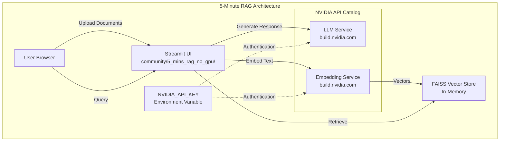
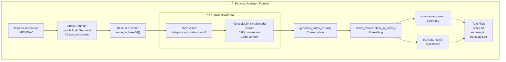
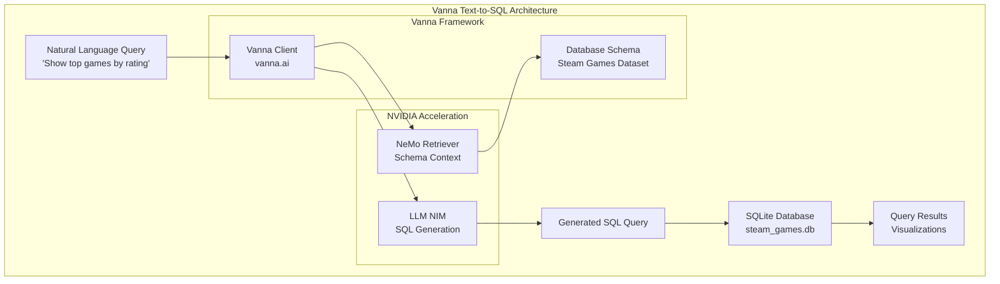
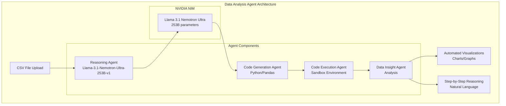
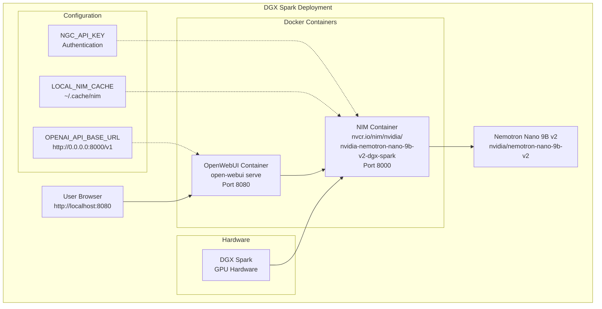
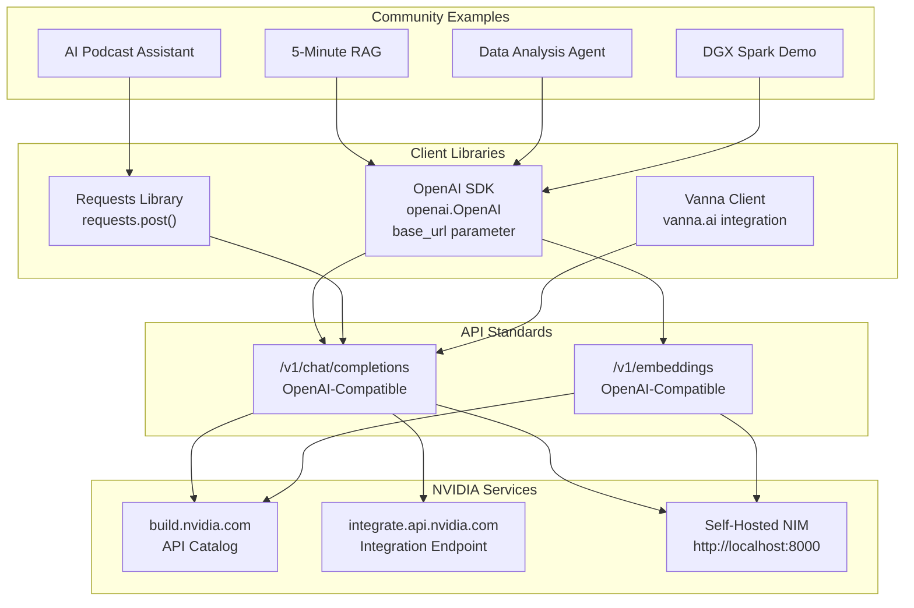
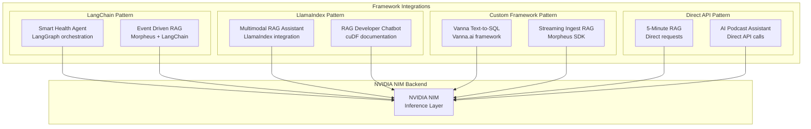

<!-- source: DeepWiki mcp.deepwiki.com · repo NVIDIA/GenerativeAIExamples · page 8 Community Examples and Integrations · fetched 2026-10-26 -->

# Community Examples and Integrations

<details>
<summary>Relevant source files</summary>

The following files were used as context for generating this wiki page:

- [LICENSE.DATA](LICENSE.DATA)
- [LICENSE.md](LICENSE.md)
- [README.md](README.md)
- [community/README.md](community/README.md)
- [community/ai-podcast-assistant/README.md](community/ai-podcast-assistant/README.md)
- [community/ai-podcast-assistant/ai-podcast-assistant-phi4-mulitmodal.ipynb](community/ai-podcast-assistant/ai-podcast-assistant-phi4-mulitmodal.ipynb)
- [community/dgx-spark-demo/README.md](community/dgx-spark-demo/README.md)
- [community/dgx-spark-demo/openwebui_interface.png](community/dgx-spark-demo/openwebui_interface.png)
- [docs/contributing.md](docs/contributing.md)
- [oss_tutorials/Building_a_Simple_AI_Agent_with_Qwen3_Next_powered_by_NVIDIA_NIM.ipynb](oss_tutorials/Building_a_Simple_AI_Agent_with_Qwen3_Next_powered_by_NVIDIA_NIM.ipynb)
- [oss_tutorials/notes.txt](oss_tutorials/notes.txt)

</details>


This page documents community-contributed examples and integration patterns that demonstrate practical applications of NVIDIA's Generative AI software ecosystem. These examples showcase diverse use cases ranging from simple prototypes requiring no local GPU to production-ready enterprise solutions, illustrating integration with popular frameworks and specialized tooling.

For core RAG implementations using official frameworks, see [RAG Implementations](#6). For industry-specific production solutions (Asset Lifecycle Management and SQL Server Integration), see [Industry Solutions](#7). For foundational infrastructure and model serving, see [Overview](#1).

## Overview

Community examples are sample code and deployments that demonstrate integration patterns with NVIDIA NIM, the NVIDIA API Catalog (build.nvidia.com), and the broader NVIDIA AI ecosystem. These examples are community-maintained and illustrate various architectural approaches for building generative AI applications.

The examples are organized by deployment complexity and use case:
- **Quick Start Examples**: Minimal setup, cloud-only, no GPU required
- **Framework-Based Examples**: LlamaIndex, LangChain, Haystack integrations
- **Multimodal Examples**: Audio, vision, and multimodal processing
- **Industry Applications**: Domain-specific solutions
- **Enterprise Integration**: Database and infrastructure integration
- **Specialized Tools**: Development utilities and helper applications

Sources: [community/README.md:1-98](), [README.md:214-217]()

## Community Examples Inventory

### Quick Start: 5-Minute RAG (No GPU Required)

The `5_mins_rag_no_gpu` example provides a minimal RAG implementation using the NVIDIA API Catalog, requiring no local GPU infrastructure.

**Technical Architecture:**


**Key Implementation Details:**
- Single-file RAG pipeline implementation
- Uses FAISS for local vector storage (no external database)
- Streamlit-based web interface
- Requires only `NVIDIA_API_KEY` environment variable

Sources: [community/README.md:42-44](), [README.md:89-122]()

### Multimodal: AI Podcast Assistant

The `ai-podcast-assistant` demonstrates multimodal processing using Phi-4-Multimodal LLM for audio transcription, summarization, and translation.

**Processing Pipeline:**


**Technical Implementation:**
- **Model**: Phi-4-Multimodal (5.6B parameters, 128K context)
- **Audio Processing**: `pydub.AudioSegment` for chunking long audio
- **Encoding**: Base64 encoding for API transmission
- **Functions**: `generate_detailed_notes()`, `refine_transcription_to_notes()`, `summarize_notes()`, `translate_text()`
- **API Endpoint**: `https://integrate.api.nvidia.com/v1/chat/completions`

Sources: [community/ai-podcast-assistant/README.md:1-93](), [community/ai-podcast-assistant/ai-podcast-assistant-phi4-mulitmodal.ipynb:1-353]()

### Framework Integration: Vanna Text-to-SQL

The `Vanna_with_NVIDIA_AI_Endpoints` example demonstrates natural language to SQL query generation using Vanna's open-source framework accelerated with NVIDIA NIM and NeMo Retriever.

**Architecture:**


**Key Components:**
- Natural language query interface
- Schema-aware SQL generation
- Integration with NVIDIA AI endpoints for acceleration
- Support for data visualization
- Uses Vanna's open-source text-to-SQL pipeline

Sources: [community/README.md:34-36]()

### Development Tool: Data Analysis Agent

The `data-analysis-agent` provides an interactive agentic application for data exploration with automated visualization and step-by-step reasoning.

**Agent Architecture:**


**Implementation Features:**
- **Model**: Llama-3.1-Nemotron-Ultra-253B-v1 for advanced reasoning
- **Modular Architecture**: Separate agents for insight, code generation, execution, and reasoning
- **Automated Visualization**: Generates charts and graphs from data
- **Transparent Reasoning**: Provides step-by-step explanations
- **CSV Support**: Handles uploaded CSV files for analysis

Sources: [community/README.md:38-40]()

### Enterprise: DGX Spark Demo

The `dgx-spark-demo` showcases local deployment of NVIDIA Nemotron Nano 9B v2 on DGX Spark hardware using NIM with OpenWebUI frontend.

**Deployment Architecture:**


**Deployment Commands:**
```bash
# NIM Container
docker run -it --rm \
    --gpus all \
    --shm-size=16GB \
    -e NGC_API_KEY \
    -v "$LOCAL_NIM_CACHE:/opt/nim/.cache" \
    -p 8000:8000 \
    nvcr.io/nim/nvidia/nvidia-nemotron-nano-9b-v2-dgx-spark:latest

# OpenWebUI Configuration
export OPENAI_API_BASE_URL=http://0.0.0.0:8000/v1
export DEFAULT_MODEL="nvidia/nemotron-nano-9b-v2"
open-webui serve --host 0.0.0.0 --port 8080
```

Sources: [community/dgx-spark-demo/README.md:1-146]()

## Deployment Patterns

Community examples demonstrate two primary deployment patterns based on infrastructure requirements and use case constraints.

### Cloud-Based (API Catalog)

Examples using the NVIDIA API Catalog (`build.nvidia.com`) for hosted model inference:

| Example | API Endpoint | Authentication | GPU Required |
|---------|--------------|----------------|--------------|
| 5-Minute RAG | `build.nvidia.com` | `NVIDIA_API_KEY` | No |
| AI Podcast Assistant | `integrate.api.nvidia.com/v1` | `NVIDIA_API_KEY` | No |
| Vanna Text-to-SQL | `build.nvidia.com` endpoints | API Key | No |
| Data Analysis Agent | `build.nvidia.com` endpoints | API Key | No |

**Advantages:**
- No local GPU infrastructure required
- Pay-per-use pricing model
- Immediate availability
- Automatic model updates

**Configuration Pattern:**
```bash
export NVIDIA_API_KEY="nvapi-..."
# Application connects to build.nvidia.com
```

Sources: [README.md:93-100](), [community/README.md:42-44]()

### Self-Hosted NIM

Examples using locally deployed NVIDIA Inference Microservices:

| Example | Container Image | Port | Hardware |
|---------|----------------|------|----------|
| DGX Spark Demo | `nvcr.io/nim/nvidia/nvidia-nemotron-nano-9b-v2-dgx-spark:latest` | 8000 | DGX Spark |
| Asset Lifecycle Mgmt | Self-hosted NIMs | Custom | On-premises |
| SQL Server AI | NIM with TLS | HTTPS | Azure/Enterprise |

**Advantages:**
- Data stays on-premises
- Predictable costs
- Network latency control
- Enterprise compliance

**Configuration Pattern:**
```bash
docker run -it --rm \
    --gpus all \
    -e NGC_API_KEY \
    -v "$LOCAL_NIM_CACHE:/opt/nim/.cache" \
    -p 8000:8000 \
    nvcr.io/nim/...
```

Sources: [community/dgx-spark-demo/README.md:40-63](), [README.md:162-163]()

## Integration Architecture

Community examples integrate with NVIDIA services through standardized interfaces and client libraries.

### API Compatibility Layers



**OpenAI SDK Configuration:**
```python
from openai import OpenAI

# API Catalog
client = OpenAI(
    base_url="https://integrate.api.nvidia.com/v1",
    api_key=os.environ["NVIDIA_API_KEY"]
)

# Self-Hosted NIM
client = OpenAI(
    base_url="http://localhost:8000/v1",
    api_key=""  # May be empty for local
)
```

Sources: [community/ai-podcast-assistant/ai-podcast-assistant-phi4-mulitmodal.ipynb:64-126](), [community/dgx-spark-demo/README.md:73-85]()

### Framework Integration Patterns

Community examples demonstrate integration with popular generative AI frameworks:



Sources: [community/README.md:30-98]()

## Specialized Use Cases

### Streaming and Real-Time Processing

**FM Radio ASR Streaming RAG:**
Demonstrates real-time processing of FM radio signals with ASR and RAG:

- **Signal Processing**: NVIDIA Holoscan SDK for I/Q sample processing
- **ASR**: NVIDIA Riva for speech-to-text
- **Vector Storage**: Time-informed FAISS database
- **RAG**: LangChain connectors to NVIDIA AI Foundation Models

**Streaming Document Ingestion:**
Performance-oriented pipeline for heterogeneous document processing:

- **Architecture**: Morpheus SDK for asynchronous processing
- **Parallelism**: CPU and GPU-accelerated nodes
- **Chunking**: Automatic document segmentation
- **Embedding**: Batch vector computation
- **Storage**: Vector database upload with horizontal scaling

Sources: [community/README.md:46-53]()

### Multimodal Document Processing

**ORAN Chatbot Multimodal Assistant:**
Technical specification chatbot with multimodal capabilities:

- **Document Types**: PDF, PowerPoint, Word with complex layouts
- **Processing**: Text, images, slides, tables extraction
- **Query Types**: Text queries with optional image input
- **Response Format**: Text with reference images, source links
- **Backend**: NeMo Service for thin client deployment

**Multimodal RAG Assistant:**
Comprehensive document ingestion with multiple modalities:

- **Ingestion**: PDFs, slides, documents with images and tables
- **Query Interface**: Text and image-based queries
- **Response**: Text responses with image/table references
- **Framework**: LlamaIndex with NIM microservices integration

Sources: [community/README.md:54-64]()

### Development and Productivity Tools

**LLM Prompt Design Helper:**
Interactive tool for prompt engineering and RAG development:

- **NIM Integration**: API catalog, self-deployed, Hugging Face NIMs
- **RAG Configuration**: Local/temporary vector stores, self-hosted search engines
- **Features**: System prompt design, few-shot prompt configuration, LLM settings
- **Interface**: User-friendly UI for iteration

**Chat with LLM (Llama 3.1 Nemotron Nano):**
React-based conversational UI with local inference:

- **Model**: Llama-3.1-Nemotron-Nano-4B-v1.1
- **Server**: NVIDIA Dynamo inference server
- **RAG**: Live document search and reasoning
- **Deployment**: Local or edge infrastructure, cloud-free
- **Features**: Low-latency responses, contextual understanding

Sources: [community/README.md:83-98]()

## Example Directory Structure

The community examples follow a consistent organizational pattern:

```
community/
├── 5_mins_rag_no_gpu/              # Quick start RAG
│   └── [Streamlit application]
├── ai-podcast-assistant/            # Multimodal audio processing
│   ├── README.md
│   └── ai-podcast-assistant-phi4-mulitmodal.ipynb
├── chat-and-rag-glean/             # Glean API integration
├── chat-llama-nemotron/            # Local LLM chat
├── data-analysis-agent/            # Agentic data analysis
├── dgx-spark-demo/                 # DGX Spark deployment
│   ├── README.md
│   └── openwebui_interface.png
├── digital-human-security-analyst/ # Morpheus + ACE
├── event-driven-rag-cve-analysis/  # Morpheus RAG
├── fm-asr-streaming-rag/           # Holoscan + Riva
├── knowledge_graph_rag/            # Graph-based RAG
├── llm-prompt-design-helper/       # Development tool
├── multimodal_assistant/           # Multimodal RAG
├── oran-chatbot-multimodal/        # ORAN specs chatbot
├── rag-developer-chatbot/          # cuDF documentation
├── smart-health-agent/             # LangGraph agent
├── streaming_ingest_rag/           # Morpheus ingestion
├── synthetic-data-retriever-customization/ # Retrieval tuning
└── Vanna_with_NVIDIA_AI_Endpoints/ # Text-to-SQL
```

Each example typically includes:
- `README.md`: Setup instructions, prerequisites, architecture overview
- Implementation files: Python scripts, Jupyter notebooks, or application code
- Configuration files: Docker Compose, environment variables, deployment configs
- Documentation: Architecture diagrams, troubleshooting guides

Sources: [community/README.md:1-98]()

## Getting Started with Community Examples

### Prerequisites

Common requirements across community examples:

1. **NVIDIA API Key**: Obtain from [build.nvidia.com](https://build.nvidia.com/explore/)
2. **Python 3.x**: Most examples require Python 3.10+
3. **Docker** (optional): For containerized deployments
4. **GPU Hardware** (optional): Required only for self-hosted NIM examples

### Basic Setup Pattern

```bash
# Clone repository
git clone https://github.com/nvidia/GenerativeAIExamples.git
cd GenerativeAIExamples/community/<example-name>

# Set API key
export NVIDIA_API_KEY=nvapi-...

# Install dependencies (example-specific)
pip install -r requirements.txt

# Run example (varies by implementation)
python app.py  # or jupyter notebook example.ipynb
```

### Example Selection Guide

| If You Want To... | Use This Example | GPU Required |
|-------------------|-----------------|--------------|
| Try RAG quickly | `5_mins_rag_no_gpu` | No |
| Process podcast audio | `ai-podcast-assistant` | No |
| Generate SQL from text | `Vanna_with_NVIDIA_AI_Endpoints` | No |
| Analyze CSV data | `data-analysis-agent` | No |
| Deploy locally on DGX | `dgx-spark-demo` | Yes |
| Build knowledge graphs | `knowledge_graph_rag` | No |
| Process streaming data | `streaming_ingest_rag` | Recommended |
| Create multimodal RAG | `multimodal_assistant` | No |

Sources: [README.md:89-122](), [community/README.md:1-98]()

## Community Contributions

Community examples are maintained through open collaboration. The repository welcomes contributions following the standard GitHub workflow:

1. Fork the upstream repository
2. Create feature branches in your fork
3. Submit pull requests with detailed descriptions
4. Ensure code is signed-off (Developer Certificate of Origin)
5. Examples undergo manual testing before acceptance

**Contribution Guidelines:**
- Examples must include comprehensive `README.md` with setup instructions
- Code should follow consistent patterns from existing examples
- Integration with NVIDIA services must use documented APIs
- Examples should be self-contained and reproducible
- Sign all commits with `git commit -s`

Sources: [docs/contributing.md:1-55](), [README.md:214-217]()

## Integration with Core Framework

Community examples complement the core NVIDIA Generative AI Examples by demonstrating:

- **Alternative Frameworks**: Integration patterns beyond LangChain/LlamaIndex core examples
- **Specialized Use Cases**: Domain-specific applications (healthcare, security, telecommunications)
- **Deployment Variations**: Different infrastructure and scaling approaches
- **Experimental Features**: Cutting-edge capabilities not yet in core examples
- **Third-Party Tools**: Integration with external services (Glean, Vanna, OpenWebUI)

For production-ready RAG implementations, see [RAG Implementations](#6). For enterprise predictive maintenance and database integration, see [Industry Solutions](#7). For model customization and evaluation, see [NeMo Data Flywheel](#4).

Sources: [README.md:1-218](), [community/README.md:18-24]()