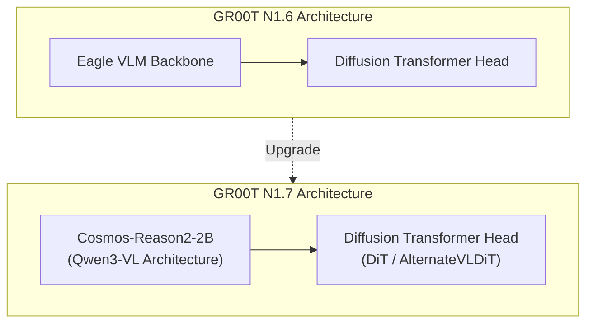
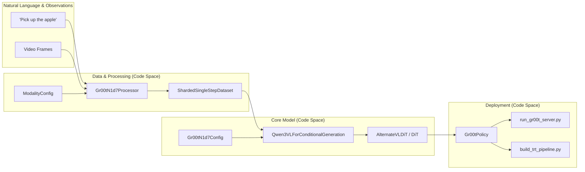
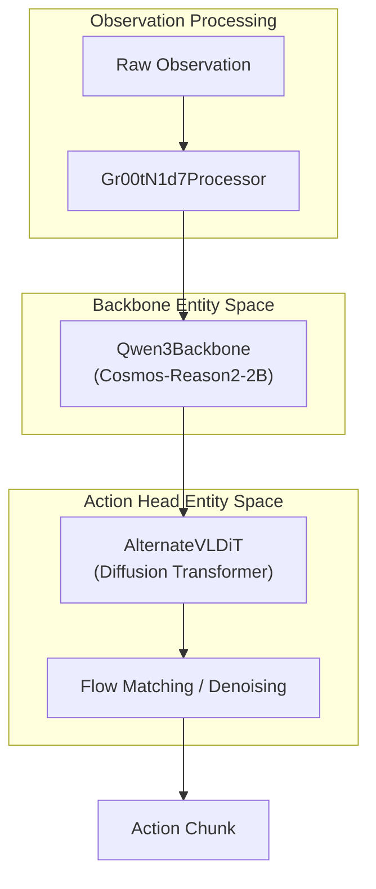

<!-- source: DeepWiki mcp.deepwiki.com · repo NVIDIA/Isaac-GR00T · page 1 Introduction to Isaac-GR00T · fetched 2026-10-26 -->

# Introduction to Isaac-GR00T

Relevant source files

The following files were used as context for generating this wiki page:

- [README.md](README.md)
- [media/header_compress.png](media/header_compress.png)
- [media/model-architecture.png](media/model-architecture.png)
- [scripts/deployment/README.md](scripts/deployment/README.md)

## Purpose and Scope

This page introduces the NVIDIA Isaac-GR00T system, an open vision-language-action (VLA) foundation model for generalist humanoid and manipulator robot control. This document covers the system's purpose, architecture overview, key features, and the N1.7 architecture update from N1.6.

For detailed information on specific subsystems:
- System architecture and pipelines: see [System Architecture Overview](#1.1)
- Core terminology and concepts: see [Key Concepts and Terminology](#1.2)
- Installation procedures: see [Installation and Setup](#2)
- Data format specifications: see [Data Pipeline and Configuration](#3)
- Model architecture details: see [Model Architecture and Core Components](#4)
- Deployment procedures: see [Inference and Deployment](#5)
- Training procedures: see [Training GR00T Models](#6)

**Sources:** [README.md:1-15](), [README.md:33-47]()

---

## What is Isaac-GR00T?

Isaac-GR00T is a **cross-embodiment vision-language-action (VLA) model** designed to enable generalist robot control across diverse platforms and tasks. The model processes multimodal inputs—video observations, robot proprioceptive state, and natural language instructions—to generate continuous action sequences for manipulation and locomotion tasks [README.md:66-70]().

### Key Characteristics

| Aspect | Description |
|--------|-------------|
| **Model Type** | Vision-Language-Action (VLA) foundation model [README.md:66-67]() |
| **Training Data** | Mixture of humanoid, bimanual, and semi-humanoid data, including 20K hours of EgoScale human video [README.md:68-70]() |
| **Embodiments Supported** | Humanoids (Unitree G1, Agibot G1), manipulators (WidowX, Google Robot, DROID), and bimanual arms [README.md:38-48](), [README.md:68-69]() |
| **Architecture** | Cosmos-Reason2-2B (Qwen3-VL) VLM + Diffusion Transformer (DiT) head [README.md:72-76](), [README.md:99-100]() |
| **Action Generation** | Continuous actions via flow matching / diffusion denoising [README.md:72-73]() |
| **Data Format** | LeRobot v2 compatible (Parquet files with metadata) [README.md:80-81]() |
| **License** | Apache 2.0 (Fully commercially licensable) [README.md:70-71]() |

**Sources:** [README.md:66-77](), [README.md:87-95]()

---

## What's New in GR00T N1.7

GR00T N1.7 is the General Availability release, featuring a modernized VLM backbone and significant code-level improvements for flexible resolution handling and cross-embodiment performance.

### Architectural Evolution

**Key Changes from N1.6:**

| Feature | N1.6 | N1.7 | Impact |
|-----------|------|------|--------|
| **VLM Backbone** | Eagle | **Cosmos-Reason2-2B (Qwen3-VL)** | Native aspect ratio support; no image padding required [README.md:99-100](), [README.md:115-116](). |
| **Action Space** | Absolute | **Relative EEF Action Space** | Improved generalization across human and robot embodiments [README.md:89-91](). |
| **Data Handling** | Single Path | **Multi-dataset mixture weighting** | Easier configuration for multi-dataset training [README.md:101-102](). |
| **Pre-training** | Standard Mixture | **+20K hours EgoScale Video** | Improved generalization and language-following via human priors [README.md:70-71](), [README.md:92-93](). |
| **Deployment** | `dit_only` TRT | **`full_pipeline` TRT Export** | Accelerates backbone (ViT + LLM) for major speedups [scripts/deployment/README.md:90-94](). |

**Sources:** [README.md:49-65](), [README.md:86-105](), [scripts/deployment/README.md:66-100]()

---

## System Architecture Overview

The following diagram bridges the "Natural Language Space" (instructions) and "Code Entity Space" (specific classes and scripts) to show how data flows through the GR00T N1.7 system.

### End-to-End System Flow

**Sources:** [README.md:78-85](), [README.md:114-116](), [scripts/deployment/README.md:1-4](), [scripts/deployment/README.md:102-105]()

---

## Core Components and Classes

The N1.7 implementation centers around several key classes that manage the lifecycle from data to action.

### Model Architecture: Gr00tN1d7Model

The model integrates the multimodal reasoning of the VLM with the precision of the diffusion head.

| Component | Class/Entity | Role |
|-----------|-------------|---------|
| **Backbone** | `Qwen3VLForConditionalGeneration` | Processes images at native resolution and instructions [README.md:99-100](). |
| **Action Head** | `AlternateVLDiT` | Denoises continuous actions based on VLM embeddings [scripts/deployment/README.md:83](). |
| **Data Handler** | `Gr00tN1d7Processor` | Handles tokenization, image resizing, and state normalization [README.md:114-116](). |
| **Inference Wrapper**| `Gr00tPolicy` | Provides a high-level API for real-time robot control [README.md:84](). |
| **Deployment Server**| `run_gr00t_server.py` | ZMQ-based server for remote policy inference. |

**Sources:** [README.md:73-77](), [README.md:99-100](), [scripts/deployment/README.md:76-85]()

---

## Primary Workflows

### Workflow 1: Fine-tuning on Custom Data
Users can adapt the base `nvidia/GR00T-N1.7-3B` model to specific tasks using the provided training scripts [README.md:82-83]().
1. **Prepare Data**: Convert raw demonstrations to LeRobot v2 format [README.md:80]().
2. **Compute Stats**: Generate normalization statistics for the specific embodiment.
3. **Launch**: Use `launch_finetune.py` with your own data and modality config [README.md:82]().

### Workflow 2: Inference and Deployment
1. **Standalone**: Use `standalone_inference_script.py` for quick validation on recorded datasets [scripts/deployment/README.md:50-62]().
2. **Server-Client**: Launch the policy server and connect a robot controller via the Policy API [README.md:83-84]().
3. **Optimization**: Use `build_trt_pipeline.py` to compile the model for high-frequency execution on NVIDIA hardware including Thor, Orin, and Spark [scripts/deployment/README.md:102-111]().

**Sources:** [README.md:78-85](), [scripts/deployment/README.md:1-25](), [scripts/deployment/README.md:102-111]()

---

## Hardware and Platform Support

GR00T N1.7 is optimized for a range of NVIDIA hardware, from data center GPUs to edge platforms.

| Platform | Recommended Use | Key Components |
|----------|-----------------|----------------|
| **dGPU** (H100, RTX 4090) | Training & High-perf Inference | PyTorch, Flash-Attn, TensorRT [scripts/deployment/README.md:16]() |
| **Jetson Thor** | Next-gen Humanoid Edge | Docker or Bare Metal deployment [scripts/deployment/README.md:17]() |
| **DGX Spark** | Development & Evaluation | Docker or Bare Metal deployment [scripts/deployment/README.md:18]() |
| **Jetson Orin** | Current-gen Robot Edge | Docker or Bare Metal deployment [scripts/deployment/README.md:19]() |

**Sources:** [scripts/deployment/README.md:14-25](), [scripts/deployment/README.md:151-153]()

---

