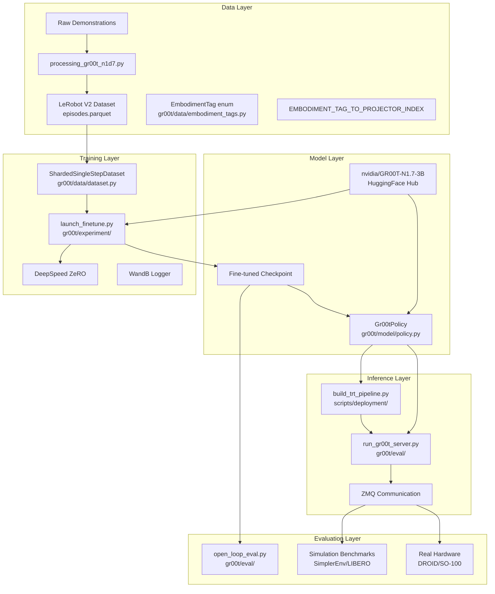
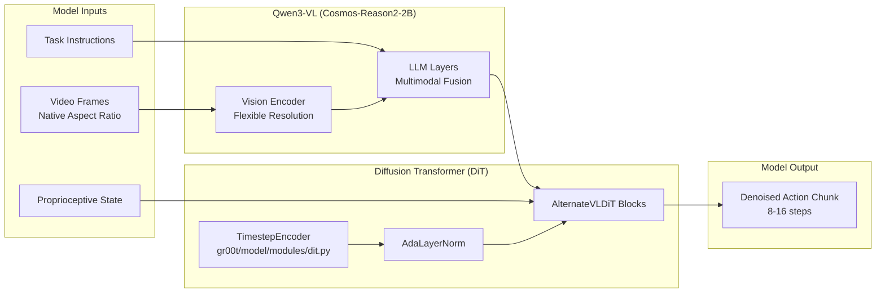

<!-- source: DeepWiki mcp.deepwiki.com · repo NVIDIA/Isaac-GR00T · page 1.1 System Architecture Overview · fetched 2026-10-26 -->

# System Architecture Overview

Relevant source files

The following files were used as context for generating this wiki page:

- [README.md](README.md)
- [gr00t/__init__.py](gr00t/__init__.py)
- [gr00t/model/gr00t_n1d7/processing_gr00t_n1d7.py](gr00t/model/gr00t_n1d7/processing_gr00t_n1d7.py)
- [scripts/deployment/README.md](scripts/deployment/README.md)
- [scripts/deployment/build_tensorrt_engine.py](scripts/deployment/build_tensorrt_engine.py)

## Overview

Isaac-GR00T N1.7 is a vision-language-action (VLA) foundation model system for robot control. The system architecture consists of five primary subsystems updated for the N1.7 release:

1.  **Data Layer**: Raw demonstrations → LeRobot V2 format with embodiment configurations and projector-index assignments [gr00t/model/gr00t_n1d7/processing_gr00t_n1d7.py:69-96]().
2.  **Model Layer**: Pre-trained `nvidia/GR00T-N1.7-3B` checkpoint featuring a **Qwen3-VL (Cosmos-Reason2-2B)** backbone and a **Diffusion Transformer (DiT)** action head [README.md:49-56](), [README.md:99-100]().
3.  **Training Layer**: Fine-tuning infrastructure with DeepSpeed, multi-GPU support, and `Gr00tTrainer` lifecycle [README.md:101-105]().
4.  **Inference Layer**: Policy server (`run_gr00t_server.py`) with ZMQ-based communication and TensorRT acceleration options [README.md:95-96](), [scripts/deployment/README.md:68-74]().
5.  **Evaluation Layer**: Open-loop metrics and closed-loop simulation/hardware testing across benchmarks like LIBERO, SimplerEnv, and real G1 robots [README.md:83-84](), [README.md:102-102]().

This page describes the system architecture at a high level. For terminology definitions, see [Key Concepts and Terminology](#1.2).

**Sources:** [README.md:49-105](), [gr00t/model/gr00t_n1d7/processing_gr00t_n1d7.py:69-96](), [scripts/deployment/README.md:68-74]()

## System Lifecycle and Component Interactions

The Isaac-GR00T system lifecycle flows from data preparation through training to deployment. The N1.7 architecture simplifies the pipeline while adding robust TensorRT support.

### Complete System Architecture (N1.7)

**Key Code Entities by Subsystem:**

| Subsystem | Primary Components | File Paths |
|-----------|-------------------|------------|
| **Data Layer** | `Gr00tN1d7DataCollator`, `EMBODIMENT_TAG_TO_PROJECTOR_INDEX` | [gr00t/model/gr00t_n1d7/processing_gr00t_n1d7.py:118-120](), [gr00t/model/gr00t_n1d7/processing_gr00t_n1d7.py:159-159]() |
| **Model Layer** | `Gr00tPolicy`, `Qwen3VLProcessor` | [gr00t/model/policy.py](), [gr00t/model/gr00t_n1d7/processing_gr00t_n1d7.py:49-51]() |
| **Training Layer** | `launch_finetune.py`, `ShardedSingleStepDataset` | [gr00t/experiment/launch_finetune.py]() |
| **Inference Layer** | `run_gr00t_server.py`, `build_trt_pipeline.py` | [gr00t/eval/run_gr00t_server.py](), [scripts/deployment/build_trt_pipeline.py]() |
| **Evaluation Layer** | `open_loop_eval.py`, `standalone_inference_script.py` | [gr00t/eval/open_loop_eval.py](), [scripts/deployment/standalone_inference_script.py]() |

**Sources:** [README.md:79-96](), [gr00t/model/gr00t_n1d7/processing_gr00t_n1d7.py:118-174](), [scripts/deployment/README.md:94-103]()

## Model Architecture Components

The GR00T N1.7 model is a combination of a vision-language foundation model and a diffusion transformer head. It replaces the Eagle backbone from N1.6 with **Cosmos-Reason2-2B (Qwen3-VL architecture)** [README.md:93-94](), [README.md:115-115]().

### Neural Architecture and Inference Flow

**Key Architecture Features (N1.7):**
* **Flexible Resolution:** Qwen3-VL supports encoding images in their native aspect ratio without padding [README.md:99-99]().
* **DiT Action Head:** Uses `AlternateVLDiT` blocks for denoising continuous actions [scripts/deployment/README.md:83-83]().
* **Flow Matching:** The DiT head uses a flow matching process for efficient action generation [README.md:72-76]().
* **Relative EEF Action Space:** N1.7 adopts a relative end-effector action space shared across human and robot embodiments [README.md:90-90]().

**Sources:** [README.md:72-115](), [scripts/deployment/README.md:76-84]()

## Inference and Performance

N1.7 introduces a "Full Pipeline" TensorRT optimization that accelerates both the VLM backbone and the DiT action head. The `build_trt_pipeline.py` script automates the export of all components including ViT, LLM, and DiT [scripts/deployment/build_trt_pipeline.py:104-111]().

### TensorRT Acceleration Components

| Component | Engine Name | Optimization Note |
|-----------|-------------|-------------------|
| **ViT** | Vision Engine | Qwen3-VL Vision (24 blocks, FP32 for accuracy) [scripts/deployment/README.md:78-78]() |
| **LLM** | LLM Engine | Qwen3-VL Text Model (16 layers) [scripts/deployment/README.md:79-79]() |
| **DiT** | DiT Engine | AlternateVLDiT (32 layers) [scripts/deployment/README.md:83-83]() |
| **Encoders** | State/Action | CategorySpecificMLP / MultiEmbodimentActionEncoder [scripts/deployment/README.md:81-82]() |

**Inference Performance (4 denoising steps, 1 camera):**

| Device | Mode | E2E Latency | Frequency |
|--------|------|-------------|-----------|
| **H100** | PyTorch Eager | 85.8 ms | 11.7 Hz |
| **H100** | TensorRT (Full) | **27.9 ms** | **35.9 Hz** |
| **Jetson Thor** | TensorRT (Full) | **82.3 ms** | **12.2 Hz** |

**Sources:** [scripts/deployment/README.md:76-84](), [scripts/deployment/README.md:151-153](), [scripts/deployment/build_tensorrt_engine.py:22-24]()

## Platform Specifics

Isaac-GR00T N1.7 supports a variety of NVIDIA hardware platforms, from data center GPUs to edge devices.

| Platform | Architecture | OS / CUDA | Key Script |
|----------|--------------|-----------|------------|
| **dGPU** | x86_64 | Ubuntu 22.04 / CUDA 12.8 | `uv sync` [scripts/deployment/README.md:28-30]() |
| **Jetson Thor** | aarch64 | Ubuntu 24.04 / CUDA 13.0 | `scripts/deployment/thor/` [scripts/deployment/README.md:17-17]() |
| **DGX Spark** | aarch64 | Ubuntu 24.04 / CUDA 13.0 | `scripts/activate_spark.sh` [scripts/deployment/README.md:18-18]() |
| **Jetson Orin** | aarch64 | Ubuntu 20.04 / CUDA 12.6 | `scripts/deployment/orin/` [scripts/deployment/README.md:19-19]() |

**Sources:** [scripts/deployment/README.md:14-25](), [scripts/deployment/README.md:28-30]()

---

