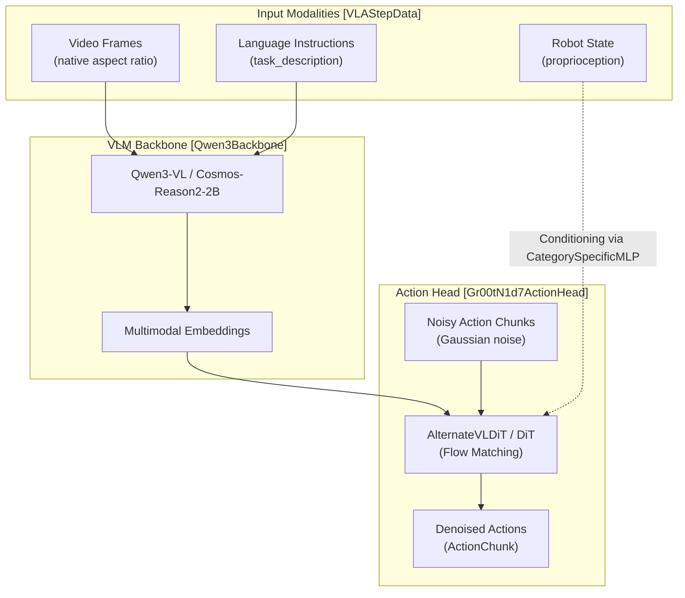
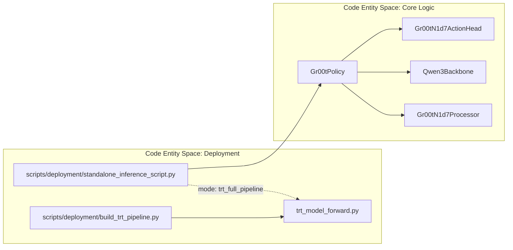

<!-- source: DeepWiki mcp.deepwiki.com · repo NVIDIA/Isaac-GR00T · page 1.2 Key Concepts and Terminology · fetched 2026-10-26 -->

# Key Concepts and Terminology

Relevant source files

The following files were used as context for generating this wiki page:

- [README.md](README.md)
- [getting_started/finetune_new_embodiment.md](getting_started/finetune_new_embodiment.md)
- [gr00t/model/gr00t_n1d7/gr00t_n1d7.py](gr00t/model/gr00t_n1d7/gr00t_n1d7.py)
- [scripts/deployment/README.md](scripts/deployment/README.md)
- [tests/gr00t/model/test_action_head.py](tests/gr00t/model/test_action_head.py)

## Purpose and Scope

This page defines the key concepts, terminology, and abstractions used throughout the Isaac GR00T N1.7 system. This release introduces significant architectural updates, including the transition to the Qwen3-VL (Cosmos-Reason2-2B) backbone and native support for variable image resolutions.

For architectural details about how these components interact, see [System Architecture Overview](1.1). For detailed data format specifications, see [LeRobot Compatible Data Format](3.1).

---

## Core Model Concepts

### Vision-Language-Action (VLA) Model

A **Vision-Language-Action (VLA) model** is a neural network that takes multimodal inputs (images, robot state, language instructions) and produces continuous action predictions. GR00T N1.7 implements this using two primary components:

1.  **VLM Backbone (Cosmos-Reason2-2B):** Based on the `Qwen3VLForConditionalGeneration` architecture. It processes visual observations and language instructions into semantic features. Unlike N1.6, it supports flexible resolutions and encodes images in their native aspect ratio [README.md:93-93](), [README.md:114-115]().
2.  **Diffusion Transformer (DiT) Action Head:** A 32-layer transformer implemented in `Gr00tN1d7ActionHead` [gr00t/model/gr00t_n1d7/gr00t_n1d7.py:38-43]() that denoises continuous actions conditioned on VLM features [README.md:73-77](). It uses flow matching for the action denoising process.

**Architecture Diagram:**

**Sources:** [README.md:73-77](), [README.md:93-93](), [gr00t/model/gr00t_n1d7/gr00t_n1d7.py:38-82](), [tests/gr00t/model/test_action_head.py:25-26]()

---

### Embodiment

An **embodiment** represents a specific robot platform configuration. In N1.7, these are managed via the `EmbodimentTag` enumeration.

| Tag Category | Description | Example Tags |
|--------------|-------------|--------------|
| **Pretrain Tags** | Baked into the base model (`nvidia/GR00T-N1.7-3B`), usable zero-shot. | `OXE_DROID_RELATIVE_EEF_RELATIVE_JOINT`, `XDOF`, `REAL_G1` |
| **Posttrain Tags** | Require a finetuned checkpoint for specific benchmarks. | `UNITREE_G1`, `SIMPLER_ENV_GOOGLE`, `LIBERO_PANDA` |
| **Finetuning Tags** | Used for integrating custom robots. | `NEW_EMBODIMENT` |

Custom embodiments must be registered using `register_modality_config` and associated with `EmbodimentTag.NEW_EMBODIMENT` during the fine-tuning process [getting_started/finetune_new_embodiment.md:71-72]().

**Sources:** [getting_started/finetune_new_embodiment.md:13-21](), [getting_started/finetune_new_embodiment.md:71-72](), [README.md:80-84]()

---

## Data Concepts

### Modality Configuration

A `ModalityConfig` defines how data is sampled and loaded for a specific embodiment.

*   **delta_indices:** Indices to sample relative to the current timestep. For video, this typically defines the current frame (`[0]`). For actions, it defines the prediction horizon (e.g., `list(range(0, 16))`) [getting_started/finetune_new_embodiment.md:27-43]().
*   **modality_keys:** The specific column names in the LeRobot dataset (e.g., `front`, `wrist`, `single_arm`, `gripper`) [getting_started/finetune_new_embodiment.md:28-47]().

### Action Representation

Actions are configured via `ActionConfig` [getting_started/finetune_new_embodiment.md:48-61]() using three key enums:
*   **ActionRepresentation:** `RELATIVE` (delta from current state) or `ABSOLUTE` (target position) [getting_started/finetune_new_embodiment.md:51-57](). N1.7 emphasizes `RELATIVE` end-effector (EEF) space for better generalization [README.md:90-90]().
*   **ActionType:** `EEF` (End-Effector) or `NON_EEF` (e.g., joint-space) [getting_started/finetune_new_embodiment.md:52-58]().
*   **ActionFormat:** `DEFAULT` or specialized formats like `XYZ_ROT6D` [getting_started/finetune_new_embodiment.md:53-59]().

**Sources:** [getting_started/finetune_new_embodiment.md:15-21](), [getting_started/finetune_new_embodiment.md:48-62](), [README.md:90-90]()

---

## Deployment and Inference

### Policy and Inference Pipeline

GR00T N1.7 supports multiple inference modes, including native PyTorch and TensorRT acceleration.

*   **Gr00tPolicy:** The high-level interface that wraps the model and processor for inference [README.md:83-84]().
*   **TensorRT Acceleration:** The `trt_full_pipeline` mode accelerates all model components (ViT, LLM, DiT, etc.) into TRT engines [scripts/deployment/README.md:68-85]().
*   **Denoising Loop:** During inference, the `get_action` method in `Gr00tN1d7ActionHead` performs the iterative denoising process to generate the `action_pred` [tests/gr00t/model/test_action_head.py:130-136]().

**Entity Mapping Diagram:**

**Sources:** [scripts/deployment/README.md:55-62](), [scripts/deployment/README.md:68-74](), [scripts/deployment/README.md:107-111](), [tests/gr00t/model/test_action_head.py:130-136]()

---

## Summary of Key Terms

| Term | Definition | Code Reference |
|------|------------|----------------|
| **Action Horizon** | The number of future action steps predicted in a single inference pass. | `config.action_horizon` [tests/gr00t/model/test_action_head.py:39-39]() |
| **Flow Matching** | The generative technique used to train the DiT head to map noise to actions. | `Gr00tN1d7ActionHead` [gr00t/model/gr00t_n1d7/gr00t_n1d7.py:39-39]() |
| **Denoising Steps** | The number of iterations used during inference to refine the action prediction. | `num_inference_timesteps` [gr00t/model/gr00t_n1d7/gr00t_n1d7.py:64-64]() |
| **Embodiment Tag** | A unique identifier mapping a robot to its specific modality and action configurations. | `EmbodimentTag` [getting_started/finetune_new_embodiment.md:14-14]() |
| **Relative EEF** | A representation where actions are deltas from the current end-effector pose. | `ActionRepresentation.RELATIVE` [getting_started/finetune_new_embodiment.md:51-51]() |

**Sources:** [gr00t/model/gr00t_n1d7/gr00t_n1d7.py:38-82](), [tests/gr00t/model/test_action_head.py:32-70](), [getting_started/finetune_new_embodiment.md:48-62]()

---

