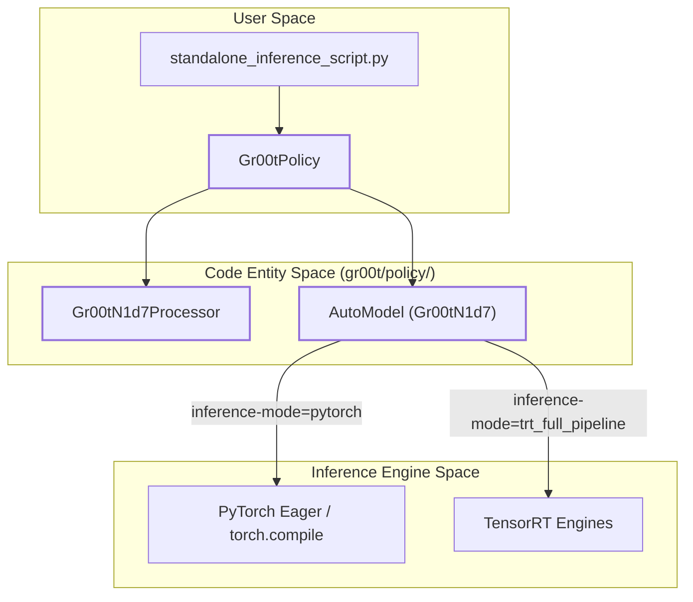
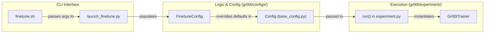

<!-- source: DeepWiki mcp.deepwiki.com · repo NVIDIA/Isaac-GR00T · page 10 Glossary · fetched 2026-10-26 -->

# Glossary

Relevant source files

The following files were used as context for generating this wiki page:

- [README.md](README.md)
- [examples/DROID/server_client.py](examples/DROID/server_client.py)
- [examples/DROID/utils.py](examples/DROID/utils.py)
- [examples/finetune.sh](examples/finetune.sh)
- [getting_started/finetune_new_embodiment.md](getting_started/finetune_new_embodiment.md)
- [gr00t/configs/data/embodiment_configs.py](gr00t/configs/data/embodiment_configs.py)
- [gr00t/configs/finetune_config.py](gr00t/configs/finetune_config.py)
- [gr00t/data/embodiment_tags.py](gr00t/data/embodiment_tags.py)
- [gr00t/experiment/experiment.py](gr00t/experiment/experiment.py)
- [gr00t/experiment/launch_finetune.py](gr00t/experiment/launch_finetune.py)
- [gr00t/model/gr00t_n1d7/gr00t_n1d7.py](gr00t/model/gr00t_n1d7/gr00t_n1d7.py)
- [gr00t/policy/gr00t_policy.py](gr00t/policy/gr00t_policy.py)
- [scripts/deployment/README.md](scripts/deployment/README.md)
- [tests/gr00t/model/test_action_head.py](tests/gr00t/model/test_action_head.py)

This page provides definitions for codebase-specific terms, domain concepts, and technical jargon used within the Isaac-GR00T N1.7 repository. It serves as a reference for onboarding engineers to understand the mapping between high-level robotics concepts and their specific implementations in the code.

## Core Concepts

### VLA Model (Vision-Language-Action)
A multimodal model architecture that processes visual observations and language instructions to directly predict robot actions. In GR00T N1.7, this is implemented by combining a **VLM Backbone** with a **DiT Action Head** [README.md:67-77]().

### Embodiment & Embodiment Tag
An "embodiment" refers to a specific robot hardware configuration (e.g., a Panda arm, a Unitree G1 humanoid). Every dataset and inference session is associated with an `EmbodimentTag`, which is a unique identifier used to look up robot-specific configurations like joint limits and camera setups [gr00t/data/embodiment_tags.py:29-56]().
*   **Code Pointer:** `gr00t.data.embodiment_tags.EmbodimentTag` [gr00t/data/embodiment_tags.py:29-144]().

### Modality Configuration
A specification of the input/output streams for a particular robot. It defines which camera keys to use (video), the dimensions of the state vector, and the format of the actions (e.g., relative vs absolute) [getting_started/finetune_new_embodiment.md:9-21]().
*   **Code Pointer:** `gr00t.configs.data.embodiment_configs.MODALITY_CONFIGS` [gr00t/configs/data/embodiment_configs.py:26-65]().

### Relative EEF Action Space
A key feature of N1.7 where actions are represented as deltas (relative changes) from the current end-effector pose rather than absolute targets. This representation is shared across human and robot data to improve generalization [README.md:89-93]().

---

## Architectural Components

### VLM Backbone (Cosmos-Reason2-2B)
The primary multimodal feature extractor. In N1.7, this is based on the **Qwen3-VL** architecture, replacing the Eagle backbone from N1.6. It supports native aspect ratios and variable resolutions for images without padding [README.md:99]().
*   **Code Pointer:** `nvidia/Cosmos-Reason2-2B` [gr00t/experiment/launch_finetune.py:100]().

### DiT (Diffusion Transformer)
The action head of the model. It uses a transformer-based architecture to denoise a continuous action vector, conditioned on the features extracted by the VLM backbone. N1.7 supports both standard `DiT` and `AlternateVLDiT` [gr00t/model/gr00t_n1d7/gr00t_n1d7.py:49-61]().
*   **Code Pointer:** `gr00t.model.gr00t_n1d7.gr00t_n1d7.Gr00tN1d7ActionHead` [gr00t/model/gr00t_n1d7/gr00t_n1d7.py:38-83]().

### Flow Matching
The generative modeling technique used for action prediction in N1.7. The `Gr00tN1d7ActionHead` implements this via a `beta_dist` for time-sampling during training [gr00t/model/gr00t_n1d7/gr00t_n1d7.py:112-115]().

---

## Data & Processing

### LeRobot Format
The standardized data format used for storing robot trajectories. GR00T uses a version compatible with LeRobot v2.0 [README.md:80]().

### Action Horizon / Execution Horizon
The number of future time steps predicted by the model in a single inference pass. `action_horizon` is the model's total prediction length, while `execution_horizon` is the subset of those steps actually sent to the robot controller [scripts/deployment/standalone_inference_script.py:61](), [getting_started/finetune_new_embodiment.md:151]().

### State Dropout
A regularization technique where robot state inputs (like joint positions) are randomly masked during training to force the model to rely more on visual information. Controlled by `state_dropout_prob` [gr00t/configs/finetune_config.py:61-64]().

---

## Code Entity Mapping

The following diagrams bridge the gap between high-level system names and the specific Python classes or scripts that implement them.

### Inference Pipeline Mapping
This diagram shows how a request flows from a user script through the policy abstraction to the underlying hardware-accelerated engines.

**Sources:** [gr00t/policy/gr00t_policy.py:70-125](), [scripts/deployment/README.md:50-74](), [scripts/deployment/README.md:88-95]()

### Training Configuration Mapping
This diagram maps the CLI arguments in the shell scripts to the internal configuration dataclasses.

**Sources:** [examples/finetune.sh:143-162](), [gr00t/experiment/launch_finetune.py:44-49](), [gr00t/configs/finetune_config.py:22-30](), [gr00t/experiment/experiment.py:34-36]()

---

## Technical Jargon & Abbreviations

| Term | Definition | Code Reference |
| :--- | :--- | :--- |
| **dGPU** | Discrete GPU (e.g., H100, RTX 4090) as opposed to integrated Jetson modules. | [scripts/deployment/README.md:16-21]() |
| **EEF** | End-Effector. Often refers to the 6D or 9D pose of the robot's hand/gripper. | [gr00t/data/embodiment_tags.py:60-62]() |
| **Projector** | MLP layers that map multimodal features to a shared space. | [gr00t/configs/finetune_config.py:55-56]() |
| **TRT** | TensorRT. NVIDIA's high-performance deep learning inference optimizer. | [scripts/deployment/README.md:66-74]() |
| **uv** | A fast Python package and environment manager used throughout the repo. | [scripts/deployment/README.md:12-16]() |
| **VLLN** | Vision-Language Layer Norm. A normalization layer used in the action head. | [gr00t/model/gr00t_n1d7/gr00t_n1d7.py:84-86]() |

**Sources:** [scripts/deployment/README.md:1-25](), [gr00t/data/embodiment_tags.py:60-98](), [gr00t/configs/finetune_config.py:48-64](), [gr00t/model/gr00t_n1d7/gr00t_n1d7.py:38-93]()