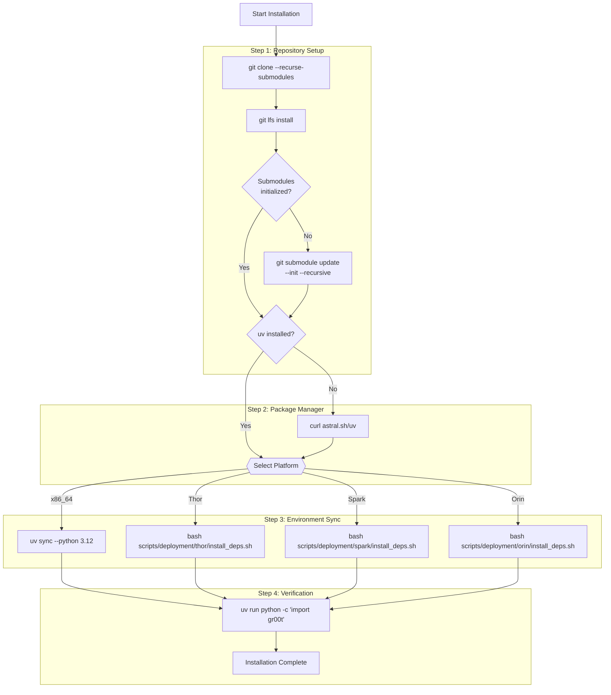
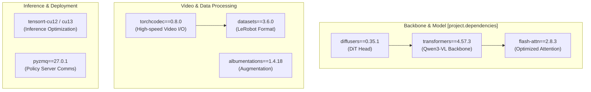

<!-- source: DeepWiki mcp.deepwiki.com · repo NVIDIA/Isaac-GR00T · page 2 Installation and Setup · fetched 2026-10-26 -->

# Installation and Setup

<details>
<summary>Relevant source files</summary>

The following files were used as context for generating this wiki page:

- [docker/Dockerfile](docker/Dockerfile)
- [docker/README.md](docker/README.md)
- [docker/build.sh](docker/build.sh)
- [gr00t/eval/rollout_policy.py](gr00t/eval/rollout_policy.py)
- [pyproject.toml](pyproject.toml)
- [scripts/deployment/spark/Dockerfile](scripts/deployment/spark/Dockerfile)
- [scripts/deployment/spark/uv.lock](scripts/deployment/spark/uv.lock)
- [uv.lock](uv.lock)

</details>


This document provides step-by-step instructions for installing the Isaac GR00T repository and configuring the development environment for GR00T N1.7. It covers repository cloning, dependency installation using `uv`, platform-specific Docker configurations, and hardware recommendations.

## Prerequisites

Before beginning installation, ensure your system meets the requirements for your target platform. GR00T N1.7 supports a variety of NVIDIA hardware, ranging from data center GPUs to edge devices.

| Platform | Python | CUDA | OS |
|----------|--------|------|----|
| **dGPU (x86_64)** | 3.12.* | 12.8 | Ubuntu 24.04 |
| **aarch64 (GB200)** | 3.12.* | 13.0 | Ubuntu 24.04 |
| **Jetson Thor / DGX Spark** | 3.12.* | 13.0 | Ubuntu 24.04 |
| **Jetson Orin** | 3.12.* | 13.2 | JetPack 7.2 |

**Important**: `git-lfs` is required to download parquet data files in `/demo_data`. Install it before cloning: `sudo apt install git-lfs && git lfs install`.

Sources: [pyproject.toml:10](), [pyproject.toml:83-84](), [docker/Dockerfile:16](), [docker/README.md:90](), [scripts/deployment/spark/Dockerfile:1-8]()

---

## Installation Workflow

The following diagram illustrates the complete installation process, highlighting the use of the `uv` package manager to handle complex dependencies like `flash-attn` and `torchcodec`.



Sources: [pyproject.toml:81-109](), [docker/README.md:18-94](), [scripts/deployment/spark/Dockerfile:18]()

---

## Step 1: Clone Repository with Submodules

The Isaac GR00T repository contains external dependencies managed as Git submodules. These must be initialized during cloning to ensure all model components are available.

```bash
git clone --recurse-submodules https://github.com/NVIDIA/Isaac-GR00T
cd Isaac-GR00T
```

If you have already cloned without submodules, initialize them:
```bash
git submodule update --init --recursive
```

Sources: [docker/README.md:38]()

---

## Step 2: Set Up the Environment with `uv`

GR00T uses [uv](https://github.com/astral-sh/uv) for fast, reproducible dependency management. The repository requires Python 3.12.

### Default Install (x86_64 dGPU)
1. **Install FFmpeg**: Required by `torchcodec` for video processing.
   ```bash
   sudo apt-get update && sudo apt-get install -y ffmpeg
   ```
2. **Install `uv`**:
   ```bash
   curl -LsSf https://astral.sh/uv/install.sh | sh
   ```
3. **Synchronize Environment**:
   ```bash
   uv sync --python 3.12
   ```

For details on platform-specific dependency structures (Thor, Orin, Spark), see [Environment and Dependencies](#2.1).

Sources: [pyproject.toml:10](), [pyproject.toml:42](), [docker/Dockerfile:79](), [docker/Dockerfile:142]()

---

## Dependency Architecture

GR00T N1.7 introduces a streamlined dependency stack optimized for the Qwen3-VL backbone and DiT action head.



Sources: [pyproject.toml:12-58]()

---

## Docker and Container Setup

For isolated environments, GR00T provides a unified `Dockerfile` that supports both x86_64 and aarch64 (GB200/Grace Hopper). Specialized Dockerfiles are also provided for edge platforms.

### Building the Image
```bash
bash docker/build.sh
```

### Supported Docker Profiles
| Profile | Base Image | Target Hardware |
|---------|------------|-----------------|
| `default` | `nvidia/cuda:12.8.0-devel-ubuntu24.04` | x86_64, GB200, Grace Hopper |
| `thor` | `scripts/deployment/thor/Dockerfile` | Jetson Thor |
| `orin` | `scripts/deployment/orin/Dockerfile` | Jetson Orin |
| `spark` | `nvidia/cuda:13.0.0-devel-ubuntu24.04` | DGX Spark |

For headless rendering configuration and build script details, see [Docker and Container Setup](#2.3).

Sources: [docker/README.md:13-94](), [docker/Dockerfile:16](), [docker/build.sh:26-54](), [scripts/deployment/spark/Dockerfile:1]()

---

## Hardware Recommendations

The N1.7 model performance varies by platform. The `uv.lock` and `pyproject.toml` files specify requirements for high-performance inference and training.

| Device | Precision | Recommended Stack |
|--------|-----------|-------------------|
| **H100 / L40** | PyTorch / DeepSpeed | `deepspeed==0.17.6` |
| **GB200 / aarch64** | PyTorch / Triton | `triton==3.5.0` |
| **Edge Devices** | TensorRT | `tensorrt-cu13` |

**Fine-tuning Requirements**: Multi-GPU setups using DeepSpeed are supported for x86_64 Linux platforms.

Sources: [pyproject.toml:47-58](), [uv.lock:28-40]()

---

## Verification Steps

After installation, verify the setup by running the following commands:

1. **Verify GR00T Installation**:
   ```bash
   uv run python -c "import gr00t; print('GR00T ready')"
   ```
2. **Verify GPU/CUDA**:
   ```bash
   uv run python -c "import torch; print(f'CUDA: {torch.cuda.is_available()}')"
   ```

If verification succeeds, you are ready to proceed to the [Quick Start Guide](#2.2) to run your first inference.

Sources: [docker/README.md:41](), [pyproject.toml:118]()

---

