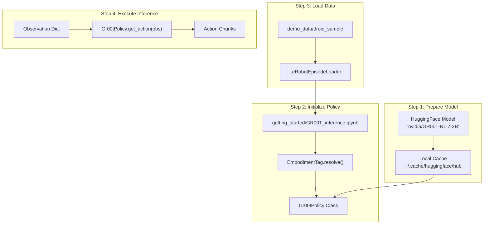
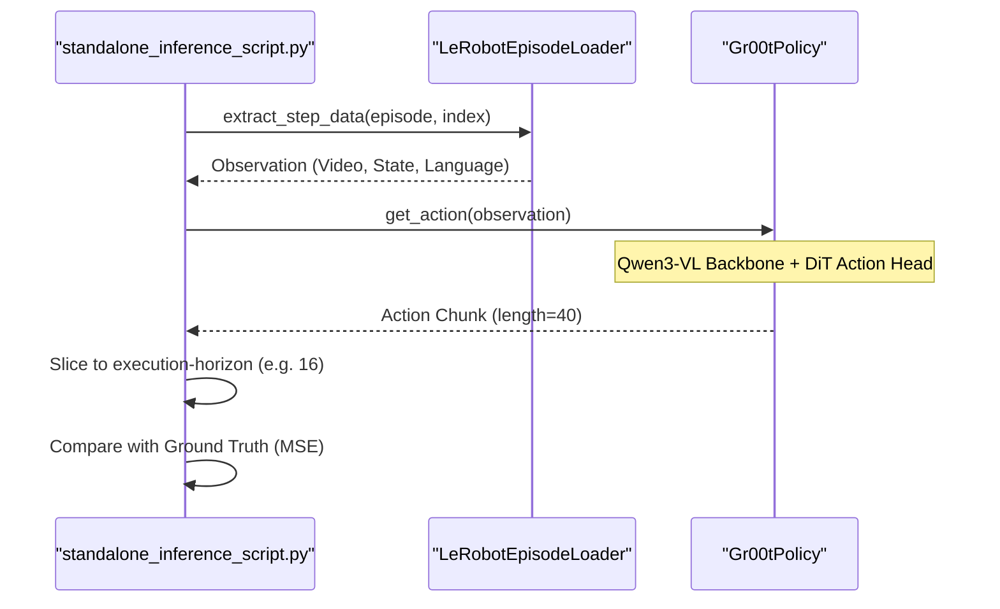

<!-- source: DeepWiki mcp.deepwiki.com · repo NVIDIA/Isaac-GR00T · page 2.2 Quick Start Guide · fetched 2026-10-26 -->

# Quick Start Guide

<details>
<summary>Relevant source files</summary>

The following files were used as context for generating this wiki page:

- [getting_started/GR00T_inference.ipynb](getting_started/GR00T_inference.ipynb)
- [getting_started/policy.md](getting_started/policy.md)
- [gr00t/eval/sim/LIBERO/setup_libero.sh](gr00t/eval/sim/LIBERO/setup_libero.sh)

</details>


## Purpose and Scope

This guide provides the fastest path to running inference with a pre-trained GR00T N1.7 checkpoint. You will learn how to load a model using the `Gr00tPolicy` API and execute inference using the `GR00T_inference.ipynb` notebook or standalone scripts. This covers zero-shot deployment and verification using the new Qwen3-VL (Cosmos-Reason2-2B) backbone.

For detailed information about:
- Installing dependencies and environment setup, see [Environment and Dependencies](#2.1)
- Fine-tuning on custom data, see [Training GR00T Models](#6)
- Complete policy API documentation, see [Policy Server Architecture](#5.1) and [Client Integration](#5.3)

---

## Prerequisites

Before starting, ensure you have completed the installation steps from [Environment and Dependencies](#2.1):

| Requirement | Status Check |
|-------------|--------------|
| Repository cloned with submodules | `ls -la external_dependencies/` should show submodules [gr00t/eval/sim/LIBERO/setup_libero.sh:8-12]() |
| `uv` package manager installed | `uv --version` |
| Python environment created | `.venv` directory exists [getting_started/GR00T_inference.ipynb:11-11]() |
| CUDA 12.8+ available | `nvidia-smi` shows GPU |

---

## Quick Start Workflow

The following diagram shows the complete zero-shot deployment workflow for GR00T N1.7, bridging the high-level process to specific code entities.

### Deployment Flow: Natural Language to Code Entities



**Sources:** [getting_started/GR00T_inference.ipynb:20-44](), [getting_started/policy.md:14-19]()

---

## Step 1: Download Pre-trained Checkpoint

GR00T N1.7 checkpoints are hosted on HuggingFace Hub and are automatically downloaded when referenced via `model_path` in the `Gr00tPolicy` constructor [getting_started/GR00T_inference.ipynb:89-94]().

### Available Checkpoints (N1.7)

| Model ID | Parameters | Description |
|----------|------------|-------------|
| `nvidia/GR00T-N1.7-3B` | ~2.9B | Base model with Cosmos-Reason2-2B backbone. [getting_started/GR00T_inference.ipynb:37-37](), [getting_started/GR00T_inference.ipynb:83-83]() |
| `nvidia/GR00T-N1.7-DROID` | ~2.9B | Finetuned on DROID dataset. [getting_started/policy.md:66-66]() |
| `nvidia/GR00T-N1.7-LIBERO` | ~2.9B | Finetuned for LIBERO simulation. [getting_started/policy.md:68-68]() |

---

## Step 2: Interactive Inference (Notebook)

The `getting_started/GR00T_inference.ipynb` notebook is the recommended way to start. It demonstrates how to use the `Gr00tPolicy` to predict actions from observations.

### Key Implementation Steps
1.  **Policy Initialization**: The policy is loaded using an `EmbodimentTag` which determines the modality configuration (state/action keys and normalization) [getting_started/policy.md:35-37]().
    ```python
    policy = Gr00tPolicy(
        model_path="nvidia/GR00T-N1.7-3B",
        embodiment_tag=EmbodimentTag.resolve("OXE_DROID_RELATIVE_EEF_RELATIVE_JOINT"),
        device="cuda"
    )
    ```
    *Source: [getting_started/GR00T_inference.ipynb:89-94]()*

2.  **Modality Configuration**: The notebook retrieves the `modality_config` from the policy to ensure the dataset loader matches the model's expected inputs (e.g., `video`, `state`, `language`) [getting_started/GR00T_inference.ipynb:136-146]().

3.  **Data Loading**: Uses `LeRobotEpisodeLoader` to pull sample data from `demo_data/droid_sample` [getting_started/GR00T_inference.ipynb:154-158]().

---

## Step 3: Standalone Inference Script

For non-interactive environments, use the `standalone_inference_script.py`. This script runs inference on local demo data and calculates metrics like Mean Squared Error (MSE) against ground truth.

### Execution Example
```bash
uv run python scripts/deployment/standalone_inference_script.py \
    --model-path nvidia/GR00T-N1.7-3B \
    --dataset-path demo_data/droid_sample \
    --embodiment-tag OXE_DROID_RELATIVE_EEF_RELATIVE_JOINT \
    --traj-ids 1 2 \
    --inference-mode pytorch \
    --execution-horizon 16
```
*Source: [getting_started/policy.md:33-85]()*

### Data Flow: Standalone Inference



**Sources:** [getting_started/GR00T_inference.ipynb:24-27](), [getting_started/policy.md:82-88]()

---

## Step 4: Understanding Parameters

### Embodiment Tags
The `--embodiment-tag` is critical as it defines how the model interprets state and action vectors.
- **Pretrain tags**: Use `OXE_DROID_RELATIVE_EEF_RELATIVE_JOINT` or `XDOF` with the base `3B` model for zero-shot tasks [getting_started/policy.md:42-42]().
- **Posttrain tags**: Tags like `LIBERO_PANDA` or `SIMPLER_ENV_GOOGLE` require their respective finetuned checkpoints [getting_started/policy.md:43-43]().

### Execution Horizon
The `--execution-horizon` (formerly `--action-horizon`) determines how many steps of the predicted chunk are executed before re-planning. For the N1.7 base model, the predicted chunk length (`action_horizon`) is 40 [getting_started/policy.md:82-90]().

---

## Troubleshooting

### Environment Setup for Simulation
If running simulation benchmarks like LIBERO, you must run the provided setup scripts to patch dependencies for Python 3.12 compatibility [gr00t/eval/sim/LIBERO/setup_libero.sh:17-32]().

### Kernel Selection
When using the Jupyter notebook, ensure the `.venv` kernel is selected to avoid missing dependency errors [getting_started/GR00T_inference.ipynb:11-11]().

### Tag Mismatches
Using a posttrain tag (e.g., `LIBERO_PANDA`) with the base model checkpoint will result in an error, as the base model only supports a specific set of zero-shot tags [getting_started/policy.md:76-76]().

**Sources:** [getting_started/GR00T_inference.ipynb:1-179](), [getting_started/policy.md:1-96](), [gr00t/eval/sim/LIBERO/setup_libero.sh:1-77]()

---

