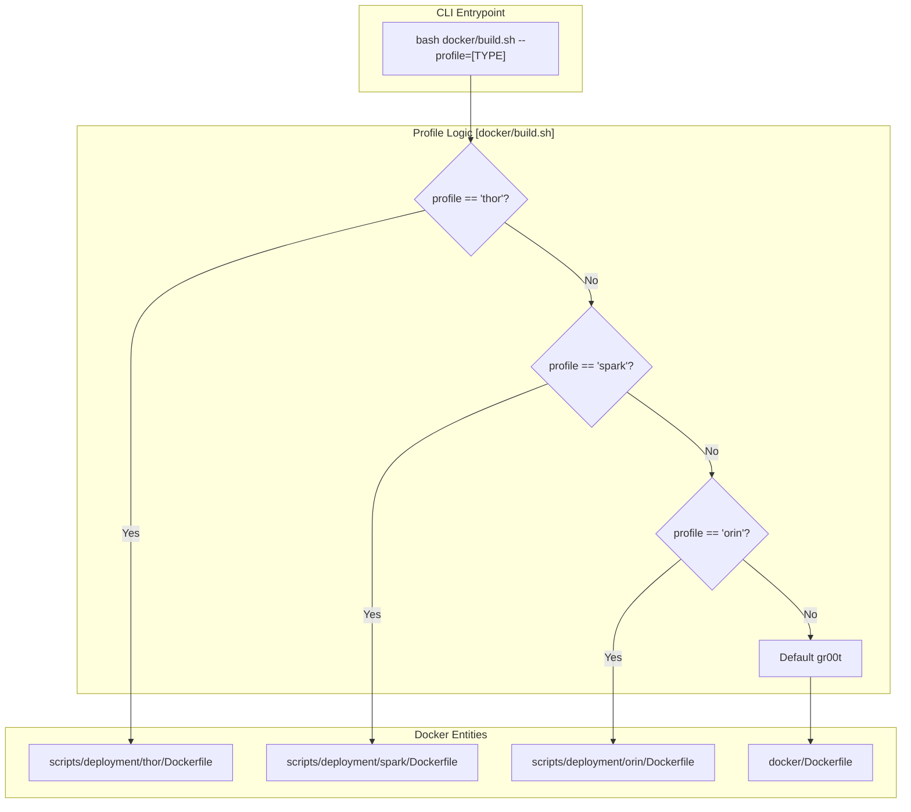
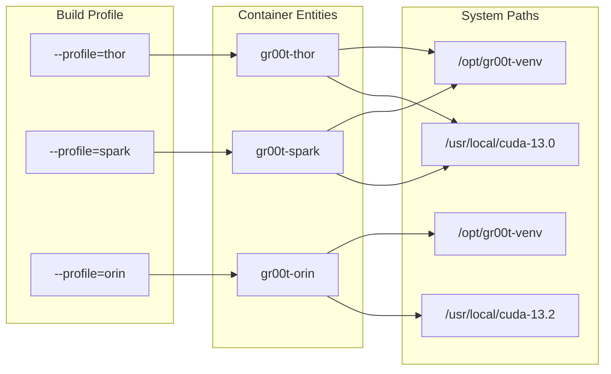

<!-- source: DeepWiki mcp.deepwiki.com · repo NVIDIA/Isaac-GR00T · page 2.3 Docker and Container Setup · fetched 2026-10-26 -->

# Docker and Container Setup

Relevant source files

The following files were used as context for generating this wiki page:

- [docker/Dockerfile](docker/Dockerfile)
- [docker/README.md](docker/README.md)
- [docker/build.sh](docker/build.sh)
- [scripts/deployment/jetson/Dockerfile](scripts/deployment/jetson/Dockerfile)
- [scripts/deployment/spark/Dockerfile](scripts/deployment/spark/Dockerfile)
- [scripts/deployment/spark/install_deps.sh](scripts/deployment/spark/install_deps.sh)
- [scripts/deployment/spark/uv.lock](scripts/deployment/spark/uv.lock)
- [tests/scripts/deployment/test_install_deps_cleanup_trap.py](tests/scripts/deployment/test_install_deps_cleanup_trap.py)
- [tools/manifest_alignment.toml](tools/manifest_alignment.toml)

This page describes the Docker-based deployment strategy for the Isaac-GR00T codebase. The system utilizes a unified containerization approach to ensure environment parity across diverse hardware architectures, including standard x86_64 servers and NVIDIA edge platforms like Thor, Orin, and Spark.

## Overview of Container Strategy

The Isaac-GR00T project provides a primary `Dockerfile` that supports both x86_64 and aarch64 (e.g., GB200, Grace Hopper) architectures [docker/Dockerfile:2-4](). For specialized edge deployments, platform-specific Dockerfiles are maintained to handle unique CUDA versions and platform requirements [docker/README.md:66-97]().

### Build and Execution Flow

The build process is managed by a central script, `docker/build.sh`, which selects the appropriate Dockerfile based on a `--profile` argument [docker/build.sh:9-16]().

**Diagram: Build Profile Resolution**

**Sources:** [docker/build.sh:9-54](), [docker/README.md:13-19]()

---

## The Main Dockerfile (x86_64 / aarch64)

The primary `docker/Dockerfile` is based on `nvidia/cuda:12.8.0-devel-ubuntu24.04` [docker/Dockerfile:16](). It automates the installation of system dependencies, including both Python 3.12 (primary) and Python 3.10 (for simulation compatibility), and the `uv` package manager [docker/Dockerfile:69-72](), [docker/Dockerfile:101-125](), [docker/Dockerfile:142]().

### Key Implementation Details
*   **Aarch64 Compatibility:** For Grace Hopper or GB200 systems, the build utilizes a bootstrap process for `torchcodec` using wheels located in `scripts/deployment/dgpu/wheels/` [docker/Dockerfile:5-8](), [docker/Dockerfile:177-180]().
*   **Dependency Management:** It uses `uv sync` to install dependencies into a global virtual environment at `/opt/gr00t-venv` [docker/Dockerfile:22-23](), [docker/Dockerfile:167-182](). A compatibility symlink is created at `/workspace/.venv` [docker/Dockerfile:191]().
*   **Version Tracking:** The image records the SHA256 hash of the `uv.lock` file used during the build to ensure environment consistency [docker/Dockerfile:183]().

**Sources:** [docker/Dockerfile:1-196](), [docker/README.md:3-4](), [docker/README.md:21]()

---

## Headless Rendering Configuration

To support simulation environments like MuJoCo and PyOpenGL within a container, the Dockerfile configures EGL and Vulkan for headless hardware acceleration [docker/Dockerfile:197-208]().

### Implementation of Graphics Drivers in Container
The container manually maps the NVIDIA EGL vendor library to ensure the `libEGL_nvidia.so.0` driver is correctly identified by the GL Vendor-Neutral Dispatch library (GLVND) [docker/Dockerfile:198-206]().

| Environment Variable | Value | Purpose |
| :--- | :--- | :--- |
| `NVIDIA_DRIVER_CAPABILITIES` | `graphics,utility,compute` | Enables GPU graphics features in container [docker/Dockerfile:21]() |
| `GR00T_GLOBAL_VENV` | `/opt/gr00t-venv` | Path to the pre-installed virtual environment [docker/Dockerfile:22]() |
| `UV_PROJECT_ENVIRONMENT` | `/opt/gr00t-venv` | Directs `uv` to use the global venv [docker/Dockerfile:23]() |

**Sources:** [docker/Dockerfile:20-23](), [docker/Dockerfile:197-208]()

---

## Platform-Specific Images

For edge deployment, Isaac-GR00T provides specialized environments tailored to specific hardware constraints and CUDA versions.

### Thor and Spark (CUDA 13)
Both Jetson Thor and DGX Spark environments utilize `nvidia/cuda:13.0.0-devel-ubuntu24.04` as a base [scripts/deployment/spark/Dockerfile:1](). They include a custom `install_deps.sh` script that manages platform-specific dependency resolution before running `uv sync` [scripts/deployment/spark/Dockerfile:18](), [scripts/deployment/spark/install_deps.sh:89-90]().

### Orin (JetPack 7.2)
The Orin container is built from `nvidia/cuda:13.2.1-devel-ubuntu24.04` for JetPack 7.2 compatibility [scripts/deployment/jetson/Dockerfile:1](). It uses a shared virtual environment at `/opt/gr00t-venv` and configures `LD_LIBRARY_PATH` to include `tensorrt_libs` [scripts/deployment/jetson/Dockerfile:18-30]().

**Diagram: Edge Container Environment Mapping**

**Sources:** [scripts/deployment/spark/Dockerfile:1-31](), [scripts/deployment/jetson/Dockerfile:1-32](), [docker/README.md:68-97]()

---

## Usage and Deployment

### Development Workflow
The recommended workflow is to start the image and then clone the repository inside it [docker/README.md:25](). If mounting local source for live editing, it should be mounted under a subdirectory to avoid hiding the image's compatibility symlinks [docker/README.md:57-64]().

### Dependency Alignment
The project uses `tools/manifest_alignment.toml` to track and allow intentional version drifts between platforms (e.g., `diffusers` or `transformers` versions) necessitated by hardware-specific wheel stacks [tools/manifest_alignment.toml:1-29]().

### Runtime Resource Limits
To ensure stability during heavy inference or training, containers are launched with specific IPC and memory locking limits:
*   `--ipc=host`: Shared memory for high-speed data transfer [docker/README.md:30-31]().
*   `--ulimit memlock=-1`: Prevents memory from being swapped out [docker/README.md:31]().
*   `--ulimit stack=67108864`: Increases stack size for deep recursive operations [docker/README.md:31]().

**Sources:** [docker/README.md:23-64](), [tools/manifest_alignment.toml:1-29]()

---

