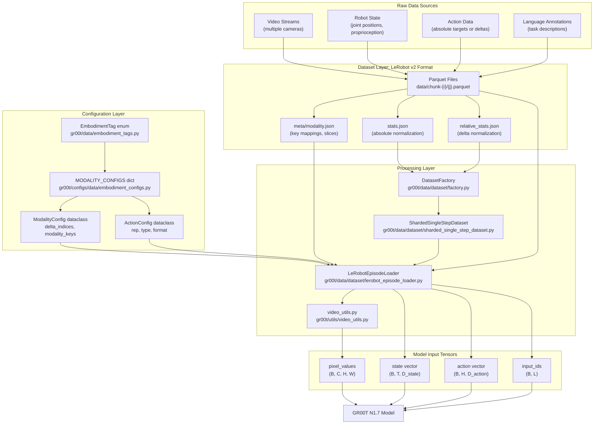
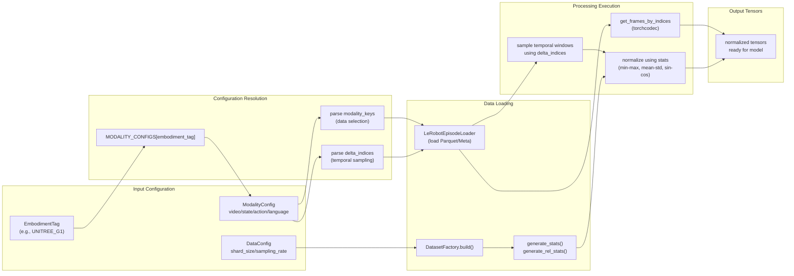

<!-- source: DeepWiki mcp.deepwiki.com · repo NVIDIA/Isaac-GR00T · page 3 Data Pipeline and Configuration · fetched 2026-10-26 -->

# Data Pipeline and Configuration

<details>
<summary>Relevant source files</summary>

The following files were used as context for generating this wiki page:

- [examples/DROID/main_gr00t.py](examples/DROID/main_gr00t.py)
- [gr00t/configs/data/data_config.py](gr00t/configs/data/data_config.py)
- [gr00t/data/dataset/factory.py](gr00t/data/dataset/factory.py)
- [gr00t/data/dataset/lerobot_episode_loader.py](gr00t/data/dataset/lerobot_episode_loader.py)
- [gr00t/eval/sim/wrapper/multistep_wrapper.py](gr00t/eval/sim/wrapper/multistep_wrapper.py)
- [gr00t/utils/video_utils.py](gr00t/utils/video_utils.py)
- [tests/gr00t/utils/test_video_backend.py](tests/gr00t/utils/test_video_backend.py)

</details>


## Purpose and Scope

This page provides an overview of the complete data pipeline and configuration system in Isaac-GR00T, explaining how robot demonstration data flows from raw datasets through various processing stages to become model-ready inputs. The pipeline is designed to support multiple robot embodiments with different sensors, action spaces, and control modalities through a flexible configuration system.

For detailed information on specific subsystems:
- Dataset format specifications: see [LeRobot Compatible Data Format](#3.1)
- Robot identification and embodiment tags: see [Robot Embodiment System](#3.2)
- Configuration file structure: see [Modality Configuration Files](#3.3)
- Action representation and transformation: see [Pose and Action Representations](#3.4)
- Processing algorithms and normalization: see [Data Processing Pipeline](#3.5)
- Video frame handling: see [Video and Image Processing](#3.6)

## Overview of the Data Pipeline

The GR00T data pipeline follows a three-layer architecture that transforms raw robot demonstrations into normalized tensors suitable for the Vision-Language-Action model:

1.  **Dataset Layer**: Raw robot data stored in the LeRobot v2 format, consisting of Parquet files for time-series data and JSON files for metadata.
2.  **Configuration Layer**: Embodiment-specific configurations that define what data to load, how to sample temporally, and how to interpret actions.
3.  **Processing Layer**: Transformation and normalization routines that convert raw data into model-ready inputs.

This architecture enables a single codebase to handle diverse robot platforms—from bimanual arms to humanoid robots—without modifying core processing logic.

**Sources:** [gr00t/data/dataset/lerobot_episode_loader.py:18-33](), [gr00t/configs/data/data_config.py:27-50]()

## Complete Data Flow Architecture

The following diagram illustrates the end-to-end data flow with specific code entities:

Title: GR00T Data Flow Architecture


This diagram shows the complete transformation pipeline. Raw sensor data is stored in LeRobot v2 format, loaded according to embodiment-specific configurations, processed through specialized processors, and finally converted into tensors that feed the Vision-Language Model backbone and DiT action head.

**Sources:** [gr00t/data/dataset/lerobot_episode_loader.py:80-114](), [gr00t/data/dataset/factory.py:28-69](), [gr00t/utils/video_utils.py:70-130]()

## The Three-Layer System

### Dataset Layer: LeRobot v2 Format

The **Dataset Layer** uses the LeRobot v2 format as the canonical data representation. This format stores time-series data in Parquet files organized by chunks, with metadata in JSON files:

-   **Data files**: `data/chunk-{i}/{j}.parquet` - Contains timestamped observations, actions, and done flags.
-   **Metadata**: `meta/modality.json` - Defines key mappings and array slicing for state/action vectors. [gr00t/data/dataset/lerobot_episode_loader.py:55]()
-   **Statistics**: `stats.json` and `relative_stats.json` - Precomputed normalization parameters. [gr00t/data/dataset/lerobot_episode_loader.py:56-57]()

All datasets must be converted to this format before training. The `LeRobotEpisodeLoader` handles parsing these metadata files and loading the corresponding data chunks. [gr00t/data/dataset/lerobot_episode_loader.py:144-174]()

**Sources:** [gr00t/data/dataset/lerobot_episode_loader.py:50-58](), [gr00t/data/dataset/factory.py:56-60]()

### Configuration Layer: Embodiment and Modality Configs

The **Configuration Layer** defines how data is loaded and interpreted for each robot embodiment.

#### EmbodimentTag Enumeration
The `EmbodimentTag` enum uniquely identifies each robot platform. It is used to look up the correct modality configuration from the registry. [gr00t/data/dataset/factory.py:53-54]()

#### Modality Configurations
Each `EmbodimentTag` maps to a modality configuration dictionary. The configuration specifies:

```python
{
    "video": ModalityConfig(delta_indices=[0], modality_keys=["front"]),
    "state": ModalityConfig(delta_indices=[0], modality_keys=["observation.state"]),
    "action": ModalityConfig(
        delta_indices=list(range(0, 16)),  # 16-step action horizon
        modality_keys=["action"],
        action_configs=[ActionConfig(...)]
    ),
    "language": ModalityConfig(delta_indices=[0], modality_keys=["task"])
}
```

The `ModalityConfig` class defines:
-   **`delta_indices`**: Temporal sampling offsets (e.g., `[0]` for current frame, `list(range(0,16))` for 16-step action prediction). [gr00t/data/dataset/lerobot_episode_loader.py:102-110]()
-   **`modality_keys`**: Which data keys to load from the dataset (must match `meta/modality.json`). [gr00t/data/dataset/lerobot_episode_loader.py:102-110]()

**Sources:** [gr00t/configs/data/data_config.py:61-72](), [gr00t/data/dataset/lerobot_episode_loader.py:80-114]()

### Processing Layer: Transformations and Normalization

The **Processing Layer** applies transformations to convert raw data into normalized model inputs.

#### LeRobotEpisodeLoader
The `LeRobotEpisodeLoader` class ([gr00t/data/dataset/lerobot_episode_loader.py:80-114]()) is the primary entry point for loading episode data. It handles:
-   Parsing LeRobot metadata.
-   Loading and decoding video data using backends like `torchcodec`. [gr00t/data/dataset/lerobot_episode_loader.py:90-92]()
-   Extracting multi-modal data according to modality configurations.

#### Video and Image Processing
Video processing is handled by `video_utils.py`, which supports multiple backends. `torchcodec` is the officially supported backend for GR00T N1.7. [gr00t/utils/video_utils.py:22-35](), [gr00t/utils/video_utils.py:70-76]()

#### Action Space Transformations
The action representation system provides classes to manage multi-step action sequences. In the DROID example, egocentric frame correction is applied to match the training pipeline. [examples/DROID/main_gr00t.py:51-54](), [examples/DROID/main_gr00t.py:57-70]()

**Sources:** [gr00t/data/dataset/lerobot_episode_loader.py:80-114](), [gr00t/utils/video_utils.py:70-130]()

## Configuration-Driven Processing Pipeline

The following diagram shows how configuration objects drive the processing pipeline:

Title: Configuration-Driven Processing


**Sources:** [gr00t/data/dataset/factory.py:28-69](), [gr00t/data/dataset/lerobot_episode_loader.py:115-143]()

## Statistics and Normalization

### Statistics Generation
GR00T uses precomputed statistics for data normalization. The `DatasetFactory` ensures these are generated on Rank 0 during initialization:
-   **`generate_stats(dataset_path)`**: Computes normalization parameters for absolute values. [gr00t/data/dataset/factory.py:59]()
-   **`generate_rel_stats(dataset_path, embodiment_tag)`**: Computes normalization parameters for relative (delta) values. [gr00t/data/dataset/factory.py:60]()

### Video Backend Safety
The system uses a lazy import pattern for video backends to avoid unnecessary dependencies. The `video_utils.py` module provides wrappers that handle `torchcodec` installation hints and FFmpeg version mismatches. [gr00t/utils/video_utils.py:22-35](), [gr00t/utils/video_utils.py:56-61]()

**Sources:** [gr00t/data/dataset/factory.py:56-61](), [gr00t/utils/video_utils.py:44-61]()

## Summary

The GR00T data pipeline is a modular system that enables multi-embodiment robot learning by separating data storage (LeRobot v2), configuration (ModalityConfigs), and processing (LeRobotEpisodeLoader). This architecture provides the flexibility to support diverse robot platforms with a unified Vision-Language-Action model.

For detailed information on each subsystem, refer to the child pages ([LeRobot Compatible Data Format](#3.1) through [Video and Image Processing](#3.6)).

---

