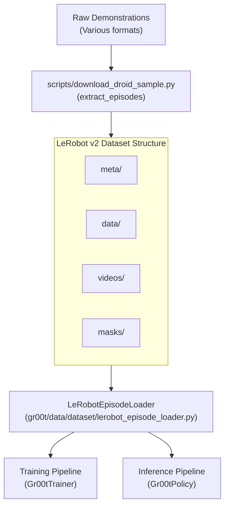
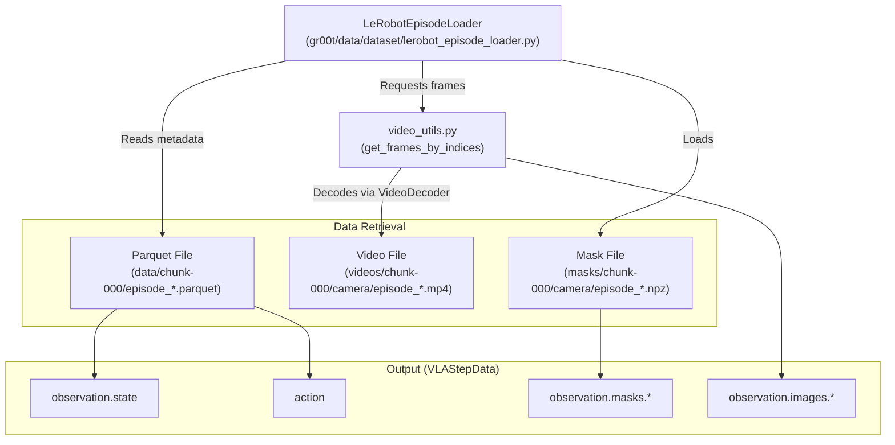

<!-- source: DeepWiki mcp.deepwiki.com · repo NVIDIA/Isaac-GR00T · page 3.1 LeRobot Compatible Data Format · fetched 2026-10-26 -->

# LeRobot Compatible Data Format

<details>
<summary>Relevant source files</summary>

The following files were used as context for generating this wiki page:

- [demo_data/cube_to_bowl_5_with_mask/meta/info.json](demo_data/cube_to_bowl_5_with_mask/meta/info.json)
- [demo_data/droid_sample/meta/relative_stats.json](demo_data/droid_sample/meta/relative_stats.json)
- [demo_data/droid_sample/meta/stats.json](demo_data/droid_sample/meta/stats.json)
- [examples/RoboLab/README.md](examples/RoboLab/README.md)
- [gr00t/data/dataset/lerobot_episode_loader.py](gr00t/data/dataset/lerobot_episode_loader.py)
- [gr00t/eval/real_robot/SO100/pyproject.toml](gr00t/eval/real_robot/SO100/pyproject.toml)
- [gr00t/utils/video_utils.py](gr00t/utils/video_utils.py)
- [scripts/download_droid_sample.py](scripts/download_droid_sample.py)
- [tests/gr00t/data/test_demo_dataset_stats.py](tests/gr00t/data/test_demo_dataset_stats.py)
- [tests/gr00t/utils/test_video_backend.py](tests/gr00t/utils/test_video_backend.py)

</details>


This document describes the LeRobot v2 data schema used by Isaac GR00T for storing robot demonstration data. The format provides a standardized structure for organizing multi-modal robot data including video observations, state information, actions, and language instructions.

**Scope:** This page covers the LeRobot v2 dataset structure, file organization, indexing system, and required metadata fields. For information about modality-specific configurations, see [3.3 Modality Configuration Files](). For data conversion and processing workflows, see [3.5 Data Processing Pipeline]().

## Overview

The Isaac GR00T system requires all training and evaluation data to follow the LeRobot v2 format. This format organizes robot demonstrations into episodes and frames, with each frame containing synchronized multi-modal observations and actions. The core logic for interacting with this format is encapsulated in the `LeRobotEpisodeLoader` class [gr00t/data/dataset/lerobot_episode_loader.py:80-113]().


**Sources:** [gr00t/data/dataset/lerobot_episode_loader.py:18-33](), [gr00t/data/dataset/lerobot_episode_loader.py:80-113](), [scripts/download_droid_sample.py:101-102]()

## Dataset Directory Structure

A LeRobot v2 dataset follows a standardized directory layout. Unlike the previous version, v2 uses a `meta/` directory for configuration and `data/` for the actual frame content stored in Parquet format [gr00t/data/dataset/lerobot_episode_loader.py:50-57]().

```
dataset_root/
├── meta/
│   ├── info.json              # Dataset metadata and feature definitions
│   ├── episodes.jsonl         # Per-episode metadata (length, timestamps)
│   ├── tasks.jsonl            # Task descriptions and index mapping
│   ├── modality.json          # Modality structure and data layout
│   ├── stats.json             # Normalization statistics
│   └── relative_stats.json    # Stats for relative action horizons
├── data/
│   └── chunk-000/
│       ├── episode_000000.parquet
│       └── ...
├── videos/
│   └── chunk-000/
│       └── {video_key}/
│           └── episode_000000.mp4
└── masks/
    └── chunk-000/
        └── {mask_key}/
            └── episode_000000_masks.npz
```

### Directory Components

| Directory | Purpose | Required | File Pattern Example |
|-----------|---------|----------|----------------------|
| `meta/` | Dataset configuration | Yes | `info.json`, `modality.json` [gr00t/data/dataset/lerobot_episode_loader.py:51-57]() |
| `data/` | Episode frame data | Yes | `episode_000000.parquet` [demo_data/cube_to_bowl_5_with_mask/meta/info.json:12]() |
| `videos/` | Video observations | Conditional | `episode_000000.mp4` [demo_data/cube_to_bowl_5_with_mask/meta/info.json:13]() |
| `masks/` | Segmentation masks | Optional | `episode_000000_masks.npz` [demo_data/cube_to_bowl_5_with_mask/meta/info.json:14]() |

**Sources:** [gr00t/data/dataset/lerobot_episode_loader.py:51-57](), [demo_data/cube_to_bowl_5_with_mask/meta/info.json:12-14]()

## Metadata Configuration

### info.json
The `info.json` file defines the dataset's global properties and the schema for all features.

- **`features`**: Defines the data types (e.g., `video`, `float32`), shapes, and names for every column in the Parquet files [demo_data/cube_to_bowl_5_with_mask/meta/info.json:15-125]().
- **`video_info`**: Contains encoding details like codec (e.g., `av1`), resolution, and FPS [demo_data/cube_to_bowl_5_with_mask/meta/info.json:56-65]().

### modality.json
This file maps high-level modalities (state, action, video, mask) to specific keys or indices within the features.

- **`state` / `action`**: Often defined as index ranges within a combined vector (e.g., `single_arm` indices 0-5) [demo_data/cube_to_bowl_5_with_mask/meta/modality.json:2-21]().
- **`video` / `mask`**: Maps a friendly name (e.g., `front`) to the `original_key` used in the Parquet/video file system [demo_data/cube_to_bowl_5_with_mask/meta/modality.json:22-42]().

**Sources:** [demo_data/cube_to_bowl_5_with_mask/meta/info.json:1-128](), [demo_data/cube_to_bowl_5_with_mask/meta/modality.json:1-43]()

## Parquet and Video Data Flow

The `LeRobotEpisodeLoader` handles the synchronization between Parquet tabular data and external binary files (videos and masks).



### Video Backend Management
The system utilizes `torchcodec` as the primary video decoding backend, managed by `gr00t/utils/video_utils.py`. 
- **`torchcodec`**: The officially supported backend. `get_frames_by_indices` uses `VideoDecoder.get_frames_at` to retrieve specific frames [gr00t/utils/video_utils.py:70-76]().
- **Lazy Loading**: Video utilities are designed to avoid importing `torchcodec` at the module level to prevent library conflicts [tests/gr00t/utils/test_video_backend.py:45-54]().
- **Timestamp Correction**: `get_frames_by_timestamps` corrects float precision drift by rounding to the nearest frame interval based on the video's average FPS [gr00t/utils/video_utils.py:79-116]().
- **FFmpeg Compatibility**: The system provides hints for FFmpeg version mismatches, as `torchcodec` 0.8.0 requires FFmpeg 4-7 [gr00t/utils/video_utils.py:28-35]().

**Sources:** [gr00t/data/dataset/lerobot_episode_loader.py:47](), [gr00t/utils/video_utils.py:28-35](), [gr00t/utils/video_utils.py:70-116](), [tests/gr00t/utils/test_video_backend.py:42-54]()

## Normalization Statistics

Normalization is critical for VLA training. The `LeRobotEpisodeLoader` parses `stats.json` and `relative_stats.json` to provide statistics for every modality [gr00t/data/dataset/lerobot_episode_loader.py:153-154]().

| Statistic File | Description |
|----------------|-------------|
| `stats.json` | Contains `mean`, `std`, `min`, `max` for global features [demo_data/droid_sample/meta/stats.json:1-217]() |
| `relative_stats.json` | Contains statistics for relative action horizons, typically indexed by timestep [demo_data/droid_sample/meta/relative_stats.json:1-217]() |

The `test_demo_dataset_stats.py` script guards against mismatches between `info.json` shapes and the dimensions found in `stats.json` [tests/gr00t/data/test_demo_dataset_stats.py:59-87]().

**Sources:** [gr00t/data/dataset/lerobot_episode_loader.py:56-57](), [demo_data/droid_sample/meta/stats.json:1-217](), [demo_data/droid_sample/meta/relative_stats.json:1-217](), [tests/gr00t/data/test_demo_dataset_stats.py:59-87]()

## Integration with VLA Pipeline

The `LeRobotEpisodeLoader` acts as the primary interface for higher-level dataset classes. It returns data in the `VLAStepData` format [gr00t/data/dataset/lerobot_episode_loader.py:32-33]().

1.  **Initialization**: The loader is initialized with a `dataset_path` and a dictionary of `ModalityConfig` objects [gr00t/data/dataset/lerobot_episode_loader.py:115-120]().
2.  **Metadata Parsing**: It loads `info.json`, `episodes.jsonl`, `tasks.jsonl`, and `modality.json` [gr00t/data/dataset/lerobot_episode_loader.py:144-174]().
3.  **Episode Loading**: When an episode is requested, it reads the corresponding Parquet file and decodes any required video frames for the specified `delta_indices` using `get_frames_by_indices` [gr00t/data/dataset/lerobot_episode_loader.py:47](), [gr00t/data/dataset/lerobot_episode_loader.py:80-113]().
4.  **Initial Actions**: It can also load `initial_actions.json` if present, which is used for policy initialization [gr00t/data/dataset/lerobot_episode_loader.py:46](), [gr00t/data/dataset/lerobot_episode_loader.py:92-93]().

**Sources:** [gr00t/data/dataset/lerobot_episode_loader.py:32-33](), [gr00t/data/dataset/lerobot_episode_loader.py:80-174](), [gr00t/utils/video_utils.py:70-76]()

---

