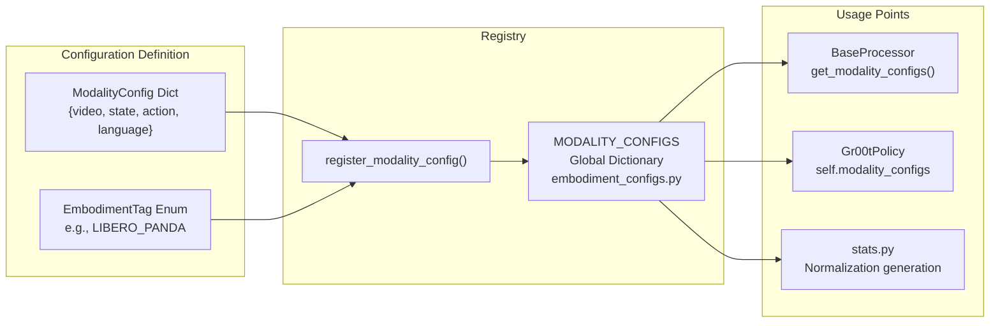

<!-- source: DeepWiki mcp.deepwiki.com · repo NVIDIA/Isaac-GR00T · page 3.2 Robot Embodiment System · fetched 2026-10-26 -->

# Robot Embodiment System

Relevant source files

The following files were used as context for generating this wiki page:

- [examples/DROID/server_client.py](examples/DROID/server_client.py)
- [examples/DROID/utils.py](examples/DROID/utils.py)
- [getting_started/data_config.md](getting_started/data_config.md)
- [gr00t/configs/data/embodiment_configs.py](gr00t/configs/data/embodiment_configs.py)
- [gr00t/data/embodiment_tags.py](gr00t/data/embodiment_tags.py)
- [gr00t/policy/gr00t_policy.py](gr00t/policy/gr00t_policy.py)

The Robot Embodiment System provides the infrastructure for identifying and configuring different robot platforms within Isaac-GR00T. This system enables a single model architecture to work across diverse robots by associating each robot with a unique identifier and corresponding configuration that specifies how its data should be processed.

This page covers the `EmbodimentTag` enumeration, the registration system for robot configurations, and the mapping between simulation environments and embodiments. For detailed information about modality configurations (video, state, action, language processing), see [Modality Configuration Files](3.3). For guidance on creating configurations for new robots, see [Custom Embodiment Development](8.2).

## EmbodimentTag Enumeration

The `EmbodimentTag` enum serves as the primary identifier for robot platforms throughout the codebase. Each enum value represents a distinct robot embodiment with its own kinematic structure, sensor configuration, and control interface.

### Definition and Location

The `EmbodimentTag` enum is defined in [gr00t/data/embodiment_tags.py:29-143]() using Python's standard `Enum` class. Each tag follows the naming convention `<dataset>_<robot_name>` [gr00t/data/embodiment_tags.py:22-26]().

### Pre-Registered Embodiments

The following table lists the embodiment tags supported by the GR00T N1.7 checkpoint:

| Enum Value | String Value | Description | Usage Category |
|-----------|--------------|-------------|----------------|
| `OXE_DROID_RELATIVE_EEF_RELATIVE_JOINT` | `"oxe_droid_relative_eef_relative_joint"` | DROID robot with relative EEF and relative joint actions | Pre-training [gr00t/data/embodiment_tags.py:60-63]() |
| `XDOF` | `"xdof_relative_eef_relative_joint"` | Generic X-DOF robot with relative EEF and joint actions | Pre-training [gr00t/data/embodiment_tags.py:65-68]() |
| `REAL_G1` | `"real_g1_relative_eef_relative_joints"` | Real Unitree G1 with relative EEF and joints | Pre-training [gr00t/data/embodiment_tags.py:75-78]() |
| `REAL_R1_PRO_SHARPA` | `"real_r1_pro_sharpa_relative_eef"` | Real R1 Pro Sharpa with relative EEF actions | Pre-training [gr00t/data/embodiment_tags.py:80-83]() |
| `UNITREE_G1` | `"unitree_g1_full_body_with_waist_height_nav_cmd"` | Sim G1 full-body with waist height and nav commands | Post-training [gr00t/data/embodiment_tags.py:102-105]() |
| `UNITREE_G1_SONIC` | `"unitree_g1_sonic"` | Unitree G1 with SONIC whole-body controller | Post-training [gr00t/data/embodiment_tags.py:107-110]() |
| `SIMPLER_ENV_GOOGLE` | `"simpler_env_google"` | SimplerEnv Google robot | Post-training [gr00t/data/embodiment_tags.py:112-115]() |
| `SIMPLER_ENV_WIDOWX` | `"simpler_env_widowx"` | SimplerEnv WidowX robot | Post-training [gr00t/data/embodiment_tags.py:117-120]() |
| `LIBERO_PANDA` | `"libero_sim"` | LIBERO Panda robot (Goal/Object/Spatial/10) | Post-training [gr00t/data/embodiment_tags.py:122-125]() |
| `NEW_EMBODIMENT` | `"new_embodiment"` | Placeholder for new embodiments during development | Development [gr00t/data/embodiment_tags.py:128-131]() |
| `ROBOCASA_GR1_TABLETOP` | `"robocasa_gr1_tabletop"` | RoboCasa GR1 tabletop tasks | Development [gr00t/data/embodiment_tags.py:133-137]() |
| `ROBOCASA_PANDA_OMRON` | `"robocasa_panda_omron"` | RoboCasa Panda arm tasks | Development [gr00t/data/embodiment_tags.py:139-143]() |

**Sources:** [gr00t/data/embodiment_tags.py:29-143]()

### Embodiment Tag Structure

```mermaid
graph TB
    subgraph "EmbodimentTag Enum"
        Enum["EmbodimentTag Enum Class"]
        
        subgraph "Pretrain Tags (Base Model)"
            DROID["OXE_DROID_RELATIVE_EEF_RELATIVE_JOINT"]
            XDOF["XDOF"]
            G1_REAL["REAL_G1"]
            R1_SHARPA["REAL_R1_PRO_SHARPA"]
        end
        
        subgraph "Posttrain Tags (Finetuned)"
            G1_SIM["UNITREE_G1"]
            G1_SONIC["UNITREE_G1_SONIC"]
            GOOGLE["SIMPLER_ENV_GOOGLE"]
            WIDOWX["SIMPLER_ENV_WIDOWX"]
            LIBERO["LIBERO_PANDA"]
        end
        
        subgraph "Finetuning Tags (Custom)"
            NEW["NEW_EMBODIMENT"]
            RC_GR1["ROBOCASA_GR1_TABLETOP"]
            RC_PANDA["ROBOCASA_PANDA_OMRON"]
        end
        
        Enum --> DROID
        Enum --> XDOF
        Enum --> G1_REAL
        Enum --> G1_SIM
        Enum --> G1_SONIC
        Enum --> GOOGLE
        Enum --> WIDOWX
        Enum --> LIBERO
        Enum --> NEW
        Enum --> RC_GR1
        Enum --> RC_PANDA
    end
    
    Usage1["Used in processor:<br/>BaseProcessor / Gr00tN1d7Processor"]
    Usage2["Used in policy:<br/>Gr00tPolicy"]
    
    Enum --> Usage1
    Enum --> Usage2
```

**Sources:** [gr00t/data/embodiment_tags.py:29-143](), [gr00t/policy/gr00t_policy.py:30-105]()

## Embodiment Configuration Registry

Each `EmbodimentTag` must be associated with a complete modality configuration that specifies how to process video, state, action, and language data for that robot. This mapping is maintained in the `MODALITY_CONFIGS` dictionary.

### MODALITY_CONFIGS Dictionary

The `MODALITY_CONFIGS` dictionary maps embodiment tag string values to configuration dictionaries. Located in [gr00t/configs/data/embodiment_configs.py:26-189](), this registry serves as the central source of truth for all embodiment-specific processing parameters.

Each entry in `MODALITY_CONFIGS` contains four top-level keys:
- `"video"`: `ModalityConfig` specifying camera keys and sampling parameters.
- `"state"`: `ModalityConfig` specifying proprioceptive state keys and encoding.
- `"action"`: `ModalityConfig` specifying action keys, horizon, and `ActionConfig` list.
- `"language"`: `ModalityConfig` specifying task description keys.

**Sources:** [gr00t/configs/data/embodiment_configs.py:26-189](), [getting_started/data_config.md:13-32]()

### Configuration Examples

#### Complex Humanoid: Unitree G1 (Sim)

The Unitree G1 configuration shows a complex locomanipulation setup with multiple action modalities and different representations:

| Modality | Keys | Delta Indices | ActionConfigs |
|----------|------|---------------|---------------|
| video | `["ego_view"]` | `[0]` | Single egocentric camera |
| state | `["left_leg", "right_leg", "waist", "left_arm", "right_arm", "left_hand", "right_hand"]` | `[0]` | 7 joint groups |
| action | `["left_arm", "right_arm", "left_hand", "right_hand", "waist", "base_height_command", "navigate_command"]` | `[0..49]` | 50-step horizon with 7 separate `ActionConfig` objects |
| language | `["annotation.human.task_description"]` | `[0]` | Single task string |

**Sources:** [gr00t/configs/data/embodiment_configs.py:115-189]()

#### Whole-Body Control: Unitree G1 SONIC

The SONIC variant uses latents for the locomotion component:

| Modality | Keys | Delta Indices | Notes |
|----------|------|---------------|-------|
| action | `["motion_token", "left_hand_joints", "right_hand_joints"]` | `[0..39]` | Uses `motion_token` for latent-based control |

**Sources:** [gr00t/configs/data/embodiment_configs.py:67-114]()

#### Open-X-Embodiment: DROID

The DROID configuration used in N1.7 pre-training:

| Modality | Keys | Delta Indices | Notes |
|----------|------|---------------|-------|
| video | `["exterior_image_1_left", "wrist_image_left"]` | `[-15, 0]` | History of 2 frames |
| state | `["eef_9d", "gripper_position", "joint_position"]` | `[0]` | 9D EEF + Joints |
| action | `["eef_9d", "gripper_position", "joint_position"]` | `[0..39]` | 40-step horizon |

**Sources:** [gr00t/configs/data/embodiment_configs.py:28-65]()

## Projector Index Mapping

In the GR00T N1.7 architecture, each embodiment is associated with a specific projector index. This allows the model to use embodiment-specific projection layers if needed. The `Gr00tN1d7Processor` uses an internal mapping `EMBODIMENT_TAG_TO_PROJECTOR_INDEX` to route data from a specific `EmbodimentTag` to its corresponding projector index in the transformer backbone.

When initializing a `Gr00tPolicy`, the system validates that the provided `embodiment_tag` exists within the checkpoint's supported modality configurations [gr00t/policy/gr00t_policy.py:127-160]().

**Sources:** [gr00t/policy/gr00t_policy.py:127-160]()

## Environment to Embodiment Mapping

The evaluation system requires mapping from gym-registered environment names to `EmbodimentTag` values. This enables the policy server to automatically load the correct modality configuration for a given simulation environment.

### Lookup and Resolution

The `EmbodimentTag.resolve()` class method is the primary tool for converting strings to tags [gr00t/data/embodiment_tags.py:146-180](). It performs a case-insensitive search matching by enum **name** first, then by enum **value**.

**Sources:** [gr00t/data/embodiment_tags.py:146-180]()

## Embodiment System Lifecycle

The embodiment system integrates with multiple components throughout the training, inference, and evaluation pipelines.

### Configuration Flow Diagram

**Sources:** [gr00t/configs/data/embodiment_configs.py:26-189](), [gr00t/policy/gr00t_policy.py:129-165](), [getting_started/data_config.md:19-32]()

### Inference Pipeline

The `Gr00tPolicy` class uses embodiment tags throughout inference:

1. **Initialization** [gr00t/policy/gr00t_policy.py:83-106](): The policy constructor accepts an `embodiment_tag` and resolves it using `EmbodimentTag.resolve()`.
2. **Config Loading** [gr00t/policy/gr00t_policy.py:129-165](): It retrieves the specific modality configurations for that tag from the `processor.get_modality_configs()`.
3. **Validation**: The policy checks if the tag is a `POSTTRAIN_TAGS` [gr00t/policy/gr00t_policy.py:142-147]() or `FINETUNE_ONLY_TAGS` [gr00t/policy/gr00t_policy.py:148-152]() to provide helpful error messages if the wrong checkpoint (e.g., base model) is used.

**Sources:** [gr00t/policy/gr00t_policy.py:83-165]()

## DROID Example Integration

The DROID robot integration in `examples/DROID/` demonstrates how embodiment tags enable real robot deployment:

1. **Message Serialization** [examples/DROID/server_client.py:165-167](): The `MsgSerializer` handles `ModalityConfig` objects by converting them to JSON-serializable dictionaries for network transmission.
2. **Action Mapping** [examples/DROID/server_client.py:100-104](): The `ActionConfig` defines the `ActionRepresentation` (e.g., `RELATIVE`) and `ActionType` (e.g., `EEF`) used by the DROID embodiment.
3. **Data Configuration**: The DROID configuration in `embodiment_configs.py` specifies `eef_9d` as the `state_key` for relative end-effector control [gr00t/configs/data/embodiment_configs.py:41-46]().

**Sources:** [examples/DROID/server_client.py:100-172](), [gr00t/configs/data/embodiment_configs.py:28-65]()

---

