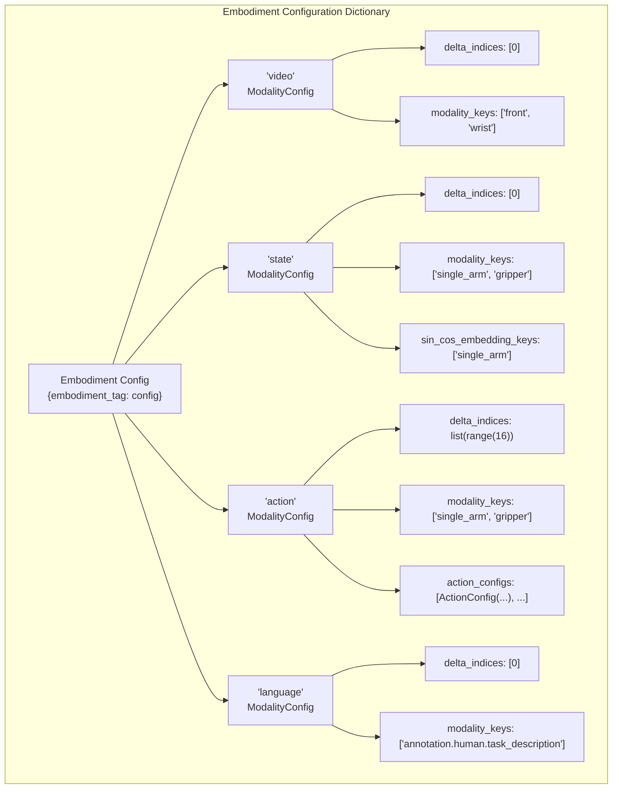
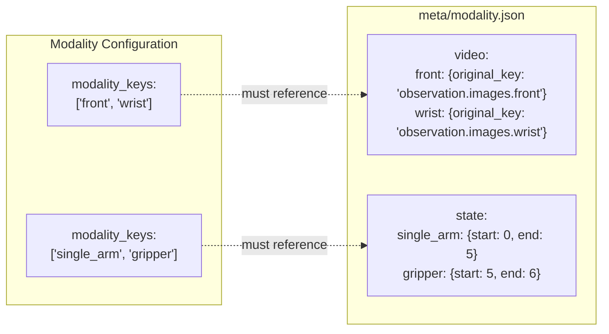
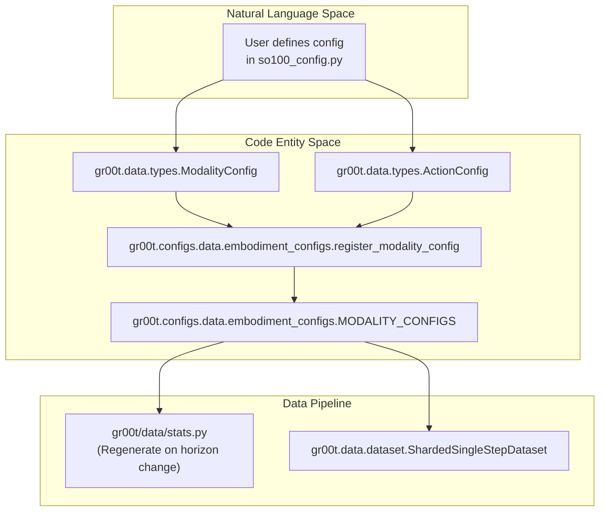

<!-- source: DeepWiki mcp.deepwiki.com · repo NVIDIA/Isaac-GR00T · page 3.3 Modality Configuration Files · fetched 2026-10-26 -->

# Modality Configuration Files

<details>
<summary>Relevant source files</summary>

The following files were used as context for generating this wiki page:

- [getting_started/data_config.md](getting_started/data_config.md)
- [getting_started/finetune_new_embodiment.md](getting_started/finetune_new_embodiment.md)
- [gr00t/model/gr00t_n1d7/gr00t_n1d7.py](gr00t/model/gr00t_n1d7/gr00t_n1d7.py)
- [tests/getting_started/test_data_config_md.py](tests/getting_started/test_data_config_md.py)
- [tests/getting_started/test_finetune_new_embodiment_md.py](tests/getting_started/test_finetune_new_embodiment_md.py)
- [tests/gr00t/model/test_action_head.py](tests/gr00t/model/test_action_head.py)

</details>


This document details the structure and usage of modality configuration files in the GR00T system. Modality configurations define how data from different robot embodiments should be loaded, temporally sampled, and transformed for model input. Each configuration bridges your dataset's physical structure (defined in `meta/modality.json`) and the model's data processing pipeline [getting_started/data_config.md:3-6]().

For information about the robot embodiment system and `EmbodimentTag` enumeration, see [3.2 Robot Embodiment System](). For details on action representation conversions and pose transformations, see [3.4 Pose and Action Representations](). For the complete data processing pipeline, see [3.5 Data Processing Pipeline]().

## Core Data Structures

The modality configuration system is built around two primary classes: `ModalityConfig` and `ActionConfig`. These dataclasses define the structure of configuration data that flows through the training and inference pipelines [getting_started/data_config.md:13-16]().

### ModalityConfig Class

The `ModalityConfig` class specifies how data for a particular modality (video, state, action, or language) should be sampled and loaded from the dataset.

**Key attributes:**
- `delta_indices`: List of temporal offsets to sample relative to the current timestep [getting_started/data_config.md:39-44]().
- `modality_keys`: List of keys to load from the dataset (must match keys in `meta/modality.json`) [getting_started/data_config.md:94-97]().
- `sin_cos_embedding_keys`: Optional list of keys for sine/cosine encoding (typically for joint angles in radians) [getting_started/data_config.md:106-109]().
- `mean_std_embedding_keys`: Optional list of keys for mean/std normalization instead of min-max [getting_started/data_config.md:118-121]().
- `action_configs`: Optional list of `ActionConfig` objects (required for action modality) [getting_started/data_config.md:122-125]().

**Sources:** [getting_started/data_config.md:33-126](), [getting_started/finetune_new_embodiment.md:15-21]()

### ActionConfig Class

The `ActionConfig` class defines how each action modality should be interpreted and transformed. Each action key in `modality_keys` requires a corresponding `ActionConfig` in the same order [getting_started/data_config.md:124-126]().

**Key attributes:**
- `rep`: `ActionRepresentation` enum (`RELATIVE` or `ABSOLUTE`) [getting_started/data_config.md:197-203]().
- `type`: `ActionType` enum (`EEF` for end-effector, `NON_EEF` for joint space) [getting_started/data_config.md:205-209]().
- `format`: `ActionFormat` enum (`DEFAULT`, `XYZ_ROT6D`, or `XYZ_ROTVEC`) [getting_started/data_config.md:211-216]().
- `state_key`: Optional reference state key for computing relative actions if the action and state keys differ [getting_started/data_config.md:218-221]().

**Sources:** [getting_started/data_config.md:193-230](), [getting_started/finetune_new_embodiment.md:48-61]()

## Modality Configuration Structure

Each robot embodiment requires a complete modality configuration dictionary with four top-level keys: `"video"`, `"state"`, `"action"`, and `"language"`.

### Configuration Dictionary Structure



**Sources:** [getting_started/data_config.md:13-31](), [getting_started/finetune_new_embodiment.md:24-68]()

### Video Modality Configuration

Defines camera views and temporal sampling. Stick with `[0]` for video unless stacking frames is required [getting_started/data_config.md:45-46]().

**Example from SO-100:**
```python
"video": ModalityConfig(
    delta_indices=[0],
    modality_keys=[
        "front",
        "wrist",
    ],
)
```
**Sources:** [getting_started/finetune_new_embodiment.md:26-32](), [getting_started/data_config.md:128-147]()

### State Modality Configuration

Defines proprioceptive observations. Radians should use `sin_cos_embedding_keys` to double dimensionality and improve learning [getting_started/data_config.md:108-115]().

**Example from SO-100:**
```python
"state": ModalityConfig(
    delta_indices=[0],
    modality_keys=[
        "single_arm",
        "gripper",
    ],
)
```
**Sources:** [getting_started/finetune_new_embodiment.md:34-40](), [getting_started/data_config.md:149-162]()

### Action Modality Configuration

Defines the action space and prediction horizon. If `delta_indices` is modified (e.g., from 16 steps to 8), you **must** regenerate statistics via `gr00t/data/stats.py` or an `IndexError` will occur during normalization [getting_started/data_config.md:57-89]().

**Example from SO-100:**
```python
"action": ModalityConfig(
    delta_indices=list(range(0, 16)),
    modality_keys=["single_arm", "gripper"],
    action_configs=[
        ActionConfig(rep=ActionRepresentation.RELATIVE, type=ActionType.NON_EEF, format=ActionFormat.DEFAULT),
        ActionConfig(rep=ActionRepresentation.ABSOLUTE, type=ActionType.NON_EEF, format=ActionFormat.DEFAULT),
    ],
)
```
**Sources:** [getting_started/finetune_new_embodiment.md:42-62](), [getting_started/data_config.md:164-191]()

### Language Modality Configuration

Defines the task instruction source from the dataset [getting_started/finetune_new_embodiment.md:63-67]().

**Example:**
```python
"language": ModalityConfig(
    delta_indices=[0],
    modality_keys=["annotation.human.task_description"],
)
```
**Sources:** [getting_started/finetune_new_embodiment.md:64-67](), [getting_started/data_config.md:232-241]()

## Configuration Fields Deep Dive

### delta_indices

Defines temporal offsets relative to the current timestep [getting_started/data_config.md:39-44]().

| Value Pattern | Typical Use |
|---------------|-------------|
| `[0]` | Current frame/state/language [getting_started/data_config.md:42]() |
| `[-2, -1, 0]` | Historical context (supported but rarely used in N1.7) [getting_started/data_config.md:45]() |
| `list(range(0, 16))` | 16-step future action horizon [getting_started/data_config.md:54]() |

**Sources:** [getting_started/data_config.md:39-58]()

### modality_keys

Keys must match the `meta/modality.json` definition exactly [getting_started/data_config.md:96-97]().



**Sources:** [getting_started/data_config.md:94-104]()

## Action Configuration Dimensions

### ActionRepresentation Enum

| Value | Meaning |
|-------|---------|
| `RELATIVE` | Deltas from current state (`action_t = state_t + delta_t`) [getting_started/data_config.md:197-201](). |
| `ABSOLUTE` | Direct target positions/values [getting_started/data_config.md:202-203](). |

### ActionType Enum

| Value | Meaning |
|-------|---------|
| `EEF` | End-effector Cartesian control (requires 9D: pos + 6D rot) [getting_started/data_config.md:205-207](). |
| `NON_EEF` | Joint space or other control (e.g., gripper, mobile base) [getting_started/data_config.md:208-209](). |

### ActionFormat Enum

| Value | Meaning |
|-------|---------|
| `DEFAULT` | Standard values (joints, gripper) [getting_started/data_config.md:211-212](). |
| `XYZ_ROT6D` | 3D position + 6D continuous rotation representation [getting_started/data_config.md:213-214](). |
| `XYZ_ROTVEC` | 3D position + rotation vector [getting_started/data_config.md:215-216](). |

**Sources:** [getting_started/data_config.md:193-216]()

## Configuration Registration

For custom embodiments, configurations must be registered using `register_modality_config` under the `EmbodimentTag.NEW_EMBODIMENT` tag [getting_started/finetune_new_embodiment.md:70-71]().

**Implementation:**
```python
from gr00t.configs.data.embodiment_configs import register_modality_config
from gr00t.data.embodiment_tags import EmbodimentTag

# Register your dictionary
register_modality_config(so100_config, embodiment_tag=EmbodimentTag.NEW_EMBODIMENT)
```

**Sources:** [getting_started/finetune_new_embodiment.md:13-14](), [getting_started/finetune_new_embodiment.md:70-71](), [getting_started/data_config.md:19-20]()

## Configuration Flow Through the System



**Sources:** [getting_started/finetune_new_embodiment.md:11-71](), [getting_started/data_config.md:57-89](), [tests/getting_started/test_data_config_md.py:27-33]()

---

