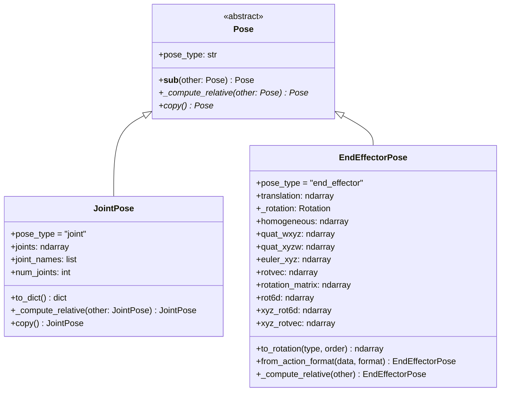
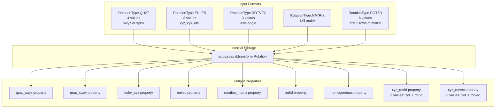
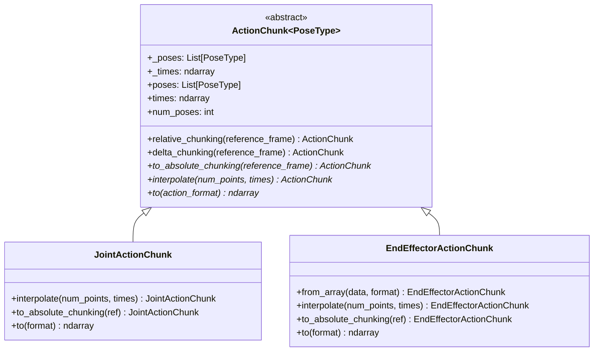
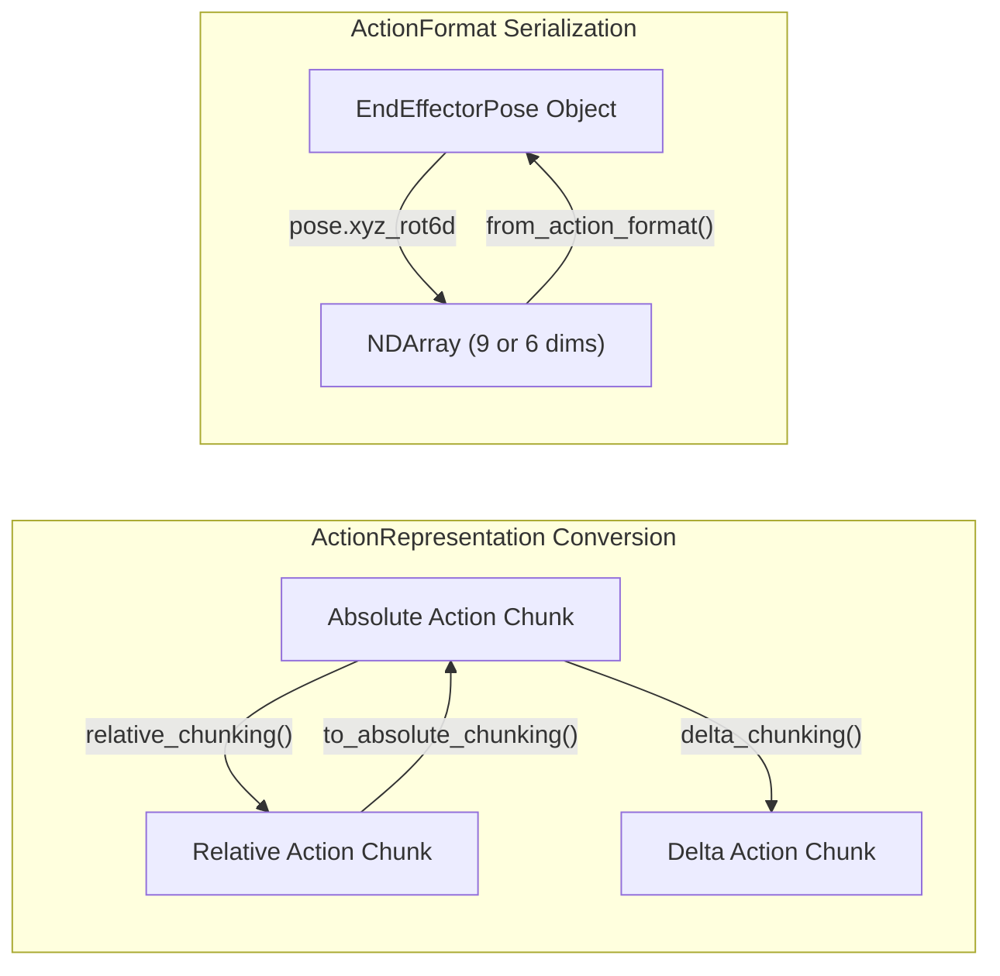

<!-- source: DeepWiki mcp.deepwiki.com · repo NVIDIA/Isaac-GR00T · page 3.4 Pose and Action Representations · fetched 2026-10-26 -->

# Pose and Action Representations

<details>
<summary>Relevant source files</summary>

The following files were used as context for generating this wiki page:

- [gr00t/data/dataset/sharded_mixture_dataset.py](gr00t/data/dataset/sharded_mixture_dataset.py)
- [gr00t/data/state_action/action_chunking.py](gr00t/data/state_action/action_chunking.py)
- [gr00t/data/state_action/pose.py](gr00t/data/state_action/pose.py)
- [gr00t/data/state_action/state_action_processor.py](gr00t/data/state_action/state_action_processor.py)
- [gr00t/data/stats.py](gr00t/data/stats.py)
- [gr00t/eval/sim/LIBERO/libero_env.py](gr00t/eval/sim/LIBERO/libero_env.py)
- [gr00t/eval/sim/SimplerEnv/simpler_env.py](gr00t/eval/sim/SimplerEnv/simpler_env.py)
- [gr00t/experiment/utils.py](gr00t/experiment/utils.py)
- [tests/gr00t/data/state_action/test_eef_action_format.py](tests/gr00t/data/state_action/test_eef_action_format.py)

</details>


This document describes the pose and action representation system in Isaac GR00T, which provides a unified framework for handling robot configurations and trajectories in both joint space and Cartesian space. The system supports multiple rotation representations, automatic conversion between absolute and relative coordinates, and integration with various action formats used across different robot embodiments.

For information about how these representations are used in the broader data processing pipeline, see [Data Processing Pipeline](#3.5). For details on modality configurations that specify which representations to use for each embodiment, see [Modality Configuration Files](#3.3).

---

## Overview of the Pose System

The pose system provides a type-safe abstraction for robot configurations through a class hierarchy rooted in the abstract `Pose` base class [gr00t/data/state_action/pose.py:104-110](). Two concrete implementations handle different control spaces:

- **`JointPose`**: Represents configurations in joint space (angles/positions of robot joints) [gr00t/data/state_action/pose.py:177-184]().
- **`EndEffectorPose`**: Represents poses in Cartesian space (3D position + 3D rotation of end-effector) [gr00t/data/state_action/pose.py:300-307]().

Both classes support computing relative transformations via the subtraction operator (`-`), which enables seamless conversion between absolute and relative action representations [gr00t/data/state_action/pose.py:114-151]().

**Class Hierarchy**



**Sources:** [gr00t/data/state_action/pose.py:104-151](), [gr00t/data/state_action/pose.py:177-210](), [gr00t/data/state_action/pose.py:300-340]()

---

## JointPose: Joint Space Representation

The `JointPose` class represents robot configurations in joint space as a vector of joint angles or positions. This is the most direct representation for robot control in joint space [gr00t/data/state_action/pose.py:177-184]().

### Key Properties

| Property | Type | Description |
|----------|------|-------------|
| `joints` | `ndarray` | Joint angles/positions as float64 array [gr00t/data/state_action/pose.py:225]() |
| `joint_names` | `list[str]` | Optional names for each joint [gr00t/data/state_action/pose.py:228]() |
| `num_joints` | `int` | Number of joints in the configuration [gr00t/data/state_action/pose.py:251]() |

### Relative Computation

For joint poses, the relative transformation is computed as simple element-wise subtraction [gr00t/data/state_action/pose.py:289-291]():

```python
relative_joints = self.joints - other.joints
```

This represents the joint-space displacement needed to go from `other` to `self`.

**Sources:** [gr00t/data/state_action/pose.py:177-298]()

---

## EndEffectorPose: Cartesian Space Representation

The `EndEffectorPose` class represents end-effector poses in Cartesian space with a 3D translation vector and 3D rotation [gr00t/data/state_action/pose.py:300-307](). Internally, rotation is stored as a `scipy.spatial.transform.Rotation` object, enabling efficient conversion between multiple rotation representations [gr00t/data/state_action/pose.py:341]().

### Supported Rotation Representations



**Sources:** [gr00t/data/state_action/pose.py:76-84](), [gr00t/data/state_action/pose.py:300-709]()

### Rotation Type Details

| Type | Enum | Size | Description |
|------|------|------|-------------|
| Quaternion | `RotationType.QUAT` | 4 | Unit quaternion (w,x,y,z or x,y,z,w) [gr00t/data/state_action/pose.py:79]() |
| Euler Angles | `RotationType.EULER` | 3 | XYZ, ZYX, etc. conventions [gr00t/data/state_action/pose.py:80]() |
| Rotation Vector | `RotationType.ROTVEC` | 3 | Axis-angle representation [gr00t/data/state_action/pose.py:81]() |
| Rotation Matrix | `RotationType.MATRIX` | 3×3 | Full rotation matrix [gr00t/data/state_action/pose.py:82]() |
| 6D Rotation | `RotationType.ROT6D` | 6 | First 2 rows of rotation matrix [gr00t/data/state_action/pose.py:83]() |

The **6D rotation representation** (rot6d) is particularly important for learning-based methods as it avoids discontinuities. It stores the first two rows of the rotation matrix, and the third row is recovered via cross product [gr00t/data/state_action/pose.py:411-453]().

**Sources:** [gr00t/data/state_action/pose.py:76-84](), [gr00t/data/state_action/pose.py:411-453]()

### Relative Transformation for EndEffectorPose

For end-effector poses, the relative transformation is computed using homogeneous transformation matrices [gr00t/data/state_action/pose.py:656-660]():

```python
T_relative = inv(T_other) @ T_self
```

This represents the transformation in `other`'s coordinate frame that brings it to `self` [gr00t/data/state_action/pose.py:72-73]().

**Sources:** [gr00t/data/state_action/pose.py:58-73](), [gr00t/data/state_action/pose.py:639-660]()

---

## ActionChunk Classes: Trajectory Representation

Action trajectories are represented as sequences of poses using the `ActionChunk` generic class hierarchy [gr00t/data/state_action/action_chunking.py:29-36](). This enables unified handling of temporal action sequences with interpolation and relative/absolute conversion.

**ActionChunk Class Hierarchy**



**Sources:** [gr00t/data/state_action/action_chunking.py:29-192]()

### JointActionChunk

Represents a trajectory in joint space as a sequence of `JointPose` objects [gr00t/data/state_action/action_chunking.py:194-200]().

**Key Features:**
- Linear interpolation of joint values [gr00t/data/state_action/action_chunking.py:250-325]().
- Element-wise addition for absolute conversion [gr00t/data/state_action/action_chunking.py:336-371]().

**Sources:** [gr00t/data/state_action/action_chunking.py:194-393]()

### EndEffectorActionChunk

Represents a trajectory in Cartesian space as a sequence of `EndEffectorPose` objects [gr00t/data/state_action/action_chunking.py:395-401]().

**Key Features:**
- SLERP (Spherical Linear Interpolation) for rotations [gr00t/data/state_action/action_chunking.py:475-562]().
- Support for multiple action formats (homogeneous, xyz_rot6d, xyz_rotvec) [gr00t/data/state_action/action_chunking.py:564-601]().
- Homogeneous matrix composition for absolute conversion [gr00t/data/state_action/action_chunking.py:603-637]().

**Sources:** [gr00t/data/state_action/action_chunking.py:395-660]()

---

## Action Representations and Formats

The codebase defines three primary enums to control how actions are interpreted and stored:

### ActionRepresentation
Defines the coordinate frame reference for the action chunk [gr00t/data/types.py:33-36]():
- **ABSOLUTE**: Poses are in the world/base frame.
- **RELATIVE**: Poses are relative to a fixed reference frame (usually the start of the chunk).
- **DELTA**: Each pose is relative to the immediately preceding pose [gr00t/data/state_action/action_chunking.py:111-141]().

### ActionType
Distinguishes between control spaces [gr00t/data/types.py:39-41]():
- **EEF**: End-effector Cartesian control.
- **NON_EEF**: Joint space control.

### ActionFormat
Defines the serialization format for end-effector actions [gr00t/data/types.py:44-47]():
- **DEFAULT**: Homogeneous transformation matrices (4x4).
- **XYZ_ROT6D**: 3D translation + 6D rotation (9 values total).
- **XYZ_ROTVEC**: 3D translation + rotation vector (6 values total).

**Conversion Flow**



**Sources:** [gr00t/data/types.py:33-47](), [gr00t/data/state_action/action_chunking.py:82-141](), [gr00t/data/state_action/pose.py:662-683]()

---

## Action Configuration

The `ActionConfig` dataclass ties these representations together for a specific robot modality [gr00t/data/types.py:77-82]().

```python
@dataclass
class ActionConfig:
    rep: ActionRepresentation  # RELATIVE, DELTA, or ABSOLUTE
    type: ActionType           # EEF or NON_EEF
    format: ActionFormat       # DEFAULT, XYZ_ROT6D, or XYZ_ROTVEC
    state_key: str | None      # Key in states dict to use as reference
```

This configuration is used by the `StateActionProcessor` to automatically convert raw dataset actions into the representation required by the model [gr00t/data/state_action/state_action_processor.py:22-24]().

**Sources:** [gr00t/data/types.py:77-126](), [gr00t/data/state_action/state_action_processor.py:16-61]()

---

