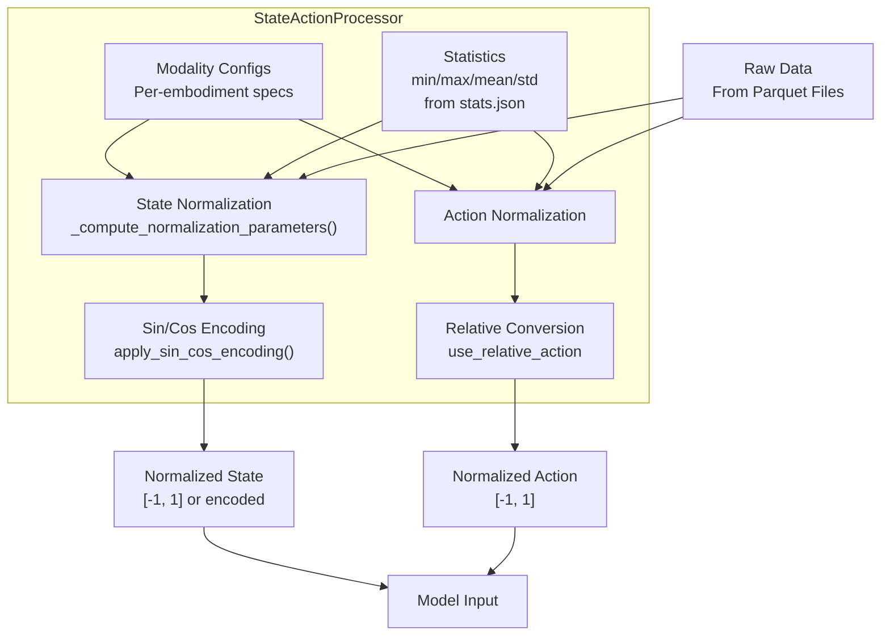
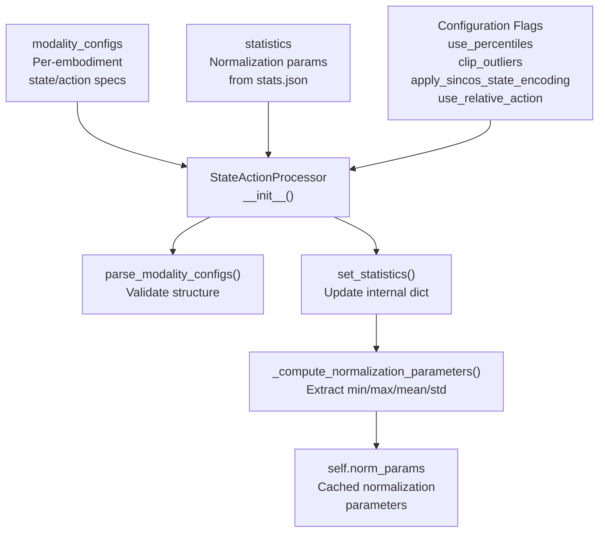
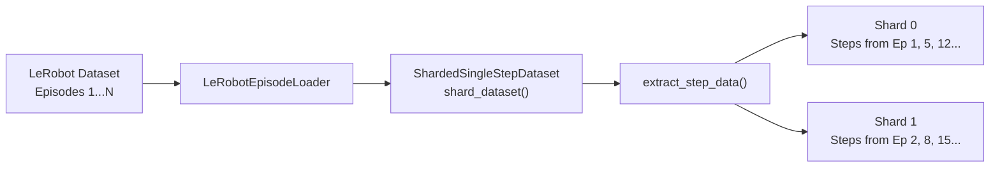
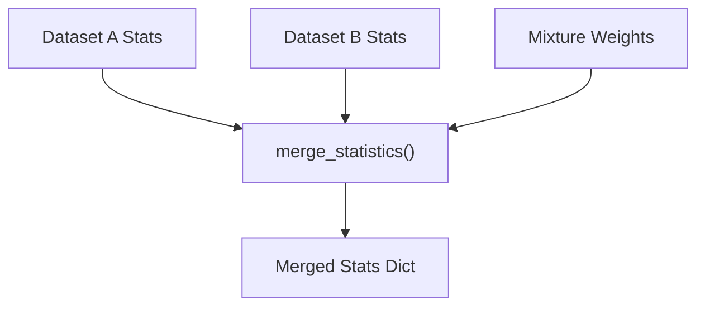

<!-- source: DeepWiki mcp.deepwiki.com · repo NVIDIA/Isaac-GR00T · page 3.5 Data Processing Pipeline · fetched 2026-10-26 -->

# Data Processing Pipeline

Relevant source files

The following files were used as context for generating this wiki page:

- [gr00t/data/dataset/sharded_single_step_dataset.py](gr00t/data/dataset/sharded_single_step_dataset.py)
- [gr00t/data/state_action/action_chunking.py](gr00t/data/state_action/action_chunking.py)
- [gr00t/data/state_action/pose.py](gr00t/data/state_action/pose.py)
- [gr00t/data/state_action/state_action_processor.py](gr00t/data/state_action/state_action_processor.py)
- [gr00t/eval/sim/LIBERO/libero_env.py](gr00t/eval/sim/LIBERO/libero_env.py)
- [gr00t/eval/sim/SimplerEnv/simpler_env.py](gr00t/eval/sim/SimplerEnv/simpler_env.py)
- [gr00t/eval/sim/robocasa/setup_RoboCasa.sh](gr00t/eval/sim/robocasa/setup_RoboCasa.sh)
- [gr00t/eval/sim/robocasa365/__init__.py](gr00t/eval/sim/robocasa365/__init__.py)
- [gr00t/eval/sim/robocasa365/gymnasium_groot.py](gr00t/eval/sim/robocasa365/gymnasium_groot.py)
- [gr00t/eval/sim/robocasa365/setup_RoboCasa365.sh](gr00t/eval/sim/robocasa365/setup_RoboCasa365.sh)
- [gr00t/eval/sim/wrapper/video_recording_wrapper.py](gr00t/eval/sim/wrapper/video_recording_wrapper.py)
- [gr00t/experiment/utils.py](gr00t/experiment/utils.py)
- [tests/gr00t/data/test_sharded_datasets.py](tests/gr00t/data/test_sharded_datasets.py)

## Purpose and Scope

This page describes the core data processing components that transform raw robot data into normalized, model-ready tensors. The focus is on the `StateActionProcessor` class, normalization strategies, statistics computation, the `ShardedSingleStepDataset`, and the transformation of pose and action representations.

This page covers:
- `StateActionProcessor`: The central class for state and action normalization [gr00t/data/state_action/state_action_processor.py:52-61]()
- Normalization strategies: min/max, mean/std, and sin/cos encoding [gr00t/data/state_action/state_action_processor.py:20-24]()
- Statistics management: Computing and merging normalization parameters [gr00t/data/state_action/state_action_processor.py:112-143]()
- `ShardedSingleStepDataset`: Efficient step-level data loading and sharding [gr00t/data/dataset/sharded_single_step_dataset.py:82-127]()
- Pose representations: `JointPose` and `EndEffectorPose` classes [gr00t/data/state_action/pose.py:177-300]()
- Action chunking: `ActionChunk` base class and its specialized implementations [gr00t/data/state_action/action_chunking.py:29-161]()

---

## Processing Architecture Overview

The data processing system centers around the `StateActionProcessor` class, which coordinates normalization and transformation of state and action data.

**Diagram: StateActionProcessor Data Flow**

**Sources:** [gr00t/data/state_action/state_action_processor.py:52-61](), [gr00t/data/state_action/state_action_processor.py:145-168](), [gr00t/data/utils.py:37-45]()

---

## StateActionProcessor Class

The `StateActionProcessor` class is the central component for processing state and action data. It handles normalization, denormalization, and conversion between absolute and relative action representations.

### Initialization

**Diagram: StateActionProcessor Initialization**

### Key Constructor Parameters

| Parameter | Type | Purpose |
|-----------|------|---------|
| `modality_configs` | `dict[str, dict[str, ModalityConfig]]` | Embodiment-specific configurations [gr00t/data/state_action/state_action_processor.py:76-79]() |
| `statistics` | `dict` | Pre-computed normalization statistics [gr00t/data/state_action/state_action_processor.py:80-84]() |
| `use_percentiles` | `bool` | Use q01/q99 instead of min/max for bounds [gr00t/data/state_action/state_action_processor.py:85]() |
| `clip_outliers` | `bool` | Clip normalized values to [-1, 1] [gr00t/data/state_action/state_action_processor.py:86]() |
| `apply_sincos_state_encoding` | `bool` | Enable sin/cos encoding for state [gr00t/data/state_action/state_action_processor.py:87]() |
| `use_relative_action` | `bool` | Convert absolute actions to relative [gr00t/data/state_action/state_action_processor.py:94]() |

**Sources:** [gr00t/data/state_action/state_action_processor.py:63-102](), [gr00t/data/state_action/state_action_processor.py:145-168]()

---

## ShardedSingleStepDataset

The `ShardedSingleStepDataset` is the primary dataset implementation for VLA training. It provides step-level data access by sharding individual timesteps across episodes to ensure balanced and randomized data loading.

### Sharding Strategy

The dataset uses a `LeRobotEpisodeLoader` to read raw data and then distributes timesteps into shards based on a `shard_size` parameter [gr00t/data/dataset/sharded_single_step_dataset.py:129-155]().

**Key Features:**
- **Step-level access:** Unlike episode-level loaders, it allows sampling individual steps for training [gr00t/data/dataset/sharded_single_step_dataset.py:97]().
- **Balanced Sharding:** Distributes timesteps across shards to maintain consistent batch sizes [gr00t/data/dataset/sharded_single_step_dataset.py:98]().
- **Sampling Rate:** Supports `episode_sampling_rate` to use only a fraction of available data for efficiency [gr00t/data/dataset/sharded_single_step_dataset.py:99]().
- **Step Extraction:** The `extract_step_data` function handles the specific logic of loading delta indices for each modality [gr00t/data/dataset/sharded_single_step_dataset.py:27-79]().

**Diagram: Dataset to Shard Transformation**

**Sources:** [gr00t/data/dataset/sharded_single_step_dataset.py:27-79](), [gr00t/data/dataset/sharded_single_step_dataset.py:82-127](), [gr00t/data/dataset/sharded_single_step_dataset.py:160-165]()

---

## Normalization Strategies

The `StateActionProcessor` supports three normalization strategies, selected per modality key based on configuration.

### Strategy 1: Min-Max Normalization

Scales values to the range [-1, 1] using minimum and maximum values from dataset statistics.

**Formula:**
`normalized = 2 * (value - min) / (max - min) - 1`

**When to Use:**
- State modalities without periodic structure (e.g., Cartesian positions, gripper states) [gr00t/data/state_action/state_action_processor.py:20](). Implementation found in `normalize_values_minmax` [gr00t/data/utils.py:41]().

### Strategy 2: Mean-Std Normalization

Standardizes values using mean and standard deviation.

**Formula:**
`normalized = (value - mean) / std`

**When to Use:**
- State modalities with Gaussian distributions (e.g., velocities) [gr00t/data/state_action/state_action_processor.py:20](). Implementation found in `normalize_values_meanstd` [gr00t/data/utils.py:40]().

### Strategy 3: Sin-Cos Encoding

Encodes angular values using sine and cosine functions to preserve periodicity.

**Formula:**
`encoded = [sin(value), cos(value)]`

**When to Use:**
- State modalities representing angles in radians [gr00t/data/state_action/state_action_processor.py:20](). Implementation found in `apply_sin_cos_encoding` [gr00t/data/utils.py:38]().

**Sources:** [gr00t/data/state_action/state_action_processor.py:145-168](), [gr00t/data/utils.py:37-45]()

---

## Statistics Management

Statistics are often pre-computed and merged when dealing with multi-embodiment datasets.

### Merging Statistics

The `merge_statistics` function is used by `ShardedMixtureDataset` to combine statistics from multiple datasets using weighted averages for means and global min/max for bounds [tests/gr00t/data/test_sharded_datasets.py:92-140]().

**Diagram: Statistics Merging Flow**

**Sources:** [tests/gr00t/data/test_sharded_datasets.py:26-30](), [tests/gr00t/data/test_sharded_datasets.py:92-140](), [tests/gr00t/data/test_sharded_datasets.py:168-195]()

---

## Pose and Action Representations

The pipeline uses specialized classes to handle robot-specific geometry and trajectory chunking.

### Pose Classes

- **`Pose`**: Abstract base class defining the subtraction operator for relative transformations [gr00t/data/state_action/pose.py:104-175]().
- **`JointPose`**: Represents a configuration in joint space (e.g., motor angles) [gr00t/data/state_action/pose.py:177-219]().
- **`EndEffectorPose`**: Represents a 6-DOF pose in Cartesian space [gr00t/data/state_action/pose.py:27-29]().

### ActionChunk Classes

- **`ActionChunk`**: Abstract base class for robot action sequences, supporting relative and delta chunking [gr00t/data/state_action/action_chunking.py:29-57]().
- **`JointActionChunk`**: A sequence of `JointPose` objects [gr00t/data/state_action/action_chunking.py:18-19]().
- **`EndEffectorActionChunk`**: A sequence of `EndEffectorPose` objects [gr00t/data/state_action/action_chunking.py:18-19]().

**Key Methods:**
- `relative_chunking(reference_frame)`: Transforms all poses in the chunk to be relative to a reference [gr00t/data/state_action/action_chunking.py:82-110]().
- `delta_chunking(reference_frame)`: Computes a sequence where each pose is relative to the previous one [gr00t/data/state_action/action_chunking.py:111-141]().
- `to_absolute_chunking(reference_frame)`: Reconstructs absolute targets from relative poses [gr00t/data/state_action/action_chunking.py:143-160]().

**Sources:** [gr00t/data/state_action/pose.py:104-219](), [gr00t/data/state_action/action_chunking.py:29-160]()

---

