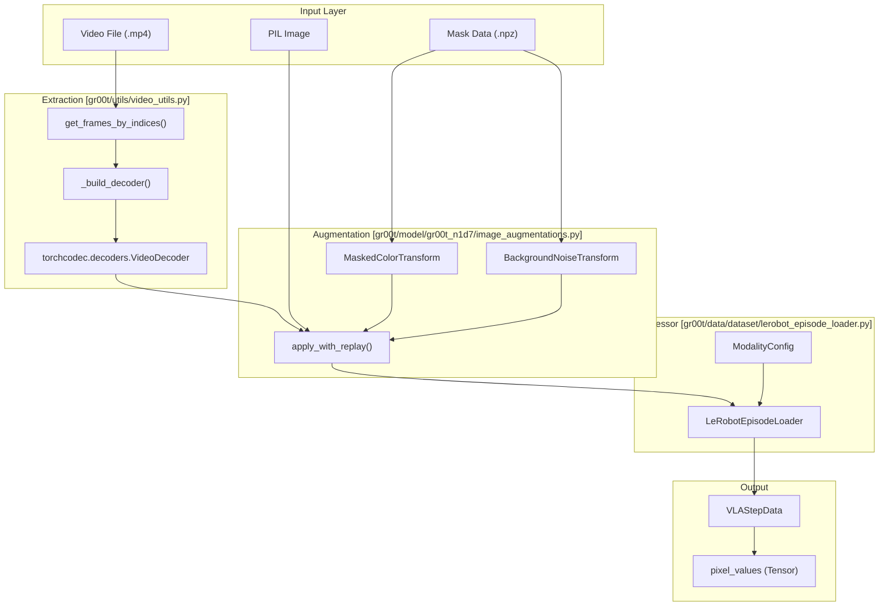
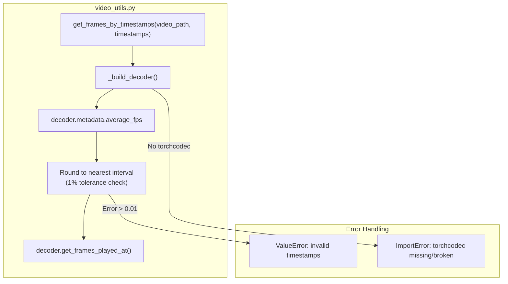

<!-- source: DeepWiki mcp.deepwiki.com · repo NVIDIA/Isaac-GR00T · page 3.6 Video and Image Processing · fetched 2026-10-26 -->

# Video and Image Processing

Relevant source files

The following files were used as context for generating this wiki page:

- [gr00t/data/dataset/lerobot_episode_loader.py](gr00t/data/dataset/lerobot_episode_loader.py)
- [gr00t/model/gr00t_n1d7/image_augmentations.py](gr00t/model/gr00t_n1d7/image_augmentations.py)
- [gr00t/utils/video_utils.py](gr00t/utils/video_utils.py)
- [tests/examples/test_so100.py](tests/examples/test_so100.py)
- [tests/gr00t/utils/test_torchcodec_import.py](tests/gr00t/utils/test_torchcodec_import.py)
- [tests/gr00t/utils/test_video_backend.py](tests/gr00t/utils/test_video_backend.py)

This page describes the video and image processing subsystems in Isaac-GR00T, including image augmentation pipelines, variable resolution support, video frame extraction utilities, mask-guided background suppression, and the `Gr00tN1d7Processor` that prepares visual inputs for the Qwen3-VL (Cosmos-Reason2-2B) backbone.

## Overview

GR00T's video and image processing system consists of five main components:

1.  **Image Transformation Pipeline**: Uses `albumentations` for training/evaluation augmentations, supporting complex multi-view consistency [gr00t/model/gr00t_n1d7/image_augmentations.py:26-95]().
2.  **Variable Resolution Support**: Native aspect ratio preservation via the Qwen3-VL processor, handling diverse camera views without distortion.
3.  **Video Frame Extraction**: A high-performance utility based on `torchcodec` for extracting frames from video files with timestamp precision [gr00t/utils/video_utils.py:70-130]().
4.  **Mask-Guided Augmentation**: Region-specific transformations (noise/tinting) using segmentation masks for domain randomization [gr00t/model/gr00t_n1d7/image_augmentations.py:98-175]().
5.  **Gr00tN1d7Processor**: The processor that handles data collation, transformation, and preparation for model input [gr00t/data/dataset/lerobot_episode_loader.py:80-143]().

### Data Flow: From Raw Video to VLM Input

The following diagram bridges the high-level data flow to the specific code entities responsible for processing.

**Visual Data Processing Flow**

Sources:
- [gr00t/utils/video_utils.py:64-77]()
- [gr00t/model/gr00t_n1d7/image_augmentations.py:26-95]()
- [gr00t/data/dataset/lerobot_episode_loader.py:80-143]()

---

## Image Transformation Pipelines

GR00T N1.7 utilizes an `albumentations`-based pipeline to handle image transformations. This approach is preferred for its efficiency and native support for "replay" functionality, which is critical for multi-camera robot embodiments.

### Albumentations and Replay Functionality

The `apply_with_replay` function ensures that if a robot has multiple cameras (e.g., `front` and `wrist`), the same random augmentations (like color jitter or crops) are applied consistently across all views for a given timestep [gr00t/model/gr00t_n1d7/image_augmentations.py:26-95]().

| Feature | Description | Implementation |
| :--- | :--- | :--- |
| **ReplayCompose** | Saves augmentation parameters from the first image to apply to subsequent images. | [gr00t/model/gr00t_n1d7/image_augmentations.py:68-79]() |
| **Mask-Based Transforms** | Applied per-frame before the main transform if masks are provided. | [gr00t/model/gr00t_n1d7/image_augmentations.py:63-66]() |
| **Type Conversion** | Ensures output is `uint8` and converted to `(C, H, W)` Torch tensors. | [gr00t/model/gr00t_n1d7/image_augmentations.py:85-93]() |

Sources:
- [gr00t/model/gr00t_n1d7/image_augmentations.py:26-95]()

---

## Mask-Guided Background Suppression

Mask-guided augmentations leverage per-frame segmentation masks to apply targeted transformations, primarily for **domain randomization** and sim-to-real transfer.

### Supported Augmentation Types

1.  **Masked Color Transform**: Applies a random color tint to specific mask regions (e.g., target objects) to improve color generalization. It uses an `alpha_range` to control the overlay intensity [gr00t/model/gr00t_n1d7/image_augmentations.py:98-145]().
2.  **Background Noise Transform**: Replaces specified mask regions (typically background pixels with value `0`) with random RGB noise to prevent the model from overfitting to static environment backgrounds [gr00t/model/gr00t_n1d7/image_augmentations.py:147-175]().

The `LeRobotEpisodeLoader` identifies these requirements via the `modality.json` configuration, specifically looking for the `"mask"` modality [gr00t/data/dataset/lerobot_episode_loader.py:59-174]().

Sources:
- [gr00t/model/gr00t_n1d7/image_augmentations.py:98-175]()
- [gr00t/data/dataset/lerobot_episode_loader.py:59-174]()

---

## Video Frame Extraction

Video processing is handled by the `video_utils.py` module, which leverages `torchcodec` for high-performance decoding. The system is designed to be "import-safe," meaning `torchcodec` is only loaded when a decoding function is actually called to avoid environment conflicts [tests/gr00t/utils/test_video_backend.py:42-71]().

### Key Functions

*   **`get_frames_by_indices`**: Retrieves specific frames by their integer index. It returns an `NHWC` `uint8` numpy array [gr00t/utils/video_utils.py:70-77]().
*   **`get_frames_by_timestamps`**: Retrieves frames at specific time points in seconds. It includes a critical **1% tolerance check** to correct for floating-point drift in timestamps, ensuring the decoder doesn't snap to the wrong frame [gr00t/utils/video_utils.py:79-116]().
*   **`get_all_frames`**: Decodes the entire video sequence and returns both the frames and their corresponding Presentation Time Stamps (PTS) [gr00t/utils/video_utils.py:119-130]().

### Timestamp Accumulation Logic
The `get_accumulate_timestamp_idxs` function handles mapping sparse or irregular video timestamps to a fixed control frequency (`dt`). It ensures that for each time window, the first available timestamp is chosen, and can handle dropped frames by repeating the last valid index [gr00t/utils/video_utils.py:133-168]().

**Video Decoding Logic**

Sources:
- [gr00t/utils/video_utils.py:70-168]()
- [tests/gr00t/utils/test_video_backend.py:83-130]()

---

## Variable Resolution and Qwen3-VL

GR00T N1.7 introduces native support for variable image resolutions, moving away from forced square letterboxing. This is facilitated by the Qwen3-VL (Cosmos-Reason2-2B) backbone.

The `LeRobotEpisodeLoader` and associated processors handle different resolutions by parsing the `modality.json` and `info.json` metadata. This allows the model to process wide-angle front cameras and narrow-field wrist cameras in their native aspect ratios, which is crucial for preserving spatial relationships in manipulation tasks [gr00t/data/dataset/lerobot_episode_loader.py:144-174]().

### Deployment Considerations
When deploying on edge platforms like **NVIDIA Orin** or **Thor**, specific installation scripts (`install_deps.sh`) ensure that the correct version of `torchcodec` (compatible with the system's FFmpeg) is installed to maintain this processing pipeline [gr00t/utils/video_utils.py:22-35]().

Sources:
- [gr00t/data/dataset/lerobot_episode_loader.py:144-174]()
- [gr00t/utils/video_utils.py:22-35]()

---

