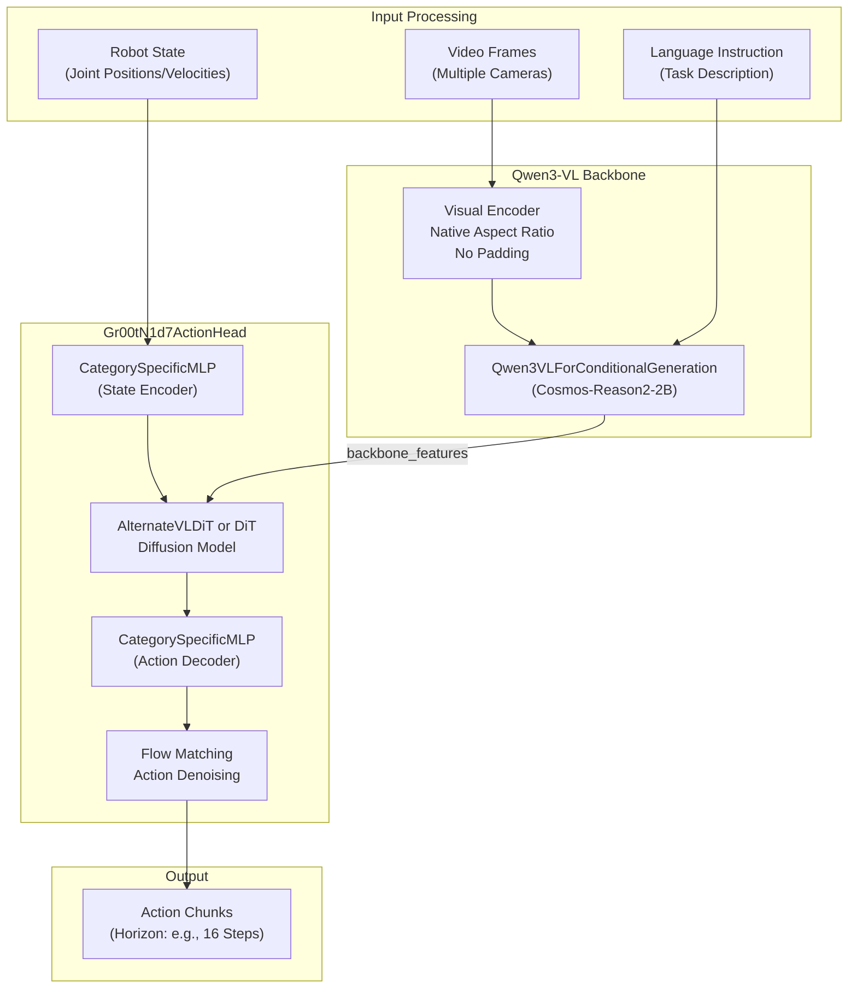
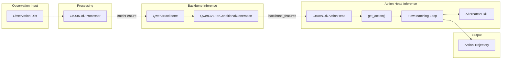

<!-- source: DeepWiki mcp.deepwiki.com · repo NVIDIA/Isaac-GR00T · page 4 Model Architecture and Core Components · fetched 2026-10-26 -->

# Model Architecture and Core Components

Relevant source files

The following files were used as context for generating this wiki page:

- [getting_started/finetune_new_embodiment.md](getting_started/finetune_new_embodiment.md)
- [gr00t/model/gr00t_n1d7/gr00t_n1d7.py](gr00t/model/gr00t_n1d7/gr00t_n1d7.py)
- [gr00t/model/modules/qwen3_backbone.py](gr00t/model/modules/qwen3_backbone.py)
- [tests/gr00t/model/test_action_head.py](tests/gr00t/model/test_action_head.py)

## Purpose and Scope

This page provides a technical overview of the **GR00T N1.7** model architecture and its core components. GR00T N1.7 represents a significant update over N1.6, moving to a **Qwen3-VL** (Cosmos-Reason2-2B) backbone and introducing native aspect ratio support. This page covers the high-level design, the integration of the Vision-Language Model (VLM) and Diffusion Transformer (DiT), and the data flow through the system. For detailed implementation specifics, refer to the sub-pages:

- For architectural details and N1.7 improvements: [GR00T N1.7 Architecture](#4.1)
- For the Qwen3-VL backbone implementation: [Qwen3-VL Backbone (Cosmos-Reason2-2B)](#4.2)
- For the action head and flow matching process: [Diffusion Transformer (DiT) and Flow Matching](#4.3)
- For the data collation and image augmentation pipeline: [Gr00tN1d7Processor](#4.4)
- For the inference interface and usage: [Gr00tPolicy Interface](#4.5)

For data preparation and embodiment configurations, see [Data Pipeline and Configuration](#3). For fine-tuning procedures, see [Training GR00T Models](#6). For deployment, see [Inference and Deployment](#5).

---

## High-Level Architecture

GR00T N1.7 is a vision-language-action (VLA) model that combines a Qwen3-VL foundation model with a Diffusion Transformer (DiT) action head optimized for flow matching. The model is configured via `Gr00tN1d7Config` [gr00t/model/gr00t_n1d7/gr00t_n1d7.py:27](), which defines parameters for both the backbone and the action head.

### GR00T N1.7 Architecture Diagram

**Sources:** [gr00t/model/gr00t_n1d7/gr00t_n1d7.py:38-82](), [gr00t/model/modules/qwen3_backbone.py:135-156]()

### Component Breakdown

| Component | Class / Implementation | Description |
|-----------|------------------------|-------------|
| **VLM Backbone** | `Qwen3Backbone` | Wrapper for `Qwen3VLForConditionalGeneration` supporting variable resolutions [gr00t/model/modules/qwen3_backbone.py:135](). |
| **Action Head** | `Gr00tN1d7ActionHead` | Orchestrates state encoding, diffusion denoising, and action decoding [gr00t/model/gr00t_n1d7/gr00t_n1d7.py:38](). |
| **Diffusion Model** | `AlternateVLDiT` / `DiT` | Transformer-based denoising core [gr00t/model/gr00t_n1d7/gr00t_n1d7.py:49-61](). |
| **State Encoder** | `CategorySpecificMLP` | Encodes proprioceptive state history, conditioned on embodiment [gr00t/model/gr00t_n1d7/gr00t_n1d7.py:66-71](). |
| **Action Decoder** | `CategorySpecificMLP` | Maps diffusion features back to action space [gr00t/model/gr00t_n1d7/gr00t_n1d7.py:77-82](). |

**Sources:** [gr00t/model/gr00t_n1d7/gr00t_n1d7.py:38-82](), [gr00t/model/modules/qwen3_backbone.py:135-156]()

---

## Data Flow Through the Model

The following diagram illustrates how observations flow through the code entities to generate robot actions during inference.

### Code Entity Data Flow

**Sources:** [gr00t/model/gr00t_n1d7/gr00t_n1d7.py:127-154](), [tests/gr00t/model/test_action_head.py:127-154]()

---

## Core Components Overview

### Qwen3-VL Backbone (Cosmos-Reason2-2B)

The backbone is managed by the `Qwen3Backbone` class [gr00t/model/modules/qwen3_backbone.py:135](). It utilizes the `nvidia/Cosmos-Reason2-2B` model [gr00t/model/modules/qwen3_backbone.py:138](). Unlike previous versions, it supports **native aspect ratios**, avoiding padding and preserving spatial information.

**Key Characteristics:**
- **Layer Selection**: Can output features from specific LLM layers [gr00t/model/modules/qwen3_backbone.py:141]().
- **Unfreezing Strategy**: Supports fine-tuning specific parts of the LLM or visual tower via `tune_llm` and `tune_visual` flags [gr00t/model/modules/qwen3_backbone.py:139-140]().
- **Rotary Embeddings**: Includes specialized logic to recompute vision and text rotary inverse frequencies for different devices [gr00t/model/modules/qwen3_backbone.py:79-105]().

For details, see [Qwen3-VL Backbone (Cosmos-Reason2-2B)](#4.2).

### Diffusion Transformer (DiT) and Flow Matching

The action head, `Gr00tN1d7ActionHead`, implements a **Flow Matching** diffusion policy [gr00t/model/gr00t_n1d7/gr00t_n1d7.py:39](). It defaults to using `AlternateVLDiT` for the diffusion model [gr00t/model/gr00t_n1d7/gr00t_n1d7.py:50]().

**Key Characteristics:**
- **Embodiment Conditioning**: Uses `CategorySpecificMLP` for state and action encoding/decoding, allowing the model to handle multiple robot types simultaneously [gr00t/model/gr00t_n1d7/gr00t_n1d7.py:66-82]().
- **Training Objective**: The `forward` method returns a flow matching loss during training [tests/gr00t/model/test_action_head.py:105-111]().
- **Inference**: The `get_action` method performs an iterative denoising loop to generate predicted actions [tests/gr00t/model/test_action_head.py:130-136]().
- **State Dropout**: Supports `state_dropout_prob` to improve robustness during training [gr00t/model/gr00t_n1d7/gr00t_n1d7.py:99]().

For details, see [Diffusion Transformer (DiT) and Flow Matching](#4.3).

### Gr00tN1d7Processor

The processor handles the transformation of raw observations (images, states, language) into the specific tensor formats required by the Qwen3-VL backbone and the action head. It is critical for maintaining consistency between training data (often in LeRobot v2 format) and real-time inference inputs.

For details, see [Gr00tN1d7Processor](#4.4).

### Gr00tPolicy Interface

`Gr00tPolicy` is the top-level class that integrates the backbone and action head. It provides a standardized interface for inference, supporting both standard PyTorch execution and optimized TensorRT pipelines.

For details, see [Gr00tPolicy Interface](#4.5).

---

## Summary

The GR00T N1.7 architecture leverages the **Qwen3-VL** backbone for advanced multimodal reasoning and a **Flow Matching DiT** head for precise action generation. The system is designed for multi-embodiment support, allowing a single model to control various robots by conditioning on embodiment tags and using specialized MLP projectors.

For component-specific details, see sub-pages [GR00T N1.7 Architecture](#4.1), [Qwen3-VL Backbone (Cosmos-Reason2-2B)](#4.2), [Diffusion Transformer (DiT) and Flow Matching](#4.3), [Gr00tN1d7Processor](#4.4), and [Gr00tPolicy Interface](#4.5).

---

