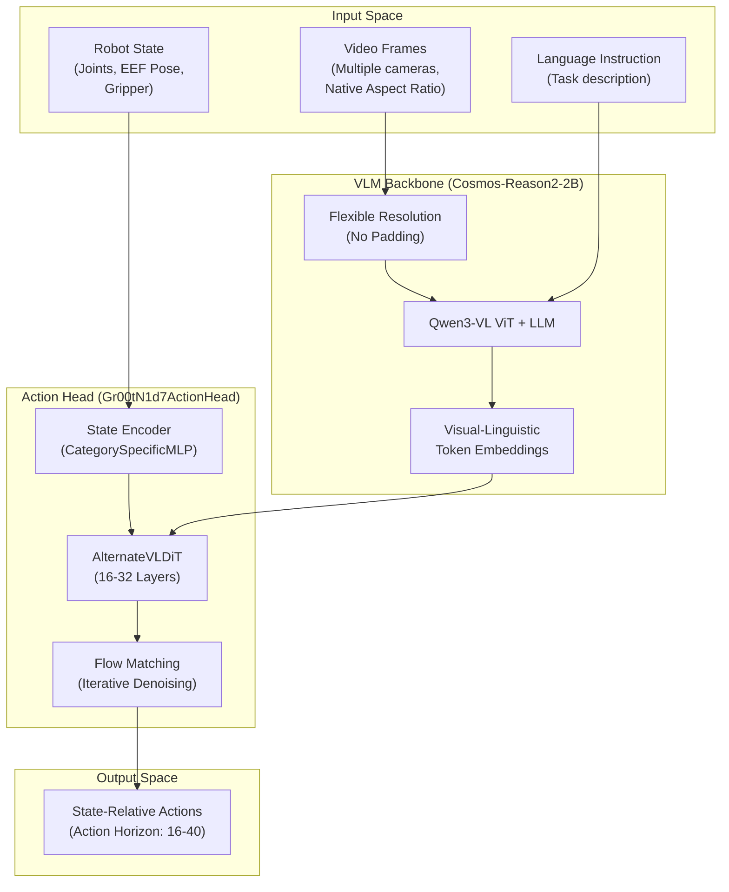
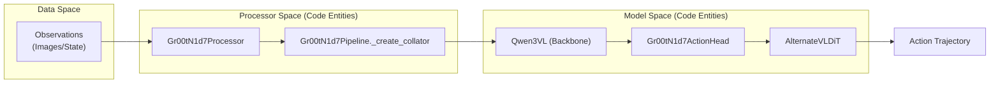

<!-- source: DeepWiki mcp.deepwiki.com · repo NVIDIA/Isaac-GR00T · page 4.1 GR00T N1.7 Architecture · fetched 2026-10-26 -->

# GR00T N1.7 Architecture

Relevant source files

The following files were used as context for generating this wiki page:

- [getting_started/finetune_new_embodiment.md](getting_started/finetune_new_embodiment.md)
- [gr00t/configs/model/gr00t_n1d7.py](gr00t/configs/model/gr00t_n1d7.py)
- [gr00t/model/gr00t_n1d7/gr00t_n1d7.py](gr00t/model/gr00t_n1d7/gr00t_n1d7.py)
- [gr00t/model/gr00t_n1d7/setup.py](gr00t/model/gr00t_n1d7/setup.py)
- [tests/gr00t/model/test_action_head.py](tests/gr00t/model/test_action_head.py)

## Purpose and Scope

This document details the neural network architecture of **GR00T N1.7**, a vision-language-action (VLA) model designed for generalized humanoid robot control. N1.7 represents a significant upgrade over N1.6, replacing the previous backbone with the **Cosmos-Reason2-2B** (Qwen3-VL architecture) and introducing a more streamlined processing pipeline.

The model is a hybrid architecture consisting of a Vision-Language Model (VLM) backbone for multimodal perception and a Diffusion Transformer (DiT) head for high-fidelity action generation through flow matching.

---

## Architecture Overview

GR00T N1.7 processes interleaved multimodal inputs—including multiple camera streams, robot proprioceptive state, and natural language instructions—to produce continuous action sequences.

### High-Level Architecture Diagram

**Sources:** [gr00t/configs/model/gr00t_n1d7.py:28-33](), [gr00t/model/gr00t_n1d7/gr00t_n1d7.py:38-83](), [gr00t/model/gr00t_n1d7/setup.py:47-50]()

---

## Key Changes from N1.6 to N1.7

The transition from N1.6 to N1.7 involves several fundamental architectural shifts aimed at improving generalization and inference efficiency.

| Feature | GR00T N1.6 | GR00T N1.7 | Impact |
| :--- | :--- | :--- | :--- |
| **VLM Backbone** | Eagle (Cosmos-Reason-2B) | **Cosmos-Reason2-2B (Qwen3-VL)** | Native aspect ratio support; better spatial reasoning. |
| **Action Head** | Diffusion (VP-ODE) | **Flow Matching (Beta-Schedule)** | More stable training; better time-sampling distribution. |
| **Action Horizon** | 8-16 steps | **Up to 40 steps** | Longer-term planning capability. |
| **Config Class** | `Gr00tN1d6Config` | `Gr00tN1d7Config` | Unified config for backbone and action head. |
| **Training** | Standard Diffusion | **Flow Matching + Beta Dist** | Uses `Beta(1.5, 1.0)` for noise scheduling. |

**Sources:** [gr00t/configs/model/gr00t_n1d7.py:28-110](), [gr00t/model/gr00t_n1d7/gr00t_n1d7.py:112-115]()

---

## Core Components

### 1. VLM Backbone: Cosmos-Reason2-2B
The backbone utilizes the **Qwen3-VL** architecture. Unlike traditional VLMs that resize images to fixed squares, this backbone encodes images in their **native aspect ratio**.

*   **Implementation**: Configured via `Gr00tN1d7Config` with `model_name="nvidia/Cosmos-Reason2-2B"` [gr00t/configs/model/gr00t_n1d7.py:40-41]().
*   **Feature Extraction**: Produces visual-linguistic tokens with an embedding dimension of 2048 [gr00t/configs/model/gr00t_n1d7.py:44]().
*   **Trainability**: Supports freezing the LLM (`tune_llm=False`) or visual encoder (`tune_visual=False`) while tuning only the top LLM layers [gr00t/configs/model/gr00t_n1d7.py:43-46]().

### 2. Diffusion Transformer (DiT) Action Head
The `Gr00tN1d7ActionHead` is the core action generation module, utilizing Flow Matching.

*   **Architecture**: Can use `DiT` or `AlternateVLDiT` [gr00t/model/gr00t_n1d7/gr00t_n1d7.py:49-61]().
*   **Configuration**: Defaults to 16 layers and 32 attention heads [gr00t/configs/model/gr00t_n1d7.py:94-95]().
*   **Conditioning**: The head uses `AdaLayerNorm` for timestep conditioning and integrates backbone features via cross-attention [gr00t/configs/model/gr00t_n1d7.py:91-103]().
*   **Noise Schedule**: Uses a Beta distribution for time sampling during training: `Beta(noise_beta_alpha=1.5, noise_beta_beta=1.0)` [gr00t/configs/model/gr00t_n1d7.py:107-108]().

**Sources:** [gr00t/model/gr00t_n1d7/gr00t_n1d7.py:38-120](), [gr00t/configs/model/gr00t_n1d7.py:73-110]()

### 3. State and Action Encoders
The model uses embodiment-aware MLPs to handle diverse robot configurations.

*   **State Encoder**: `CategorySpecificMLP` projects raw proprioceptive state into the `input_embedding_dim` (default 1536) [gr00t/model/gr00t_n1d7/gr00t_n1d7.py:66-71]().
*   **Action Encoder**: `MultiEmbodimentActionEncoder` handles noisy action inputs during the flow matching process [gr00t/model/gr00t_n1d7/gr00t_n1d7.py:72-76]().
*   **Action Decoder**: `CategorySpecificMLP` maps DiT latents back to the target action dimension [gr00t/model/gr00t_n1d7/gr00t_n1d7.py:77-82]().

**Sources:** [gr00t/model/gr00t_n1d7/gr00t_n1d7.py:66-82](), [gr00t/configs/model/gr00t_n1d7.py:77-78]()

---

## Data Flow: From Perception to Action

The following diagram maps the logical flow of data to the specific code entities responsible for processing it.

**Sources:** [gr00t/model/gr00t_n1d7/setup.py:47-50](), [gr00t/model/gr00t_n1d7/gr00t_n1d7.py:105-154]()

---

## Configuration: Gr00tN1d7Config

The model is driven by a unified `Gr00tN1d7Config` class which inherits from HuggingFace's `PretrainedConfig`.

| Parameter | Default | Description |
| :--- | :--- | :--- |
| `max_state_dim` | 132 | Maximum dimension for robot proprioception state. |
| `max_action_dim` | 132 | Maximum dimension for output actions. |
| `action_horizon` | 40 | Number of future action steps predicted. |
| `state_history_length`| 1 | Number of past states included in input. |
| `num_inference_timesteps` | 4 | Number of denoising steps for flow matching inference. |
| `state_dropout_prob` | 0.8 | Probability of zeroing out state during training for vision-only robustness. |

**Sources:** [gr00t/configs/model/gr00t_n1d7.py:28-123]()

---

## Multi-Embodiment Support

N1.7 is designed to be trained on a mix of robot platforms. It supports up to 32 distinct embodiments (`max_num_embodiments`) [gr00t/configs/model/gr00t_n1d7.py:123](). 

*   **Embodiment Tagging**: Each dataset sample is associated with an `EmbodimentTag` [getting_started/finetune_new_embodiment.md:14]().
*   **Projector Indexing**: The `Gr00tN1d7ActionHead` uses the `embodiment_id` to select the appropriate MLP weights in `CategorySpecificMLP` [gr00t/model/gr00t_n1d7/gr00t_n1d7.py:67-82]().

**Sources:** [gr00t/model/gr00t_n1d7/gr00t_n1d7.py:66-82](), [getting_started/finetune_new_embodiment.md:71-72]()

---

