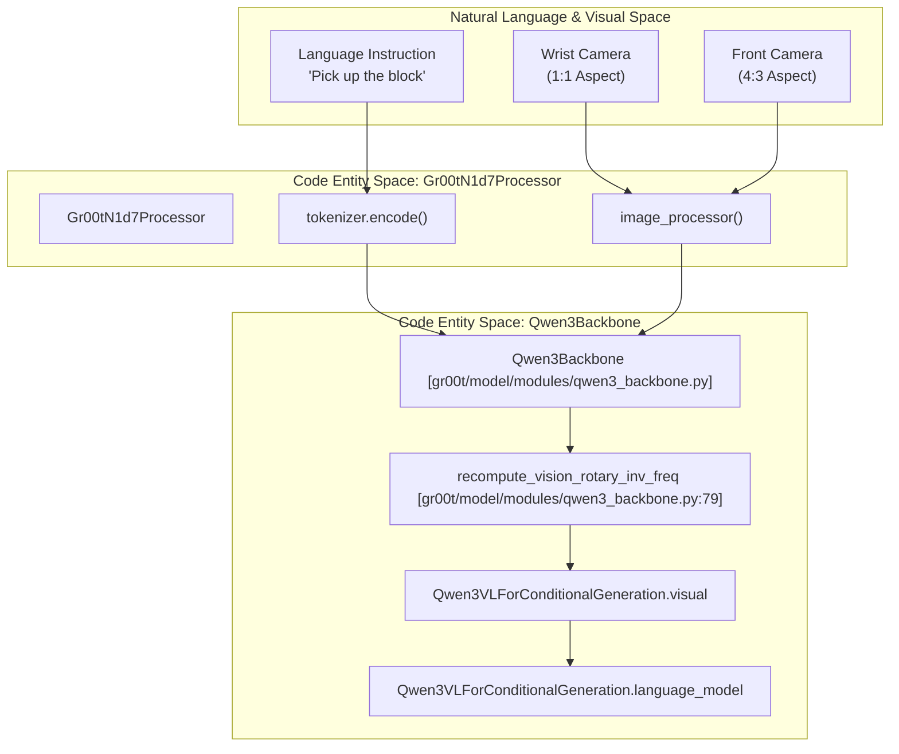
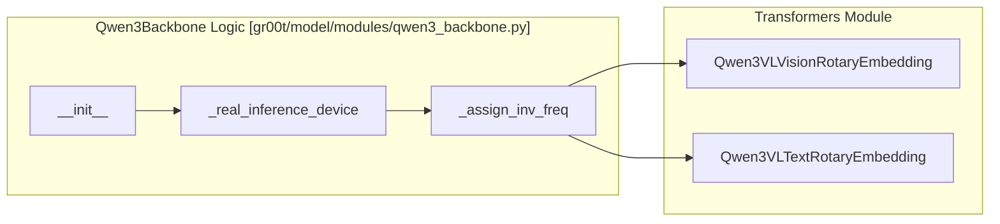

<!-- source: DeepWiki mcp.deepwiki.com · repo NVIDIA/Isaac-GR00T · page 4.2 Qwen3-VL Backbone (Cosmos-Reason2-2B) · fetched 2026-10-26 -->

# Qwen3-VL Backbone (Cosmos-Reason2-2B)

Relevant source files

The following files were used as context for generating this wiki page:

- [gr00t/model/modules/qwen3_backbone.py](gr00t/model/modules/qwen3_backbone.py)
- [tests/gr00t/model/test_qwen3_rope.py](tests/gr00t/model/test_qwen3_rope.py)

## Purpose and Scope

This document describes the **Qwen3-VL (Cosmos-Reason2-2B)** backbone, which serves as the core Vision-Language foundation for the **GR00T N1.7** architecture. Replacing the Eagle-based backbone from N1.6, the Qwen3-VL model provides native support for variable aspect ratios, enhanced reasoning capabilities, and a streamlined integration with the Diffusion Transformer (DiT) action head. It processes multimodal inputs—camera frames and natural language instructions—to generate contextual embeddings used for action prediction.

**Sources:** [gr00t/model/modules/qwen3_backbone.py:150-156](), [gr00t/model/modules/qwen3_backbone.py:138-138]()

---

## Cosmos-Reason2-2B Backbone

The GR00T N1.7 system utilizes the `Qwen3VLForConditionalGeneration` architecture [gr00t/model/modules/qwen3_backbone.py:27-27](). This model is optimized for embodied AI, providing spatial reasoning and temporal understanding across multiple camera streams. The implementation is wrapped in the `Qwen3Backbone` class [gr00t/model/modules/qwen3_backbone.py:135-135]().

### Key Technical Specifications

| Property | Description |
|----------|-------------|
| **Model Family** | Qwen3-VL (Cosmos-Reason2-2B) |
| **Vision Encoder** | ViT-based, typically loaded in BF16 or FP32 [gr00t/model/modules/qwen3_backbone.py:145-145]() |
| **Language Model** | Transformer-based with Flash Attention support [gr00t/model/modules/qwen3_backbone.py:168-178]() |
| **Resolution** | Native aspect ratio support via Qwen3-VL processor |
| **RoPE Repair** | Automatic analytic re-computation of `inv_freq` for `meta` device loads [gr00t/model/modules/qwen3_backbone.py:79-105]() |

**Sources:** [gr00t/model/modules/qwen3_backbone.py:27-31](), [gr00t/model/modules/qwen3_backbone.py:135-149]()

---

## Multimodal Input Processing

The `Qwen3Backbone` wrapper class manages the data flow between raw observations and the transformer layers. It handles the alignment of visual tokens from multiple cameras with textual instruction tokens.

### Native Aspect Ratio Support

Unlike traditional VLMs that crop or pad images to square dimensions, Qwen3-VL processes images at their native aspect ratio. This is critical for robotics where peripheral information is vital for safety and task completion. The system uses a specialized `inv_freq` repair mechanism to ensure Rotary Positional Embeddings (RoPE) are correctly initialized across different hardware backends, preventing the "NaN garbage" bug common in `meta` device loading [tests/gr00t/model/test_qwen3_rope.py:18-33]().

**Diagram: Multimodal Data Flow and RoPE Initialization**

**Sources:** [gr00t/model/modules/qwen3_backbone.py:79-105](), [tests/gr00t/model/test_qwen3_rope.py:18-33]()

---

## Layer Unfreezing Strategy

To balance general-purpose reasoning with task-specific robot control, GR00T N1.7 employs a selective unfreezing strategy during initialization.

### Training Configurations

| Parameter | Component | Behavior |
|------|-----------|----------|
| `tune_llm` | Qwen3 LLM Layers | If true, allows gradients to update the language transformer weights [gr00t/model/modules/qwen3_backbone.py:139](). |
| `tune_visual` | Qwen3 ViT | If true, updates the vision encoder to better recognize robot-specific objects [gr00t/model/modules/qwen3_backbone.py:140](). |
| `tune_top_llm_layers` | Selective LLM | Allows tuning only the top $N$ layers of the LLM for efficient fine-tuning [gr00t/model/modules/qwen3_backbone.py:146](). |

**Sources:** [gr00t/model/modules/qwen3_backbone.py:136-149]()

---

## Implementation Detail: The Qwen3Backbone Wrapper

The `Qwen3Backbone` class encapsulates the complex RoPE handling required for Qwen3-VL. Because Qwen3-VL registers its vision and text RoPE `inv_freq` with `persistent=False`, these buffers are not restored from checkpoints and can be left uninitialized when loaded under a `meta` context [tests/gr00t/model/test_qwen3_rope.py:18-23]().

### RoPE Analytic Repair

The class provides functions to re-derive the frequencies via the module's own constructor to ensure the analytic formula remains the single source of truth:
*   `recompute_vision_rotary_inv_freq`: Specifically for the ViT tower [gr00t/model/modules/qwen3_backbone.py:79-90]().
*   `recompute_text_rotary_inv_freq`: Handles the text model, including `attention_scaling` for different RoPE types (default, scaled, or dynamic) [gr00t/model/modules/qwen3_backbone.py:92-105]().

**Diagram: RoPE Buffer Repair Workflow**

**Sources:** [gr00t/model/modules/qwen3_backbone.py:64-133](), [tests/gr00t/model/test_qwen3_rope.py:18-33]()

---

## Gated Repository Handling

Since `Cosmos-Reason2-2B` is a gated Hugging Face repository, the backbone includes explicit error handling for authentication issues. If the model cannot be downloaded, `Qwen3Backbone` provides a descriptive hint instructing the user to authenticate via `hf auth login` or the `HF_TOKEN` environment variable [gr00t/model/modules/qwen3_backbone.py:34-41]().

**Sources:** [gr00t/model/modules/qwen3_backbone.py:34-61]()

---

