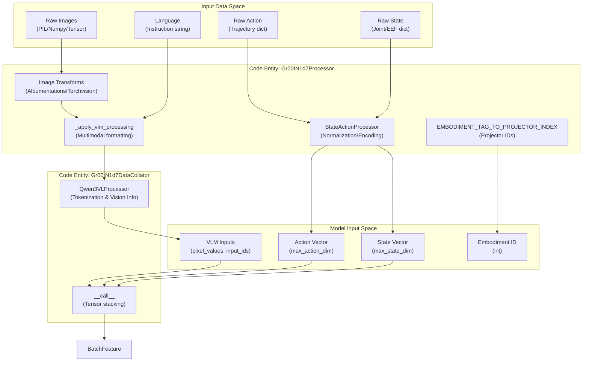

<!-- source: DeepWiki mcp.deepwiki.com · repo NVIDIA/Isaac-GR00T · page 4.4 Gr00tN1d7Processor · fetched 2026-10-26 -->

# Gr00tN1d7Processor

<details>
<summary>Relevant source files</summary>

The following files were used as context for generating this wiki page:

- [gr00t/__init__.py](gr00t/__init__.py)
- [gr00t/model/gr00t_n1d7/processing_gr00t_n1d7.py](gr00t/model/gr00t_n1d7/processing_gr00t_n1d7.py)
- [scripts/deployment/build_tensorrt_engine.py](scripts/deployment/build_tensorrt_engine.py)
- [tests/getting_started/test_policy_md.py](tests/getting_started/test_policy_md.py)
- [tests/gr00t/experiment/test_trainer_resume_strictness.py](tests/gr00t/experiment/test_trainer_resume_strictness.py)
- [tests/gr00t/model/test_vlm_image_input_parity.py](tests/gr00t/model/test_vlm_image_input_parity.py)
- [tests/scripts/deployment/test_trt_pipeline.py](tests/scripts/deployment/test_trt_pipeline.py)

</details>


## Purpose and Scope

The `Gr00tN1d7Processor` is the core data processing component for the GR00T N1.7 architecture. It transforms raw robot observations—including multi-view images, joint states, and natural language instructions—into model-ready inputs for the Qwen3-VL (Cosmos-Reason2-2B) backbone and the Diffusion Transformer (DiT) action head. [gr00t/model/gr00t_n1d7/processing_gr00t_n1d7.py:123-157]()

Compared to N1.6, the N1.7 processor is specifically optimized for:
- **Native Aspect Ratio Support**: Handling variable image sizes across different camera views without forced resizing to square dimensions by utilizing the `Qwen3VLProcessor`. [gr00t/model/gr00t_n1d7/processing_gr00t_n1d7.py:123-129](), [tests/gr00t/model/test_vlm_image_input_parity.py:85-93]()
- **Qwen3-VL Integration**: Preparing multimodal content for the Cosmos-Reason2-2B backbone, including direct support for CHW uint8 tensors to avoid PIL round-trip overhead. [tests/gr00t/model/test_vlm_image_input_parity.py:16-22]()
- **Enhanced Augmentation**: Advanced image transformations using the Albumentations backend, including mask-guided background suppression. [gr00t/model/gr00t_n1d7/processing_gr00t_n1d7.py:41-45]()

**Sources:** [gr00t/model/gr00t_n1d7/processing_gr00t_n1d7.py:1-157](), [tests/gr00t/model/test_vlm_image_input_parity.py:16-115]()

---

## Architecture Overview

The `Gr00tN1d7Processor` coordinates several sub-systems to prepare a unified batch for the VLA model.



**Diagram: Gr00tN1d7Processor data transformation pipeline**

**Sources:** [gr00t/model/gr00t_n1d7/processing_gr00t_n1d7.py:159-174](), [gr00t/model/gr00t_n1d7/processing_gr00t_n1d7.py:58-120](), [gr00t/data/state_action/state_action_processor.py:38-40]()

---

## Core Components

### Gr00tN1d7Processor Class
The main entry point for processing individual samples. It manages the `StateActionProcessor` for numerical data and handles the image augmentation pipeline. It also validates that embodiment action horizons do not exceed the model's `max_action_horizon`. [gr00t/model/gr00t_n1d7/processing_gr00t_n1d7.py:132-157]()

| Attribute | Type | Description |
|-----------|------|-------------|
| `state_action_processor` | `StateActionProcessor` | Handles normalization (min/max, mean/std) and relative action conversion. [gr00t/model/gr00t_n1d7/processing_gr00t_n1d7.py:38-40]() |
| `processor` | `Qwen3VLProcessor` | Backend processor for the Qwen3-VL (Cosmos) backbone. [gr00t/model/gr00t_n1d7/processing_gr00t_n1d7.py:123-129]() |
| `EMBODIMENT_TAG_TO_PROJECTOR_INDEX` | `dict[str, int]` | Public lookup mapping embodiment tags to specific projector indices (e.g., `libero_sim` maps to 2). [gr00t/model/gr00t_n1d7/processing_gr00t_n1d7.py:69-120]() |

**Sources:** [gr00t/model/gr00t_n1d7/processing_gr00t_n1d7.py:58-157]()

### Gr00tN1d7DataCollator Class
The collator is responsible for merging multiple processed samples into a single batch. It initializes the `Qwen3VLProcessor` with `padding_side = "left"` to ensure compatibility with Flash Attention during training and inference. [gr00t/model/gr00t_n1d7/processing_gr00t_n1d7.py:159-172]()

**Sources:** [gr00t/model/gr00t_n1d7/processing_gr00t_n1d7.py:159-174]()

---

## Data Processing Pipeline

### 1. State and Action Transformation
The processor utilizes `StateActionProcessor` to normalize inputs. States are often sin/cos encoded for angular values and padded to a fixed length. During inference, the `decode_action` method reverses these transforms to produce robot-executable commands. [tests/getting_started/test_policy_md.py:131-137]()

**Sources:** [gr00t/data/state_action/state_action_processor.py:38-40](), [tests/getting_started/test_policy_md.py:131-137]()

### 2. Variable Resolution Image Processing
Unlike previous versions, N1.7 supports variable aspect ratios. The processor now passes CHW uint8 tensors directly to the VLM processor, eliminating the PIL round-trip to maintain bitwise parity and improve performance. [tests/gr00t/model/test_vlm_image_input_parity.py:16-22]()

**Transform Logic:**
- **Parity Assertion**: Direct tensor inputs are verified to be bitwise identical to the legacy PIL-based path. [tests/gr00t/model/test_vlm_image_input_parity.py:94-104]()
- **Smart Resize**: Handles non-square inputs (e.g., 240x320) and non-patch-multiple dimensions (e.g., 243x243) through the Qwen3VL backend. [tests/gr00t/model/test_vlm_image_input_parity.py:85-91]()

**Sources:** [tests/gr00t/model/test_vlm_image_input_parity.py:16-115](), [gr00t/model/gr00t_n1d7/processing_gr00t_n1d7.py:41-45]()

### 3. VLM Input Preparation
The `_apply_vlm_processing` logic prepares the multimodal conversation for the Qwen3-VL backbone.

```python
# The internal representation used to generate input_ids and pixel_values
conversation = [
    {
        "role": "user",
        "content": [
            *[{"type": "image", "image": img} for img in frames],
            {"type": "text", "text": language_instruction},
        ],
    }
]
```

**Sources:** [tests/gr00t/model/test_vlm_image_input_parity.py:69-82]()

---

## Projector Index Mapping

N1.7 uses a structured `_PROJECTOR_INDEX_GROUPS` to manage how different embodiments share visual projectors. Multiple tags share an index only if they describe the same physical embodiment (e.g., different data sources for the same robot). [gr00t/model/gr00t_n1d7/processing_gr00t_n1d7.py:58-68]()

| Projector Index | Embodiment Tags |
|-----------------|-----------------|
| 0               | `simpler_env_google` |
| 1               | `simpler_env_widowx` |
| 2               | `libero_sim` |
| 10              | `new_embodiment`, `robocasa_panda_omron`, `robocasa_gr1_tabletop` |
| 11              | `unitree_g1_sonic` |
| 24              | `oxe_droid_relative_eef_relative_joint` |
| 25              | `real_g1_*`, `unitree_g1_full_body_*` |

**Sources:** [gr00t/model/gr00t_n1d7/processing_gr00t_n1d7.py:69-96]()

---

## Deployment Integration

For high-performance inference, the processor's output is compatible with the TensorRT deployment pipeline. The `build_trt_pipeline.py` script verifies that TRT engine outputs maintain a cosine similarity of $\ge 0.99$ compared to the PyTorch processor/model output. [tests/scripts/deployment/test_trt_pipeline.py:77-82]()

The deployment pipeline supports:
- **Full Pipeline Export**: Exporting ViT, LLM, State/Action Encoders, and DiT. [scripts/deployment/build_tensorrt_engine.py:22-24]()
- **Auto Shape Profiling**: Deriving TensorRT min/opt/max shapes directly from the ONNX models produced by the processor-guided export. [scripts/deployment/build_tensorrt_engine.py:121-166]()

**Sources:** [tests/scripts/deployment/test_trt_pipeline.py:17-82](), [scripts/deployment/build_tensorrt_engine.py:18-35]()

---

## Key Differences from N1.6

| Feature | N1.6 (Gr00tN1d6Processor) | N1.7 (Gr00tN1d7Processor) |
|-----------|---------------------------|---------------------------|
| **Backbone** | Eagle (Clip/SigLIP) | Qwen3-VL (Cosmos-Reason2) |
| **Image Input** | PIL-based CHW | Direct CHW uint8 Tensor [tests/gr00t/model/test_vlm_image_input_parity.py:18-20]() |
| **Resolution** | Fixed Square (224/336) | Dynamic Aspect Ratio [tests/gr00t/model/test_vlm_image_input_parity.py:85-93]() |
| **Action Head** | MLP / Deterministic | Diffusion Transformer (DiT) [tests/scripts/deployment/test_trt_pipeline.py:79-82]() |
| **Padding Side** | Default | Left (Flash Attention compatible) [gr00t/model/gr00t_n1d7/processing_gr00t_n1d7.py:169]() |

**Sources:** [gr00t/model/gr00t_n1d7/processing_gr00t_n1d7.py:159-172](), [tests/gr00t/model/test_vlm_image_input_parity.py:16-115]()

---

