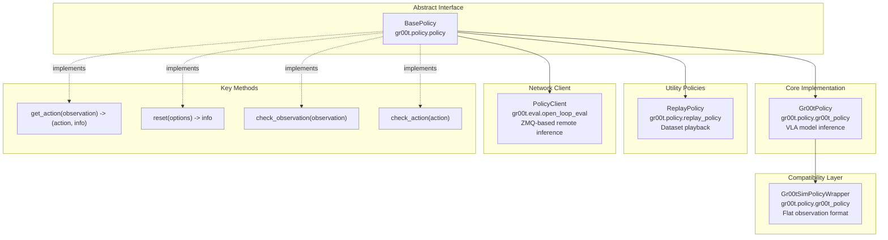
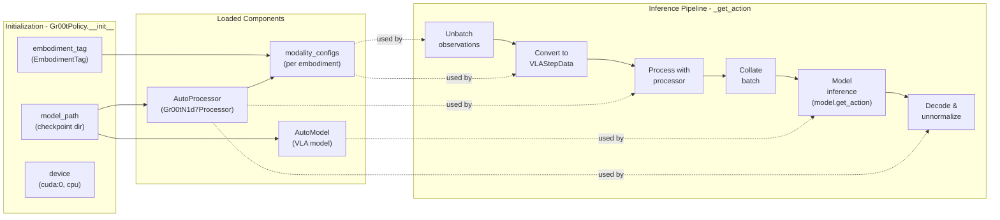
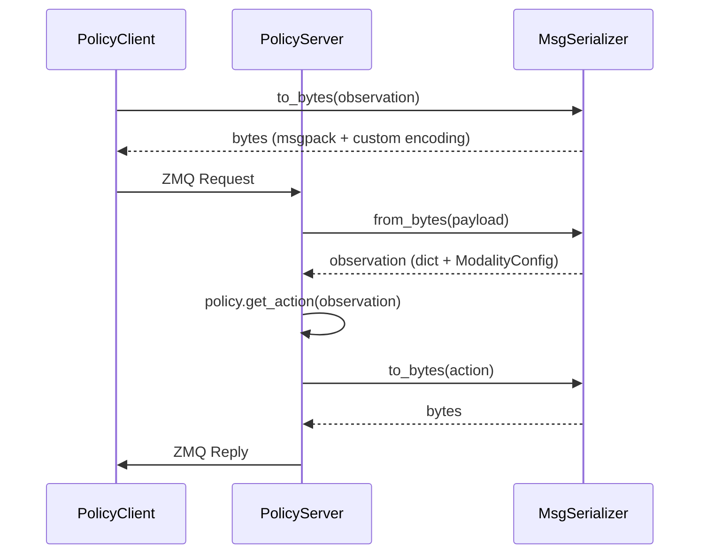

<!-- source: DeepWiki mcp.deepwiki.com · repo NVIDIA/Isaac-GR00T · page 4.5 Gr00tPolicy Interface · fetched 2026-10-26 -->

# Gr00tPolicy Interface

<details>
<summary>Relevant source files</summary>

The following files were used as context for generating this wiki page:

- [gr00t/eval/open_loop_eval.py](gr00t/eval/open_loop_eval.py)
- [gr00t/policy/replay_policy.py](gr00t/policy/replay_policy.py)
- [gr00t/policy/server_client.py](gr00t/policy/server_client.py)
- [tests/gr00t/policy/test_gr00t_policy.py](tests/gr00t/policy/test_gr00t_policy.py)

</details>


This page documents the `Gr00tPolicy` class and related policy interfaces used for model inference in the GR00T N1.7 system. The policy interface provides the primary API for loading trained models and generating robot actions from observations, supporting both local inference and remote server-client architectures.

---

## Policy Interface Architecture

The GR00T policy system is built on an abstract base class that defines a standard interface for all policies. This enables consistent usage patterns across different policy implementations, including the core VLA inference, simulation wrappers, and replay policies.

### Policy Class Hierarchy

"The following diagram illustrates the relationship between the base policy abstractions and their concrete implementations."



**Sources**: [gr00t/policy/policy.py:16-132](), [gr00t/policy/gr00t_policy.py:61-418](), [gr00t/policy/replay_policy.py:33-114](), [gr00t/eval/open_loop_eval.py:31-31]()

The policy interface follows a consistent pattern:

| Component | File Location | Purpose |
|-----------|---------------|---------|
| `BasePolicy` | [gr00t/policy/policy.py:16-132]() | Abstract interface defining the policy contract and validation logic. |
| `Gr00tPolicy` | [gr00t/policy/gr00t_policy.py:61-418]() | Main policy implementation for N1.7 VLA model inference. |
| `Gr00tSimPolicyWrapper` | [gr00t/policy/gr00t_policy.py:420-673]() | Wrapper for compatibility with Gr00t simulation environments (flat observation format). |
| `ReplayPolicy` | [gr00t/policy/replay_policy.py:33-114]() | Policy that replays recorded actions from a LeRobot-style dataset for debugging/validation. |
| `PolicyClient` | [gr00t/eval/open_loop_eval.py:31-31]() | Network client for remote inference via ZMQ. |

---

## Gr00tPolicy Class

The `Gr00tPolicy` class is the primary implementation for running inference with trained GR00T N1.7 models. It loads a pretrained model checkpoint, handles device placement, and manages the processor pipeline.

### Gr00tPolicy Data Flow

"This diagram maps the inference process from input observations to the neural network execution."



**Sources**: [gr00t/policy/gr00t_policy.py:61-418]()

### Initialization and Tag Resolution

The `Gr00tPolicy` constructor loads the model and processor, then validates that the provided `EmbodimentTag` is supported by the specific checkpoint.

```python
# From gr00t/policy/gr00t_policy.py
policy = Gr00tPolicy(
    embodiment_tag=EmbodimentTag.LIBERO_PANDA,
    model_path="nvidia/GR00T-N1.7-3B",
    device="cuda:0",
    strict=True
)
```

**Key initialization steps**:
1. **Model Loading**: Loads model using `AutoModel.from_pretrained()` and sets to `bfloat16` precision [gr00t/policy/gr00t_policy.py:100-103]().
2. **Processor Loading**: Loads the processor (typically `Gr00tN1d7Processor`) from the model directory or a `processor/` subdirectory [gr00t/policy/gr00t_policy.py:109-116]().
3. **Tag Validation**: Checks if the `embodiment_tag` exists in the checkpoint's modality configuration [gr00t/policy/gr00t_policy.py:121-151]().
4. **Modality Extraction**: Extracts specific configs for video, state, and action for the resolved embodiment [gr00t/policy/gr00t_policy.py:152-156]().

**Sources**: [gr00t/policy/gr00t_policy.py:74-167]()

---

### Observation and Action Formats

`Gr00tPolicy` expects observations in a nested dictionary format. This format allows for multiple sensors (e.g., multiple cameras or state groups) per modality.

#### Observation Format
```python
observation = {
    "video": {
        "camera_name": np.ndarray[np.uint8, (B, T, H, W, C)]
    },
    "state": {
        "state_name": np.ndarray[np.float32, (B, T, D)]
    },
    "language": {
        "language_key": list[list[str]]  # (B, T)
    }
}
```
- **B**: Batch size.
- **T**: Temporal horizon (number of frames/steps).
- **H, W, C**: Image dimensions and channels (RGB).
- **D**: State dimension.

**Sources**: [gr00t/policy/gr00t_policy.py:169-231](), [gr00t/policy/replay_policy.py:132-145]()

#### Action Format
The policy returns a dictionary where each key matches an action modality defined in the `ModalityConfig`.
- **Shape**: `(B, T_action, D_action)`
- **T_action**: The prediction horizon (e.g., 16 or 50 steps depending on embodiment).

**Sources**: [gr00t/policy/gr00t_policy.py:360-403](), [gr00t/policy/replay_policy.py:48-52]()

---

### Inference Pipeline

The `_get_action` method implements the core inference flow, bridging the raw observation inputs to the model's tensor inputs.

1. **Unbatching**: Observations are split into individual samples for processing [gr00t/policy/gr00t_policy.py:104-125]().
2. **Step Data Conversion**: Each sample is converted into a `VLAStepData` object [gr00t/policy/gr00t_policy.py:127-142]().
3. **Processor Call**: The processor transforms raw images and states into normalized tensors [gr00t/policy/gr00t_policy.py:335]().
4. **Collation**: Processed samples are collated back into a batch [gr00t/policy/gr00t_policy.py:338]().
5. **Dtype Conversion**: Floating point tensors are converted to `bfloat16` to match the model weights [gr00t/policy/gr00t_policy.py:339]().
6. **Model Execution**: `model.get_action()` is called, triggering the flow matching/diffusion denoising process [gr00t/policy/gr00t_policy.py:342-344]().
7. **Decoding**: The model's normalized output is decoded back into the robot's action space via `processor.decode_action()` [gr00t/policy/gr00t_policy.py:350-352]().

**Sources**: [gr00t/policy/gr00t_policy.py:306-358]()

---

## Simulation and Compatibility Layers

### Gr00tSimPolicyWrapper
The `Gr00tSimPolicyWrapper` acts as a translation layer for simulation environments that use flat observation keys (e.g., `video.image` instead of nested dictionaries).

- **Input Translation**: Maps flat keys from the environment to the nested structure required by `Gr00tPolicy` [gr00t/policy/gr00t_policy.py:562-617]().
- **Output Translation**: Maps nested action outputs back to flat keys (e.g., `action.joint_position`) [gr00t/policy/gr00t_policy.py:619-637]().
- **Legacy Support**: Handles mapping between `task` and `annotation.human.task_description` to support various dataset versions [gr00t/policy/gr00t_policy.py:540-542]().

**Sources**: [gr00t/policy/gr00t_policy.py:420-673]()

### ReplayPolicy
The `ReplayPolicy` allows for deterministic testing by playing back actions directly from a LeRobot-style dataset while still performing the same observation validation as the live model.

- **Initialization**: Loads an episode using `LeRobotEpisodeLoader` [gr00t/policy/replay_policy.py:98-103]().
- **Action Preloading**: Extracts all actions from the episode for efficient access during the rollout [gr00t/policy/replay_policy.py:115-131]().
- **Validation**: Implements `check_observation` to ensure the simulation environment provides data matching the dataset's configuration [gr00t/policy/replay_policy.py:132-157]().

**Sources**: [gr00t/policy/replay_policy.py:33-200]()

---

## Remote Inference Server

The `PolicyServer` class wraps a `BasePolicy` (typically `Gr00tPolicy`) to provide inference over a network using ZeroMQ.

### Server-Client Serialization

"This diagram shows how complex objects like ModalityConfig and NumPy arrays are serialized for network transport."



**Sources**: [gr00t/policy/server_client.py:33-170]()

- **MsgSerializer**: A specialized serializer using `msgpack` and `msgpack_numpy` with strict safety boundaries [gr00t/policy/server_client.py:33-45]().
- **Safety Boundaries**: Explicitly refuses to decode `object-dtype` ndarrays to prevent arbitrary code execution via pickle [gr00t/policy/server_client.py:65-72](), [gr00t/policy/server_client.py:95-102]().
- **Custom Encoders**: Handles `ModalityConfig` by converting to/from JSON within the msgpack stream [gr00t/policy/server_client.py:106-136]().

**Sources**: [gr00t/policy/server_client.py:33-170]()

---

## Policy Validation

The `BasePolicy` provides a `strict` mode that enforces data integrity checks before and after inference.

| Method | Validation Checks |
|--------|-------------------|
| `check_observation` | Validates that all required video/state keys are present, dtypes are correct (`uint8` for video, `float32` for state), and temporal horizons match the config [gr00t/policy/gr00t_policy.py:169-304](), [gr00t/policy/replay_policy.py:126-157](). |
| `check_action` | Validates that the model output contains all expected action keys and matches the required output dimensions [gr00t/policy/gr00t_policy.py:360-403](). |

**Sources**: [gr00t/policy/policy.py:70-132](), [gr00t/policy/gr00t_policy.py:169-403](), [gr00t/policy/replay_policy.py:126-157]()

---

