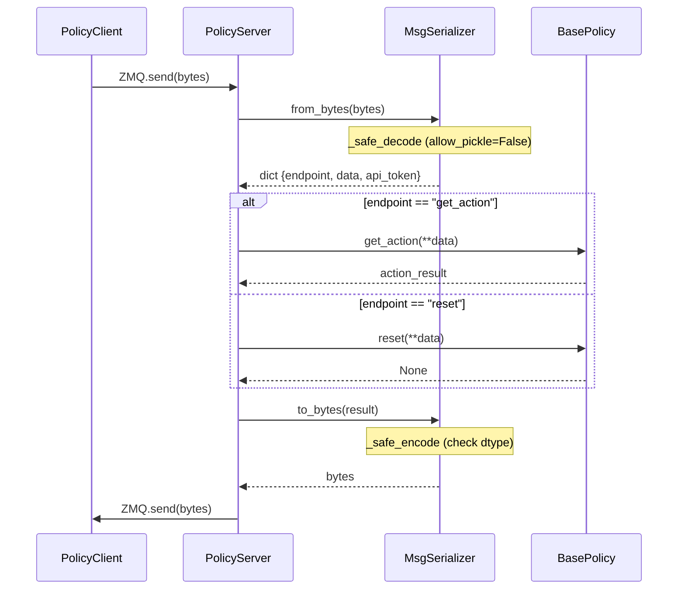

<!-- source: DeepWiki mcp.deepwiki.com · repo NVIDIA/Isaac-GR00T · page 5.1 Policy Server Architecture · fetched 2026-10-26 -->

# Policy Server Architecture

<details>
<summary>Relevant source files</summary>

The following files were used as context for generating this wiki page:

- [gr00t/eval/open_loop_eval.py](gr00t/eval/open_loop_eval.py)
- [gr00t/eval/run_gr00t_server.py](gr00t/eval/run_gr00t_server.py)
- [gr00t/policy/server_client.py](gr00t/policy/server_client.py)

</details>


## Purpose and Scope

This document describes the architecture of the GR00T policy server system, which enables remote inference by exposing trained models through a high-performance ZeroMQ (ZMQ) interface. The server-client architecture decouples model execution from environment interaction, allowing compute-intensive VLA models to run on powerful GPU hardware while clients (such as robot controllers or simulators) consume actions over a network.

For instructions on starting and configuring a server instance, see [Starting an Inference Server](5.2). For details on implementing client code, see [Client Integration](5.3).

## Architecture Overview

The policy server system follows a Request-Reply pattern using **ZeroMQ (ZMQ)**. Unlike standard REST APIs, this implementation uses a binary serialization protocol (**MessagePack**) to minimize latency and overhead when transmitting high-dimensional sensor data like video frames and robot states.

The following diagram maps the logical architecture to the specific code entities responsible for execution:

**Figure 1: System Component Mapping**
```mermaid
graph TB
    subgraph "Server Process (GPU Host)"
        Entry["run_gr00t_server.py"]
        ServerClass["PolicyServer [gr00t/policy/server_client.py]"]
        
        subgraph "Policy Implementation"
            BasePol["BasePolicy [gr00t/policy/policy.py]"]
            Gr00tPol["Gr00tPolicy [gr00t/policy/gr00t_policy.py]"]
            ReplayPol["ReplayPolicy [gr00t/policy/replay_policy.py]"]
        end
        
        ZMQ_REP["ZMQ.REP Socket<br/>(port: 5555)"]
        Serializer["MsgSerializer [gr00t/policy/server_client.py]"]
        
        Entry --> ServerClass
        ServerClass --> ZMQ_REP
        ServerClass --> Serializer
        ServerClass --> Gr00tPol
        ServerClass --> ReplayPol
        Gr00tPol --|> BasePol
        ReplayPol --|> BasePol
    end
    
    subgraph "Client Process (Robot/Sim)"
        ClientClass["PolicyClient [gr00t/policy/server_client.py]"]
        ZMQ_REQ["ZMQ.REQ Socket"]
    end
    
    ZMQ_REQ <== "ZMQ TCP Protocol (MsgPack)" ==> ZMQ_REP
```
**Sources:** [gr00t/policy/server_client.py:145-170](), [gr00t/eval/run_gr00t_server.py:91-174]()

## Server Components

### Entrypoint: run_gr00t_server.py
The script `run_gr00t_server.py` is the primary entrypoint for deploying a policy. It uses `tyro` to parse `ServerConfig` and instantiates the appropriate policy backend based on the provided arguments.

| Configuration Field | Code Entity | Description |
|:---|:---|:---|
| `model_path` | `ServerConfig.model_path` | Path to the model checkpoint. If provided, starts `Gr00tPolicy`. [gr00t/eval/run_gr00t_server.py:58-59]() |
| `dataset_path` | `ServerConfig.dataset_path` | Path to a LeRobot dataset. If provided, starts `ReplayPolicy`. [gr00t/eval/run_gr00t_server.py:68-69]() |
| `embodiment_tag` | `EmbodimentTag` | Resolves the robot type to load correct modality configs. [gr00t/eval/run_gr00t_server.py:92-92]() |
| `use_sim_policy_wrapper` | `Gr00tSimPolicyWrapper` | Wraps the policy for compatibility with simulation environments. [gr00t/eval/run_gr00t_server.py:162-165]() |

**Sources:** [gr00t/eval/run_gr00t_server.py:54-90](), [gr00t/eval/run_gr00t_server.py:101-157]()

### The PolicyServer Class
The `PolicyServer` class manages the ZMQ lifecycle. It binds a `zmq.REP` socket to the specified host and port and enters a listening loop.

*   **Socket Initialization**: The constructor creates a `zmq.Context` and binds a `zmq.REP` socket to `tcp://{host}:{port}`. [gr00t/policy/server_client.py:167-169]()
*   **Endpoint Registration**: The server uses a registry pattern via `_endpoints`, mapping string keys to `EndpointHandler` objects. [gr00t/policy/server_client.py:140-143](), [gr00t/policy/server_client.py:170-170]()
*   **Linger Behavior**: The server implements a bounded linger (`_CLOSE_LINGER_MS = 1000`) to ensure pending replies are flushed before the port is released. [gr00t/policy/server_client.py:153-153]()

**Sources:** [gr00t/policy/server_client.py:145-170]()

## Message Serialization and Protocol

To handle complex Python objects and large numpy arrays efficiently, the system uses a custom `MsgSerializer` built on top of `msgpack`.

### Serialization Logic
The `MsgSerializer` handles the conversion between Python objects and bytes while enforcing a strict `allow_pickle=False` policy for security. [gr00t/policy/server_client.py:33-45]()

1.  **Numpy Arrays**: The serializer uses `msgpack_numpy` but wraps it with `_safe_encode` and `_safe_decode`. It explicitly refuses `object-dtype` ndarrays to prevent arbitrary code execution via `pickle`. [gr00t/policy/server_client.py:60-72](), [gr00t/policy/server_client.py:95-102]()
2.  **ModalityConfig**: Custom hooks `_encode_custom` and `_decode_custom` handle the serialization of `ModalityConfig` objects to and from JSON-serializable dictionaries. [gr00t/policy/server_client.py:106-136]()

### Data Flow Diagram
The following diagram illustrates the serialization and routing logic within the server's processing pipeline.

**Figure 2: Server Request Processing Flow**

**Sources:** [gr00t/policy/server_client.py:47-57](), [gr00t/policy/server_client.py:60-103]()

## Policy Client

The `PolicyClient` (referenced in `open_loop_eval.py`) allows remote scripts to interact with the server as if it were a local policy. [gr00t/eval/open_loop_eval.py:31-31]()

*   **Usage in Evaluation**: In `open_loop_eval.py`, if a `model_path` is not provided, the system defaults to using a `PolicyClient` to communicate with a running server. [gr00t/eval/open_loop_eval.py:40-46]()
*   **Observation Parsing**: Clients are responsible for formatting observations using `parse_observation_gr00t` before sending them to the server's `get_action` endpoint. [gr00t/eval/open_loop_eval.py:181-182]()

**Sources:** [gr00t/eval/open_loop_eval.py:27-31](), [gr00t/eval/open_loop_eval.py:181-183]()

## Supported Endpoints

The server architecture supports a flexible endpoint system defined by the `EndpointHandler` dataclass. [gr00t/policy/server_client.py:139-143]()

| Endpoint | Handler Logic | Input Requirement |
|:---|:---|:---|
| `get_action` | Calls `policy.get_action` | `requires_input=True` |
| `reset` | Calls `policy.reset` | `requires_input=True` |
| `ping` | Internal status check | `requires_input=False` |
| `get_modality_config` | Returns policy config | `requires_input=False` |

**Sources:** [gr00t/policy/server_client.py:140-143](), [gr00t/eval/run_gr00t_server.py:167-171]()

---

