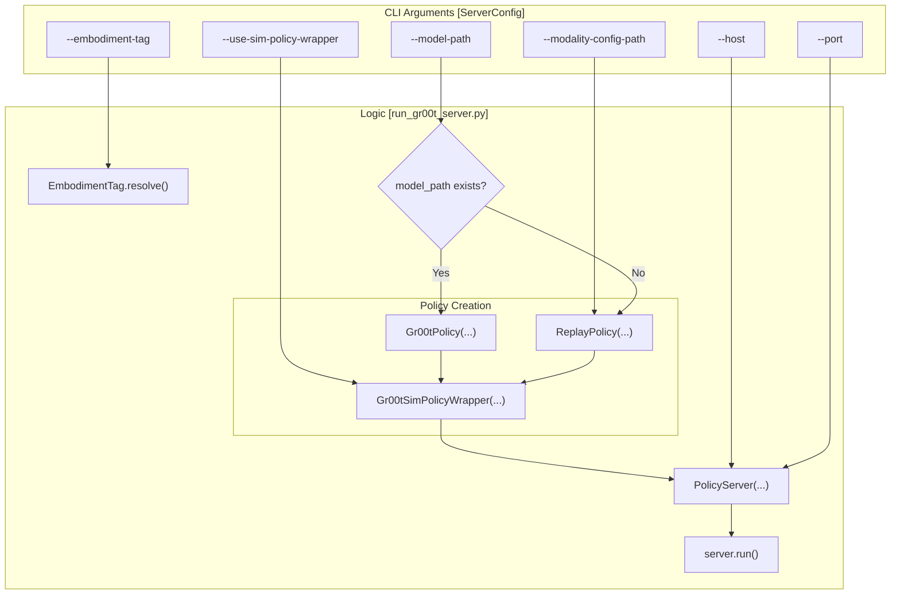
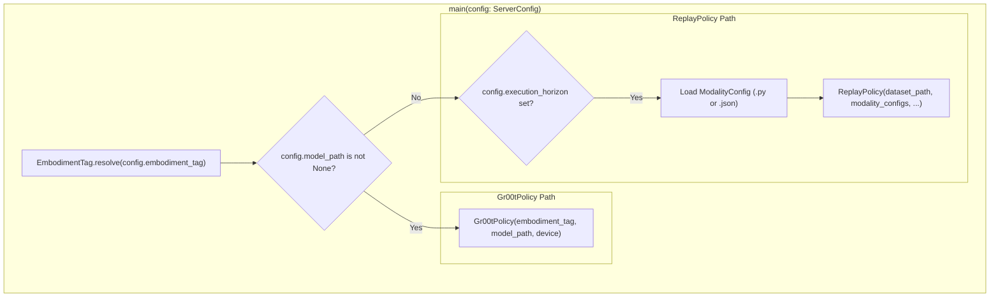

<!-- source: DeepWiki mcp.deepwiki.com · repo NVIDIA/Isaac-GR00T · page 5.2 Starting an Inference Server · fetched 2026-10-26 -->

# Starting an Inference Server

<details>
<summary>Relevant source files</summary>

The following files were used as context for generating this wiki page:

- [gr00t/eval/run_gr00t_server.py](gr00t/eval/run_gr00t_server.py)
- [gr00t/policy/__init__.py](gr00t/policy/__init__.py)
- [tests/conftest.py](tests/conftest.py)
- [tests/getting_started/test_real_world_deployment_md.py](tests/getting_started/test_real_world_deployment_md.py)

</details>


This page provides step-by-step instructions for launching the GR00T inference server using `run_gr00t_server.py`. It covers command-line arguments, checkpoint loading options, and configuration for both simulation and real-world deployment.

**Scope:** This page focuses on starting the server process. For architectural details about the communication protocol, see [Policy Server Architecture](5.1). For connecting clients to the running server, see [Client Integration](5.3).

---

## Server Script Overview

The inference server is launched using the `run_gr00t_server.py` script. This script acts as the primary entry point for deploying GR00T N1.7 models, providing a network-accessible interface for policy inference.

**Primary Script:** [gr00t/eval/run_gr00t_server.py:1-180]()

The server supports two main policy backends:
1. **`Gr00tPolicy`**: Runs neural network inference using the Qwen3-VL backbone and DiT action head [gr00t/eval/run_gr00t_server.py:105-110]().
2. **`ReplayPolicy`**: Replays recorded actions from a dataset, which is essential for verifying data pipelines and environment synchronization [gr00t/eval/run_gr00t_server.py:152-157]().

### Launch Configuration Mapping

The following diagram maps command-line arguments to the internal code entities and initialization flow:


**Sources:** [gr00t/eval/run_gr00t_server.py:54-89](), [gr00t/eval/run_gr00t_server.py:91-171]()

---

## Basic Server Launch

### Minimal Example (HuggingFace Model)
To launch a server using a pre-trained model from HuggingFace for a specific embodiment:

```bash
uv run python gr00t/eval/run_gr00t_server.py \
    --model-path nvidia/GR00T-N1.7-SimplerEnv-Fractal \
    --embodiment-tag SIMPLER_ENV_GOOGLE \
    --use-sim-policy-wrapper
```

### Parameters Explained

| Parameter | Type | Default | Description |
|-----------|------|---------|-------------|
| `--model-path` | `str` | `None` | Path to checkpoint directory or HF repo ID [gr00t/eval/run_gr00t_server.py:58-59](). |
| `--embodiment-tag` | `str` | `new_embodiment` | Tag resolved via `EmbodimentTag` [gr00t/eval/run_gr00t_server.py:61-62](). |
| `--use-sim-policy-wrapper`| `bool` | `False` | Wraps policy for simulation compatibility [gr00t/eval/run_gr00t_server.py:87-88](). |
| `--host` | `str` | `0.0.0.0` | Network interface to bind to [gr00t/eval/run_gr00t_server.py:78-79](). |
| `--port` | `int` | `5555` | ZMQ/Network port [gr00t/eval/run_gr00t_server.py:81-82](). |
| `--device` | `str` | `cuda` | Hardware device for inference [gr00t/eval/run_gr00t_server.py:64-65](). |

**Sources:** [gr00t/eval/run_gr00t_server.py:54-89]()

---

## Common Deployment Scenarios

### 1. SimplerEnv Evaluation
For evaluation in simulation, the `Gr00tSimPolicyWrapper` is required to ensure the policy correctly interprets the simulation's observation space.

```bash
uv run python gr00t/eval/run_gr00t_server.py \
    --model-path nvidia/GR00T-N1.7-SimplerEnv-Bridge \
    --embodiment-tag SIMPLER_ENV_WIDOWX \
    --use-sim-policy-wrapper
```
**Sources:** [gr00t/eval/run_gr00t_server.py:162-165]()

### 2. Real Robot (SO-100)
When deploying to a custom robot like SO-100, the `new_embodiment` tag is often used with a locally fine-tuned checkpoint.

```bash
uv run python gr00t/eval/run_gr00t_server.py \
  --model-path /tmp/so100_finetune/checkpoint-10000 \
  --embodiment-tag new_embodiment 
```
**Sources:** [gr00t/eval/run_gr00t_server.py:61-62](), [gr00t/eval/run_gr00t_server.py:105-110]()

---

## Policy Initialization Logic

The server determines which policy class to instantiate based on the provided arguments in `ServerConfig`.

### Gr00tPolicy vs. ReplayPolicy Flow


**Sources:** [gr00t/eval/run_gr00t_server.py:91-157]()

### Modality Configuration for Replay
If starting a `ReplayPolicy` server (using `--dataset-path`), you must provide a modality configuration. The script supports:
- **Python Files (.py)**: The file is imported, and its side effects (calling `register_modality_config`) are used to populate the registry [gr00t/eval/run_gr00t_server.py:125-131]().
- **JSON Files (.json)**: Parsed directly into `ModalityConfig` instances via `_load_json_modality_configs` [gr00t/eval/run_gr00t_server.py:132-133]().
- **Built-in Registry**: If no path is provided, it attempts to look up the configuration using the `embodiment_tag` in the global `MODALITY_CONFIGS` registry [gr00t/eval/run_gr00t_server.py:141-143]().

---

## Server Execution

Once the policy is initialized, the script creates a `PolicyServer` instance within a context manager.

```python
with PolicyServer(
    policy=policy,
    host=config.host,
    port=config.port,
) as server:
    server.run()
```
**Sources:** [gr00t/eval/run_gr00t_server.py:167-173]()

### Startup Verification
When the server starts successfully, it prints the configuration:
```text
Starting GR00T inference server...
  Embodiment tag: EmbodimentTag.SIMPLER_ENV_GOOGLE
  Model path: nvidia/GR00T-N1.7-SimplerEnv-Fractal
  Device: cuda
  Host: 0.0.0.0
  Port: 5555
```
**Sources:** [gr00t/eval/run_gr00t_server.py:93-98]()

---

