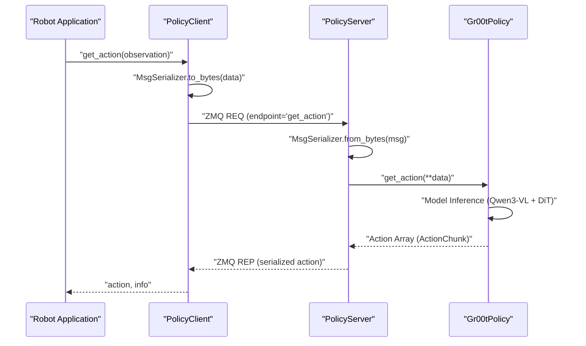
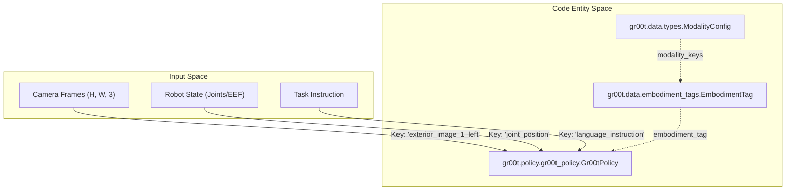

<!-- source: DeepWiki mcp.deepwiki.com · repo NVIDIA/Isaac-GR00T · page 5.3 Client Integration · fetched 2026-10-26 -->

# Client Integration

Relevant source files

The following files were used as context for generating this wiki page:

- [examples/DROID/server_client.py](examples/DROID/server_client.py)
- [examples/DROID/utils.py](examples/DROID/utils.py)
- [gr00t/configs/data/embodiment_configs.py](gr00t/configs/data/embodiment_configs.py)
- [gr00t/data/embodiment_tags.py](gr00t/data/embodiment_tags.py)
- [gr00t/eval/open_loop_eval.py](gr00t/eval/open_loop_eval.py)
- [gr00t/policy/gr00t_policy.py](gr00t/policy/gr00t_policy.py)
- [gr00t/policy/server_client.py](gr00t/policy/server_client.py)

## Purpose and Scope

This document explains how to integrate GR00T policies into robotic environments using the `PolicyClient` class. The client acts as the interface between a robot controller or simulation environment and the remote `PolicyServer` hosting the GR00T model. This page details the implementation of client-side logic, including connection management, observation formatting, action handling, and integration with real-world platforms like DROID.

For information about starting and configuring the policy server, see [Starting an Inference Server](#5.2). For the overall server-client architecture design, see [Policy Server Architecture](#5.1).

---

## PolicyClient Implementation

The `PolicyClient` class ([gr00t/policy/server_client.py:172-248]()) inherits from `BasePolicy` and provides a synchronous interface to communicate with a `PolicyServer` via ZeroMQ. It abstracts the serialization of multimodal data and the request-response cycle.

### Key Components

- **ZeroMQ Socket**: Uses a `zmq.REQ` (Request) socket to send commands to the server ([gr00t/policy/server_client.py:168-169]()).
- **Message Serialization**: Utilizes `MsgSerializer` to pack data into `msgpack` format. In the main codebase, this includes specialized guards against arbitrary code execution by refusing object-dtype ndarrays that would trigger `pickle.loads` ([gr00t/policy/server_client.py:33-103]()).
- **Endpoint Handling**: Methods like `get_action`, `reset`, and `ping` wrap calls to the server-side `EndpointHandler` ([gr00t/policy/server_client.py:140-142]()) via the ZMQ request-reply pattern.

**Key Class Reference:**

| **Class** | **Role** | **Source** |
|-----------|----------|------------|
| `PolicyClient` | Synchronous client for model inference | [gr00t/policy/server_client.py:172]() |
| `MsgSerializer` | Handles binary serialization for ZMQ with security guards | [gr00t/policy/server_client.py:33]() |
| `ModalityConfig` | Defines expected input/output keys and sampling indices | [gr00t/data/types.py:32]() |
| `PolicyServer` | ZMQ server hosting the `BasePolicy` implementation | [gr00t/policy/server_client.py:145]() |

Sources: [gr00t/policy/server_client.py:33-170](), [gr00t/policy/gr00t_policy.py:70-167]()

---

## Client-Server Data Flow

The following diagram illustrates how the `PolicyClient` interacts with the `PolicyServer` and the underlying `Gr00tPolicy`.

### Communication Sequence

**Endpoint Registry:**
The `PolicyServer` uses `EndpointHandler` to manage callable routes ([gr00t/policy/server_client.py:140-142]()). By default, it supports:
- `ping`: Health check.
- `get_action`: Triggers model inference via `self.policy.get_action` ([gr00t/policy/server_client.py:162]()).
- `reset`: Resets policy state/buffers.
- `get_modality_config`: Returns the embodiment's configuration mapping.

Sources: [gr00t/policy/server_client.py:140-170](), [gr00t/policy/gr00t_policy.py:70-126]()

---

## Observation Formatting

To receive valid actions, the client must provide observations matching the `ModalityConfig` of the active `EmbodimentTag` ([gr00t/data/embodiment_tags.py:29]()).

### Mapping Observations to Code Entities

### Observation Structure Example (DROID)
For the `OXE_DROID_RELATIVE_EEF_RELATIVE_JOINT` tag ([gr00t/data/embodiment_tags.py:60]()), the expected observation dictionary includes:

- **Video**: `exterior_image_1_left` and `wrist_image_left` ([gr00t/configs/data/embodiment_configs.py:31]()).
- **State**: `eef_9d`, `gripper_position`, and `joint_position` ([gr00t/configs/data/embodiment_configs.py:35]()).
- **Language**: `annotation.language.language_instruction` ([gr00t/configs/data/embodiment_configs.py:63]()).

In evaluation scripts, `parse_observation_gr00t` is used to align these keys with the model's expected format ([gr00t/eval/open_loop_eval.py:181]()).

Sources: [gr00t/configs/data/embodiment_configs.py:28-65](), [gr00t/data/embodiment_tags.py:57-144](), [gr00t/eval/open_loop_eval.py:171-184]()

---

## Integration Example: DROID Robot

The DROID integration provides a reference for real-world deployment. The example client uses a custom `MsgSerializer` that handles `ModalityConfig` and `numpy` arrays ([examples/DROID/server_client.py:144-172]()).

### Key Integration Steps

1. **Client Initialization**: Connects to the server and retrieves `ModalityConfig` to determine `delta_indices` for history ([examples/DROID/server_client.py:108-115]()).
2. **Frame Preprocessing**: Images are resized using `resize_with_pad` to maintain aspect ratio with zero padding ([examples/DROID/utils.py:34-59]()).
3. **Action Handling**: The model returns an action chunk. In open-loop evaluation, the `execution_horizon` determines how many steps of the chunk are used before the next inference ([gr00t/eval/open_loop_eval.py:143-171]()).
4. **Data Types**: The `convert_to_uint8` utility is used to reduce network payload size for image transmission ([examples/DROID/utils.py:24-31]()).

### Action Configuration
The DROID embodiment uses a mix of relative and absolute actions:
- **EEF**: `ActionRepresentation.RELATIVE` in `XYZ_ROT6D` format ([gr00t/configs/data/embodiment_configs.py:42-44]()).
- **Gripper**: `ActionRepresentation.ABSOLUTE` ([gr00t/configs/data/embodiment_configs.py:48]()).
- **Joints**: `ActionRepresentation.RELATIVE` ([gr00t/configs/data/embodiment_configs.py:54]()).

Sources: [examples/DROID/server_client.py:144-172](), [examples/DROID/utils.py:24-81](), [gr00t/configs/data/embodiment_configs.py:37-60]()

---

## Connection and State Management

### Health Checks and Resets
Before starting a rollout, the client should verify connectivity and reset the policy state:
- **Ping**: The `PolicyClient` provides a `ping` method to verify the ZMQ connection.
- **Reset**: The `reset` method clears internal action buffers and recurrent states on the server ([gr00t/policy/server_client.py:165]()).

### Message Serialization Contract
The `MsgSerializer` enforces a strict contract:
- **Encoding**: Converts `ModalityConfig` to JSON-serializable dictionaries using `to_json_serializable` ([gr00t/policy/server_client.py:106-109]()).
- **Decoding**: Reconstructs `ModalityConfig` and `numpy` arrays from their tagged message markers (`__ModalityConfig__`, `__ndarray_class__`) ([gr00t/policy/server_client.py:112-136]()).
- **Security**: Specifically checks for `allow_pickle=False` when loading `numpy` arrays from bytes to prevent remote code execution ([gr00t/policy/server_client.py:75-84]()).

Sources: [gr00t/policy/server_client.py:33-136](), [gr00t/data/utils.py:28-29]()

---

