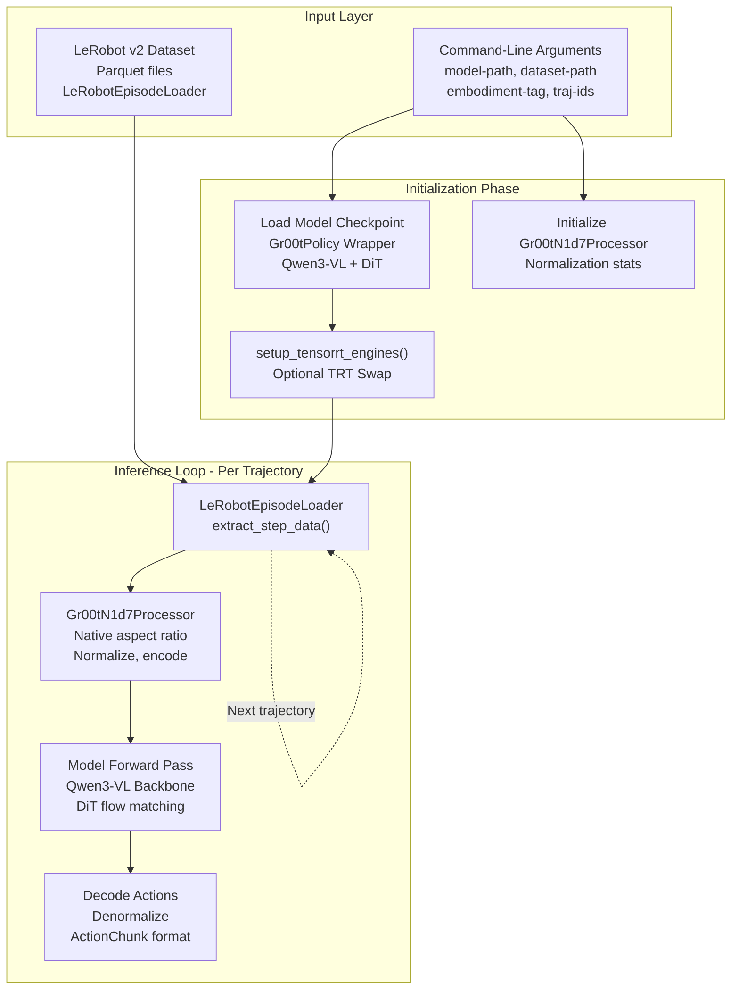
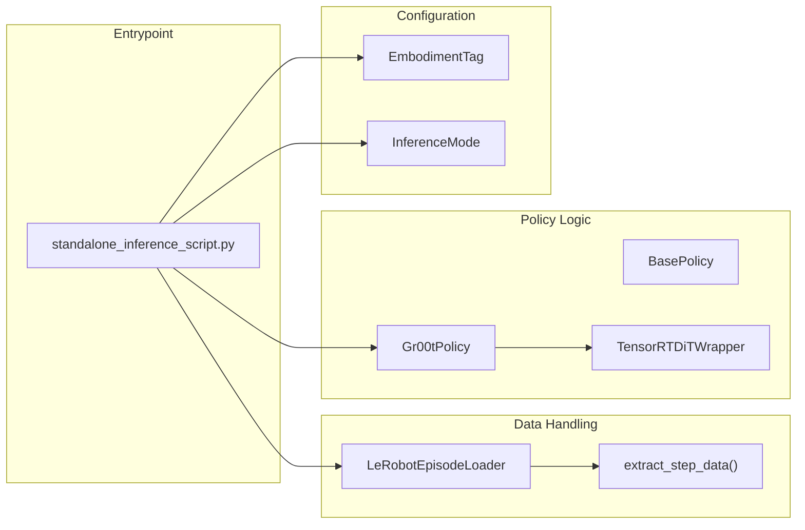

<!-- source: DeepWiki mcp.deepwiki.com · repo NVIDIA/Isaac-GR00T · page 5.4 Standalone Inference Script · fetched 2026-10-26 -->

# Standalone Inference Script

<details>
<summary>Relevant source files</summary>

The following files were used as context for generating this wiki page:

- [.gitattributes](.gitattributes)
- [gr00t/deployment/modes.py](gr00t/deployment/modes.py)
- [scripts/deployment/benchmark_inference.py](scripts/deployment/benchmark_inference.py)
- [scripts/deployment/standalone_inference_script.py](scripts/deployment/standalone_inference_script.py)

</details>


## Purpose and Scope

The standalone inference script (`scripts/deployment/standalone_inference_script.py`) provides a mechanism to run GR00T model inference directly without setting up a policy server. This script is optimized for quick model testing, benchmarking, and development workflows where you need to validate model outputs on existing datasets. It supports the N1.7 architecture (Qwen3-VL/Cosmos-Reason2-2B backbone) and offers multiple execution backends including native PyTorch and TensorRT.

For production deployment using a server-client architecture with ZMQ communication, see [5.1 Policy Server Architecture](), [5.2 Starting an Inference Server](), and [5.3 Client Integration]().

**Sources:** [scripts/deployment/standalone_inference_script.py:48-78]()

---

## Overview

The standalone inference script is a self-contained utility that loads a GR00T model, processes observations from a dataset, and generates action predictions. Unlike the server-client architecture which separates model inference (GPU server) from environment execution (client), this script executes the entire pipeline in a single process.

### Key Characteristics

| Aspect | Standalone Script | Server-Client (see [5.1]()) |
|--------|------------------|----------------------------------|
| **Process Model** | Single process | Distributed (server + client) |
| **Use Case** | Testing, benchmarking, development | Production, real robots, simulation |
| **Setup Complexity** | Minimal | Requires server startup + client connection |
| **Observation Source** | Dataset replay | Live environments or datasets |
| **Backends** | PyTorch, TRT Full Pipeline, TRT DiT-only | PyTorch, TRT Full Pipeline, TRT DiT-only |

**Sources:** [scripts/deployment/standalone_inference_script.py:48-78](), [gr00t/deployment/modes.py:89-99]()

---

## Command-Line Interface

The script accepts several command-line arguments that configure the inference process, utilizing `tyro` for argument parsing.

### Basic Invocation

```bash
python scripts/deployment/standalone_inference_script.py \
  --model-path nvidia/GR00T-N1.7-3B \
  --dataset-path demo_data/droid_sample \
  --embodiment-tag OXE_DROID_RELATIVE_EEF_RELATIVE_JOINT \
  --traj-ids 1 2 \
  --inference-mode pytorch \
  --execution-horizon 8
```

### Command-Line Arguments

| Argument | Type | Description | Example Values |
|----------|------|-------------|----------------|
| `--model-path` | str | Path or HuggingFace model ID for checkpoint | `nvidia/GR00T-N1.7-3B` |
| `--dataset-path` | str | Path to LeRobot v2 formatted dataset | `demo_data/droid_sample` |
| `--embodiment-tag` | `EmbodimentTag` | Enum identifying the robot embodiment | `LIBERO_PANDA` |
| `--traj-ids` | list[int] | Trajectory indices to process from dataset | `0 1 2` |
| `--inference-mode` | `InferenceMode` | Backend selection (PyTorch or TRT variants) | `pytorch`, `trt_full_pipeline` |
| `--execution-horizon` | int | Number of action steps to execute per inference | `8`, `16` |
| `--trt-engine-path`| str | Path to directory containing TRT engines | `./gr00t_trt_deployment/engines` |

**Sources:** [scripts/deployment/standalone_inference_script.py:53-78](), [gr00t/deployment/modes.py:89-99]()

---

## Execution Flow

The following diagram illustrates how the standalone inference script processes data and generates predictions for the N1.7 architecture:

### Standalone Inference Data Flow (N1.7)



**Sources:** [scripts/deployment/standalone_inference_script.py:30-36](), [scripts/deployment/standalone_inference_script.py:108-177](), [gr00t/deployment/modes.py:126-134]()

---

## Inference Modes

The script supports multiple inference backends defined in `InferenceMode`.

### PyTorch Mode
Uses native PyTorch execution. In N1.7, this utilizes the `Qwen3-VL` architecture for multimodal processing and the `DiT` head for action generation.

### TensorRT Modes
The script can swap PyTorch modules for TensorRT engines using `InferenceMode` flags:
*   `n17_full_pipeline`: Accelerates all components including ViT, LLM, and Action Head.
*   `dit_only`: Accelerates only the Diffusion Transformer action head.
*   `vit_llm_only`: Accelerates the VLM backbone while keeping the action head in PyTorch (useful for platforms like Spark/sm121).

**Sources:** [gr00t/deployment/modes.py:89-99](), [gr00t/deployment/modes.py:126-134](), [scripts/deployment/benchmark_inference.py:27-33]()

---

## Code Entity Mapping

The following diagram bridges the script logic to the internal classes and functions.

### Script Component Architecture



**Sources:** [scripts/deployment/standalone_inference_script.py:29-41](), [gr00t/deployment/modes.py:89-99]()

---

## Implementation Details

### Seed Management
The script includes a `set_seed` function to ensure deterministic behavior across Python, NumPy, and PyTorch, including setting `CUBLAS_WORKSPACE_CONFIG` for deterministic CUDA kernels.
[scripts/deployment/standalone_inference_script.py:85-105]()

### TensorRT DiT Wrapper
When accelerating only the DiT component, `TensorRTDiTWrapper` is used to:
1.  **Initialize**: Load the serialized engine via `trt.Runtime`. [scripts/deployment/standalone_inference_script.py:111-134]()
2.  **Input Handling**: Set input shapes for `sa_embs`, `vl_embs`, and `timestep` tensors. [scripts/deployment/standalone_inference_script.py:138-154]()
3.  **Execution**: Bind CUDA memory addresses and execute asynchronously on the current PyTorch stream. [scripts/deployment/standalone_inference_script.py:156-177]()

### Benchmarking Support
A sibling script, `scripts/deployment/benchmark_inference.py`, provides more granular timing for:
*   **Data Processing**: `VLAStepData` preparation and collation. [scripts/deployment/benchmark_inference.py:22]()
*   **Backbone**: Qwen3-VL forward pass latency. [scripts/deployment/benchmark_inference.py:23]()
*   **Action Head**: Flow-matching diffusion model latency. [scripts/deployment/benchmark_inference.py:24]()

**Sources:** [scripts/deployment/standalone_inference_script.py:108-177](), [scripts/deployment/benchmark_inference.py:18-49]()

---

