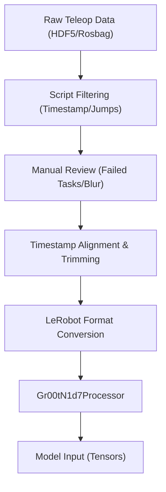
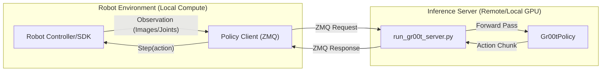

<!-- source: DeepWiki mcp.deepwiki.com · repo NVIDIA/Isaac-GR00T · page 5.5 Real-World Deployment Guide · fetched 2026-10-26 -->

# Real-World Deployment Guide

Relevant source files

The following files were used as context for generating this wiki page:

- [getting_started/real_world_deployment.md](getting_started/real_world_deployment.md)
- [gr00t/policy/__init__.py](gr00t/policy/__init__.py)
- [tests/conftest.py](tests/conftest.py)
- [tests/getting_started/test_real_world_deployment_md.py](tests/getting_started/test_real_world_deployment_md.py)

This guide covers the end-to-end workflow for deploying Isaac-GR00T N1.7 on physical robot hardware. The process spans hardware preparation, data collection, model training, and closed-loop execution using a server-client architecture.

## Deployment Workflow Overview

The real-world deployment of a Vision-Language-Action (VLA) model involves several distinct engineering phases to ensure stability and performance.

| Phase | Description |
| :--- | :--- |
| **Hardware Preparation** | Verifying sensors (wrist/third-person cameras), compute (Jetson/GPU), and robot SDKs `[getting_started/real_world_deployment.md:18-43]()`. |
| **Data Collection** | Using teleoperation (Master-Slave, VR, or UMI) to collect ~100+ episodes `[getting_started/real_world_deployment.md:45-92]()`. |
| **Preprocessing** | Filtering trajectories, aligning timestamps, and converting to LeRobot format `[getting_started/real_world_deployment.md:93-129]()`. |
| **Training** | Fine-tuning the GR00T N1.7 backbone on embodiment-specific data `[getting_started/real_world_deployment.md:12-12]()`. |
| **Deployment** | Setting up a ZMQ-based Server-Client architecture for real-time inference `[getting_started/real_world_deployment.md:14-15]()`. |

Sources: `[getting_started/real_world_deployment.md:5-17]()`, `[getting_started/real_world_deployment.md:18-43]()`, `[getting_started/real_world_deployment.md:45-92]()`, `[getting_started/real_world_deployment.md:93-129]()`.

## Hardware and Teleoperation

Successful deployment requires high-frequency action execution (30 FPS recommended) and stable real-time joint state feedback `[getting_started/real_world_deployment.md:24-28]()`. Note that 30 FPS refers to the execution and capture rate; the model inference rate can be lower (e.g., ~10 Hz) by utilizing multi-step action chunking `[getting_started/real_world_deployment.md:30-30]()`.

### Teleoperation Device Selection
The choice of teleoperation device impacts data quality and the ease of cross-embodiment transfer.

*   **Master-Slave Arms:** High operational intuition but high embodiment dependency (requires similar kinematics) `[getting_started/real_world_deployment.md:60-60]()`.
*   **UMI / Fast-UMI:** Low embodiment dependency and hardware-agnostic, making it suitable for general VLA training `[getting_started/real_world_deployment.md:61-61]()`.
*   **VR/Glove/Exoskeleton:** Flexible for complex tasks but involves higher integration overhead `[getting_started/real_world_deployment.md:62-64]()`.

### Sensor Configuration
Standard deployments utilize a multi-camera setup:
1.  **Wrist-mounted camera:** Captures close-range manipulation visuals `[getting_started/real_world_deployment.md:36-36]()`.
2.  **Third-person camera:** Captures global scene context `[getting_started/real_world_deployment.md:37-37]()`.
3.  **Proprioception:** Real-time acquisition of joint states and gripper positions `[getting_started/real_world_deployment.md:38-38]()`.

Sources: `[getting_started/real_world_deployment.md:32-38]()`, `[getting_started/real_world_deployment.md:49-65]()`.

## Data Collection and Preprocessing

Data quality is the primary driver of real-world performance. 

### Critical Collection Rules
*   **Timestamp Synchronization:** Camera streams must be strictly matched, and joint state sampling should exceed camera FPS for accurate alignment `[getting_started/real_world_deployment.md:70-74]()`.
*   **Action Representation:** For same-embodiment setups, log `Joint States`. For cross-embodiment (e.g., UMI to Piper), record task-space End-Effector (EEF) poses `[getting_started/real_world_deployment.md:76-80]()`.
*   **Scene Consistency:** In early stages, keep third-person camera extrinsics fixed and avoid varying lighting `[getting_started/real_world_deployment.md:86-90]()`.

### Preprocessing Pipeline
Raw data must be converted to the LeRobot format before it can be processed by the model pipeline `[getting_started/real_world_deployment.md:95-97]()`.

**Data Flow: Raw to Model-Ready**

Sources: `[getting_started/real_world_deployment.md:68-94]()`, `[getting_started/real_world_deployment.md:95-116]()`.

## Deployment Setup (Server-Client)

GR00T uses a ZMQ-based architecture to separate heavy model inference from the real-time robot control loop.

### Policy Server Implementation
The `PolicyServer` (typically running on a high-end GPU or Jetson Thor) hosts the `Gr00tPolicy`. It listens for observation data and returns action chunks.

**Key Components:**
*   **`Gr00tPolicy`**: Wraps the model for inference and handles the interface for action generation `[gr00t/policy/__init__.py:16-24]()`.
*   **`BasePolicy` / `PolicyWrapper`**: Provide abstractions for integrating policies into different environments or simulation frameworks `[gr00t/policy/policy.py:17-17]()`.

### Policy Client Implementation
The client (running on the robot's local compute) collects observations, sends them to the server, and executes the returned action chunk.

**Code Entity Association: System Integration**

Sources: `[gr00t/policy/__init__.py:1-24]()`, `[getting_started/real_world_deployment.md:14-16]()`.

## Closed-Loop Testing and Optimization

Once the pipeline is running, performance tuning is required to handle real-world latency and mechanical jitter.

### Quantitative Diagnostic Metrics
During validation, three key metrics are used to assess trajectory quality `[tests/getting_started/test_real_world_deployment_md.py:26-32]()`:
1.  **Intra-Acceleration (`metric_intra_accel`):** Measures the smoothness within a single generated action chunk.
2.  **Boundary Jump (`metric_boundary_jump`):** Detects discontinuities between consecutive action chunks.
3.  **Momentum Shift (`metric_momentum_shift`):** Evaluates how well the model maintains physical consistency across execution steps.

### Handling Jitter and Latency
*   **Stop-and-Go Behavior:** If inference latency exceeds the execution time of an action chunk, the robot will pause. Optimization (e.g., TensorRT) or increasing the action chunk size can mitigate this `[getting_started/real_world_deployment.md:15-16, 30-30]()`.
*   **Environment Configuration:** Test environments often use `conftest.py` to pin workers to specific GPUs to avoid memory contention during multi-process execution `[tests/conftest.py:29-58]()`.

Sources: `[getting_started/real_world_deployment.md:15-16]()`, `[tests/getting_started/test_real_world_deployment_md.py:26-48]()`, `[tests/conftest.py:29-58]()`.

---

