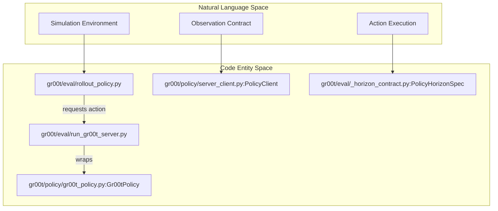
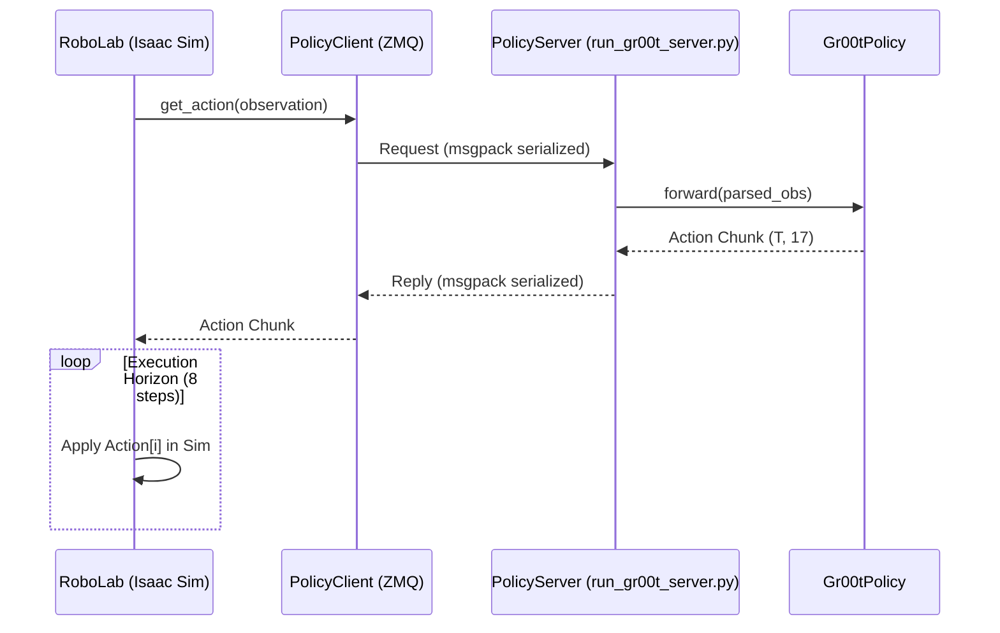

<!-- source: DeepWiki mcp.deepwiki.com · repo NVIDIA/Isaac-GR00T · page 5.6 RoboLab Integration · fetched 2026-10-26 -->

# RoboLab Integration

Relevant source files

The following files were used as context for generating this wiki page:

- [demo_data/droid_sample/meta/relative_stats.json](demo_data/droid_sample/meta/relative_stats.json)
- [demo_data/droid_sample/meta/stats.json](demo_data/droid_sample/meta/stats.json)
- [examples/DROID/README.md](examples/DROID/README.md)
- [examples/RoboLab/README.md](examples/RoboLab/README.md)
- [examples/robocasa-gr1-tabletop-tasks/README.md](examples/robocasa-gr1-tabletop-tasks/README.md)
- [examples/robocasa/README.md](examples/robocasa/README.md)
- [gr00t/eval/open_loop_eval.py](gr00t/eval/open_loop_eval.py)
- [gr00t/eval/real_robot/SO100/pyproject.toml](gr00t/eval/real_robot/SO100/pyproject.toml)
- [gr00t/policy/server_client.py](gr00t/policy/server_client.py)
- [scripts/download_droid_sample.py](scripts/download_droid_sample.py)
- [tests/gr00t/data/test_demo_dataset_stats.py](tests/gr00t/data/test_demo_dataset_stats.py)

The GR00T N1.7 framework integrates with the **RoboLab** (Isaac Sim) environment to facilitate large-scale closed-loop evaluation of vision-language-action (VLA) policies. This integration utilizes the N1.7 DROID checkpoint, allowing for zero-shot or fine-tuned evaluation across diverse household manipulation tasks within a high-fidelity simulation.

## System Architecture

The integration follows a server-client model where the GR00T inference server hosts the model, and the RoboLab environment acts as a client that provides observations and executes predicted actions.

### Data Flow and Observation Contract

RoboLab interacts with the `PolicyServer` [gr00t/policy/server_client.py:145-170]() using a specific observation contract. The server expects observations to be serialized via `MsgSerializer` [gr00t/policy/server_client.py:33-45](), which handles `numpy` arrays and `ModalityConfig` objects.

| Component | Responsibility |
| :--- | :--- |
| **RoboLab Client** | Captures Isaac Sim camera frames (180x320), retrieves robot state (EEF 9D, gripper, joints), and sends them to the server. |
| **Policy Server** | Receives observations, processes them through the `Gr00tPolicy` [gr00t/policy/gr00t_policy.py:30](), and returns an action chunk. |
| **Execution Horizon** | RoboLab executes a fixed number of steps (`--open-loop-horizon 8`) from the returned chunk before requesting a new inference [examples/RoboLab/README.md:15-24](). |

### Code Entity Mapping

The following diagram bridges the conceptual RoboLab components to the specific classes and scripts in the `Isaac-GR00T` codebase.

**RoboLab to Code Entity Mapping**

Sources: [gr00t/policy/server_client.py:145-170](), [gr00t/eval/run_gr00t_server.py:69-72](), [examples/RoboLab/README.md:11-24](), [gr00t/eval/_horizon_contract.py:28-29]()

## DROID Checkpoint Setup

RoboLab evaluation for N1.7 is validated using the `nvidia/GR00T-N1.7-DROID` checkpoint [examples/RoboLab/README.md:13-14](). This model uses the `OXE_DROID_RELATIVE_EEF_RELATIVE_JOINT` embodiment tag, which defines the following modality structure:

*   **Video:** `exterior_image_1_left` and `wrist_image_left` [examples/DROID/README.md:13]().
*   **State/Action (17D):** 9D Relative End-Effector (`eef_9d`) + 1D Absolute Gripper + 7D Relative Joints [examples/DROID/README.md:14-21]().

### Image Handling
For RoboLab, images must be provided in `HWC uint8` format at a resolution of `180x320` without letterboxing or black padding [examples/RoboLab/README.md:92](). The DROID model specifically uses the **left exterior** and **left wrist** cameras [examples/RoboLab/README.md:91]().

Sources: [examples/DROID/README.md:3-21](), [examples/RoboLab/README.md:86-92]()

## Multi-GPU Evaluation Layout

To handle the computational load of 120+ tasks and thousands of episodes, the evaluation is typically distributed across multiple GPUs using a server-client layout.

1.  **Server Side:** A single GPU (or a dedicated node) runs `run_gr00t_server.py` with the `--use-sim-policy-wrapper` flag [examples/robocasa/README.md:114-118]().
2.  **Client Side:** Multiple Isaac Sim instances (RoboLab) run `rollout_policy.py`, specifying the `--policy-client-host` and `--n-envs` to parallelize episode collection [examples/robocasa/README.md:121-130]().

**Inference Flow Diagram**

Sources: [gr00t/policy/server_client.py:48-57](), [gr00t/eval/open_loop_eval.py:181-183](), [examples/robocasa/README.md:121-130]()

## Performance and Benchmarks

The N1.7 DROID checkpoint achieves an average success rate of **8.58%** across 120 RoboLab tasks (4,800 episodes), outperforming the N1.6 reference (7.25%) [examples/RoboLab/README.md:19-22]().

### Success Highlights
Successes are concentrated in visually clear manipulation tasks:
*   **BananaOnPlateTask:** 100% (40/40)
*   **UnstackRubiksCubeTask:** 95% (38/40)
*   **SauceBottlesCrateTask:** 82.5% (33/40)

Sources: [examples/RoboLab/README.md:19-45]()

---

