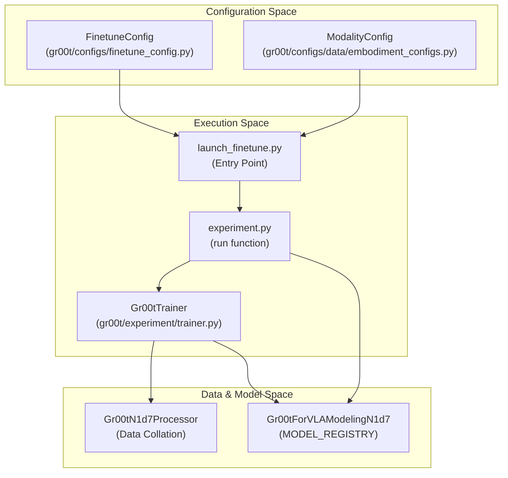
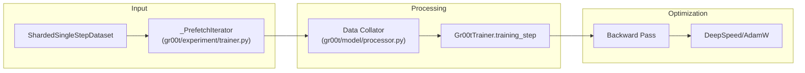

<!-- source: DeepWiki mcp.deepwiki.com · repo NVIDIA/Isaac-GR00T · page 6 Training GR00T Models · fetched 2026-10-26 -->

# Training GR00T Models

Relevant source files

The following files were used as context for generating this wiki page:

- [ATTRIBUTIONS.md](ATTRIBUTIONS.md)
- [examples/finetune.sh](examples/finetune.sh)
- [gr00t/configs/finetune_config.py](gr00t/configs/finetune_config.py)
- [gr00t/experiment/experiment.py](gr00t/experiment/experiment.py)
- [gr00t/experiment/launch_finetune.py](gr00t/experiment/launch_finetune.py)
- [gr00t/experiment/trainer.py](gr00t/experiment/trainer.py)

## Purpose and Scope

This page provides an overview of the training processes for GR00T models, specifically focusing on the N1.7 architecture (using the `Qwen3-VL/Cosmos-Reason2-2B` backbone). Training in the GR00T system occurs in two distinct phases: large-scale pre-training and task-specific fine-tuning.

**Scope of this document:**
- Distinction between pre-training and fine-tuning processes.
- Overview of the training infrastructure and the `Gr00tTrainer` lifecycle.
- High-level overview of training entry points (`launch_finetune.py`).
- Hardware infrastructure and distributed training setup.

**Related documentation:**
- [Pre-training Overview](#6.1) — Multi-embodiment data requirements and the `MODEL_REGISTRY` pipeline.
- [Fine-tuning Overview](#6.2) — The `Gr00tTrainer` lifecycle and when to fine-tune.
- [Fine-tuning Configuration](#6.3) — Detail the `FinetuneConfig` dataclass parameters.
- [Fine-tuning Examples](#6.4) — Concrete examples for SimplerEnv, SO-100, and LIBERO.
- [Distributed Training with DeepSpeed](#6.5) — Multi-GPU training and ZeRO optimization.

---

## Training Phases: Pre-training vs Fine-tuning

GR00T model development follows a two-stage training paradigm to balance general robotic intelligence with specific task precision.

### Pre-training Phase
**Purpose:** Learn general-purpose robotic manipulation skills and cross-embodiment knowledge.
- **Backbone:** N1.7 utilizes the `nvidia/Cosmos-Reason2-2B` (Qwen3-VL) model [gr00t/experiment/launch_finetune.py:100-100]().
- **Pipeline:** Managed via the `MODEL_REGISTRY`, which instantiates the appropriate model pipeline based on the configuration [gr00t/experiment/experiment.py:36-36]().
- **Outcome:** A base foundation model capable of zero-shot reasoning across various robot types.

### Fine-tuning Phase
**Purpose:** Adapt the pre-trained base model to specific robot embodiments, tasks, or environments.
- **Logic:** Handled by the `launch_finetune.py` script [gr00t/experiment/launch_finetune.py:16-17]().
- **Scope:** Typically involves unfreezing the multimodal projector and the Diffusion Transformer (DiT) action head [gr00t/configs/finetune_config.py:55-59]().
- **Data:** Requires task-specific datasets in LeRobot V2 format [gr00t/configs/finetune_config.py:36-37]().

**Sources:** [gr00t/experiment/launch_finetune.py:16-27](), [gr00t/configs/finetune_config.py:22-64](), [gr00t/experiment/experiment.py:36-36]()

---

## Training Architecture: Code to System Mapping

The training system bridges the high-level goal of "learning actions" with specific code entities that manage data flow and optimization.

**Diagram: Training System Entity Mapping**
This diagram associates natural language training concepts with the specific Python classes and scripts responsible for them.

**Sources:** [gr00t/experiment/launch_finetune.py:49-59](), [gr00t/experiment/experiment.py:34-36](), [gr00t/experiment/trainer.py:152-167]()

---

## The Training Lifecycle

The training process is orchestrated by the `run` function in `experiment.py`, which sets up the environment and initializes the `Gr00tTrainer`.

### 1. Configuration and Setup
The system validates the configuration, ensuring `global_batch_size` is divisible by the number of GPUs [gr00t/experiment/experiment.py:74-77](). It initializes distributed process groups using the NCCL backend for multi-GPU communication [gr00t/experiment/experiment.py:142-157]().

### 2. Model and Pipeline Initialization
The training script prepares the model configuration, including unfreezing flags for the LLM backbone, visual encoder, and diffusion action head [gr00t/experiment/launch_finetune.py:78-81](). It also handles specialized image preprocessing parameters like `shortest_image_edge` and `crop_fraction` [gr00t/experiment/launch_finetune.py:86-92]().

### 3. Training Execution (Gr00tTrainer)
The `Gr00tTrainer` subclass of HuggingFace's `Trainer` is used to manage the optimization loop [gr00t/experiment/trainer.py:152-152](). It includes specialized features:
- **Async Data Loading:** Utilizes `_PrefetchIterator` to sample and collate batches in a background thread to maximize GPU utilization [gr00t/experiment/trainer.py:77-91]().
- **Profiling:** The `ProfCallback` monitors step performance [gr00t/experiment/trainer.py:43-49]().
- **Accuracy Metrics:** The `_batch_accuracy` function computes token-level accuracy, specifically handling causal prediction shifts and ignoring padding/masked tokens [gr00t/experiment/trainer.py:118-149]().

**Diagram: Data Flow in Gr00tTrainer**

**Sources:** [gr00t/experiment/experiment.py:72-157](), [gr00t/experiment/trainer.py:16-28](), [gr00t/experiment/trainer.py:77-116](), [gr00t/experiment/launch_finetune.py:78-92]()

---

## Distributed Training and DeepSpeed

For multi-GPU setups, GR00T utilizes `torchrun` and DeepSpeed to manage model sharding and gradient synchronization.

- **Launch Command:** Multi-GPU training is triggered via `torchrun --nproc_per_node="$NUM_GPUS"` [examples/finetune.sh:223-223]().
- **Batch Management:** The system enforces that `global_batch_size` is divisible by `num_gpus` to ensure consistent per-device batches [gr00t/experiment/experiment.py:74-77]().
- **Callbacks:** `BestMetricCheckpointCallback` and `CheckpointFormatCallback` manage the persistence of model weights during the training run [gr00t/experiment/experiment.py:35-35]().

**Typical Fine-tuning Entry Point:**
Users typically interact with the `examples/finetune.sh` wrapper script, which handles environment variables and constructs the `launch_finetune.py` command [examples/finetune.sh:143-223]().

| Parameter | Code Reference | Description |
| :--- | :--- | :--- |
| `base_model_path` | `FinetuneConfig.base_model_path` | Path to pre-trained weights [gr00t/configs/finetune_config.py:33-34]() |
| `embodiment_tag` | `FinetuneConfig.embodiment_tag` | Target robot identifier [gr00t/configs/finetune_config.py:39-40]() |
| `tune_llm` | `FinetuneConfig.tune_llm` | Whether to unfreeze the VLM backbone [gr00t/configs/finetune_config.py:49-50]() |
| `state_dropout_prob` | `FinetuneConfig.state_dropout_prob` | Regularization for state inputs [gr00t/configs/finetune_config.py:61-64]() |

**Sources:** [examples/finetune.sh:143-223](), [gr00t/experiment/launch_finetune.py:104-120](), [gr00t/configs/finetune_config.py:32-64]()

---

