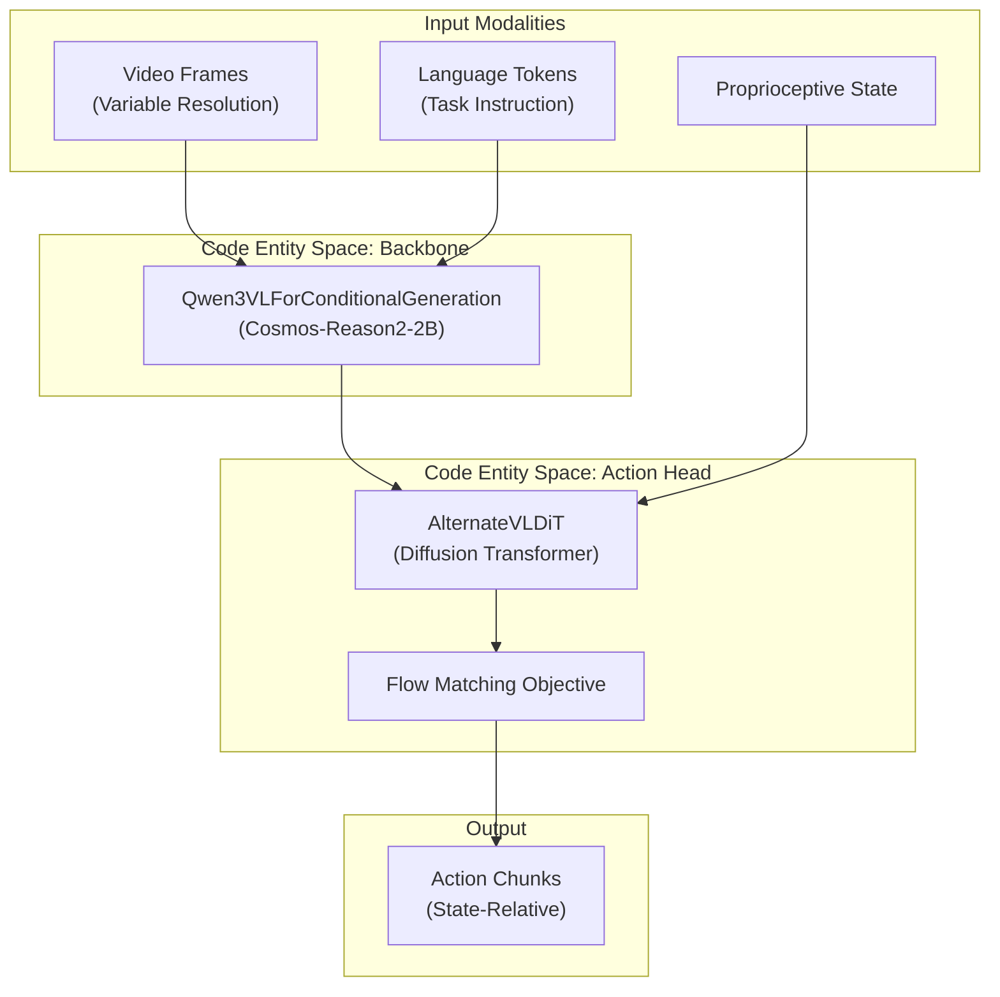
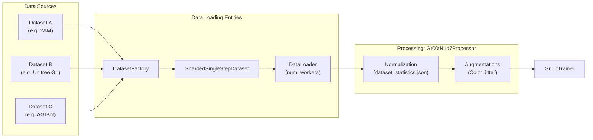

<!-- source: DeepWiki mcp.deepwiki.com · repo NVIDIA/Isaac-GR00T · page 6.1 Pre-training Overview · fetched 2026-10-26 -->

# Pre-training Overview

<details>
<summary>Relevant source files</summary>

The following files were used as context for generating this wiki page:

- [examples/finetune.sh](examples/finetune.sh)
- [gr00t/configs/finetune_config.py](gr00t/configs/finetune_config.py)
- [gr00t/experiment/experiment.py](gr00t/experiment/experiment.py)
- [gr00t/experiment/launch_finetune.py](gr00t/experiment/launch_finetune.py)
- [gr00t/model/base/model_pipeline.py](gr00t/model/base/model_pipeline.py)

</details>


## Purpose and Scope

This page explains the **pre-training process** for GR00T foundation models, which creates general-purpose base models from diverse multi-embodiment robot data. Pre-training produces checkpoints like `nvidia/Cosmos-Reason2-2B` that serve as starting points for downstream task-specific adaptation.

**Scope of this page:**
- Pre-training objectives and multi-embodiment data requirements.
- Training infrastructure and the `MODEL_REGISTRY` pipeline.
- Model architecture configuration and the `run` lifecycle in `gr00t/experiment/experiment.py` [gr00t/experiment/experiment.py:226-385]().
- Data flow from sharded datasets to the training loop.

**For related topics, see:**
- Fine-tuning pre-trained models: [Fine-tuning Overview](#6.2)
- Fine-tuning configuration: [Fine-tuning Configuration](#6.3)
- Distributed training: [Distributed Training with DeepSpeed](#6.5)

---

## What is Pre-training?

Pre-training is the initial phase where GR00T learns general robot manipulation skills from a large, diverse dataset spanning multiple robot embodiments. In N1.7, this process utilizes the **Qwen3-VL (Cosmos-Reason2-2B)** backbone combined with a **Diffusion Transformer (DiT)** action head.

**Key differences from fine-tuning in N1.7:**

| Aspect | Pre-training | Fine-tuning |
|--------|-------------|-------------|
| **Data Scale** | 10,000+ hours (multi-embodiment) | 10-100 hours (single embodiment) |
| **Backbone** | `nvidia/Cosmos-Reason2-2B` [gr00t/experiment/launch_finetune.py:100]() | Pre-trained GR00T checkpoint |
| **Training Duration** | Days to weeks | Hours to days |
| **Tunable Params** | Full model or large subsets | Typically `tune_projector` and `tune_diffusion_model` [gr00t/configs/finetune_config.py:55-58]() |
| **Output** | General-purpose base model | Task-specific checkpoint |

**Sources:** [gr00t/experiment/launch_finetune.py:78-102](), [gr00t/configs/finetune_config.py:49-61]()

---

## Pre-training Architecture and Model Registry

The pre-training process is orchestrated through a pipeline retrieved from the `MODEL_REGISTRY` [gr00t/experiment/experiment.py:36](). This registry maps configuration types to specific model training pipelines, such as the `BasicPipeline` [gr00t/model/base/model_pipeline.py:68]().

### Model Pipeline Initialization
The `run` function in `gr00t/experiment/experiment.py` initializes the training pipeline:
1. **Pipeline Retrieval**: `pipeline = MODEL_REGISTRY.get(type(config.model))(config, save_cfg_dir)` [gr00t/experiment/experiment.py:226-228]().
2. **Setup**: `pipeline.setup()` prepares the model and processor [gr00t/model/base/model_pipeline.py:79-82]().
3. **Model Access**: `model = pipeline.return_model()` [gr00t/model/base/model_pipeline.py:42-43]().

### N1.7 Pre-training Architecture

**Sources:** [gr00t/experiment/experiment.py:226-230](), [gr00t/experiment/launch_finetune.py:78-103](), [gr00t/model/base/model_pipeline.py:84-101]()

---

## Data Pipeline and Multi-Embodiment Requirements

Pre-training requires a mixture of datasets from different robots, managed via `EmbodimentTag` and `ModalityConfig`.

### Data Flow for Pre-training
The data is loaded using a sharded strategy to handle massive datasets efficiently.



### Configuration Parameters
Key data parameters defined in `FinetuneConfig` (and shared with pre-training logic):
- `shard_size`: Size of shards for preloading (default: 1024) [gr00t/configs/finetune_config.py:176]().
- `num_shards_per_epoch`: Limits memory usage by controlling active shards [gr00t/configs/finetune_config.py:182]().
- `episode_sampling_rate`: Frequency of sampling from trajectories [gr00t/configs/finetune_config.py:179]().
- `ds_weights_alpha`: Power-law exponent for dataset soup weighting [gr00t/configs/finetune_config.py:172-175]().

**Sources:** [gr00t/configs/finetune_config.py:172-182](), [gr00t/experiment/launch_finetune.py:121-124](), [gr00t/model/base/model_pipeline.py:103-121]()

---

## Training Infrastructure

### Checkpointing and Standalone Artifacts
The training system uses specialized callbacks to ensure that every saved checkpoint is "standalone," containing all necessary configuration for future inference or fine-tuning.

**Standalone Artifacts saved by `save_run_config_artifacts`:**
- `config.yaml`: The resolved OmegaConf configuration [gr00t/experiment/experiment.py:165]().
- `dataset_statistics.json`: Statistics computed by the `BasicPipeline` for action normalization [gr00t/model/base/model_pipeline.py:113-120]().

### Logging and Profiling
The `Gr00tTrainer` utilizes `ProfCallback` to profile data loading and forward pass times [gr00t/experiment/experiment.py:34](). Logging is configured to reduce verbosity for external libraries like `transformers` and `datasets` [gr00t/experiment/experiment.py:49-50]().

**Sources:** [gr00t/experiment/experiment.py:34-50](), [gr00t/experiment/experiment.py:160-165](), [gr00t/model/base/model_pipeline.py:113-120]()

---

## Launching Pre-training

While `launch_finetune.py` is the primary user-facing script, it demonstrates how to configure the underlying `run` function for large-scale training.

### Execution Flow
1. **Config Setup**: Load default config and override with experiment-specific paths [gr00t/experiment/launch_finetune.py:61-74]().
2. **Modality Registration**: Import custom Python modality configs via `load_modality_config` [gr00t/experiment/launch_finetune.py:31-41]().
3. **Distributed Init**: Initialize the NCCL process group via `_init_distributed_process_group` [gr00t/experiment/experiment.py:142-157]().
4. **Trainer Loop**: Execute `Gr00tTrainer` within the `run` function [gr00t/experiment/experiment.py:242]().

### Example Launch (Distributed)
Pre-training is typically launched via `torchrun` to utilize multiple GPUs:
```bash
exec torchrun --nproc_per_node="$NUM_GPUS" --master_port="$MASTER_PORT" \
    gr00t/experiment/launch_finetune.py \
    --base_model_path "nvidia/Cosmos-Reason2-2B" \
    --global_batch_size 128 \
    --num_gpus 8 \
    ...
```
**Sources:** [examples/finetune.sh:223](), [gr00t/experiment/experiment.py:142-157](), [gr00t/experiment/launch_finetune.py:104-120]()

---

## Output Artifacts

Successful pre-training results in a model directory containing:

| File | Description |
|------|-------------|
| `model.safetensors` | Trained weights for Qwen3 backbone and DiT head. |
| `config.yaml` | The exact configuration used during the run [gr00t/experiment/experiment.py:165](). |
| `dataset_statistics.json` | Statistics for action normalization [gr00t/model/base/model_pipeline.py:117](). |
| `initial_actions.npz` | Initial state/action information for tracking [gr00t/experiment/experiment.py:38](). |

**Sources:** [gr00t/experiment/experiment.py:160-165](), [gr00t/model/base/model_pipeline.py:113-121](), [gr00t/experiment/experiment.py:38]()

---

