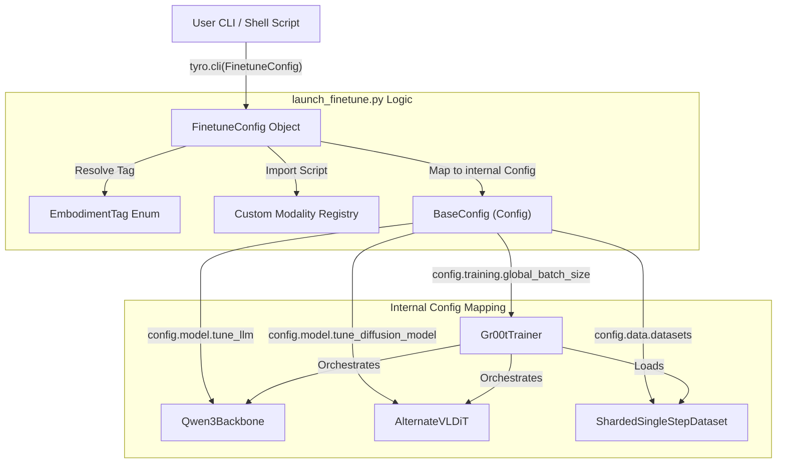
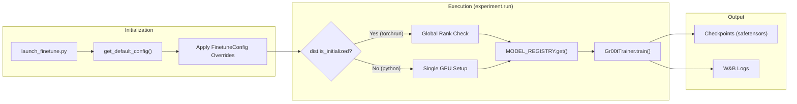

<!-- source: DeepWiki mcp.deepwiki.com · repo NVIDIA/Isaac-GR00T · page 6.3 Fine-tuning Configuration · fetched 2026-10-26 -->

# Fine-tuning Configuration

<details>
<summary>Relevant source files</summary>

The following files were used as context for generating this wiki page:

- [demo_data/libero_demo/meta/stats.json](demo_data/libero_demo/meta/stats.json)
- [examples/finetune.sh](examples/finetune.sh)
- [gr00t/configs/base_config.py](gr00t/configs/base_config.py)
- [gr00t/configs/finetune_config.py](gr00t/configs/finetune_config.py)
- [gr00t/configs/training/training_config.py](gr00t/configs/training/training_config.py)
- [gr00t/experiment/experiment.py](gr00t/experiment/experiment.py)
- [gr00t/experiment/launch_finetune.py](gr00t/experiment/launch_finetune.py)

</details>


This page provides detailed documentation for configuring fine-tuning experiments with GR00T models. It covers the `FinetuneConfig` dataclass, which defines the parameters for the `launch_finetune.py` entry point, including hyperparameters, dataset paths, embodiment settings, and model tuning flags.

## Configuration Infrastructure

GR00T N1.7 utilizes a structured configuration system based on Python dataclasses and `tyro` for CLI parsing. The primary interface for fine-tuning is `launch_finetune.py`, which populates a `FinetuneConfig` object and converts it into the internal `Config` format used by the `Gr00tTrainer`.

### FinetuneConfig Dataclass
The `FinetuneConfig` class in `gr00t/configs/finetune_config.py` defines the schema for fine-tuning parameters. It is designed to provide a simplified user experience compared to the full training pipeline while still exposing critical controls for model adaptation.

**Key Components of FinetuneConfig:**
*   **Data and Model Paths**: Pointers to base checkpoints and training data.
*   **Model Tuning Flags**: Boolean flags to unfreeze specific model components (LLM, Visual Encoder, Projector, Diffusion Head).
*   **Augmentation Settings**: Parameters for color jitter, random rotations, and mask-guided background suppression.
*   **Training Hyperparameters**: Learning rates, batch sizes, and optimization schedules.

**Sources:** [gr00t/configs/finetune_config.py:22-30](), [gr00t/experiment/launch_finetune.py:49-53]()

---

## Core Configuration Parameters

### Model and Data Paths
| Parameter | Type | Description |
| :--- | :--- | :--- |
| `base_model_path` | `str` | Path to the pretrained base model (Hugging Face ID or local directory). [gr00t/configs/finetune_config.py:33-34]() |
| `dataset_path` | `str` | Path to the dataset root directory containing trajectory data. [gr00t/configs/finetune_config.py:36-37]() |
| `embodiment_tag` | `str` | Name or value of the robot embodiment (e.g., `SO100`, `UNITREE_G1`). [gr00t/configs/finetune_config.py:39-40]() |
| `modality_config_path`| `str \| None`| Optional path to a Python file defining a custom modality config. [gr00t/configs/finetune_config.py:42-46]() |

### Model Tuning Flags
These flags determine which parts of the N1.7 architecture are updated during backpropagation.

*   **`tune_llm`** (`bool`, default: `False`): If `True`, the language model backbone is fine-tuned. [gr00t/configs/finetune_config.py:49-50]()
*   **`tune_visual`** (`bool`, default: `False`): If `True`, the visual encoder (e.g., ViT) is fine-tuned. [gr00t/configs/finetune_config.py:52-53]()
*   **`tune_projector`** (`bool`, default: `True`): Controls tuning of the multimodal projector layers. [gr00t/configs/finetune_config.py:55-56]()
*   **`tune_diffusion_model`** (`bool`, default: `True`): Controls tuning of the diffusion-based action decoder. [gr00t/configs/finetune_config.py:58-59]()

### Training Hyperparameters
| Parameter | Default | Description |
| :--- | :--- | :--- |
| `global_batch_size` | `64` | Total effective batch size across all GPUs. [gr00t/configs/finetune_config.py:124-126]() |
| `learning_rate` | `1e-4` | Initial learning rate for the optimizer. [gr00t/configs/finetune_config.py:131-132]() |
| `max_steps` | `10000` | Total training iterations. [gr00t/configs/finetune_config.py:163-164]() |
| `warmup_ratio` | `0.05` | Proportion of steps used for LR warm-up. [gr00t/configs/finetune_config.py:169-170]() |
| `state_dropout_prob`| `0.2` | Dropout applied to robot state inputs for regularization. [gr00t/configs/finetune_config.py:61-64]() |
| `use_percentiles` | `True` | Use q01/q99 statistics for state/action normalization. [gr00t/configs/finetune_config.py:84-88]() |

**Sources:** [gr00t/configs/finetune_config.py:32-181]()

---

## Data Augmentation Configuration

GR00T N1.7 supports standard image augmentations and advanced mask-guided background suppression.

### Standard Augmentations
*   **`random_rotation_angle`**: Maximum rotation in degrees. [gr00t/configs/finetune_config.py:67-68]()
*   **`color_jitter_params`**: Dictionary with keys `brightness`, `contrast`, `saturation`, and `hue`. [gr00t/configs/finetune_config.py:70-82]()
*   **`shortest_image_edge`** and **`crop_fraction`**: Used for aspect-ratio aware resizing and cropping. [gr00t/configs/finetune_config.py:90-102]()

### Mask-Guided Background Suppression
The `extra_augmentation_config` parameter accepts a JSON string to configure noise and color transforms on specific masked regions.

```json
{
  "background_noise_transforms": [{"target_mask_values": [0], "p": 0.9}],
  "masked_region_transforms": [{"target_mask_values": [4], "p": 1.0, "alpha_range": [0, 1]}]
}
```
**Sources:** [gr00t/configs/finetune_config.py:104-121]()

---

## Configuration Data Flow

The following diagram illustrates how user-provided `FinetuneConfig` parameters are processed and applied to the training pipeline.

### From CLI to Model Entities

**Sources:** [gr00t/experiment/launch_finetune.py:49-130](), [gr00t/experiment/experiment.py:72-140]()

---

## Implementation Detail: launch_finetune.py

The `launch_finetune.py` script serves as the bridge between the high-level `FinetuneConfig` and the low-level `Gr00tTrainer`.

### Key Functions
*   **`load_modality_config(path)`**: Dynamically imports a Python file to register new robot modalities at runtime. [gr00t/experiment/launch_finetune.py:31-41]()
*   **Embodiment Resolution**: Converts string tags into `EmbodimentTag` enums to ensure consistency with the internal registry. [gr00t/experiment/launch_finetune.py:52-53]()
*   **Config Overwriting**: The script initializes a default system config via `get_default_config()` and overwrites specific fields based on the `FinetuneConfig` values before calling `run(config)`. [gr00t/experiment/launch_finetune.py:61-130]()

### Execution and Distributed Training

**Sources:** [gr00t/experiment/launch_finetune.py:130](), [gr00t/experiment/experiment.py:142-165]()

---

## Practical Examples

### Simplified Fine-tuning via Bash
The `examples/finetune.sh` script provides a wrapper around `launch_finetune.py` to handle `torchrun` and environment variables automatically.

```bash
bash examples/finetune.sh \
  --base-model-path /path/to/checkpoint \
  --dataset-path /path/to/lerobot_data \
  --embodiment-tag SO100 \
  --output-dir ./outputs/so100_ft \
  --max-steps 5000
```
**Sources:** [examples/finetune.sh:33-48](), [examples/finetune.sh:143-223]()

### Resume and Save Options
*   **`resume_from_checkpoint`**: Allows continuing training from a saved state. [gr00t/configs/training/training_config.py:76-77]()
*   **`save_only_model`**: Skips saving optimizer/scheduler states to reduce checkpoint size. [gr00t/configs/training/training_config.py:73-74]()

**Sources:** [gr00t/configs/training/training_config.py:165-178]()

---

## Validation and Logging

### Validation Rules
The system performs validation in `warn_configs` to catch common errors:
*   **Batch Size**: `global_batch_size` must be divisible by the number of GPUs. [gr00t/experiment/experiment.py:75-77]()
*   **GPU Mismatch**: `num_gpus` must match the launcher's `WORLD_SIZE`. [gr00t/experiment/experiment.py:62-69]()
*   **Augmentation Consistency**: `use_albumentations_transforms` must be True if `shortest_image_edge` is set. [gr00t/experiment/experiment.py:137-139]()

### Config Persistence
Every experiment saves a resolved `config.yaml` to the output directory for reproducibility. [gr00t/experiment/experiment.py:160-165]()

**Sources:** [gr00t/experiment/experiment.py:53-140]()

---

