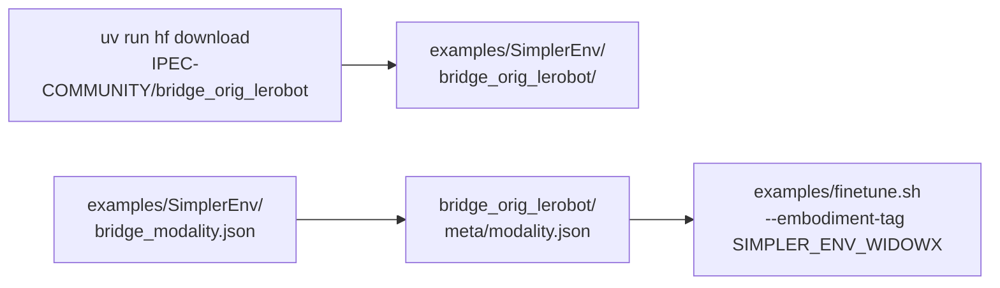
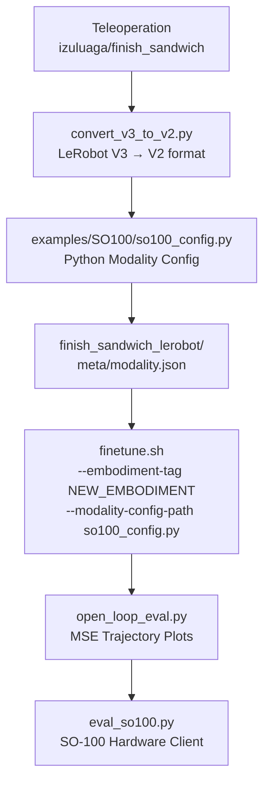

<!-- source: DeepWiki mcp.deepwiki.com · repo NVIDIA/Isaac-GR00T · page 6.4 Fine-tuning Examples · fetched 2026-10-26 -->

# Fine-tuning Examples

<details>
<summary>Relevant source files</summary>

The following files were used as context for generating this wiki page:

- [examples/LIBERO/README.md](examples/LIBERO/README.md)
- [examples/SO100/README.md](examples/SO100/README.md)
- [examples/SimplerEnv/README.md](examples/SimplerEnv/README.md)
- [examples/rebot-arm-dm/README.md](examples/rebot-arm-dm/README.md)
- [examples/rebot-arm-dm/modality.json](examples/rebot-arm-dm/modality.json)
- [examples/rebot-arm-dm/pyproject.toml](examples/rebot-arm-dm/pyproject.toml)
- [examples/rebot-arm-dm/rebot_config.py](examples/rebot-arm-dm/rebot_config.py)
- [media/open_loop_eval_rebot_arm_dm.jpg](media/open_loop_eval_rebot_arm_dm.jpg)
- [tests/getting_started/test_data_config_md.py](tests/getting_started/test_data_config_md.py)
- [tests/getting_started/test_finetune_new_embodiment_md.py](tests/getting_started/test_finetune_new_embodiment_md.py)

</details>


This page provides concrete, reproducible examples of fine-tuning GR00T N1.7 for different robot embodiments and task domains. Each example demonstrates the complete workflow from dataset preparation to model evaluation, with specific commands, file paths, and configuration references.

For general fine-tuning concepts and workflows, see [Fine-tuning Overview](#6.2). For detailed documentation of configuration parameters, see [Fine-tuning Configuration](#6.3). For distributed training with DeepSpeed, see [Distributed Training with DeepSpeed](#6.5).

## Fine-tuning Scenario Overview

GR00T N1.7 supports two primary fine-tuning scenarios:

| Scenario | Embodiment Tag Type | Modality Config Required | Example Use Cases |
|----------|-------------------|-------------------------|-------------------|
| **Pre-registered Embodiments** | Built-in tag (e.g., `SIMPLER_ENV_GOOGLE`, `LIBERO_PANDA`) | No - config included | SimplerEnv benchmarks, LIBERO |
| **Custom Embodiments** | `NEW_EMBODIMENT` | Yes - user provides `modality.json` or config file | SO-100, reBot Arm DM |

Sources: [examples/SimplerEnv/README.md:63-84](), [examples/SO100/README.md:49](), [examples/rebot-arm-dm/README.md:35-36]()

## Example 1: SimplerEnv Bridge Dataset (WidowX Robot)

The Bridge dataset provides real-world manipulation demonstrations for the WidowX robot. This example uses the pre-registered `SIMPLER_ENV_WIDOWX` embodiment tag [examples/SimplerEnv/README.md:63]().

### Dataset Preparation



**Dataset Download and Configuration:**

```bash
# Download Bridge dataset from HuggingFace
uv run hf download \
    --repo-type dataset IPEC-COMMUNITY/bridge_orig_lerobot \
    --local-dir examples/SimplerEnv/bridge_orig_lerobot/

# Copy pre-configured modality file to the dataset meta directory
cp examples/SimplerEnv/bridge_modality.json examples/SimplerEnv/bridge_orig_lerobot/meta/modality.json
```

Sources: [examples/SimplerEnv/README.md:50-57]()

### Fine-tuning Configuration

The fine-tuning script `examples/finetune.sh` is a shared launcher. For Bridge, it is invoked with high state dropout to prevent overfitting on proprioception [examples/SimplerEnv/README.md:65]().

| Parameter | Value | Purpose |
|-----------|-------|---------|
| `NUM_GPUS` | 8 | Distributed training count |
| `--base-model-path` | `nvidia/GR00T-N1.7-3B` | Pre-trained N1.7 base model |
| `--embodiment-tag` | `SIMPLER_ENV_WIDOWX` | Pre-registered WidowX configuration |
| `GLOBAL_BATCH_SIZE` | 1024 | Effective batch size across GPUs |
| `MAX_STEPS` | 20000 | Total training iterations |
| `--state-dropout-prob` | 0.8 | High dropout for Bridge (WidowX) |

**Execution Command:**

```bash
NUM_GPUS=8 MAX_STEPS=20000 GLOBAL_BATCH_SIZE=1024 SAVE_STEPS=1000 uv run bash examples/finetune.sh \
    --base-model-path nvidia/GR00T-N1.7-3B \
    --dataset-path examples/SimplerEnv/bridge_orig_lerobot/ \
    --embodiment-tag SIMPLER_ENV_WIDOWX \
    --output-dir /tmp/bridge_finetune \
    --state-dropout-prob 0.8
```

Sources: [examples/SimplerEnv/README.md:60-66]()

### Evaluation Workflow

Evaluation uses a server-client architecture. The server hosts the `Gr00tPolicy` while the client runs the simulation rollout [examples/SimplerEnv/README.md:133-163]().

**Server Setup (Terminal 1):**
```bash
uv run python gr00t/eval/run_gr00t_server.py \
    --model-path /tmp/bridge_finetune/checkpoint-30000 \
    --embodiment-tag SIMPLER_ENV_WIDOWX \
    --use-sim-policy-wrapper
```

**Client Evaluation (Terminal 2):**
```bash
gr00t/eval/sim/SimplerEnv/simpler_uv/.venv/bin/python gr00t/eval/rollout_policy.py \
    --n-episodes 10 \
    --policy-client-host 127.0.0.1 \
    --policy-client-port 5555 \
    --max-episode-steps 300 \
    --env-name simpler_env_widowx/widowx_spoon_on_towel \
    --n-action-steps 4 \
    --n-envs 5
```

Sources: [examples/SimplerEnv/README.md:138-163]()

## Example 2: LIBERO (Multi-Suite Evaluation)

LIBERO is a benchmark for lifelong robot learning. GR00T N1.7 supports all four suites: Spatial, Object, Goal, and 10-Long [examples/LIBERO/README.md:1-5]().

### Fine-tuning Results (N1.7)

All LIBERO suites were fine-tuned with `--state-dropout-prob 0.2` [examples/LIBERO/README.md:13-15]().

| Suite | Success Rate | Max Steps | Batch Size |
|-------|--------------|-----------|------------|
| Spatial | 97.65% | 20K | 640 |
| Goal | 97.5% | 20K | 640 |
| Object | 98.45% | 20K | 640 |
| 10 (Long) | 94.35% | 20K | 640 |

Sources: [examples/LIBERO/README.md:17-22]()

### Fine-tuning LIBERO 10-Long

```bash
# Download and patch
uv run hf download --repo-type dataset IPEC-COMMUNITY/libero_10_no_noops_1.0.0_lerobot --local-dir examples/LIBERO/libero_10_no_noops_1.0.0_lerobot/
cp -r examples/LIBERO/modality.json examples/LIBERO/libero_10_no_noops_1.0.0_lerobot/meta/

# Launch
NUM_GPUS=8 MAX_STEPS=20000 GLOBAL_BATCH_SIZE=640 SAVE_STEPS=1000 uv run bash examples/finetune.sh \
    --base-model-path nvidia/GR00T-N1.7-3B \
    --dataset-path examples/LIBERO/libero_10_no_noops_1.0.0_lerobot/ \
    --embodiment-tag LIBERO_PANDA \
    --output-dir /tmp/libero_10 \
    --state-dropout-prob 0.2
```

Sources: [examples/LIBERO/README.md:29-45]()

## Example 3: reBot Arm DM (Custom Embodiment)

The reBot Arm B601 DM example demonstrates how to integrate a new robot using the `NEW_EMBODIMENT` tag and a Python-based modality configuration [examples/rebot-arm-dm/README.md:31-38]().

### Custom Modality Configuration

For custom embodiments, a Python script defines the mapping between dataset keys and model modalities. The `rebot_config.py` uses `register_modality_config` to bind the configuration to the `NEW_EMBODIMENT` tag [examples/rebot-arm-dm/rebot_config.py:16-70]().

```python
# rebot_config.py snippet
rebot_config = {
    "video": ModalityConfig(delta_indices=[0], modality_keys=["front", "side"]),
    "state": ModalityConfig(delta_indices=[0], modality_keys=["single_arm", "gripper"]),
    "action": ModalityConfig(
        delta_indices=list(range(0, 16)),
        modality_keys=["single_arm", "gripper"],
        action_configs=[
            ActionConfig(rep=ActionRepresentation.RELATIVE, type=ActionType.NON_EEF),
            ActionConfig(rep=ActionRepresentation.ABSOLUTE, type=ActionType.NON_EEF),
        ],
    ),
    "language": ModalityConfig(delta_indices=[0], modality_keys=["annotation.human.task_description"]),
}
register_modality_config(rebot_config, embodiment_tag=EmbodimentTag.NEW_EMBODIMENT)
```

Sources: [examples/rebot-arm-dm/rebot_config.py:27-70]()

### Fine-tuning and Open-Loop Eval

```bash
# Fine-tune
CUDA_VISIBLE_DEVICES=0 NUM_GPUS=1 uv run bash examples/finetune.sh \
  --base-model-path nvidia/GR00T-N1.7-3B \
  --dataset-path <path-to-lerobot-dataset> \
  --modality-config-path examples/rebot-arm-dm/rebot_config.py \
  --embodiment-tag NEW_EMBODIMENT \
  --output-dir /tmp/rebot-arm-dm_finetune

# Open-loop evaluation
uv run python gr00t/eval/open_loop_eval.py \
  --dataset-path <path-to-lerobot-dataset> \
  --embodiment-tag NEW_EMBODIMENT \
  --model-path /tmp/rebot-arm-dm_finetune/checkpoint-10000 \
  --traj-ids 0 \
  --action-horizon 16 \
  --steps 400
```

Sources: [examples/rebot-arm-dm/README.md:31-50]()

## Example 4: SO-100 Robot

The SO-100 example follows a similar workflow for real-world robot deployment [examples/SO100/README.md:1-3]().

### Custom Embodiment Workflow



**Dataset Conversion:**
SO-100 data collected via LeRobot teleoperation often uses the V3 format. It must be converted to V2 for GR00T compatibility [examples/SO100/README.md:28-34]().

```bash
uv run --project scripts/lerobot_conversion \
  python scripts/lerobot_conversion/convert_v3_to_v2.py \
  --repo-id izuluaga/finish_sandwich \
  --root examples/SO100/finish_sandwich_lerobot

# Copy the modality schema
cp examples/SO100/modality.json examples/SO100/finish_sandwich_lerobot/izuluaga/finish_sandwich/meta/modality.json
```

Sources: [examples/SO100/README.md:28-39]()

### Closed-Loop Real Robot Deployment

After fine-tuning, the model is served via `run_gr00t_server.py`, and a hardware-specific client (`eval_so100.py`) handles the control loop [examples/SO100/README.md:93-124]().

**Server:**
```bash
uv run python gr00t/eval/run_gr00t_server.py \
  --model-path /tmp/so100_finetune/checkpoint-10000 \
  --embodiment-tag NEW_EMBODIMENT 
```

**Client:**
```bash
uv run --no-sync python eval_so100.py \
  --robot.type=so101_follower \
  --robot.port="$ROBOT_PORT" \
  --policy_host=localhost \
  --policy_port=5555 \
  --lang_instruction="finish the ham cheese olives sandwich"
```

Sources: [examples/SO100/README.md:96-124]()

## Summary of Configuration Parameters

| Feature | SimplerEnv (Fractal) | LIBERO | SO-100 / reBot |
|---------|----------------------|--------|--------|
| **Embodiment Tag** | `SIMPLER_ENV_GOOGLE` | `LIBERO_PANDA` | `NEW_EMBODIMENT` |
| **State Dropout** | 0.5 | 0.2 | Default (0.0) |
| **Batch Size** | 1024 | 640 | Default |
| **Steps** | 20,000 | 20,000 | 10,000 (typical) |
| **Action Horizon** | 1 | 8 | 16 |

Sources: [examples/SimplerEnv/README.md:81-87](), [examples/LIBERO/README.md:17-22](), [examples/rebot-arm-dm/README.md:43-50](), [examples/SO100/README.md:58-65]()

---

