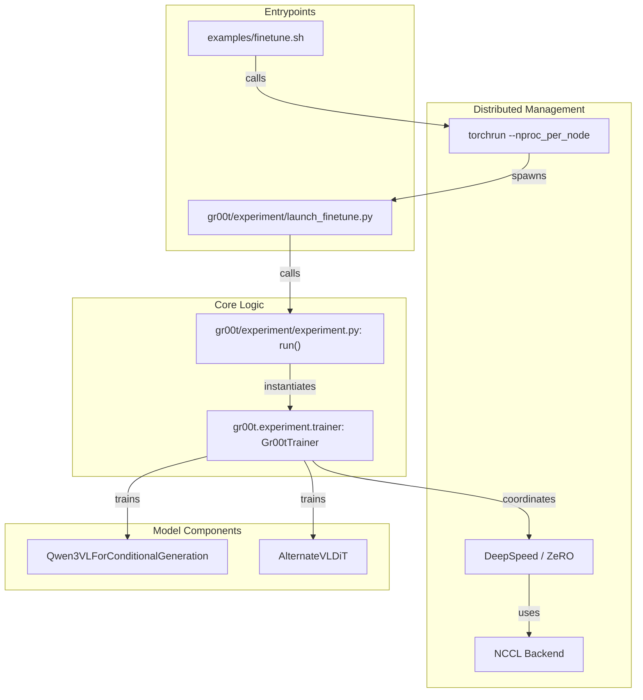
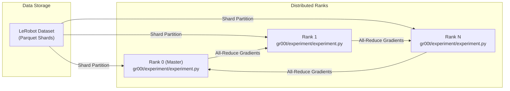

<!-- source: DeepWiki mcp.deepwiki.com · repo NVIDIA/Isaac-GR00T · page 6.5 Distributed Training with DeepSpeed · fetched 2026-10-26 -->

# Distributed Training with DeepSpeed

<details>
<summary>Relevant source files</summary>

The following files were used as context for generating this wiki page:

- [examples/finetune.sh](examples/finetune.sh)
- [gr00t/configs/finetune_config.py](gr00t/configs/finetune_config.py)
- [gr00t/experiment/experiment.py](gr00t/experiment/experiment.py)
- [gr00t/experiment/launch_finetune.py](gr00t/experiment/launch_finetune.py)
- [tests/gr00t/experiment/_run_distributed_experiment.py](tests/gr00t/experiment/_run_distributed_experiment.py)

</details>


## Purpose and Scope

This page explains how GR00T integrates DeepSpeed for distributed multi-GPU training. It covers DeepSpeed configuration, ZeRO optimization stages, multi-GPU setup, and performance tuning strategies for both pre-training and fine-tuning workflows. GR00T N1.7 utilizes the `Hugging Face Trainer` as a high-level abstraction, which in turn leverages DeepSpeed to handle large-scale VLA model training.

For general training concepts and single-GPU training, see [Pre-training Overview]() and [Fine-tuning Overview](). For specific fine-tuning examples, see [Fine-tuning Examples]().

**Note:** DeepSpeed is the primary backend for distributed training in GR00T. While single-GPU training is supported, multi-GPU training requires `torchrun` to manage the process group and DeepSpeed for memory optimization.

---

## DeepSpeed Integration Architecture

GR00T uses DeepSpeed as the distributed training backend. The integration provides automatic data parallelism, gradient accumulation, and memory optimization through ZeRO (Zero Redundancy Optimizer). The training lifecycle is managed by the `Gr00tTrainer` class.

### Training Launch Flow

The following diagram maps the execution flow from the shell entrypoint to the core training classes.



**Sources:** [examples/finetune.sh:223](), [gr00t/experiment/launch_finetune.py:130](), [gr00t/experiment/experiment.py:34](), [gr00t/experiment/experiment.py:142-157]()

---

## Multi-GPU Setup

### Environment Configuration

The repository provides a utility script `examples/finetune.sh` that simplifies the `torchrun` command generation. It handles the mapping between global batch size and local device batch sizes.

**Multi-GPU Training Execution (e.g., 8 GPUs):**
```bash
export NUM_GPUS=8
export GLOBAL_BATCH_SIZE=128

bash examples/finetune.sh \
  --base-model-path nvidia/Cosmos-Reason2-2B \
  --dataset-path /data/my_dataset \
  --embodiment-tag SO100 \
  --output-dir ./outputs/my_experiment
```

Inside `finetune.sh`, if `NUM_GPUS` is greater than 1, it executes the training via `torchrun` with `--nproc_per_node` [examples/finetune.sh:216-223]().

### Process Group Initialization
The `_init_distributed_process_group` function in `experiment.py` initializes the NCCL process group. It binds the communicator to the local rank using `torch.cuda.set_device(local_rank)` to ensure efficient device-to-rank mapping [gr00t/experiment/experiment.py:142-157]().

### Batch Size Validation
The system enforces strict consistency between the launcher and the configuration. The `_assert_num_gpus_matches_world_size` function checks that `config.training.num_gpus` matches the environment's `WORLD_SIZE` to prevent silent rescaling of the effective batch size [gr00t/experiment/experiment.py:53-70]().

**Sources:** [gr00t/experiment/experiment.py:53-70](), [gr00t/experiment/experiment.py:142-157](), [examples/finetune.sh:216-223]()

---

## Distributed Data Flow

Data is sharded across GPUs to ensure that each rank processes unique trajectories. This is managed by the `HF Trainer` integration and the `ShardedSingleStepDataset`.



**Sources:** [gr00t/experiment/experiment.py:53-60](), [gr00t/configs/finetune_config.py:124-129](), [tests/gr00t/experiment/_run_distributed_experiment.py:125-136]()

---

## Performance Tuning and ZeRO

GR00T leverages DeepSpeed ZeRO to manage the memory footprint of the Cosmos-Reason2-2B backbone.

### ZeRO Stage Configuration
The training pipeline is optimized for:
*   **ZeRO Stage 2:** Partitions gradients and optimizer states. This is the recommended default for N1.7 fine-tuning to balance speed and memory.
*   **ZeRO Stage 3:** Partitions model parameters as well. Required if fine-tuning the full LLM backbone (`tune_llm=True`) on hardware with limited VRAM.

### Precision and Memory Flags
In `launch_finetune.py`, several flags directly impact distributed performance:
*   `tune_llm`: When `False` (default), the backbone is frozen, significantly reducing memory requirements on distributed ranks [gr00t/configs/finetune_config.py:49]().
*   `backbone_trainable_params_fp32`: Set to `True` to ensure stability during mixed-precision training by keeping trainable parameters in FP32 [gr00t/experiment/launch_finetune.py:101]().
*   `gradient_accumulation_steps`: Multiplies `global_batch_size` to produce the post-accumulation per-optimizer-step batch [gr00t/configs/finetune_config.py:134-136]().

**Sources:** [gr00t/experiment/launch_finetune.py:78-101](), [gr00t/configs/finetune_config.py:49-59](), [gr00t/configs/finetune_config.py:134-136]()

---

## Checkpointing in Distributed Training

When training with DeepSpeed, checkpoints are handled by the `Gr00tTrainer`. On the main process (rank 0), configuration and metadata are saved, while model weights are synchronized across the process group.

| File/Entity | Rank Responsibility | Description |
| :--- | :--- | :--- |
| `config.yaml` | Rank 0 | The full experiment configuration [gr00t/experiment/experiment.py:165](). |
| `wandb` logs | Rank 0 | Metrics and artifacts logged to Weights & Biases [gr00t/configs/finetune_config.py:156-161](). |
| `pytorch_model.bin` | All (Distributed) | Sharded or merged model weights depending on ZeRO stage. |
| `initial_actions.json` | Rank 0 | Saved via `save_initial_actions` for evaluation baseline [gr00t/experiment/experiment.py:38](). |

The `save_only_model` flag in `FinetuneConfig` allows users to skip saving optimizer and scheduler states, which significantly reduces disk usage in distributed runs [gr00t/configs/finetune_config.py:205]().

**Sources:** [gr00t/experiment/experiment.py:160-165](), [gr00t/configs/finetune_config.py:156-161](), [gr00t/experiment/launch_finetune.py:126]()

---

## Hardware and Execution Tuning

### Multi-GPU Coordination
The `run_on_rank0` and `run_or_wait_on_rank0` utilities are used to ensure that certain operations (like dataset downloading or directory creation) are only performed once per node or cluster [gr00t/experiment/experiment.py:37]().

### Dataloader Optimization
`dataloader_num_workers` should be tuned based on the number of CPU cores per GPU to prevent data starvation. In distributed settings, this is defined per-GPU [gr00t/configs/finetune_config.py:128-129]().

### Testing Distributed Logic
The codebase includes a specialized entry point `_run_distributed_experiment.py` used by pytest to validate multi-GPU functionality. It performs an `all_reduce` check to ensure the NCCL process group is communicating correctly before proceeding with the training loop [tests/gr00t/experiment/_run_distributed_experiment.py:125-132]().

**Sources:** [gr00t/experiment/experiment.py:37](), [gr00t/configs/finetune_config.py:128-129](), [tests/gr00t/experiment/_run_distributed_experiment.py:125-132]()

---

