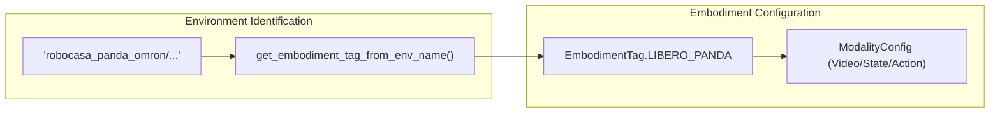

<!-- source: DeepWiki mcp.deepwiki.com · repo NVIDIA/Isaac-GR00T · page 7 Evaluation and Benchmarking · fetched 2026-10-26 -->

# Evaluation and Benchmarking

<details>
<summary>Relevant source files</summary>

The following files were used as context for generating this wiki page:

- [gr00t/eval/rollout_policy.py](gr00t/eval/rollout_policy.py)
- [pyproject.toml](pyproject.toml)
- [tests/examples/test_droid.py](tests/examples/test_droid.py)
- [tests/examples/test_libero.py](tests/examples/test_libero.py)
- [tests/examples/test_robocasa.py](tests/examples/test_robocasa.py)
- [tests/examples/test_robocasa_gr1_tabletop.py](tests/examples/test_robocasa_gr1_tabletop.py)
- [tests/examples/test_simplerenv.py](tests/examples/test_simplerenv.py)
- [uv.lock](uv.lock)

</details>


This section covers the evaluation and benchmarking capabilities of Isaac-GR00T N1.7, including open-loop trajectory analysis, closed-loop simulation rollouts, and integration with standard robotics benchmarks like SimplerEnv, LIBERO, and RoboCasa.

**Scope**: This page provides a high-level overview of evaluation methodologies and the system architecture for assessing model performance. For detailed information about specific topics, see the following child pages:

*   **[Evaluation Pipeline Overview](#7.1)**: Open-loop vs closed-loop concepts, metrics (MSE, Success Rate), and general workflow.
*   **[Open-Loop Evaluation](#7.2)**: Using trajectory analysis to compare predicted actions against ground truth.
*   **[Closed-Loop Evaluation](#7.3)**: Simulation and real-world rollouts using the `rollout_policy.py` framework [gr00t/eval/rollout_policy.py:1-206]().
*   **[SimplerEnv Benchmarks](#7.4)**: Evaluating on Google Robot and WidowX tasks [tests/examples/test_simplerenv.py:142-169]().
*   **[LIBERO Benchmarks](#7.5)**: Testing on the LIBERO-Spatial, Object, Goal, and 10-Long suites [tests/examples/test_libero.py:112-165]().
*   **[SO-100 Robot Evaluation](#7.6)**: Specific procedures for the SO-100 low-cost humanoid arm.
*   **[DROID and Other Real Robot Integration](#7.7)**: Working with DROID datasets and ZED camera integration [tests/examples/test_droid.py:120-189]().
*   **[Environment-to-Embodiment Mapping](#7.8)**: How the system maps simulation environment strings to `EmbodimentTag` configurations via `get_embodiment_tag_from_env_name` [gr00t/eval/rollout_policy.py:159-174]().
*   **[RoboCasa Benchmarks](#7.9)**: Detail RoboCasa and RoboCasa GR1 Tabletop Tasks setup and evaluation [tests/examples/test_robocasa.py:182-182](), [tests/examples/test_robocasa_gr1_tabletop.py:168-178]().
*   **[GR00T Whole-Body Control (SONIC)](#7.10)**: Explain the GR00T Whole-Body Control benchmark with Unitree G1 and SONIC integration.

## Evaluation System Architecture

The evaluation architecture bridges the gap between the high-level task specification (Natural Language) and the low-level robot execution (Code Entity Space). It utilizes a `BasePolicy` [gr00t/eval/rollout_policy.py:31-31]() abstraction that can be backed by a local model or a remote inference server.

### Evaluation Data Flow

The following diagram illustrates how evaluation scripts interact with the model and environments.

```mermaid
graph TD
    subgraph "Natural Language Space"
        Task["Task Instruction: 'pick up the red block'"]
    end

    subgraph "Code Entity Space (Evaluation)"
        EvalScript["rollout_policy.py"]
        Policy["BasePolicy / Gr00tPolicy"]
        Env["gym.Env (SimplerEnv / LIBERO / RoboCasa)"]
        EnvFn["get_gym_env()"]
    end

    subgraph "Action Space"
        PredAction["Predicted ActionChunk"]
        GTAction["Ground Truth Action"]
    end

    Task -->|Text Input| Policy
    EvalScript -->|Calls| EnvFn
    EnvFn -->|Creates| Env
    EvalScript -->|Step Data| Policy
    Policy -->|get_action()| PredAction
    
    EvalScript -->|Closed-Loop| Env
    Env -->|Next Obs| EvalScript
    PredAction -->|execute via MultiStepWrapper| Env
    
    EvalScript -->|Open-Loop Comparison| GTAction
    GTAction -->|Metrics Calculation| Metrics["MSE / Success Rate"]
```

**Sources**: [gr00t/eval/rollout_policy.py:156-174](), [gr00t/eval/rollout_policy.py:30-31]()

## Open-Loop vs. Closed-Loop Evaluation

The codebase distinguishes between evaluating a model's prediction accuracy on static data and its functional success in a dynamic environment.

### Comparison Table

| Feature | Open-Loop Evaluation | Closed-Loop Evaluation |
| :--- | :--- | :--- |
| **Primary Framework** | Static Trajectory Comparison | `rollout_policy.py` [gr00t/eval/rollout_policy.py:1-206]() |
| **Data Source** | Dataset (e.g., LeRobot format) | `gym.Env` (Dynamic Sim/Real) [gr00t/eval/rollout_policy.py:33-33]() |
| **Key Metrics** | MSE, MAE, Q-Score | Success Rate, Time to Completion |
| **Visualization** | Trajectory Plots | `VideoRecordingWrapper` [gr00t/eval/rollout_policy.py:196-206]() |
| **Code Entity** | Data Loaders | `create_eval_env` [gr00t/eval/rollout_policy.py:177-206]() |

**Sources**: [gr00t/eval/rollout_policy.py:61-110](), [gr00t/eval/rollout_policy.py:177-206]()

## Environment and Embodiment Mapping

A critical component of the evaluation pipeline is the mapping system, which ensures that when a benchmark is initialized, the policy uses the correct `EmbodimentTag` [gr00t/eval/rollout_policy.py:26-26]() and modality configuration.



**Sources**: [gr00t/eval/rollout_policy.py:159-174](), [gr00t/eval/rollout_policy.py:26-29]()

## Key Evaluation Components

### 1. Multi-Step Rollouts
For closed-loop evaluation, the `MultiStepWrapper` [gr00t/eval/rollout_policy.py:30-30]() handles the execution of action chunks. Since GR00T N1.7 outputs a chunk of actions, the wrapper manages the temporal execution of these steps within the simulation environment before requesting a new inference.
**Sources**: [gr00t/eval/rollout_policy.py:83-96]()

### 2. Video Recording
The `VideoRecordingWrapper` is used during benchmarks to capture model performance. It supports configurable FPS, codecs, and specific video keys for different environments like RoboCasa [gr00t/eval/rollout_policy.py:39-54]().
**Sources**: [gr00t/eval/rollout_policy.py:62-80](), [gr00t/eval/rollout_policy.py:196-206]()

### 3. Benchmark Suites
Isaac-GR00T integrates several external benchmarks:
*   **SimplerEnv**: Handled via `get_simpler_env_fn` [gr00t/eval/rollout_policy.py:112-121]().
*   **LIBERO**: Handled via `get_libero_env_fn` [gr00t/eval/rollout_policy.py:124-133]().
*   **RoboCasa**: Handled via `get_robocasa_env_fn` [gr00t/eval/rollout_policy.py:136-153]().

For details on running these benchmarks, see the specific child pages listed at the top of this page.

**Sources**: [gr00t/eval/rollout_policy.py:112-153](), [tests/examples/test_simplerenv.py:142-169](), [tests/examples/test_libero.py:112-165]()

---

