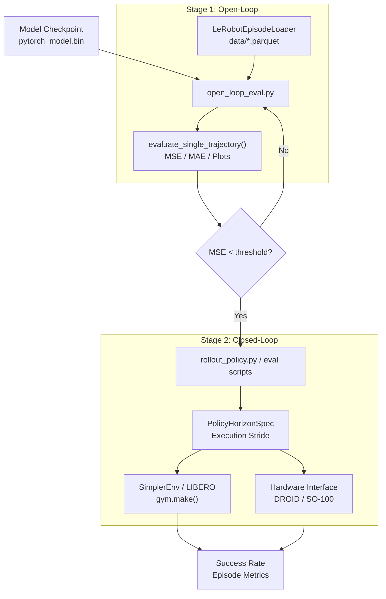
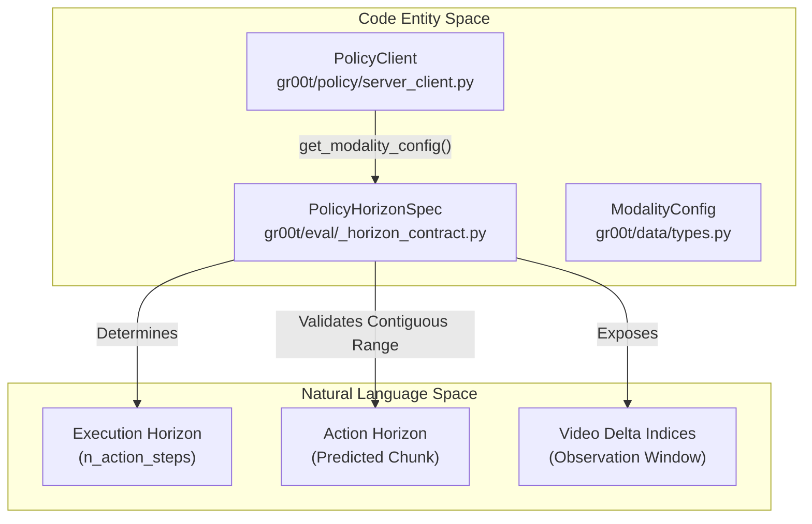

<!-- source: DeepWiki mcp.deepwiki.com · repo NVIDIA/Isaac-GR00T · page 7.1 Evaluation Pipeline Overview · fetched 2026-10-26 -->

# Evaluation Pipeline Overview

Relevant source files

The following files were used as context for generating this wiki page:

- [gr00t/eval/_horizon_contract.py](gr00t/eval/_horizon_contract.py)
- [gr00t/eval/open_loop_eval.py](gr00t/eval/open_loop_eval.py)
- [gr00t/policy/server_client.py](gr00t/policy/server_client.py)

The GR00T evaluation system provides two complementary approaches for validating model performance: **open-loop evaluation** compares predicted actions against ground-truth trajectories from datasets, while **closed-loop evaluation** executes policies in simulation or hardware environments to measure task success rates.

## Purpose and Scope

The evaluation pipeline implements a two-stage validation workflow:

1.  **Open-Loop Evaluation:** Offline action prediction comparison using `gr00t/eval/open_loop_eval.py` [gr00t/eval/open_loop_eval.py:1-46]() against recorded LeRobot v2 datasets.
2.  **Closed-Loop Evaluation:** Real-time policy execution using the rollout framework and environment-specific wrappers.

This staged approach enables rapid iteration: open-loop evaluation identifies model issues (like poor action distribution matching) without environment setup, while closed-loop evaluation validates actual task completion through physical interaction.

**Sources:** [gr00t/eval/open_loop_eval.py:1-46]()

## Two-Stage Evaluation Workflow

**Diagram: Evaluation Pipeline Stage Progression**

**Sources:** [gr00t/eval/open_loop_eval.py:136-184](), [gr00t/eval/_horizon_contract.py:72-98]()

### Evaluation Stage Comparison

| Stage | Implementation | Execution Context | Infrastructure | Output Metrics |
| :--- | :--- | :--- | :--- | :--- |
| **Open-Loop** | `open_loop_eval.py` | Offline dataset replay | `LeRobotEpisodeLoader` | MSE, MAE, Trajectory Plots |
| **Closed-Loop** | `rollout_policy.py` / `main_gr00t.py` | Real-time interaction | `PolicyHorizonSpec` | Success Rate, Q-Score |

**Sources:** [gr00t/eval/open_loop_eval.py:49-71](), [gr00t/eval/_horizon_contract.py:72-98]()

## Stage 1: Open-Loop Evaluation

Open-loop evaluation performs model inference on recorded trajectories and computes action prediction error. It uses `LeRobotEpisodeLoader` [gr00t/eval/open_loop_eval.py:24-24]() to fetch observations and compares the model's output against the dataset's ground truth.

### Open-Loop Components

*   **Trajectory Plotting**: `plot_trajectory_results` [gr00t/eval/open_loop_eval.py:49-128]() generates visual comparisons between ground truth (`gt_action`) and predicted actions (`pred_action`) across time for specific joints/dimensions. It marks inference points every `execution_horizon` steps [gr00t/eval/open_loop_eval.py:108-117]().
*   **Observation Parsing**: `parse_observation_gr00t` [gr00t/eval/open_loop_eval.py:181-181]() converts raw dataset steps into the multimodal dictionary format required by `Gr00tPolicy`.
*   **Single Trajectory Eval**: `evaluate_single_trajectory` [gr00t/eval/open_loop_eval.py:136-184]() iterates through a trajectory at a fixed `execution_horizon`, performing inference and accumulating results. It validates the open-loop stride against the model's predicted chunk using `PolicyHorizonSpec` [gr00t/eval/open_loop_eval.py:165-167]().

**Sources:** [gr00t/eval/open_loop_eval.py:49-184](), [gr00t/eval/_horizon_contract.py:141-155]()

## Stage 2: Closed-Loop Evaluation

Closed-loop evaluation involves running the policy in a live environment. A critical component for both simulation and real-robot clients is the `PolicyHorizonSpec`, which acts as the "contract" for temporal execution.

### The Horizon Contract

**Diagram: Policy-Environment Interface Contract**

**Sources:** [gr00t/eval/_horizon_contract.py:72-155](), [gr00t/policy/server_client.py:145-170]()

### Key Classes and Functions

*   **`PolicyHorizonSpec`**: The single source of truth for policy-coupled horizons [gr00t/eval/_horizon_contract.py:72-98](). It ensures that the `n_action_steps` (execution stride) is valid relative to the model's `action_horizon` (predicted chunk length).
*   **`from_modality_config`**: Resolves the spec from a raw config dict. It enforces that `action.delta_indices` is a contiguous range starting at 0 to prevent silent mis-execution of sparse windows [gr00t/eval/_horizon_contract.py:122-155]().
*   **`PolicyServer` / `PolicyClient`**: Facilitates remote evaluation. The server hosts the `BasePolicy` [gr00t/policy/server_client.py:162-162]() and uses `MsgSerializer` to handle high-performance NumPy array transmission via ZeroMQ [gr00t/policy/server_client.py:33-57]().
*   **`MsgSerializer`**: A specialized serializer that prevents unsafe pickle usage while supporting `ModalityConfig` and NumPy objects [gr00t/policy/server_client.py:33-136]().

**Sources:** [gr00t/eval/_horizon_contract.py:72-163](), [gr00t/policy/server_client.py:33-170]()

## Evaluation Metrics

| Metric | Context | Implementation | Description |
| :--- | :--- | :--- | :--- |
| **MSE** | Open-Loop | `np.mean((gt - pred)**2)` | Mean Squared Error between predicted and actual action chunks. |
| **MAE** | Open-Loop | `np.mean(np.abs(gt - pred))` | Mean Absolute Error; less sensitive to outliers than MSE. |
| **Success Rate** | Closed-Loop | Env Step Info | Percentage of episodes where the environment returned a "success" signal. |
| **q_score** | Both | `ActionChunk.q_score` | The confidence or quality score output by the VLA head for a generated action chunk. |

**Sources:** [gr00t/eval/open_loop_eval.py:49-71](), [gr00t/eval/open_loop_eval.py:182-182]()

---

